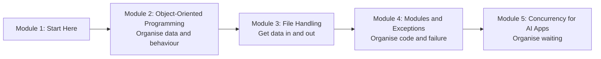

# How This Course Works

## Introduction

After [Python Fundamentals](../../python-fundamentals/course.md) you can write scripts: read some input, loop over a list, call a few functions, print an answer. That is enough for a 50-line tool. It stops being enough the day your script grows to 2,000 lines, three teammates start editing it, it has to read a messy CSV export from the accounts team, it crashes at 3 a.m. because an API timed out, and it needs to call an LLM 500 times without taking an hour.

This course is about that jump: from **scripts that work** to **programs that keep working**. Every AI engineering course that comes after this one (FastAPI services, LangChain apps, LangGraph agents, MCP servers) assumes the skills taught here. When you open the source of any serious Python library, you will see classes, decorators, context managers, custom exceptions, packages and `async def` everywhere. After this course, none of it will look strange.

This short article tells you what you will learn, how the lessons are built, what to install, and how the code examples work.

> 💡 **Key Insight**
>
> Advanced Python is not about clever tricks. It is about **organising code so that it stays understandable, testable and safe as it grows**. Classes organise data with behaviour, modules organise files, exceptions organise failure, and concurrency organises waiting. Each module of this course is one of those tools.

---

## What You Will Learn

By the end of this course you will be able to:

- **Design classes** with attributes, methods, inheritance, properties, abstract base classes and dataclasses, and explain the method resolution order (MRO) when several parent classes are involved.
- **Write and read decorators**, including ones that take arguments, and know when to use `@classmethod`, `@staticmethod` and `@property`.
- **Make your own objects behave like built-ins** with dunder methods: printing nicely, comparing, adding, iterating, being used in `with` blocks.
- **Read and write files correctly**: text versus bytes, encodings, CSV, JSON, `pathlib`, buffering, seeking, and writing files safely so a crash never leaves half a file behind.
- **Structure a project** as modules and packages, manage dependencies with virtual environments, `pip` and `pyproject.toml`.
- **Handle errors like a professional**: custom exception hierarchies, exception chaining, context managers, retries, logging, and knowing what *not* to catch.
- **Run work concurrently**: threads, processes and `asyncio`, what the GIL is (and what the free-threaded build changes), and how to call many AI APIs at once with limits and timeouts.

### The course at a glance

Module 2 is the longest and the most important: classes show up in every later module. Module 3 uses classes to wrap files. Module 4 uses classes to build exception hierarchies and context managers. Module 5 brings it all together in a program that calls ten (pretend) AI APIs at once, with a concurrency limit, timeouts, retries and clean error reporting.

| Module | Lessons | You will build |
|---|---|---|
| 2. Object-Oriented Programming | 5 articles + 1 lab | A library system with books, members, loans and fines |
| 3. File Handling | 2 articles + 1 lab | A log file analyser that writes CSV and JSON reports |
| 4. Modules and Exceptions | 3 articles | A small package with its own exception hierarchy |
| 5. Concurrency for AI Apps | 2 articles + 1 lab | A concurrent client for ten APIs with limits and retries |

---

## How Every Lesson Is Built

Every article follows the same shape, so you always know where to look:

| Section | What it gives you |
|---|---|
| **Before you start** | Links to the earlier lessons this one depends on. If a term feels unfamiliar, follow the link. |
| **Introduction** | Why the topic matters, with an everyday example. |
| **Key Insight** | The one idea to remember if you remember nothing else. |
| **Core Explanation** | The topic, step by step from the simplest case to the advanced one, with diagrams, tables and runnable code. |
| **Try It Yourself** | Exercises with answers hidden in a fold. |
| **Real-World Examples** | Where the idea appears in real libraries and products. |
| **Common Misconceptions** | The mistakes almost everyone makes, corrected. |
| **Interview Relevance** | What interviewers ask about the topic and what a strong answer covers. |
| **Key Takeaways** | A one-minute summary to review later. |

**Labs** are guided builds. You start from nothing and finish with a working program that uses every idea from the module. Labs are where the ideas stick, so please don't skip them.

---

## What You Need Before Starting

- **Python Fundamentals.** You should be comfortable with functions (including default and keyword arguments, `*args` and `**kwargs`), lists, dictionaries, sets, comprehensions, loops and generators. Each lesson links back to the exact [Python Fundamentals](../../python-fundamentals/course.md) module it builds on.
- **Python 3.13 or newer.** Every example in this course was run on Python 3.13 and works on 3.14. Check your version with `python3 --version` (on Windows, `py --version`). Get the latest version from [python.org](https://www.python.org/downloads/) or your package manager.
- **A code editor** such as VS Code or PyCharm, and a terminal.

You do **not** need to install any third-party packages for the runnable examples. Everything uses the standard library. A few short snippets show how real libraries (such as `httpx` or the Anthropic SDK) would be used; those are marked as not run and need an API key or network access.

### How the code examples work

Within one lesson, the code blocks are meant to be **run in order, in one file or one notebook**, the way you would build a program step by step. A later block may use a class or function defined in an earlier one.

When a block is followed by **Output:**, that is the real output, produced by running the code. Every example on this site is run automatically before the site is published, so the output you see is what you will get. Examples that create files write them into a **temporary folder** (made with the `tempfile` module), so running them never clutters your computer and gives the same result every time.

Concurrency examples are a special case: real timings change from run to run. So those lessons simulate slow API calls with `asyncio.sleep` and print things that don't depend on the speed of your machine, such as the order of results or how many calls were running at the same time.

---

## How to Get the Most Out of It

1. **Type the code, don't paste it.** Typing makes you read every line.
2. **Predict before you run.** Say out loud what you expect to be printed. When you're wrong, you have found something worth understanding.
3. **Break things on purpose.** Remove a `super().__init__()` call, forget an `await`, open a file in the wrong mode. Reading the error message you get is a skill, and this course trains it.
4. **Do the labs.** They combine the ideas of a module the way real code does.
5. **Use the "Before you start" links.** If something feels confusing, a building block is usually missing.

---

## Common Misconceptions

### Misconception 1: "Object-oriented programming is old-fashioned; I can just use functions"

Plain functions are great, and Python lets you mix styles freely. But every major library you will use for AI work (pandas, PyTorch, FastAPI, Pydantic, LangChain, LangGraph) is built from classes, and you configure it by subclassing, decorating and calling methods. You need OOP to *read* those libraries even if you write mostly functions yourself.

### Misconception 2: "Async makes code faster"

Async makes **waiting** cheaper. If your program spends its time waiting for networks (as AI apps do), async lets it wait for many things at once. If your program spends its time computing, async does nothing for you. Module 5 explains exactly when to reach for threads, processes or `asyncio`.

### Misconception 3: "Good code never raises exceptions"

Good code raises exceptions **on purpose**, with clear messages, at the right place, and catches them only where it can actually do something useful. Module 4 is about doing that well.

---

## Key Takeaways

- This course takes you from **scripts** to **maintainable programs**: OOP, files, modules, exceptions and concurrency.
- Every later AI engineering course on this site assumes these skills.
- You need **Python Fundamentals** and **Python 3.13 or newer**. No third-party packages are needed for the runnable examples.
- Code blocks in a lesson run **in order in one file**; outputs shown are real; files go to a **temporary folder**.
- Type the code, predict the output, and do the labs.

---

**Up next:** [Classes and Objects](../02-object-oriented-programming/classes-and-objects.md)
