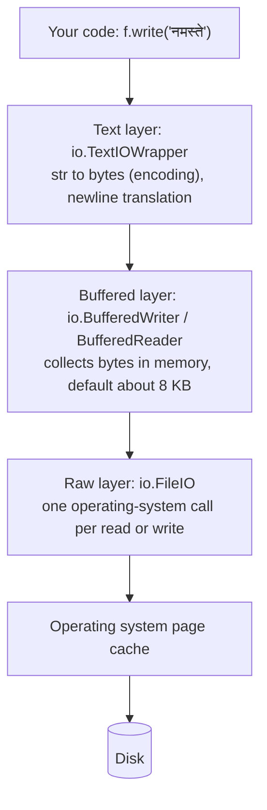

# Buffered I/O and Other File Methods: The Complete Guide

> 📚 **Before you start**
>
> - [Reading and Writing Files](reading-and-writing-files.md): `open`, modes, encodings, `pathlib`, `tempfile`
> - [Encapsulation and Abstraction](../02-object-oriented-programming/encapsulation-and-abstraction.md), for the idea of a shared interface (every file-like object has `read` and `write`)

## Introduction

Your script writes a progress log while it processes 50,000 customer records. You open the log in another window and it is empty, even though the script has been "writing" for a minute. Then the script crashes, and the last few hundred lines it wrote never appear at all. Another day, you overwrite `settings.json`, the laptop battery dies half-way, and the file is left half-written and unreadable.

All three surprises come from **buffering**, the layer between your `write()` calls and the disk. Buffering is the reason file I/O in Python is fast, and also the reason it sometimes behaves in ways that look like bugs. This lesson opens up that layer.

By the end you will understand Python's three I/O layers (raw, buffered and text), control buffering and flushing, move around inside a file with `seek` and `tell`, process large binary files in chunks, use in-memory files (`StringIO` and `BytesIO`), write files **atomically** so a crash can never leave a half-written file, and know the rest of the file object's methods.

> 💡 **Key Insight**
>
> `write()` doesn't write to the disk; it writes to a **buffer in memory**. Data moves to the operating system when the buffer fills, when you call `flush()`, or when the file is closed, and reaches the physical disk only when the OS decides to (or when you call `os.fsync()`). Fewer, larger trips to the OS are what make I/O fast.

---

## Core Explanation

### 1. The Three Layers of a Python File

When you call `open()`, Python builds a small stack of objects from the `io` module:



You can see the layers yourself:

```python
import io
import os
import tempfile
from pathlib import Path

tmp = tempfile.TemporaryDirectory()
base = Path(tmp.name)
path = base / "layers.txt"

with open(path, "w", encoding="utf-8") as text_file:
    print(type(text_file).__name__, "->", type(text_file.buffer).__name__,
          "->", type(text_file.buffer.raw).__name__)
    print(text_file.encoding, text_file.mode, text_file.name == str(path))

with open(path, "rb") as binary_file:          # binary mode skips the text layer
    print(type(binary_file).__name__, "->", type(binary_file.raw).__name__)

with open(path, "rb", buffering=0) as raw_file:  # unbuffered binary: the raw layer only
    print(type(raw_file).__name__)

print(io.DEFAULT_BUFFER_SIZE)
```

Output:

```
TextIOWrapper -> BufferedWriter -> FileIO
utf-8 w True
BufferedReader -> FileIO
FileIO
8192
```

| Mode | Object you get | Reads/writes |
|---|---|---|
| `"r"`, `"w"`, `"a"` (text) | `TextIOWrapper` | `str` |
| `"rb"` | `BufferedReader` | `bytes` |
| `"wb"`, `"ab"` | `BufferedWriter` | `bytes` |
| `"r+b"`, `"w+b"` | `BufferedRandom` | `bytes` |
| `"rb"`/`"wb"` with `buffering=0` | `FileIO` | `bytes` |

### 2. Why Buffering Exists

Each trip from your program to the operating system is a **system call**, and system calls are slow compared to normal Python work. Writing a 10,000-line file one line at a time without a buffer would mean 10,000 system calls. With an 8 KB buffer, the same data goes out in a handful of large calls.

The cost of this speed is that data you have "written" may still be sitting in memory:

```python
log = base / "progress.log"
f = open(log, "w", encoding="utf-8")
f.write("processed record 1\n")
print("size on disk after write:", log.stat().st_size)
f.flush()                                    # push the buffer to the operating system
print("size on disk after flush:", log.stat().st_size)
f.write("processed record 2\n")
f.close()                                    # close() flushes too
print("size on disk after close:", log.stat().st_size)
```

Output:

```
size on disk after write: 0
size on disk after flush: 19
size on disk after close: 38
```

That's the "empty log file" mystery from the introduction. It also explains lost data on a crash: if the process dies before a flush, whatever is still in the buffer is gone.

### 3. Controlling Buffering: The `buffering` Argument, `flush()` and `os.fsync()`

`open()` takes a `buffering` argument:

| `buffering=` | Meaning |
|---|---|
| `-1` (default) | Choose automatically: a block buffer for files (typically 8 KB), line buffering for interactive terminals |
| `0` | **No buffering.** Binary mode only; every `write` is a system call |
| `1` | **Line buffering.** Text mode only; the buffer is flushed whenever a newline is written |
| `n > 1` | A buffer of about `n` bytes |

Line buffering is a good choice for logs you want to watch live:

```python
live_log = base / "live.log"
with open(live_log, "w", encoding="utf-8", buffering=1) as f:
    f.write("step 1 done\n")
    print("visible immediately:", live_log.stat().st_size, "bytes")
    f.write("step 2 in progress...")               # no newline yet, so not flushed
    print("still:", live_log.stat().st_size, "bytes")
```

Output:

```
visible immediately: 12 bytes
still: 12 bytes
```

There are actually **two** levels of "written":

1. **`f.flush()`** moves data from Python's buffer to the operating system. Other programs can now read it, and it survives *your process* crashing.
2. **`os.fsync(f.fileno())`** asks the operating system to push its own cache to the physical disk. Only then does the data survive a *power cut* or OS crash. It is slow, so use it for data that really matters (payments, the final write of a settings file), not every log line.

```python
important = base / "ledger.txt"
with open(important, "a", encoding="utf-8") as f:
    f.write("2026-10-11,UPI,Sharma Chai,-40\n")
    f.flush()                    # Python buffer -> OS
    os.fsync(f.fileno())         # OS cache -> disk
print(important.read_text(encoding="utf-8"), end="")
```

Output:

```
2026-10-11,UPI,Sharma Chai,-40
```

`f.fileno()` returns the **file descriptor**, the small integer the operating system uses to identify the open file.

The same buffering applies to the screen. `sys.stdout` is a `TextIOWrapper` too: line-buffered when attached to a terminal, block-buffered when redirected to a file or pipe. That's why `print()` output from a long-running script sometimes appears in bursts in a log file. Use `print(..., flush=True)`, or run Python with `-u` (unbuffered) or the environment variable `PYTHONUNBUFFERED=1` (common in Docker containers).

### 4. Moving Around a File: `seek()` and `tell()`

Every open file has a **position**: where the next read or write will happen. `tell()` reports it; `seek(offset, whence)` moves it.

| `whence` | Constant | Offset is measured from |
|---|---|---|
| `0` | `os.SEEK_SET` | the start of the file (default) |
| `1` | `os.SEEK_CUR` | the current position |
| `2` | `os.SEEK_END` | the end of the file |

```python
data = base / "scores.bin"
data.write_bytes(b"IND287AUS254ENG301")             # three fixed-width 6-byte records

with open(data, "rb") as f:
    print(f.tell(), f.read(6))                     # position 0, first record
    print(f.tell())
    f.seek(12)                                     # jump straight to record 3
    print(f.read(6))
    f.seek(-6, os.SEEK_END)                        # last record, counted from the end
    print(f.read(3), f.read(3))
    f.seek(-9, os.SEEK_CUR)                        # move back relative to here
    print(f.read(3), f.tell())
    print(f.seek(0, os.SEEK_END), f.read())        # at the end, read() returns b""
```

Output:

```
0 b'IND287'
6
b'ENG301'
b'ENG' b'301'
b'254' 12
18 b''
```

With **fixed-width records**, `seek(record_number * record_size)` gives instant random access, which is how simple databases and file formats work.

**Text mode is different.** In text files, `tell()` returns an opaque number (not necessarily a character count, because one character can be several bytes in UTF-8), and you may only `seek()` to `0`, to the end, or to a value previously returned by `tell()`. For precise positioning, use binary mode.

#### Reading the end of a large file

`seek` from the end lets you read the last part of a big log without reading the whole file, like the Unix `tail` command:

```python
big_log = base / "server.log"
with open(big_log, "w", encoding="utf-8") as f:
    for i in range(1, 10_001):
        f.write(f"2026-10-11 10:{i % 60:02d} INFO request {i} ok\n")

def tail(path, lines=3, block=1024):
    with open(path, "rb") as f:
        end = f.seek(0, os.SEEK_END)
        f.seek(max(0, end - block))                  # read only the last block
        chunk = f.read()
    return chunk.decode("utf-8", errors="replace").splitlines()[-lines:]

print(big_log.stat().st_size, "bytes")
for line in tail(big_log):
    print(line)
```

Output:

```
378894 bytes
2026-10-11 10:38 INFO request 9998 ok
2026-10-11 10:39 INFO request 9999 ok
2026-10-11 10:40 INFO request 10000 ok
```

(A production `tail` keeps reading earlier blocks until it has enough lines, but the idea is the same.)

### 5. Editing in Place: `r+` Mode and `truncate()`

Mode `"r+b"` lets you read and write the same file without erasing it. Combined with `seek`, you can overwrite bytes in the middle. `truncate(size)` cuts the file to `size` bytes (or to the current position):

```python
with open(data, "r+b") as f:
    f.seek(9)                    # the "254" in AUS254
    f.write(b"261")              # overwrite exactly three bytes
    f.seek(0)
    print(f.read())
    f.truncate(12)               # drop the last record
    f.seek(0)
    print(f.read())
```

Output:

```
b'IND287AUS261ENG301'
b'IND287AUS261'
```

Overwriting in place only works when the new data is the **same length** as the old. For text files where lines change length, read everything, change it, and write a new file (atomically, see section 9).

### 6. Processing Large Binary Files in Chunks

For binary files (images, PDFs, model weights, ZIP archives) there are no "lines". Read fixed-size **chunks** in a loop. The walrus operator `:=` (assignment inside an expression) keeps the loop short:

```python
import hashlib

blob = base / "model.bin"
blob.write_bytes(bytes(range(256)) * 4096)          # a 1 MiB pretend file

def sha256_of(path, chunk_size=64 * 1024):
    digest = hashlib.sha256()
    chunks = 0
    with open(path, "rb") as f:
        while chunk := f.read(chunk_size):         # b"" at the end ends the loop
            digest.update(chunk)
            chunks += 1
    return digest.hexdigest(), chunks

checksum, chunks = sha256_of(blob)
print(chunks, "chunks;", checksum[:16])

with open(blob, "rb") as f:                         # Python 3.11+: the same in one call
    print(hashlib.file_digest(f, "sha256").hexdigest()[:16])
```

Output:

```
16 chunks; fbbab289f7f94b25
fbbab289f7f94b25
```

Only 64 KB is in memory at any moment, whatever the file size. Checksums like this verify downloads (for example, that a large model file wasn't corrupted) and detect duplicate files.

Copying file objects in chunks is built in, too: `shutil.copyfileobj(src, dst, length)` does the same loop for you, and works with any file-like objects, including network streams.

### 7. Binary Records with `struct`

Many binary formats store numbers as raw bytes rather than text. The `struct` module packs Python values into bytes and unpacks them, according to a **format string**:

```python
import struct

# one sensor reading: station id (unsigned short), temperature (float), humidity (unsigned byte)
RECORD = struct.Struct("<Hfb")                     # < little-endian, H=2 bytes, f=4 bytes, b=1 byte
print(RECORD.size, "bytes per record")

readings = [(101, 31.5, 70), (102, 28.25, 85), (103, 35.0, 40)]
sensor_file = base / "sensors.dat"
with open(sensor_file, "wb") as f:
    for r in readings:
        f.write(RECORD.pack(*r))

with open(sensor_file, "rb") as f:
    f.seek(RECORD.size * 1)                        # jump to the second record
    print(RECORD.unpack(f.read(RECORD.size)))

print([r for r in RECORD.iter_unpack(sensor_file.read_bytes())])
```

Output:

```
7 bytes per record
(102, 28.25, 85)
[(101, 31.5, 70), (102, 28.25, 85), (103, 35.0, 40)]
```

Seven bytes per reading versus about 15 as text, and instant random access. Formats like WAV audio, BMP images and many network protocols are parsed exactly this way.

### 8. In-Memory Files: `io.StringIO` and `io.BytesIO`

`io.StringIO` is a text file that lives in memory; `io.BytesIO` is a binary one. They have the same methods as real files (`read`, `write`, `seek`, iteration), so any code that accepts a file object accepts them too. This is duck typing in action:

```python
import csv

buffer = io.StringIO()
writer = csv.writer(buffer)
writer.writerows([["city", "orders"], ["Pune", 42], ["Nagpur", 17]])
csv_text = buffer.getvalue()                       # everything written so far
print(repr(csv_text))

reader = csv.DictReader(io.StringIO(csv_text))     # "open" a string as a file
print([row["city"] for row in reader])

bio = io.BytesIO()
bio.write("₹ symbol".encode("utf-8"))
bio.seek(0)
print(bio.read(3), bio.tell(), len(bio.getvalue()))
```

Output:

```
'city,orders\r\nPune,42\r\nNagpur,17\r\n'
['Pune', 'Nagpur']
b'\xe2\x82\xb9' 3 10
```

(The `csv` module writes `\r\n` line endings by default, as the CSV standard specifies. That's why files for it are opened with `newline=""`.)

Uses:

- **Tests**: feed a function a `StringIO` instead of a real file, so tests need no disk.
- **Building content in memory** before sending it somewhere: an uploaded file, an HTTP response, an email attachment, a cloud storage object.
- **Wrapping bytes from an API** (`io.BytesIO(response.content)`) so a library that expects a file (for example an image or PDF reader) can read them.

To treat a binary stream as text, wrap it: `io.TextIOWrapper(binary_stream, encoding="utf-8")`. That is literally what `open()` does in text mode.

### 9. Atomic Writes: Never Leave a Half-Written File

If a program crashes while overwriting `settings.json`, the file may be left empty or cut off, and the old good version is gone. The fix is the **atomic write** pattern:

1. Write the new content to a **temporary file in the same folder**.
2. Flush it and `fsync` it.
3. Rename it over the original with **`os.replace()`**.

On the same file system, `os.replace` is atomic: anyone reading the file sees either the complete old version or the complete new one, never a mixture.

```python
import json

def write_json_atomic(path, data):
    path = Path(path)
    fd, tmp_name = tempfile.mkstemp(dir=path.parent, prefix=path.name, suffix=".tmp")
    try:
        with open(fd, "w", encoding="utf-8") as f:      # open() also accepts a file descriptor
            json.dump(data, f, ensure_ascii=False, indent=2)
            f.flush()
            os.fsync(f.fileno())
        os.replace(tmp_name, path)                     # the atomic swap
    except BaseException:
        os.unlink(tmp_name)                            # don't leave junk behind on failure
        raise

settings = base / "settings.json"
write_json_atomic(settings, {"model": "claude-opus-5-5", "max_tokens": 1024})
write_json_atomic(settings, {"model": "claude-opus-5-5", "max_tokens": 2048})
print(json.loads(settings.read_text(encoding="utf-8")))
print(sorted(p.name for p in base.glob("settings*")))   # no leftover temp files
```

Output:

```
{'model': 'claude-opus-5-5', 'max_tokens': 2048}
['settings.json']
```

`except BaseException:` followed by a bare `raise` cleans up and then re-raises *whatever* went wrong, even a Ctrl+C. You'll learn the details in [try/except and Custom Exceptions](../04-modules-and-exceptions/try-except-and-custom-exceptions.md). The temporary file must be in the **same folder** because a rename across different disks or file systems is a copy, which is not atomic.

### 10. The Rest of the File Object's Methods and Attributes

| Member | What it tells you or does |
|---|---|
| `f.name`, `f.mode`, `f.encoding`, `f.closed` | The path, mode, text encoding and whether it is closed |
| `f.readable()`, `f.writable()`, `f.seekable()` | Capabilities (a pipe or socket is not seekable) |
| `f.isatty()` | `True` if connected to an interactive terminal |
| `f.fileno()` | The OS file descriptor |
| `f.flush()` | Push Python's buffer to the OS |
| `f.truncate(size=None)` | Cut the file at `size` or at the current position |
| `f.readinto(buffer)` | (binary) Read straight into an existing `bytearray`, avoiding a copy |
| `f.peek(n)` | (buffered binary reader) Look at upcoming bytes without moving the position |
| `f.detach()` | Separate a wrapper from its underlying layer |

```python
with open(big_log, "rb") as f:
    print(f.readable(), f.writable(), f.seekable(), f.isatty())
    print(f.peek(10)[:10], f.tell())             # peek doesn't move the position
    buf = bytearray(10)
    n = f.readinto(buf)
    print(n, bytes(buf), f.tell())
```

Output:

```
True False True False
b'2026-10-11' 0
10 b'2026-10-11' 10
```

### 11. File System Operations: `os` and `shutil`

Working *with* files (copying, moving, inspecting) rather than inside them:

```python
import shutil

backup_dir = base / "backup"
backup_dir.mkdir()
shutil.copy2(settings, backup_dir / "settings.json")     # copy2 keeps timestamps too
shutil.copytree(backup_dir, base / "backup_copy")       # copy a whole folder
shutil.move(base / "backup_copy", base / "archive")     # move or rename
info = (base / "archive" / "settings.json").stat()
print(info.st_size, "bytes;", sorted(p.name for p in base.iterdir() if p.is_dir()))
shutil.rmtree(base / "archive")                         # delete a folder and everything in it
print(sorted(p.name for p in base.iterdir() if p.is_dir()))
total, used, free = shutil.disk_usage(base)
print(free > 0)
```

Output:

```
54 bytes; ['archive', 'backup']
['backup']
True
```

`shutil.rmtree` deletes without asking and without a recycle bin, so double-check the path you give it.

Two more tools worth knowing, briefly:

- **`mmap`** maps a file into memory so you can treat it like a big `bytearray` and let the OS load pages on demand. It's used for very large files that need random access, and by libraries such as NumPy (`np.memmap`) to work on arrays bigger than RAM.
- **File locking** (stopping two processes writing the same file at once) is OS-specific in Python (`fcntl` on Unix, `msvcrt` on Windows). If several processes need to write shared data, a database such as SQLite is usually the better answer.

```python
tmp.cleanup()
```

---

## Try It Yourself

1. Open a file in text mode with `buffering=1`, write `"a"` (no newline) and check its size on disk, then write `"\n"` and check again. Explain the two numbers.
2. Write the bytes `b"0123456789"` to a file. Using `seek` and `read`, print the last 3 bytes, then the 3 bytes in the middle starting at position 4.
3. Write a function `count_lines_fast(path)` that counts `b"\n"` bytes by reading the file in 1 MiB binary chunks. Test it on a file with 25,000 lines.
4. Use `io.StringIO` to test a function `shout_lines(file)` that returns every line of a file in upper case, without touching the disk.

<details>
<summary>Show answers</summary>

**1.** The first write sits in the buffer (no newline yet); the newline triggers a flush.

```python
with tempfile.TemporaryDirectory() as d:
    p = Path(d) / "x.txt"
    with open(p, "w", encoding="utf-8", buffering=1) as f:
        f.write("a")
        first = p.stat().st_size
        f.write("\n")
        second = p.stat().st_size
    print(first, second)
```

Output:

```
0 2
```

**2.**

```python
with tempfile.TemporaryDirectory() as d:
    p = Path(d) / "digits.bin"
    p.write_bytes(b"0123456789")
    with open(p, "rb") as f:
        f.seek(-3, os.SEEK_END)
        print(f.read())
        f.seek(4)
        print(f.read(3))
```

Output:

```
b'789'
b'456'
```

**3.**

```python
def count_lines_fast(path):
    count = 0
    with open(path, "rb") as f:
        while chunk := f.read(1024 * 1024):
            count += chunk.count(b"\n")
    return count

with tempfile.TemporaryDirectory() as d:
    p = Path(d) / "many.txt"
    p.write_text("".join(f"line {i}\n" for i in range(25_000)), encoding="utf-8")
    print(count_lines_fast(p))
```

Output:

```
25000
```

**4.**

```python
def shout_lines(file):
    return [line.rstrip("\n").upper() for line in file]

print(shout_lines(io.StringIO("chai\nsamosa\njalebi\n")))
```

Output:

```
['CHAI', 'SAMOSA', 'JALEBI']
```

</details>

---

## Real-World Examples

### Example 1: Logs in containers

Python apps running in Docker often show no logs until they exit, because `stdout` is block-buffered when it isn't a terminal. Setting `PYTHONUNBUFFERED=1` in the Dockerfile is a standard fix, and you now know why it works.

### Example 2: Downloading large files

Downloading a multi-gigabyte model or dataset with `httpx` or `requests` uses streaming: the response body arrives in chunks, each chunk is written to an open binary file, and a SHA-256 checksum is updated as you go, exactly the chunk loop from section 6.

### Example 3: Safe config and state files

Editors, package managers and tools like `pip` write important files atomically (temporary file plus rename) so that a crash or power cut never leaves a corrupted file. Agent frameworks that checkpoint their state to disk use the same pattern.

### Example 4: Uploads without temporary files

A web API that generates a CSV or PDF report builds it in an `io.BytesIO`, then sends or uploads it straight from memory. FastAPI's `UploadFile` gives you a file-like object for incoming uploads for the same reason.

---

## Common Misconceptions

### Misconception 1: "After `write()` returns, my data is on disk"

It is in Python's buffer. `flush()` moves it to the operating system and `os.fsync()` to the disk. `close()` (or the end of a `with` block) flushes.

### Misconception 2: "Unbuffered I/O is safer, so I should always use it"

It is dramatically slower for many small writes, and it only protects against your process crashing, not power loss. Flush deliberately at important points instead.

### Misconception 3: "`seek()` works with character positions in text files"

In text mode, positions are opaque cookies because characters can take several bytes. Use binary mode for byte-exact positioning.

### Misconception 4: "Writing to a file with `w` is safe enough for important data"

`"w"` erases the file immediately; a crash before the write finishes loses both old and new data. Use the temporary-file-plus-`os.replace` pattern.

---

## Interview Relevance

Buffering questions test whether you understand what really happens below `write()`. A strong answer covers:

- **The three layers** (text, buffered, raw) and what each does.
- **Why buffering is fast** (fewer system calls) and its cost (data can be lost before a flush).
- **`flush()` vs `os.fsync()`** and when to use each.
- **`seek`/`tell`**, the `whence` values, and why text mode limits seeking.
- **Atomic writes** with a same-folder temporary file and `os.replace`.

Common follow-ups:

- *"Why does my program's output appear late when piped to a file?"* Block buffering of `stdout`; use `flush=True`, `-u` or `PYTHONUNBUFFERED`.
- *"How do you compute the checksum of a 20 GB file?"* Read binary chunks in a loop and update a `hashlib` object (or `hashlib.file_digest`).
- *"How do you unit-test code that reads files?"* Pass `io.StringIO`/`io.BytesIO` objects or use a temporary directory.

---

## Key Takeaways

- **Python files are layered**: `TextIOWrapper` (encoding) over `BufferedReader`/`BufferedWriter` (memory buffer) over `FileIO` (system calls).
- **Data reaches the OS on buffer-full, `flush()` or `close()`, and the disk on `os.fsync()`**; choose `buffering=1` for live logs.
- **`seek(offset, whence)` and `tell()` give random access**, precisely in binary mode; read big binary files in chunks with `while chunk := f.read(n)`.
- **`io.StringIO` and `io.BytesIO` are in-memory files** for tests and building content without touching disk.
- **Replace important files atomically**: write a temp file in the same folder, `fsync`, then `os.replace`.

---

**Up next:** [Lab: Log file analyser](lab-log-file-analyser.md)
