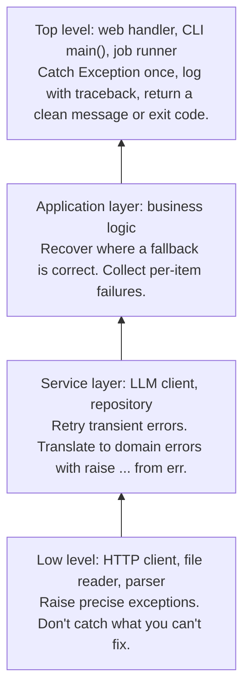

# Error Handling Best Practices: The Complete Guide

> 📚 **Before you start**
>
> - [try/except and Custom Exceptions](try-except-and-custom-exceptions.md): the syntax, the hierarchy, custom exceptions and chaining
> - [Dunder Methods](../02-object-oriented-programming/dunder-methods.md), for `__enter__` and `__exit__`
> - [Decorators, classmethod and staticmethod](../02-object-oriented-programming/decorators-classmethod-and-staticmethod.md), for the retry decorator

## Introduction

Knowing the syntax of `try`/`except` is like knowing how to use a fire extinguisher. Knowing **where** to put the extinguishers, which fires to fight yourself and when to evacuate the building is a different skill. Most real bugs in error handling aren't syntax mistakes; they're judgment mistakes:

- An `except Exception: pass` that turned a typo into three weeks of silently missing data.
- A retry loop with no delay that hammered a rate-limited API until the account was suspended.
- A function that returned `None` on failure, so the crash happened 400 lines later with a baffling `'NoneType' object is not subscriptable`.
- A database transaction left half-committed because an exception skipped the clean-up line.
- An error message in the logs that said only `Error occurred`.

This lesson is about judgment. You'll learn where to catch and where to let errors travel, EAFP versus LBYL, logging exceptions properly, guaranteeing clean-up with context managers (and writing your own with `contextlib`), retrying transient failures with exponential backoff, handling partial failure in batch jobs, warnings, and testing your error paths. These are the habits that make AI applications, which constantly talk to unreliable networks and unpredictable models, robust.

> 💡 **Key Insight**
>
> **Handle an error where you can do something useful about it, and nowhere else.** Low-level code raises precise exceptions; middle layers add context or translate them; the top level (a request handler, a job runner, `main()`) catches what's left, logs it with the traceback, and responds. Everything in between should mostly let exceptions pass.

---

## Core Explanation

### 1. The Four Things You Can Do with an Error

When code might fail, there are only four sensible responses:

| Response | When | Example |
|---|---|---|
| **Let it propagate** | You can't do anything meaningful here | A helper that parses a date lets `ValueError` reach its caller |
| **Recover** | There's a correct fallback | Missing optional config key → use the default |
| **Retry** | The failure is temporary | 429 rate limit, timeout, 503 overloaded |
| **Translate and re-raise** | Callers need a higher-level meaning | `KeyError` in a lookup → `UnknownPlanError` (with `from err`) |

What's *not* on the list: catching an exception and doing nothing (**swallowing** it). If you truly mean "ignore this specific, expected error", say so explicitly with `contextlib.suppress` (section 5) and a comment.

### 2. Catch Narrowly, and Keep the `try` Block Small

Compare these two versions of a function that reads a user's preferred language from a profile:

```python
import json

def preferred_language_bad(profile_json):
    try:
        profile = json.loads(profile_json)
        lang = profile["settings"]["language"]
        return lang.lower()
    except Exception:                        # catches EVERYTHING, including bugs
        return "en"

def preferred_language_good(profile_json):
    profile = json.loads(profile_json)       # invalid JSON is the caller's problem: let it raise
    try:
        lang = profile["settings"]["language"]
    except KeyError:                         # the one expected, recoverable case
        return "en"
    return lang.lower()

print(preferred_language_bad('{"settings": {"language": "HI"}}'))
print(preferred_language_bad('{"settings": {"language": null}}'))   # a real bug, hidden
print(preferred_language_good('{"settings": {}}'))
try:
    preferred_language_good('{"settings": {"language": null}}')
except AttributeError as err:
    print("bug surfaced:", err)
```

Output:

```
hi
en
en
bug surfaced: 'NoneType' object has no attribute 'lower'
```

The bad version quietly returned `"en"` for a profile whose language was `null`, a data problem someone needed to know about. The good version catches only the case it understands (`KeyError` for a missing setting) and only around the line that can raise it.

### 3. EAFP vs LBYL

There are two styles for dealing with conditions that might not hold:

- **LBYL**, "Look Before You Leap": check first, then act. `if key in d: value = d[key]`.
- **EAFP**, "Easier to Ask Forgiveness than Permission": just act, and handle the exception if it fails. `try: value = d[key] except KeyError: ...`.

Python generally favours EAFP, for three reasons:

```python
import os
import tempfile
from pathlib import Path

tmp = tempfile.TemporaryDirectory()
base = Path(tmp.name)
path = base / "cache.json"

# LBYL: check, then open. Between the check and the open, another process
# could delete the file: a "time-of-check to time-of-use" race condition.
if path.exists():
    data = path.read_text(encoding="utf-8")
else:
    data = "{}"

# EAFP: try it and handle the failure. No race, one file-system call instead of two.
try:
    data = path.read_text(encoding="utf-8")
except FileNotFoundError:
    data = "{}"
print(data)
```

Output:

```
{}
```

1. **No race conditions.** The file can't disappear between a check and the use, because there is no separate check.
2. **The check is always right.** The operation itself decides what's valid; a hand-written check might miss cases (permissions, a directory with that name, a broken link).
3. **The happy path is clean**, and the error case is clearly marked.

LBYL is still right when the check is cheap and failure is *common* (exceptions are slower than an `if` when they fire often), or when acting would have side effects you can't undo, such as validating a whole form before charging a card. Use `dict.get(key, default)` when a missing key is normal, which is neither: it's simply the right tool.

### 4. Don't Return `None` (or Error Codes) for Failures

Returning a special value on failure pushes the error somewhere else, where it's harder to understand:

```python
def find_user_bad(users, user_id):
    for u in users:
        if u["id"] == user_id:
            return u
    return None                                  # failure disguised as a value

class UserNotFoundError(LookupError):
    pass

def find_user(users, user_id):
    for u in users:
        if u["id"] == user_id:
            return u
    raise UserNotFoundError(f"no user with id {user_id!r}")

users = [{"id": 7, "name": "Asha"}]
try:
    print(find_user_bad(users, 8)["name"])        # crashes far from the real cause
except TypeError as err:
    print("confusing:", err)
try:
    print(find_user(users, 8)["name"])
except UserNotFoundError as err:
    print("clear:", err)
```

Output:

```
confusing: 'NoneType' object is not subscriptable
clear: no user with id 8
```

Returning `None` is fine when "not found" is a normal, expected answer *and* the name says so (`dict.get`, `re.match`, a function called `find_user_or_none`), and type hints (`-> dict | None`) remind callers to check. For genuine errors, raise.

### 5. Guaranteed Clean-Up with Context Managers

Anything you acquire (files, locks, network connections, database transactions, temporary directories) must be released even when an exception happens. `try`/`finally` works, but a **context manager** packages the acquire-and-release logic so it can't be forgotten. You saw the class-based form (`__enter__`/`__exit__`) in [Dunder Methods](../02-object-oriented-programming/dunder-methods.md). The `contextlib` module makes writing one much shorter.

#### `@contextmanager`: a generator becomes a context manager

Code before `yield` is the setup, the yielded value is what `as` receives, and code after `yield` is the clean-up. Put the `yield` in a `try`/`finally` so clean-up runs even if the `with` block raises:

```python
from contextlib import contextmanager

@contextmanager
def working_directory(path):
    """Temporarily change the current directory, always changing it back."""
    original = os.getcwd()
    os.chdir(path)
    try:
        yield Path(path)
    finally:
        os.chdir(original)

start = os.getcwd()
try:
    with working_directory(base) as here:
        print("inside:", Path.cwd() == here.resolve())
        raise RuntimeError("something failed inside the block")
except RuntimeError as err:
    print("error:", err)
print("restored:", os.getcwd() == start)
```

Output:

```
inside: True
error: something failed inside the block
restored: True
```

A context manager can also **react to the exception**. This one wraps a block in a database-style transaction: commit on success, roll back on any error, then re-raise:

```python
@contextmanager
def transaction(ledger):
    pending = []
    try:
        yield pending                       # the block adds entries here
    except Exception:
        print(f"  rolled back {len(pending)} entr{'y' if len(pending) == 1 else 'ies'}")
        raise
    else:
        ledger.extend(pending)
        print(f"  committed {len(pending)} entries")

ledger = []
with transaction(ledger) as t:
    t.append(("Asha", -500))
    t.append(("Ravi", +500))

try:
    with transaction(ledger) as t:
        t.append(("Asha", -900))
        raise ValueError("Ravi's account is frozen")
except ValueError as err:
    print("  transfer failed:", err)
print(ledger)
```

Output:

```
  committed 2 entries
  rolled back 1 entry
  transfer failed: Ravi's account is frozen
[('Asha', -500), ('Ravi', 500)]
```

This is exactly how `sqlite3` connections behave in a `with` block, and how SQLAlchemy sessions are typically used: either all of the changes happen or none do.

#### Other `contextlib` tools

```python
from contextlib import suppress, ExitStack, closing

# suppress: explicitly ignore one expected exception type
with suppress(FileNotFoundError):
    (base / "old_cache.json").unlink()        # fine if it was already gone
print("suppress: no error")

# ExitStack: manage a number of resources only known at runtime
names = ["a.txt", "b.txt", "c.txt"]
with ExitStack() as stack:
    files = [stack.enter_context(open(base / n, "w", encoding="utf-8")) for n in names]
    for f in files:
        f.write("hello\n")
    stack.callback(print, "ExitStack: all files closed")   # any extra clean-up
print(all(f.closed for f in files))

# closing: give any object with .close() a with-block
class Connection:
    def close(self):
        print("closing: connection closed")

with closing(Connection()) as conn:
    pass
```

Output:

```
suppress: no error
ExitStack: all files closed
True
closing: connection closed
```

Clean-up registered with `ExitStack` runs in reverse order (last opened, first closed), just like nested `with` blocks.

### 6. Logging Exceptions Properly

`print` is fine for scripts, but applications should use the **`logging`** module: it adds levels (DEBUG, INFO, WARNING, ERROR, CRITICAL), timestamps, the module name, and can send output to files or monitoring services. Most importantly, **`logger.exception(...)`** logs a message *plus the full traceback* of the exception currently being handled.

```python
import io
import logging

log_output = io.StringIO()                     # in a real app: a file, stderr or a log service
handler = logging.StreamHandler(log_output)
handler.setFormatter(logging.Formatter("%(levelname)s %(name)s: %(message)s"))
logger = logging.getLogger("billing")          # one logger per module: getLogger(__name__)
logger.addHandler(handler)
logger.setLevel(logging.INFO)

def charge(order_id, amount):
    try:
        if amount <= 0:
            raise ValueError(f"amount must be positive, got {amount}")
        logger.info("charged order %s: ₹%s", order_id, amount)
    except ValueError:
        logger.exception("could not charge order %s", order_id)   # message + traceback
        raise

charge("A-101", 450)
try:
    charge("A-102", -5)
except ValueError:
    pass

lines = log_output.getvalue().splitlines()
print("\n".join(l for l in lines if not l.startswith("  ")))   # hide file paths in the traceback
```

Output:

```
INFO billing: charged order A-101: ₹450
ERROR billing: could not charge order A-102
Traceback (most recent call last):
ValueError: amount must be positive, got -5
```

Logging rules that save hours of debugging:

- **Log the traceback** (`logger.exception` inside `except`, or `exc_info=True`), not just `str(err)`. The message alone often isn't enough to find the cause.
- **Pass values as arguments** (`logger.info("charged %s", order_id)`), not pre-formatted f-strings; logging formats them only if the message will actually be emitted, and log tools can group messages by template.
- **Log *or* raise, rarely both at every level.** If every layer logs and re-raises, one error appears five times. Usually log once, at the place that finally handles it. (The example above logs and re-raises only to show both behaviours.)
- **Never log secrets**: API keys, passwords, full card numbers, personal data.
- **Use `logging.getLogger(__name__)`** in each module, and configure handlers once, in the application's entry point (for example with `logging.basicConfig(level=logging.INFO)`).

### 7. Retrying Transient Failures with Exponential Backoff

Some failures fix themselves: a rate limit resets, an overloaded server recovers, a network blip passes. For those, **retry**. But retry well:

- **Only retry errors that are transient.** Retrying a 401 (bad API key) or 400 (bad request) just repeats the failure. Use the `retryable` idea from [try/except and Custom Exceptions](try-except-and-custom-exceptions.md).
- **Wait between attempts, longer each time** (**exponential backoff**): 1 s, 2 s, 4 s, 8 s... This gives the service room to recover.
- **Add random jitter**, so a thousand clients that failed at the same moment don't all retry at the same moment too.
- **Respect `retry_after`** when the server tells you how long to wait.
- **Cap the attempts and the total wait**, then give up with a clear error.

```python
import functools
import random

class TransientError(Exception):
    """Base for errors worth retrying."""

class RateLimited(TransientError):
    def __init__(self, retry_after=None):
        super().__init__("rate limited")
        self.retry_after = retry_after

class Unavailable(TransientError):
    pass

class GaveUpError(Exception):
    pass

def retry(attempts=4, base_delay=1.0, max_delay=30.0, sleep=None, rng=None):
    rng = rng or random.Random()
    def decorator(func):
        @functools.wraps(func)
        def wrapper(*args, **kwargs):
            for attempt in range(1, attempts + 1):
                try:
                    return func(*args, **kwargs)
                except TransientError as err:
                    if attempt == attempts:
                        raise GaveUpError(f"{func.__name__} failed {attempts} times") from err
                    delay = getattr(err, "retry_after", None)
                    if delay is None:
                        backoff = min(max_delay, base_delay * 2 ** (attempt - 1))
                        delay = rng.uniform(0, backoff)          # "full jitter"
                    print(f"  attempt {attempt}: {err!r}; waiting {delay:.2f}s")
                    sleep(delay)
        return wrapper
    return decorator


waits = []                                       # a fake sleep so the demo runs instantly
outcomes = iter([Unavailable("503"), RateLimited(retry_after=5), Unavailable("503"), "summary ready"])

@retry(attempts=4, sleep=waits.append, rng=random.Random(42))
def summarise(doc_id):
    result = next(outcomes)
    if isinstance(result, Exception):
        raise result
    return f"{doc_id}: {result}"

print(summarise("complaint-17"))
print("waited:", [round(w, 2) for w in waits])
```

Output:

```
  attempt 1: Unavailable('503'); waiting 0.64s
  attempt 2: RateLimited('rate limited'); waiting 5.00s
  attempt 3: Unavailable('503'); waiting 0.10s
complaint-17: summary ready
waited: [0.64, 5, 0.1]
```

Notice two design choices that make this testable: **`sleep` is a parameter** (pass `time.sleep` in production, a list's `append` in tests), and so is the **random generator** (seeded in tests). You'll write the async version, using `asyncio.sleep`, in [async and await for API Calls](../05-concurrency-for-ai-apps/async-and-await-for-api-calls.md). In production, the `tenacity` library offers all of this as configurable decorators, and official LLM SDKs retry common transient errors automatically (configurable with a `max_retries` option).

Retries must be **safe to repeat**. Re-sending "get the weather" is harmless; re-sending "charge ₹500" might charge twice. Operations that can be repeated without changing the result are called **idempotent**; for the others, APIs use an idempotency key so the server can recognise a repeated request.

### 8. Partial Failure in Batch Jobs

When processing 10,000 items, one bad item shouldn't destroy the other 9,999, but failures must not vanish either. Collect them, carry on, and report at the end:

```python
from dataclasses import dataclass, field

@dataclass
class BatchResult:
    succeeded: list = field(default_factory=list)
    failed: list = field(default_factory=list)          # (item, error) pairs

    def summary(self):
        kinds = {}
        for _, err in self.failed:
            kinds[type(err).__name__] = kinds.get(type(err).__name__, 0) + 1
        return f"{len(self.succeeded)} ok, {len(self.failed)} failed {dict(sorted(kinds.items()))}"

def classify(complaint):
    if not complaint.strip():
        raise ValueError("empty complaint")
    if len(complaint) > 40:
        raise OverflowError("too long for the model's context window (pretend)")
    return "delivery" if "late" in complaint else "other"

complaints = ["Order is late again", "", "x" * 50, "Wrong item delivered", "Very late delivery"]
result = BatchResult()
for c in complaints:
    try:
        result.succeeded.append((c, classify(c)))
    except (ValueError, OverflowError) as err:          # expected, per-item problems
        result.failed.append((c, err))
    # anything else (a bug) is NOT caught here: it should stop the batch

print(result.summary())
for item, err in result.failed:
    print(f"  {item[:12]!r:<16} {type(err).__name__}: {err}")
```

Output:

```
3 ok, 2 failed {'OverflowError': 1, 'ValueError': 1}
  ''               ValueError: empty complaint
  'xxxxxxxxxxxx'   OverflowError: too long for the model's context window (pretend)
```

The key distinction: **expected per-item problems** (bad input) are collected; **unexpected errors** (bugs, an expired API key affecting every item) are allowed to stop the job, because continuing would just produce thousands of identical failures. If many errors need to be raised together at the end, an `ExceptionGroup` can carry them.

### 9. Warnings: "This Works, but You Should Know"

Not every problem is an error. A deprecated function still works; a suspicious but legal argument might be a mistake. The `warnings` module reports such things without stopping the program:

```python
import warnings

def old_tokenise(text):
    warnings.warn("old_tokenise() is deprecated; use tokenise()", DeprecationWarning, stacklevel=2)
    return text.split()

with warnings.catch_warnings(record=True) as caught:
    warnings.simplefilter("always")               # show every warning (some are hidden by default)
    old_tokenise("chai and samosa")
print([f"{w.category.__name__}: {w.message}" for w in caught])

with warnings.catch_warnings():
    warnings.simplefilter("error", DeprecationWarning)   # turn warnings into exceptions (great in tests)
    try:
        old_tokenise("x")
    except DeprecationWarning as err:
        print("raised:", err)
```

Output:

```
['DeprecationWarning: old_tokenise() is deprecated; use tokenise()']
raised: old_tokenise() is deprecated; use tokenise()
```

`stacklevel=2` makes the warning point at the *caller's* line rather than the line inside `old_tokenise`, which is what the reader needs to fix. Since Python 3.13, `@warnings.deprecated("message")` is a decorator that does the same for functions and classes and also informs type checkers.

### 10. Testing the Error Paths

Error handling that's never tested usually doesn't work. Test that the right exception is raised, with the right message and attributes. With the standard library's `unittest`:

```python
import unittest

class FindUserTests(unittest.TestCase):
    def test_missing_user_raises(self):
        with self.assertRaises(UserNotFoundError) as ctx:
            find_user([{"id": 1}], 2)
        self.assertIn("2", str(ctx.exception))

    def test_lookup_error_family(self):
        with self.assertRaisesRegex(LookupError, "no user with id 9"):
            find_user([], 9)

suite = unittest.defaultTestLoader.loadTestsFromTestCase(FindUserTests)
outcome = unittest.TextTestRunner(stream=io.StringIO()).run(suite)
print("ran", outcome.testsRun, "tests; failures:", len(outcome.failures), "errors:", len(outcome.errors))
```

Output:

```
ran 2 tests; failures: 0 errors: 0
```

With pytest (the most popular test framework, a third-party package) the same check reads:

```python
# not-run: needs pytest installed
import pytest

def test_missing_user_raises():
    with pytest.raises(UserNotFoundError, match="no user with id 2"):
        find_user([{"id": 1}], 2)
```

Inject failures to test retries and fallbacks: pass a fake client that raises `RateLimited` twice, as the retry demo did.

### 11. A Layered Error Strategy

Putting it together, here's how errors flow through a typical AI application:



```python
app_logger = logging.getLogger("app")
app_logger.addHandler(handler)                     # the StringIO handler from section 6

def main():
    try:
        summarise_batch()
    except GaveUpError as err:
        print("Service unavailable, try again later:", err)
        return 2
    except Exception:                              # the ONE broad catch, at the top
        app_logger.exception("unexpected error")
        print("Unexpected error; details are in the log")
        return 1
    return 0

def summarise_batch():
    raise KeyError("model")                        # simulate a bug deep inside

print("exit code:", main())
print(log_output.getvalue().splitlines()[-1])      # the last line of the logged traceback
tmp.cleanup()
```

Output:

```
Unexpected error; details are in the log
exit code: 1
KeyError: 'model'
```

### 12. Anti-Pattern Checklist

| Anti-pattern | Why it hurts | Instead |
|---|---|---|
| `except: pass` or `except Exception: pass` | Hides bugs and data loss | Catch the specific error; log or handle it |
| Bare `except:` | Also catches Ctrl+C and `sys.exit` | `except Exception` at the very top only |
| Huge `try` block | You can't tell which line failed or what you meant to catch | Wrap only the line that can raise the expected error |
| `return None` / `-1` on failure | Error surfaces far away as a confusing `TypeError` | Raise a descriptive exception |
| `raise Exception("error")` | Callers can't catch it selectively; the message says nothing | A specific (custom) class and a message with values |
| `raise NewError(...)` inside `except` without `from` | The root cause is shown as an accident ("during handling...") | `raise NewError(...) from err` |
| Logging `str(err)` only | No traceback, no line number | `logger.exception(...)` |
| Retrying everything, immediately, forever | Hammers services, repeats non-transient failures | Retry transient errors only, with backoff, jitter and a cap |
| Clean-up code after the risky line, without `finally` | Skipped when an exception happens | `with` / context managers / `finally` |
| `assert` for validating input | Removed by `python -O` | `if ...: raise ValueError(...)` |

---

## Try It Yourself

1. Rewrite this LBYL code in EAFP style and explain one advantage:
   ```python
   if "price" in item and item["price"] is not None:
       total += item["price"]
   ```
2. Write a context manager `timer(results, label)` with `@contextmanager` that measures how long the block took with `time.perf_counter()` and stores it in the `results` dict under `label`, **even if the block raises**. Show that the key is present after a failing block.
3. Use the `retry` decorator from section 7 (with a fake sleep) on a function that always raises `Unavailable`. Show that `GaveUpError` is raised and that its `__cause__` is the last `Unavailable`.
4. Change `classify` from section 8 so that an empty complaint is *recovered* as `"empty"` instead of failing, while too-long complaints still fail. What does the summary print now?

<details>
<summary>Show answers</summary>

**1.** EAFP looks the value up once and treats a missing key as the exception. (The `None` check is a value check, not an exceptional case, so it stays an `if`.)

```python
total = 0
for item in [{"price": 20}, {"name": "free sample"}, {"price": None}]:
    try:
        price = item["price"]
    except KeyError:
        continue
    if price is not None:
        total += price
print(total)
```

Output:

```
20
```

**2.**

```python
import time

@contextmanager
def timer(results, label):
    start = time.perf_counter()
    try:
        yield
    finally:
        results[label] = time.perf_counter() - start

timings = {}
with timer(timings, "ok"):
    sum(range(1000))
try:
    with timer(timings, "failing"):
        raise RuntimeError("boom")
except RuntimeError:
    pass
print(sorted(timings), all(t >= 0 for t in timings.values()))
```

Output:

```
['failing', 'ok'] True
```

**3.**

```python
waits = []

@retry(attempts=3, sleep=waits.append, rng=random.Random(1))
def always_down():
    raise Unavailable("still 503")

try:
    always_down()
except GaveUpError as err:
    print(err, "| cause:", repr(err.__cause__), "| waits:", len(waits))
```

Output:

```
  attempt 1: Unavailable('still 503'); waiting 0.13s
  attempt 2: Unavailable('still 503'); waiting 1.69s
always_down failed 3 times | cause: Unavailable('still 503') | waits: 2
```

**4.**

```python
def classify(complaint):
    if not complaint.strip():
        return "empty"                              # recovered: a correct fallback
    if len(complaint) > 40:
        raise OverflowError("too long for the model's context window (pretend)")
    return "delivery" if "late" in complaint else "other"

result = BatchResult()
for c in complaints:
    try:
        result.succeeded.append((c, classify(c)))
    except (ValueError, OverflowError) as err:
        result.failed.append((c, err))
print(result.summary())
```

Output:

```
4 ok, 1 failed {'OverflowError': 1}
```

</details>

---

## Real-World Examples

### Example 1: Calling LLM APIs in production

A robust LLM call layer retries `429` and `5xx` responses with exponential backoff and jitter (honouring `retry-after` headers), never retries `400`/`401`, translates provider-specific errors into the app's own exception hierarchy, and logs each failure once with the request id. The official SDKs already retry a few times by default; your layer adds the business decisions (fallback model, user-facing message, alerting).

### Example 2: Web frameworks' top-level handlers

FastAPI lets you register exception handlers that turn your domain exceptions into HTTP responses (`UserNotFoundError` → 404, `ValidationError` → 422), with one catch-all that logs the traceback and returns a 500. That's the "top level" box in the diagram, provided by the framework.

### Example 3: Database transactions

`with sqlite3.connect(path) as conn:` commits if the block succeeds and rolls back if it raises. SQLAlchemy's `with Session() as session, session.begin():` does the same. The pattern is identical to the `transaction` context manager in section 5.

---

## Common Misconceptions

### Misconception 1: "More `try`/`except` means more robust code"

Robustness comes from handling the *right* errors in the *right* place. Extra catches mostly hide bugs. Many functions should contain no `try` at all.

### Misconception 2: "Exceptions are slow, so avoid them"

Entering a `try` block costs almost nothing in modern Python; raising is slower but only matters when it happens in a hot loop for a common case. Write clear EAFP code, and switch to a check only when profiling shows a problem.

### Misconception 3: "Retrying fixes flaky failures"

Retrying fixes *transient* failures. Retrying permanent ones wastes time and money, and retrying non-idempotent operations can duplicate actions such as payments.

### Misconception 4: "Logging the error message is enough"

Without the traceback you don't know which line failed or how the program got there. Use `logger.exception`.

---

## Interview Relevance

Senior-leaning interviews ask "how do you handle errors in a service that calls external APIs?" A strong answer covers:

- **Where to handle**: raise low, translate in the middle, catch broadly only at the top, log once with the traceback.
- **EAFP vs LBYL** and race conditions.
- **Context managers** for clean-up, including writing one with `@contextmanager` and the transaction pattern.
- **Retries**: only transient errors, exponential backoff with jitter, caps, `retry-after`, idempotency.
- **Partial failure**: collect per-item errors, stop on systemic ones, report a summary.

Common follow-ups:

- *"What's wrong with `except Exception: pass`?"* It hides bugs and data loss; if ignoring is truly intended, use `contextlib.suppress(SpecificError)` with a comment.
- *"How do you test that retry logic works?"* Inject a fake that fails N times and a fake `sleep`; assert the attempts, delays and final result.
- *"What does `stacklevel` do in `warnings.warn`?"* Points the warning at the caller's line.

---

## Key Takeaways

- **Handle errors where you can act**: propagate, recover, retry or translate; never silently swallow.
- **Catch narrowly around small `try` blocks, prefer EAFP**, and raise instead of returning `None` for failures.
- **Use context managers (`with`, `@contextmanager`, `ExitStack`, `suppress`) for guaranteed clean-up** and all-or-nothing transactions.
- **Log once with the traceback via `logger.exception`**, never log secrets, and keep one broad catch at the top level.
- **Retry only transient errors, with exponential backoff, jitter and a cap**; make `sleep` and randomness injectable so retries are testable.

---

**Up next:** [Threads, Processes and Async](../05-concurrency-for-ai-apps/threads-processes-and-async.md)
