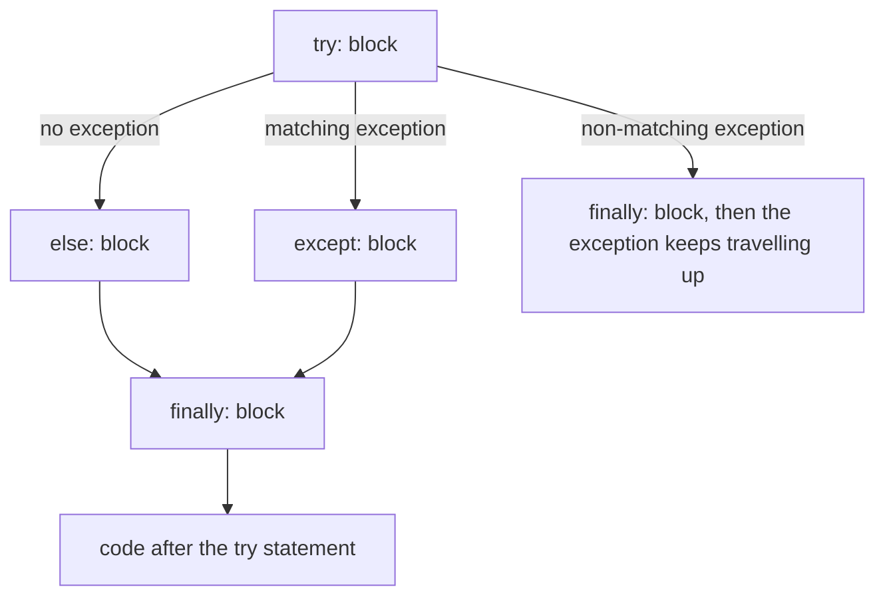
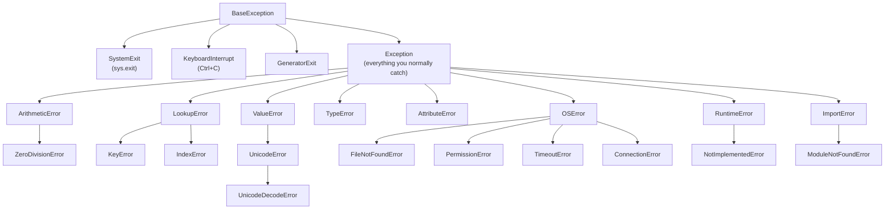
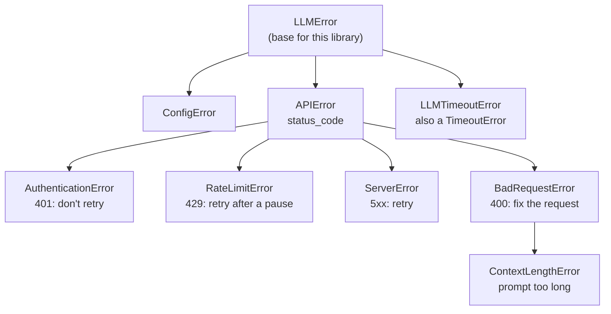

# try/except and Custom Exceptions: The Complete Guide

> 📚 **Before you start**
>
> - [Inheritance and Polymorphism](../02-object-oriented-programming/inheritance-and-polymorphism.md): exception classes form an inheritance hierarchy
> - [Reading and Writing Files](../03-file-handling/reading-and-writing-files.md), for the file errors used in examples
> - [Importing and Managing Modules](importing-and-managing-modules.md)

## Introduction

Your app calls an LLM API to summarise customer complaints. In testing it works every time. In production, on the first busy Monday morning, it meets everything the real world can throw at it: the API returns "429 Too Many Requests", one request times out, one complaint is so long it exceeds the model's context window, the API key expires at noon, and a customer's message contains bytes that aren't valid UTF-8. Each problem shows up in Python as an **exception**.

Without error handling, the first one stops the whole batch. With *bad* error handling (`except: pass` everywhere), the batch "succeeds" while silently dropping a third of the complaints. Good error handling does something in between: it **retries** what is temporary, **skips and reports** what is bad input, and **stops loudly** on what can't be fixed, like an expired key.

To do that, your code has to tell these errors apart. This lesson teaches the full `try` statement (`except`, `else`, `finally`), Python's exception hierarchy, raising and re-raising, designing your **own exception classes** and hierarchies, **exception chaining** (`raise ... from ...`), notes, and exception groups. The next lesson, [Error Handling Best Practices](error-handling-best-practices.md), builds on this to cover *when* and *where* to handle errors.

> 💡 **Key Insight**
>
> Exceptions are **objects of classes arranged in a hierarchy**, and `except SomeError` catches that class *and all its subclasses*. Designing a good exception hierarchy for your code lets each caller choose its level: catch one precise problem (`RateLimitError`), a family (`APIError`), or everything from your library (`LLMError`).

---

## Core Explanation

### 1. What Happens When an Exception Is Raised

An **exception** is an object that signals an error. When one is **raised**, Python stops running the current code and travels back up the chain of function calls (the **call stack**), looking for a matching `except` block. If none is found, the program stops and prints a **traceback**:

```python
# not-run: this crashes on purpose, to show a traceback
def average(marks):
    return sum(marks) / len(marks)

def report(student, marks):
    return f"{student}: {average(marks):.1f}"

print(report("Asha", []))
```

Example output:

```
Traceback (most recent call last):
  File "report.py", line 7, in <module>
    print(report("Asha", []))
          ~~~~~~^^^^^^^^^^^^
  File "report.py", line 5, in report
    return f"{student}: {average(marks):.1f}"
                         ~~~~~~~^^^^^^^
  File "report.py", line 2, in average
    return sum(marks) / len(marks)
           ~~~~~~~~~~~^~~~~~~~~~~~
ZeroDivisionError: division by zero
```

Read a traceback **from the bottom up**: the last line is the exception type and message; the lines above show the path the program took, with the line that actually failed nearest the bottom. "Most recent call last" means the deepest function call is at the end. The `~~~^^^` markers point at the exact expression that failed.

### 2. Catching Exceptions with `try` and `except`

```python
def safe_average(marks):
    try:
        return sum(marks) / len(marks)
    except ZeroDivisionError:
        return 0.0

print(safe_average([78, 91, 85]), safe_average([]))
```

Output:

```
84.66666666666667 0.0
```

Python runs the `try` block. If a `ZeroDivisionError` is raised inside it (or inside any function it calls), Python jumps to the matching `except` block, and the program continues after the `try` statement. Any *other* exception type passes straight through, as if the `try` weren't there.

You can handle different exceptions differently, catch several types in one clause with a tuple, and use `as` to get the exception object:

```python
def parse_amount(text):
    try:
        rupees = float(text)
        return round(1000 / rupees, 2)            # pretend: how many items at this price fit in ₹1000
    except ValueError as err:
        return f"not a number ({err})"
    except ZeroDivisionError:
        return "price can't be zero"
    except (TypeError, AttributeError) as err:
        return f"wrong type: {type(err).__name__}"

for value in ["250", "abc", "0", None]:
    print(repr(value), "->", parse_amount(value))
```

Output:

```
'250' -> 4.0
'abc' -> not a number (could not convert string to float: 'abc')
'0' -> price can't be zero
None -> wrong type: TypeError
```

The exception object carries information: `str(err)` is the message, `err.args` holds the arguments it was created with, and `type(err).__name__` is the class name. Many exception types add more attributes, for example `OSError.filename` and `errno`, or `UnicodeDecodeError.start`.

### 3. `else` and `finally`

The full `try` statement has four parts:

```python
from pathlib import Path
import tempfile, json

tmp = tempfile.TemporaryDirectory()
base = Path(tmp.name)
(base / "good.json").write_text('{"model": "claude-opus-5-5"}', encoding="utf-8")
(base / "bad.json").write_text('{"model": ', encoding="utf-8")

def load_config(name):
    print(f"loading {name}")
    try:
        f = open(base / name, encoding="utf-8")
    except FileNotFoundError:
        print("  except: no such file")
        return None
    else:                                  # runs only if the try block raised nothing
        try:
            return json.load(f)
        except json.JSONDecodeError as err:
            print(f"  except: invalid JSON at line {err.lineno} column {err.colno}")
            return None
        finally:                           # always runs: success, error or return
            f.close()
            print("  finally: file closed")

print(load_config("good.json"))
print(load_config("bad.json"))
print(load_config("missing.json"))
```

Output:

```
loading good.json
  finally: file closed
{'model': 'claude-opus-5-5'}
loading bad.json
  except: invalid JSON at line 1 column 11
  finally: file closed
None
loading missing.json
  except: no such file
None
```



- **`else`** runs only when the `try` block finished without an exception. Put code there that should run on success but whose *own* errors you don't want the `except` clauses above to catch. Keeping the `try` block small (just the line that can fail with the error you're catching) makes it clear what's being handled.
- **`finally`** runs no matter what: after success, after a handled exception, after an unhandled one, and even when the block exits with `return`, `break` or `continue`. It is for **clean-up**: closing files and connections, releasing locks, deleting temporary files. (Context managers are usually a neater way to do the same; see [Error Handling Best Practices](error-handling-best-practices.md).)

A trap: a `return` inside `finally` overrides any exception or earlier return, silently swallowing errors. Since Python 3.14 this produces a `SyntaxWarning` (PEP 765). Don't return from `finally`.

### 4. The Exception Hierarchy

All exceptions are classes that inherit from **`BaseException`**. Here is the part of the tree you'll meet most:



Because `except` matches subclasses, you can catch at whatever level fits:

```python
data = {"Pune": 42}
for action in [lambda: data["Nagpur"], lambda: [1, 2][5], lambda: open(base / "nope.txt")]:
    try:
        action()
    except LookupError as err:            # catches KeyError AND IndexError
        print("LookupError family:", type(err).__name__, err)
    except OSError as err:                # catches FileNotFoundError, PermissionError, ...
        print("OSError family:", type(err).__name__, err.strerror)

print(issubclass(FileNotFoundError, OSError), issubclass(KeyboardInterrupt, Exception))
```

Output:

```
LookupError family: KeyError 'Nagpur'
LookupError family: IndexError list index out of range
OSError family: FileNotFoundError No such file or directory
True False
```

Two rules follow from the hierarchy:

- **Order `except` clauses from specific to general.** Python uses the *first* matching clause. If `except OSError` came before `except FileNotFoundError`, the second could never run.
- **Catch `Exception`, never `BaseException`, when you mean "any error".** `KeyboardInterrupt` and `SystemExit` deliberately sit outside `Exception` so that a broad `except Exception` doesn't stop the user from pressing Ctrl+C or the program from exiting. A bare `except:` (no class) catches `BaseException` and is almost always a bug.

### 5. Raising Exceptions

Use `raise` to signal an error yourself. Pick the built-in class that matches the situation:

| Situation | Raise |
|---|---|
| Right type, unacceptable value (negative quantity, unknown option) | `ValueError` |
| Wrong type entirely | `TypeError` |
| A key or index that doesn't exist (in your own container) | `KeyError` / `IndexError` |
| A method a subclass must override | `NotImplementedError` |
| An operation not valid in the object's current state | `RuntimeError` (or a custom class) |

```python
def book_seats(available, requested):
    if not isinstance(requested, int):
        raise TypeError(f"requested must be an int, not {type(requested).__name__}")
    if requested <= 0:
        raise ValueError("requested must be at least 1")
    if requested > available:
        raise ValueError(f"only {available} seats left, asked for {requested}")
    return available - requested

for req in [2, 0, 9, "2"]:
    try:
        print("left:", book_seats(5, req))
    except (TypeError, ValueError) as err:
        print(f"{type(err).__name__}: {err}")
```

Output:

```
left: 3
ValueError: requested must be at least 1
ValueError: only 5 seats left, asked for 9
TypeError: requested must be an int, not str
```

Write messages that help whoever reads them: say what was wrong and include the offending value.

#### Re-raising

Sometimes you want to *react* to an error (log it, count it, clean up) but still let it continue to the caller. A bare `raise` inside an `except` block re-raises the current exception unchanged, with its original traceback:

```python
failures = []

def fetch_price(item):
    try:
        return {"chai": 15, "samosa": 20}[item]
    except KeyError:
        failures.append(item)          # record it...
        raise                          # ...and let the caller decide what to do

try:
    fetch_price("pizza")
except KeyError as err:
    print("caller saw KeyError:", err, "| recorded:", failures)
```

Output:

```
caller saw KeyError: 'pizza' | recorded: ['pizza']
```

### 6. Custom Exceptions

Built-in exceptions describe *what kind* of thing went wrong (`ValueError`), but not *in which part of your program* or *what the caller should do*. **Custom exception classes** fix that. A custom exception is just a class inheriting from `Exception` (or a more specific built-in):

```python
class PaymentError(Exception):
    """Something went wrong while taking a payment."""

class InsufficientFunds(PaymentError):
    def __init__(self, balance, amount):
        super().__init__(f"balance ₹{balance} is less than ₹{amount}")
        self.balance = balance          # extra data for the code that catches it
        self.amount = amount

    @property
    def shortfall(self):
        return self.amount - self.balance


try:
    raise InsufficientFunds(balance=120, amount=450)
except PaymentError as err:             # caught through its parent class
    print(type(err).__name__, "-", err)
    print("short by ₹", err.shortfall, sep="")
```

Output:

```
InsufficientFunds - balance ₹120 is less than ₹450
short by ₹330
```

Guidelines:

- **Name them with an `Error` suffix** (PEP 8), except where a name reads better otherwise, as in `InsufficientFunds`.
- **Call `super().__init__(message)`** so `str(err)` and `err.args` work as expected.
- **Add attributes** for the data a handler needs (`status_code`, `retry_after`, `order_id`) rather than making callers parse the message text.
- **Inherit from the closest built-in** when it fits. If your error is a kind of bad value, `class InvalidPNRError(ValueError)` means existing `except ValueError` code still catches it.

### 7. Designing an Exception Hierarchy

For a library or a significant module, define **one base exception** and a small tree under it. Here is a hierarchy for an LLM client, modelled on how real SDKs organise their errors:



```python
class LLMError(Exception):
    """Base class for every error raised by this client."""

class ConfigError(LLMError):
    pass

class APIError(LLMError):
    retryable = False

    def __init__(self, message, status_code):
        super().__init__(f"[{status_code}] {message}")
        self.status_code = status_code

class AuthenticationError(APIError):
    pass

class BadRequestError(APIError):
    pass

class ContextLengthError(BadRequestError):
    def __init__(self, tokens, limit):
        super().__init__(f"prompt has {tokens} tokens; the limit is {limit}", 400)
        self.tokens, self.limit = tokens, limit

class RateLimitError(APIError):
    retryable = True

    def __init__(self, message, retry_after):
        super().__init__(message, 429)
        self.retry_after = retry_after

class ServerError(APIError):
    retryable = True

class LLMTimeoutError(LLMError, TimeoutError):      # catchable as either
    retryable = True


def error_from_response(status, body):
    """Translate an HTTP error response into the right exception object."""
    if status == 401:
        return AuthenticationError(body.get("message", "invalid API key"), status)
    if status == 429:
        return RateLimitError("too many requests", retry_after=body.get("retry_after", 1))
    if status == 400 and body.get("type") == "context_length":
        return ContextLengthError(body["tokens"], body["limit"])
    if status == 400:
        return BadRequestError(body.get("message", "bad request"), status)
    return ServerError(body.get("message", "server error"), status)


responses = [
    (429, {"retry_after": 2}),
    (400, {"type": "context_length", "tokens": 250_000, "limit": 200_000}),
    (401, {"message": "API key expired"}),
    (503, {"message": "overloaded"}),
]
for status, body in responses:
    err = error_from_response(status, body)
    try:
        raise err
    except RateLimitError as e:
        print(f"wait {e.retry_after}s and retry  <- {e}")
    except ContextLengthError as e:
        print(f"trim {e.tokens - e.limit:,} tokens  <- {e}")
    except APIError as e:
        action = "retry" if e.retryable else "stop and alert"
        print(f"{action:<14} <- {type(e).__name__}: {e}")

print(isinstance(LLMTimeoutError("slow"), TimeoutError))
```

Output:

```
wait 2s and retry  <- [429] too many requests
trim 50,000 tokens  <- [400] prompt has 250000 tokens; the limit is 200000
stop and alert <- AuthenticationError: [401] API key expired
retry          <- ServerError: [503] overloaded
True
```

What the hierarchy buys you:

- **Callers choose the precision they need.** A batch job might catch `RateLimitError` to wait and `ContextLengthError` to truncate; a web endpoint might catch all of `LLMError` to return a friendly message.
- **Behaviour lives on the class.** `retryable` is a class attribute, so retry logic asks `err.retryable` instead of maintaining a list of status codes (polymorphism again).
- **Multiple inheritance where it helps.** `LLMTimeoutError` is both an `LLMError` and a built-in `TimeoutError`, so generic timeout handling also catches it.
- **One translation point.** `error_from_response` turns low-level details (status codes, JSON bodies) into meaningful exceptions in exactly one place.

The official Anthropic and OpenAI Python SDKs follow the same idea, with classes such as `RateLimitError`, `AuthenticationError` and `APIStatusError` under a common base.

Keep hierarchies **shallow and purposeful**: add a class only when some caller will want to catch it separately.

### 8. Exception Chaining: `raise ... from ...`

When you catch a low-level exception and raise a higher-level one, you don't want to lose the original. Python **chains** them. There are three cases.

**Explicit chaining with `from`** says "this error was directly caused by that one". The original is stored in `__cause__`:

```python
import traceback

def load_settings(text):
    try:
        return json.loads(text)
    except json.JSONDecodeError as err:
        raise ConfigError("settings file is not valid JSON") from err

def summary(exc):
    """The traceback without the 'File ...' lines, which contain machine-specific paths."""
    lines = traceback.format_exception(exc)
    return "".join(l for l in lines if not l.startswith("  ")).rstrip()

try:
    load_settings('{"model": claude}')
except ConfigError as err:
    print(type(err.__cause__).__name__, "|", err.__cause__)
    print(summary(err))
```

Output:

```
JSONDecodeError | Expecting value: line 1 column 11 (char 10)
Traceback (most recent call last):
json.decoder.JSONDecodeError: Expecting value: line 1 column 11 (char 10)

The above exception was the direct cause of the following exception:

Traceback (most recent call last):
ConfigError: settings file is not valid JSON
```

**Implicit chaining** happens automatically when a *new* exception is raised while handling another (often by accident, as a bug in the handler). The original goes in `__context__` and the traceback says "During handling of the above exception, another exception occurred":

```python
try:
    try:
        {}["model"]
    except KeyError:
        print(undefined_name)          # a bug inside the handler
except NameError as err:
    print(type(err.__context__).__name__, err.__cause__)
    print(summary(err).splitlines()[3])
```

Output:

```
KeyError None
During handling of the above exception, another exception occurred:
```

**Suppressing the chain with `from None`** is for when the original is just noise to the caller, such as a `KeyError` from an internal dictionary lookup:

```python
PLANS = {"free": 0, "pro": 1999}

def plan_price(name):
    try:
        return PLANS[name]
    except KeyError:
        raise ValueError(f"unknown plan {name!r}; choose from {sorted(PLANS)}") from None

try:
    plan_price("gold")
except ValueError as err:
    print(err, "| cause:", err.__cause__, "| suppressed:", err.__suppress_context__)
```

Output:

```
unknown plan 'gold'; choose from ['free', 'pro'] | cause: None | suppressed: True
```

Rule of thumb: when translating an error into your own exception type, use `from err` so the root cause stays visible in logs; use `from None` only when the original adds nothing.

### 9. Adding Context with Notes

Sometimes you don't want a new exception type, just extra context. Since Python 3.11, `add_note()` attaches strings that are printed below the message in the traceback:

```python
def process_rows(rows):
    for line_no, row in enumerate(rows, start=1):
        try:
            int(row["amount"])
        except ValueError as err:
            err.add_note(f"while processing row {line_no}: {row}")
            raise

try:
    process_rows([{"amount": "120"}, {"amount": "1,200"}])
except ValueError as err:
    print(err)
    print(err.__notes__)
```

Output:

```
invalid literal for int() with base 10: '1,200'
["while processing row 2: {'amount': '1,200'}"]
```

### 10. Exception Groups and `except*`

Normally one exception travels at a time. But when several tasks run concurrently, *several* may fail at once, and reporting only the first would hide the rest. Python 3.11 added **`ExceptionGroup`**, an exception that holds a list of exceptions, and the **`except*`** syntax, which handles the matching members of a group and lets the rest continue:

```python
def run_all_checks():
    errors = []
    for name, check in [("disk", lambda: None),
                        ("api", lambda: (_ for _ in ()).throw(RateLimitError("busy", 5))),
                        ("db", lambda: (_ for _ in ()).throw(ConnectionError("db down"))),
                        ("key", lambda: (_ for _ in ()).throw(AuthenticationError("expired", 401)))]:
        try:
            check()
        except Exception as err:
            err.add_note(f"check: {name}")
            errors.append(err)
    if errors:
        raise ExceptionGroup("health checks failed", errors)

try:
    run_all_checks()
except* RateLimitError as group:
    print("rate limited:", [str(e) for e in group.exceptions])
except* APIError as group:
    print("other API errors:", [type(e).__name__ for e in group.exceptions])
except* ConnectionError as group:
    print("connection problems:", [e.__notes__[0] for e in group.exceptions])
```

Output:

```
rate limited: ['[429] busy']
other API errors: ['AuthenticationError']
connection problems: ['check: db']
```

Unlike `except`, **every** `except*` clause whose type matches something in the group runs, each receiving a sub-group of the matching exceptions. (The odd-looking `(_ for _ in ()).throw(...)` is just a way to raise an exception inside a `lambda`, which can't contain a `raise` statement.) You will meet exception groups again with `asyncio.TaskGroup` in [async and await for API Calls](../05-concurrency-for-ai-apps/async-and-await-for-api-calls.md).

### 11. `assert`: For Bugs, Not for Input

`assert condition, message` raises `AssertionError` if the condition is false. It documents assumptions that should *never* be false if your code is correct:

```python
def split_bill(total, people):
    share = round(total / people, 2)
    assert abs(share * people - total) < people * 0.01, "rounding error too large"
    return share

print(split_bill(1000, 3))
```

Output:

```
333.33
```

Python skips `assert` statements entirely when run with the `-O` (optimise) flag. So **never use `assert` to validate user input or API data**; that check would vanish in optimised runs. Use `if ...: raise ValueError(...)` for anything that can actually happen.

```python
tmp.cleanup()
```

---

## Try It Yourself

1. Write `to_int(text, default=None)` that returns `int(text)`, or `default` if the text isn't a valid integer. Make sure passing `None` as `text` raises `TypeError` rather than returning the default (catch only what you mean to).
2. Create a hierarchy for a train booking system: `BookingError` → `SeatUnavailableError(train_no, coach)` and `PaymentFailedError(amount)`. Raise each and catch both with one `except BookingError`, printing their attributes.
3. Write `read_port(config: dict)` that returns `int(config["port"])`, raising `ConfigError("missing setting 'port'")` from `None` if the key is missing, and `ConfigError("port must be a number")` *chained* from the original error if it isn't a number. Print `__cause__` for both.
4. Predict the output, then run it:
   ```python
   def f():
       try:
           return "try"
       finally:
           print("finally runs")
   print(f())
   ```

<details>
<summary>Show answers</summary>

**1.**

```python
def to_int(text, default=None):
    try:
        return int(text)
    except ValueError:              # not TypeError: None is a programming error, let it surface
        return default

print(to_int("42"), to_int("4 2", default=-1))
try:
    to_int(None)
except TypeError as err:
    print("TypeError:", err)
```

Output:

```
42 -1
TypeError: int() argument must be a string, a bytes-like object or a real number, not 'NoneType'
```

**2.**

```python
class BookingError(Exception):
    pass

class SeatUnavailableError(BookingError):
    def __init__(self, train_no, coach):
        super().__init__(f"no seats in {coach} on train {train_no}")
        self.train_no, self.coach = train_no, coach

class PaymentFailedError(BookingError):
    def __init__(self, amount):
        super().__init__(f"payment of ₹{amount} failed")
        self.amount = amount

for err in [SeatUnavailableError(12951, "3A"), PaymentFailedError(1450)]:
    try:
        raise err
    except BookingError as e:
        print(type(e).__name__, "|", e, "|", vars(e))
```

Output:

```
SeatUnavailableError | no seats in 3A on train 12951 | {'train_no': 12951, 'coach': '3A'}
PaymentFailedError | payment of ₹1450 failed | {'amount': 1450}
```

**3.**

```python
def read_port(config):
    try:
        raw = config["port"]
    except KeyError:
        raise ConfigError("missing setting 'port'") from None
    try:
        return int(raw)
    except ValueError as err:
        raise ConfigError("port must be a number") from err

for cfg in [{}, {"port": "eighty"}, {"port": "8080"}]:
    try:
        print("port:", read_port(cfg))
    except ConfigError as err:
        print(f"{err} | cause: {err.__cause__!r}")
```

Output:

```
missing setting 'port' | cause: None
port must be a number | cause: ValueError("invalid literal for int() with base 10: 'eighty'")
port: 8080
```

**4.** `finally` runs before the function actually returns:

```python
def f():
    try:
        return "try"
    finally:
        print("finally runs")
print(f())
```

Output:

```
finally runs
try
```

</details>

---

## Real-World Examples

### Example 1: LLM SDK errors

The Anthropic Python SDK raises `anthropic.RateLimitError`, `anthropic.AuthenticationError`, `anthropic.APITimeoutError` and others, all under `anthropic.APIError`. Production code catches the specific ones to retry or alert, exactly like the hierarchy in section 7. The SDK also retries some errors automatically before you ever see them.

### Example 2: `requests` and `httpx`

HTTP libraries raise `ConnectError`, `ReadTimeout` and `HTTPStatusError`, organised under a common base (`httpx.HTTPError`). `response.raise_for_status()` is a translation function like `error_from_response`: it turns a 4xx/5xx status code into an exception.

### Example 3: Concurrency frameworks

`asyncio.TaskGroup` and the AnyIO/Trio libraries raise `ExceptionGroup` when several concurrent tasks fail, and FastAPI and LangGraph code increasingly uses `except*` to handle them.

---

## Common Misconceptions

### Misconception 1: "`except Exception` is safe because it catches everything"

It also catches your own bugs (`NameError`, `AttributeError`, `TypeError`), hiding them. Catch the specific exceptions you expect and can handle; broad catches belong only at the very top of a program, where they log and report.

### Misconception 2: "`finally` only runs when there's an error"

It runs every time the `try` statement exits, including after success and after `return`.

### Misconception 3: "Custom exceptions are overkill"

A few well-named classes cost a few lines and let callers handle errors precisely instead of parsing message strings. They also document how your code can fail.

### Misconception 4: "Raising a new exception in `except` loses the original"

Python chains it automatically (`__context__`), and `raise ... from err` records it explicitly (`__cause__`). Only `from None` hides it.

### Misconception 5: "`assert` is a quick way to validate input"

Assertions disappear under `python -O`. Use explicit `raise` for validation.

---

## Interview Relevance

Expect "explain try/except/else/finally" and "how would you design errors for this library?" A strong answer covers:

- **The four clauses** and exactly when `else` and `finally` run.
- **The hierarchy**: `BaseException` vs `Exception`, why `KeyboardInterrupt` isn't an `Exception`, catching families like `LookupError` and `OSError`, specific-before-general ordering.
- **Custom exceptions**: one base class per library, attributes for handlers, inheriting from built-ins where meaningful.
- **Chaining**: `__cause__` vs `__context__`, `raise ... from err`, `from None`.
- **Modern features**: `add_note`, `ExceptionGroup` and `except*`.

Common follow-ups:

- *"What's wrong with a bare `except:`?"* It catches `KeyboardInterrupt` and `SystemExit` and hides every bug.
- *"How do you re-raise without losing the traceback?"* A bare `raise` inside the `except` block.
- *"When would you use `except*`?"* Handling `ExceptionGroup`s from concurrent tasks, where several errors can occur at once.

---

## Key Takeaways

- **`try`/`except`/`else`/`finally`**: keep `try` small, put success code in `else` and clean-up in `finally`.
- **`except X` catches `X` and its subclasses**; order clauses specific to general, and catch `Exception`, never bare `except:`.
- **Design one base exception per library with a shallow, purposeful hierarchy** and attributes that handlers need.
- **Chain with `raise NewError(...) from err`** to keep the root cause; `from None` only when it is noise.
- **Use `add_note` for context and `ExceptionGroup`/`except*` for multiple simultaneous failures**; keep `assert` for impossible states.

---

**Up next:** [Error Handling Best Practices](error-handling-best-practices.md)
