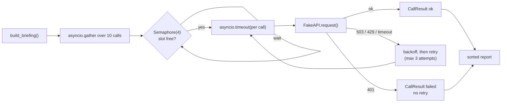

# Lab: Call 10 APIs Concurrently

> 📚 **Before you start**
>
> - [Threads, Processes and Async](threads-processes-and-async.md)
> - [async and await for API Calls](async-and-await-for-api-calls.md)
> - [try/except and Custom Exceptions](../04-modules-and-exceptions/try-except-and-custom-exceptions.md) and [Error Handling Best Practices](../04-modules-and-exceptions/error-handling-best-practices.md)

## What You'll Build

A "morning briefing" backend for a travel app. To build one user's briefing it must call **ten different services**: weather, train status, cricket score, currency rates, news, air quality, a translation API, an embeddings API, a stock quote and finally an LLM. Like real services, they misbehave:

- some are slow, one never answers at all,
- some fail with a temporary `503` and then recover,
- one answers `429 Too Many Requests` and says how long to wait,
- one rejects the API key with a permanent `401`.

You'll build an async client that calls all ten **concurrently**, **at most four at a time**, with a **per-call timeout**, **retries with exponential backoff** for temporary failures only, and a **clear report** of what succeeded and what failed, plus a fair comparison with the sequential version.



> 💡 **Key Insight**
>
> Wrap **one** call with all the protections (slot, timeout, retry, error translation) and make it **always return a result object** instead of raising. Then running ten, or ten thousand, is a single `gather`, and one bad service can never take down the whole briefing.

Run the blocks in order in one file or notebook. The services are simulated with `asyncio.sleep`, so the lab runs offline in well under a second. Because real timings vary between runs, the output shows outcomes, attempt counts and the peak number of simultaneous calls, which don't.

---

## Step 1: Simulate Ten Unreliable Services

Each fake service has a latency and a **script** of outcomes for successive calls, for example "fail with 503, then succeed". That makes the misbehaviour deterministic, so you can see exactly how the client reacts.

```python
import asyncio
import functools
import random
import time
from dataclasses import dataclass, field

class APIError(Exception):
    """Base class for errors from the fake services."""
    retryable = False

    def __init__(self, service, status, message):
        super().__init__(f"{service}: {status} {message}")
        self.service, self.status = service, status

class ServiceUnavailable(APIError):        # 503: temporary
    retryable = True

class RateLimited(APIError):               # 429: temporary, with a hint
    retryable = True

    def __init__(self, service, retry_after):
        super().__init__(service, 429, "too many requests")
        self.retry_after = retry_after

class Unauthorized(APIError):              # 401: permanent
    pass


class FakeAPI:
    def __init__(self, name, latency, script=("ok",), payload=None):
        self.name = name
        self.latency = latency
        self.script = list(script)         # outcome per call; the last one repeats
        self.payload = payload or f"{name} data"
        self.calls = 0

    async def request(self):
        outcome = self.script[min(self.calls, len(self.script) - 1)]
        self.calls += 1
        if outcome == "hang":
            await asyncio.sleep(10)        # never answers in time
        await asyncio.sleep(self.latency)
        if outcome == "503":
            raise ServiceUnavailable(self.name, 503, "overloaded")
        if outcome == "429":
            raise RateLimited(self.name, retry_after=0.02)
        if outcome == "401":
            raise Unauthorized(self.name, 401, "invalid API key")
        return self.payload


def make_services():
    return [
        FakeAPI("weather",      0.03, payload="Mumbai 31°C, humid"),
        FakeAPI("train_status", 0.05, ["503", "ok"], payload="12951 on time"),
        FakeAPI("cricket",      0.02, payload="IND 287/4 (45 ov)"),
        FakeAPI("currency",     0.01, payload="1 USD = 88.4 INR"),
        FakeAPI("news",         0.04, ["429", "ok"], payload="3 headlines"),
        FakeAPI("air_quality",  0.02, ["hang"]),
        FakeAPI("translate",    0.03, ["503", "503", "ok"], payload="नमस्ते, आपका दिन शुभ हो"),
        FakeAPI("embeddings",   0.02, payload="vector[1024]"),
        FakeAPI("stocks",       0.01, ["401"]),
        FakeAPI("llm_summary",  0.06, payload="Carry an umbrella; your train is on time."),
    ]

services = make_services()
print(len(services), "services")
print("sum of normal latencies:", round(sum(s.latency for s in services), 2), "s")
```

Output:

```
10 services
sum of normal latencies: 0.29 s
```

The sum of latencies is what a sequential client would wait **at best**, before any retries or timeouts.

---

## Step 2: The Result Object

Every call produces a `CallResult`, success or failure. Returning results instead of raising keeps one failure from cancelling or hiding the others:

```python
@dataclass
class CallResult:
    service: str
    ok: bool
    attempts: int
    value: str | None = None
    error: str | None = None

    def line(self):
        status = "OK  " if self.ok else "FAIL"
        detail = self.value if self.ok else self.error
        return f"{status} {self.service:<13} attempts={self.attempts}  {detail}"

print(CallResult("demo", True, 1, value="hello").line())
print(CallResult("demo", False, 3, error="timed out").line())
```

Output:

```
OK   demo          attempts=1  hello
FAIL demo          attempts=3  timed out
```

---

## Step 3: The Sequential Baseline

First, the simple version: call each service in turn, one attempt each, with a timeout so the hanging service can't block forever. This is what most first drafts look like:

```python
async def call_once(service, timeout):
    try:
        async with asyncio.timeout(timeout):
            return CallResult(service.name, True, 1, value=await service.request())
    except TimeoutError:
        return CallResult(service.name, False, 1, error=f"timed out after {timeout}s")
    except APIError as err:
        return CallResult(service.name, False, 1, error=str(err))

async def sequential_briefing(services, timeout=0.15):
    results = []
    for s in services:                              # one after another
        results.append(await call_once(s, timeout))
    return results

start = time.perf_counter()
seq_results = asyncio.run(sequential_briefing(make_services()))
seq_elapsed = time.perf_counter() - start

for r in seq_results:
    print(r.line())
print("succeeded:", sum(r.ok for r in seq_results), "of", len(seq_results))
```

Output:

```
OK   weather       attempts=1  Mumbai 31°C, humid
FAIL train_status  attempts=1  train_status: 503 overloaded
OK   cricket       attempts=1  IND 287/4 (45 ov)
OK   currency      attempts=1  1 USD = 88.4 INR
FAIL news          attempts=1  news: 429 too many requests
FAIL air_quality   attempts=1  timed out after 0.15s
FAIL translate     attempts=1  translate: 503 overloaded
OK   embeddings    attempts=1  vector[1024]
FAIL stocks        attempts=1  stocks: 401 invalid API key
OK   llm_summary   attempts=1  Carry an umbrella; your train is on time.
succeeded: 5 of 10
```

Slow (it waited for every service in turn, including the full timeout for the hanging one) and fragile (three services that would have succeeded on a retry are reported as failures).

---

## Step 4: One Call, Fully Protected

Now the heart of the lab: `call_with_protection` takes a slot from the semaphore, applies a per-attempt timeout, retries only **retryable** problems (503, 429, timeouts) with exponential backoff and jitter (or the server's `retry_after` hint), and converts everything into a `CallResult`. It also records how many calls are in flight, so we can verify the limit.

```python
@dataclass
class Limits:
    max_concurrent: int = 4
    timeout: float = 0.15          # per attempt
    attempts: int = 3
    base_delay: float = 0.01       # backoff: 0.01, 0.02, 0.04 ... (with jitter)

class Tracker:
    def __init__(self):
        self.in_flight = 0
        self.peak = 0
        self.retries = []          # (service, attempt, reason)

    def enter(self):
        self.in_flight += 1
        self.peak = max(self.peak, self.in_flight)

    def leave(self):
        self.in_flight -= 1


async def call_with_protection(service, sem, limits, tracker, rng):
    last_error = "no attempts made"
    for attempt in range(1, limits.attempts + 1):
        async with sem:                                   # at most max_concurrent at once
            tracker.enter()
            try:
                async with asyncio.timeout(limits.timeout):
                    value = await service.request()
                return CallResult(service.name, True, attempt, value=value)
            except TimeoutError:
                last_error, retryable, wait = f"timed out after {limits.timeout}s", True, None
            except APIError as err:
                last_error, retryable = str(err), err.retryable
                wait = getattr(err, "retry_after", None)
            finally:
                tracker.leave()

        if not retryable or attempt == limits.attempts:
            return CallResult(service.name, False, attempt, error=last_error)
        tracker.retries.append((service.name, attempt, last_error.split(": ", 1)[-1]))
        if wait is None:
            wait = rng.uniform(0, limits.base_delay * 2 ** (attempt - 1))
        await asyncio.sleep(wait)                         # back off OUTSIDE the semaphore
```

Design decisions worth noticing:

- **The backoff sleep happens after leaving the `async with sem` block**, so a service waiting to retry doesn't hold one of the four slots.
- **The timeout wraps each attempt**, not the whole retry loop, so every attempt gets a fair amount of time. (Section 8 adds an overall deadline.)
- **`finally: tracker.leave()`** keeps the in-flight count correct whether the attempt succeeds, fails, or is cancelled.
- **`Unauthorized` has `retryable = False`**, so it fails after one attempt: retrying a bad API key only wastes time and quota.

---

## Step 5: Run All Ten Concurrently

```python
async def concurrent_briefing(services, limits=Limits(), seed=7):
    sem = asyncio.Semaphore(limits.max_concurrent)
    tracker = Tracker()
    rng = random.Random(seed)
    results = await asyncio.gather(
        *(call_with_protection(s, sem, limits, tracker, rng) for s in services)
    )
    return results, tracker

start = time.perf_counter()
results, tracker = asyncio.run(concurrent_briefing(make_services()))
conc_elapsed = time.perf_counter() - start

for r in sorted(results, key=lambda r: (not r.ok, r.service)):
    print(r.line())
print()
print("succeeded:", sum(r.ok for r in results), "of", len(results))
print("peak simultaneous calls:", tracker.peak)
print("retries:", sorted(tracker.retries))
```

Output:

```
OK   cricket       attempts=1  IND 287/4 (45 ov)
OK   currency      attempts=1  1 USD = 88.4 INR
OK   embeddings    attempts=1  vector[1024]
OK   llm_summary   attempts=1  Carry an umbrella; your train is on time.
OK   news          attempts=2  3 headlines
OK   train_status  attempts=2  12951 on time
OK   translate     attempts=3  नमस्ते, आपका दिन शुभ हो
OK   weather       attempts=1  Mumbai 31°C, humid
FAIL air_quality   attempts=3  timed out after 0.15s
FAIL stocks        attempts=1  stocks: 401 invalid API key

succeeded: 8 of 10
peak simultaneous calls: 4
retries: [('air_quality', 1, 'timed out after 0.15s'), ('air_quality', 2, 'timed out after 0.15s'), ('news', 1, '429 too many requests'), ('train_status', 1, '503 overloaded'), ('translate', 1, '503 overloaded'), ('translate', 2, '503 overloaded')]
```

Compare with the sequential run: the same ten services, but now `train_status`, `news` and `translate` recover through retries, `stocks` fails fast with a clear reason (no pointless retries), and `air_quality` is reported as timed out after three attempts instead of hanging the briefing. The tracker confirms that no more than four calls were ever in flight.

---

## Step 6: Was It Actually Faster?

The naive sequential run in Step 3 isn't a fair opponent: it gave up on three services that a retry would have rescued. A fair comparison runs **the same protected calls one at a time** (a semaphore of 1). Wall-clock times vary between machines and runs, so we compare them rather than print them:

```python
start = time.perf_counter()
one_at_a_time, _ = asyncio.run(concurrent_briefing(make_services(), Limits(max_concurrent=1)))
serial_elapsed = time.perf_counter() - start

same_outcomes = [(r.service, r.ok) for r in one_at_a_time] == [(r.service, r.ok) for r in results]
print("same outcomes either way:", same_outcomes)
print("4-at-a-time faster than 1-at-a-time:", conc_elapsed < serial_elapsed)
print("total attempts:", sum(r.attempts for r in results))
```

Output:

```
same outcomes either way: True
4-at-a-time faster than 1-at-a-time: True
total attempts: 16
```

Both runs make the same 16 attempts and reach the same outcomes; only the waiting overlaps. One at a time, you pay for every wait in turn: all ten latencies, every retry, every backoff and all three of `air_quality`'s timeouts. Four at a time, the total is close to the longest single chain of waits (`air_quality`'s three timeouts plus backoff), with almost everything else hidden underneath it. That chain also shows the limit of concurrency: **the batch can never finish faster than its slowest call**, which is why the next step adds an overall deadline.

---

## Step 7: Assemble the Briefing

The results feed the final step. In a real app the last call would send the gathered facts to an LLM; here we just build the text, and degrade gracefully when a section is missing:

```python
def briefing_text(results):
    by_name = {r.service: r for r in results}
    def section(name, label):
        r = by_name[name]
        return f"{label}: {r.value}" if r.ok else f"{label}: unavailable"
    lines = [
        section("weather", "Weather"),
        section("train_status", "Your train"),
        section("air_quality", "Air quality"),
        section("cricket", "Cricket"),
        section("translate", "Greeting"),
        section("llm_summary", "Summary"),
    ]
    failed = sorted(r.service for r in results if not r.ok)
    if failed:
        lines.append(f"(Some sections are missing: {', '.join(failed)})")
    return "\n".join(lines)

print(briefing_text(results))
```

Output:

```
Weather: Mumbai 31°C, humid
Your train: 12951 on time
Air quality: unavailable
Cricket: IND 287/4 (45 ov)
Greeting: नमस्ते, आपका दिन शुभ हो
Summary: Carry an umbrella; your train is on time.
(Some sections are missing: air_quality, stocks)
```

Partial success is a feature: the user gets nine-tenths of a briefing instead of an error page.

---

## Step 8: An Overall Deadline

Per-attempt timeouts bound each call, but the user shouldn't wait longer than, say, 0.25 seconds for the whole briefing. Wrap the whole batch in `asyncio.timeout`, and collect whatever finished in time. Using tasks lets us keep the results that did complete:

```python
async def briefing_with_deadline(services, deadline, limits=Limits()):
    sem = asyncio.Semaphore(limits.max_concurrent)
    tracker, rng = Tracker(), random.Random(7)
    tasks = {s.name: asyncio.create_task(call_with_protection(s, sem, limits, tracker, rng))
             for s in services}
    try:
        async with asyncio.timeout(deadline):
            await asyncio.gather(*tasks.values())
    except TimeoutError:
        pass                                            # the timeout cancelled the unfinished tasks
    finished = {name: t.result() for name, t in tasks.items() if not t.cancelled()}
    cancelled = sorted(name for name, t in tasks.items() if t.cancelled())
    return finished, cancelled

finished, cancelled = asyncio.run(briefing_with_deadline(make_services(), deadline=0.25))
print("finished in time:", sorted(finished))
print("cut off by the deadline:", cancelled)
```

Output:

```
finished in time: ['cricket', 'currency', 'embeddings', 'llm_summary', 'news', 'stocks', 'train_status', 'translate', 'weather']
cut off by the deadline: ['air_quality']
```

When the deadline passes, `asyncio.timeout` cancels the `gather`, and `gather` cancels the tasks still running. Tasks that had already finished keep their results. `air_quality` was still on its second attempt, so it was cut off; everything else made it.

---

## Step 9: The Real Version

With real services, only `FakeAPI.request` changes. Here is the shape with `httpx` and the Anthropic SDK; `call_with_protection` stays exactly as it is, with the HTTP status codes translated into the same exception classes:

```python
# not-run: needs network access, API keys, and the httpx and anthropic packages
import httpx
from anthropic import AsyncAnthropic

http = httpx.AsyncClient(timeout=10.0)          # one shared client for all HTTP services
llm = AsyncAnthropic(max_retries=0)             # our own retry loop handles retries

class HttpService:
    def __init__(self, name, url):
        self.name, self.url = name, url

    async def request(self):
        response = await http.get(self.url)
        if response.status_code == 429:
            raise RateLimited(self.name, float(response.headers.get("retry-after", "1")))
        if response.status_code in (502, 503, 504):
            raise ServiceUnavailable(self.name, response.status_code, "unavailable")
        if response.status_code in (401, 403):
            raise Unauthorized(self.name, response.status_code, "check the API key")
        response.raise_for_status()
        return response.text[:200]

class LLMService:
    name = "llm_summary"

    async def request(self):
        message = await llm.messages.create(
            model="claude-opus-5-5",
            max_tokens=200,
            messages=[{"role": "user", "content": "Write a two-line travel briefing for Mumbai."}],
        )
        return message.content[0].text
```

Remember to close the shared client when the app shuts down (`await http.aclose()`), or create it with `async with httpx.AsyncClient() as http:` around the whole batch.

---

## Try It Yourself

1. **Tune the limit.** Run `concurrent_briefing` with `Limits(max_concurrent=1)` and `Limits(max_concurrent=10)`. Print the peak each time and check which run is faster.
2. **Give up sooner on hangs.** Make timeouts non-retryable (only one attempt for a timeout). How many attempts does `air_quality` make now, and does the batch finish faster?
3. **Circuit breaker (stretch).** Add a `failures` counter per service name; once a service has failed 2 calls in a row, return a failed `CallResult` immediately without calling it. Simulate two briefings in a row and show that `stocks` isn't called the second time.

<details>
<summary>Show answers</summary>

**1.**

```python
timings = {}
for limit in (1, 10):
    start = time.perf_counter()
    res, trk = asyncio.run(concurrent_briefing(make_services(), Limits(max_concurrent=limit)))
    timings[limit] = time.perf_counter() - start
    print(limit, "-> peak", trk.peak, "| succeeded", sum(r.ok for r in res))
print("limit 10 faster than limit 1:", timings[10] < timings[1])
```

Output:

```
1 -> peak 1 | succeeded 8
10 -> peak 10 | succeeded 8
limit 10 faster than limit 1: True
```

With a limit of 1 the calls run one at a time, like the sequential version but with retries.

**2.** Treat `TimeoutError` as permanent by changing one value in its `except` clause:

```python
async def call_no_timeout_retry(service, sem, limits, tracker, rng):
    for attempt in range(1, limits.attempts + 1):
        async with sem:
            tracker.enter()
            try:
                async with asyncio.timeout(limits.timeout):
                    return CallResult(service.name, True, attempt, value=await service.request())
            except TimeoutError:
                return CallResult(service.name, False, attempt, error="timed out (not retried)")
            except APIError as err:
                if not err.retryable or attempt == limits.attempts:
                    return CallResult(service.name, False, attempt, error=str(err))
                wait = getattr(err, "retry_after", None) or rng.uniform(0, limits.base_delay * 2 ** (attempt - 1))
            finally:
                tracker.leave()
        await asyncio.sleep(wait)

async def run(call):
    sem, tracker, rng, limits = asyncio.Semaphore(4), Tracker(), random.Random(7), Limits()
    return await asyncio.gather(*(call(s, sem, limits, tracker, rng) for s in make_services()))

start = time.perf_counter()
res = asyncio.run(run(call_no_timeout_retry))
fast = time.perf_counter() - start
print([r.line() for r in res if r.service == "air_quality"][0])
print("faster than retrying timeouts:", fast < conc_elapsed)
```

Output:

```
FAIL air_quality   attempts=1  timed out (not retried)
faster than retrying timeouts: True
```

**3.**

```python
consecutive_failures = {}

async def call_with_breaker(service, sem, limits, tracker, rng):
    if consecutive_failures.get(service.name, 0) >= 2:
        return CallResult(service.name, False, 0, error="circuit open: skipped")
    result = await call_with_protection(service, sem, limits, tracker, rng)
    consecutive_failures[service.name] = 0 if result.ok else consecutive_failures.get(service.name, 0) + 1
    return result

stocks_calls = []
for day in (1, 2, 3):
    svcs = make_services()
    res = asyncio.run(run(call_with_breaker))
    stocks = next(r for r in res if r.service == "stocks")
    print(f"briefing {day}: stocks -> {stocks.error} (attempts={stocks.attempts})")
```

Output:

```
briefing 1: stocks -> stocks: 401 invalid API key (attempts=1)
briefing 2: stocks -> stocks: 401 invalid API key (attempts=1)
briefing 3: stocks -> circuit open: skipped (attempts=0)
```

After two consecutive failures the breaker "opens" and the broken service is skipped, saving time and quota until someone fixes the key. (A production circuit breaker also closes again after a cool-down period to test whether the service has recovered.)

</details>

---

## What You've Learned

- **One fully protected call** (semaphore slot, per-attempt timeout, selective retries with backoff, error translation) that always returns a result object.
- **Concurrency with `gather`** and a **bounded number of simultaneous calls**, verified with a peak counter.
- **Retrying only what's transient**: 503, 429 (honouring `retry_after`) and timeouts, never 401.
- **Overall deadlines** with `asyncio.timeout` around a batch, keeping the results that finished in time.
- **Graceful degradation**: partial results build a useful response instead of an error.
- **Measuring fairly**: comparing runs rather than printing machine-dependent timings.

---

**Up next:** You've finished Advanced Python Programming. Continue with [Production APIs with FastAPI](../../production-apis-with-fastapi/course.md), where these async patterns power real web services, or [Generative AI and LLM Foundations](../../generative-ai-and-llm-foundations/course.md).
