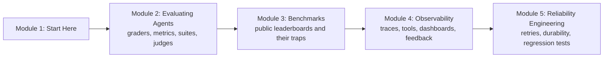

# How This Course Works

## Introduction

Think about how Indian Railways knows whether the Rajdhani is running well. Nobody stands on the platform and says "it feels fast today". There is a timetable that says what *should* happen, there are station logs that record when the train *actually* arrived at each stop, and there are maintenance rules (spare engines, signal checks, a plan for when a track is blocked) that keep the train moving when something breaks. Take away any one of the three and the railway is flying blind.

Agents need the same three things, and this course teaches all of them:

1. **Evals** say what *should* happen and check whether it did. Did the support agent actually issue the right refund, or did it only *say* it did?
2. **Observability** records what *actually* happened inside every run: which model calls, which tool calls, with what inputs, how long, and at what cost.
3. **Reliability engineering** keeps the agent working when the world misbehaves: an API times out, a model provider rate-limits you, a server restarts halfway through a 40-step task.

You have built agents in earlier courses. You have watched them work in a demo. This course answers the question every team hits next: **how do you *know* your agent works, keep knowing it after every change, and keep it working when things fail?**

> 💡 **Key Insight**
>
> A demo shows that an agent *can* work once. An eval suite shows *how often* it works, a trace shows *why* a particular run failed, and reliability engineering makes sure a failure in the world doesn't become a failure of the task. You need all three before real users depend on an agent.

---

## What You Will Learn

By the end of this course you will be able to:

- **Explain why agents are harder to evaluate** than single model calls: many valid paths, randomness, side effects on the world, and long runs where small mistakes compound.
- **Grade agents three ways**: by the final outcome (what changed in the world), by the trajectory (the steps it took) and by individual tool calls.
- **Choose and combine graders**: code checks, LLM judges and human reviewers, each where it fits.
- **Measure properly**: pass@k versus pass^k, run-to-run noise, confidence intervals, and why a 2-point lead on a leaderboard may mean nothing.
- **Build an eval suite from real failures**, write LLM-judge rubrics, and calibrate a judge against human labels.
- **Read the major agent benchmarks** (SWE-bench, Terminal-Bench, tau-bench, GAIA, OSWorld, BrowseComp and more) and spot contamination and eval awareness.
- **Trace agents with OpenTelemetry's GenAI conventions**, set up LangSmith with zero code changes, and compare Langfuse, Opik, Arize Phoenix and Braintrust.
- **Build cost, latency and token dashboards**, run feedback and annotation loops, and set up prompt optimisation pipelines.
- **Make agents reliable**: retries with backoff, timeouts, idempotent tools, durable execution with LangGraph checkpoints and Temporal, and regression tests that make model upgrades safe.

### The course at a glance

- **Module 2** is about *your own* evals: how to decide whether one agent run succeeded, how to turn many runs into trustworthy numbers, and how to build a suite that grows with your product. It ends with a lab where you build a complete eval suite for a support agent.
- **Module 3** looks outward at *public* benchmarks: what each one measures, how it is graded, and why scores can mislead.
- **Module 4** is about *seeing inside* runs: traces and spans, the OpenTelemetry GenAI standard, the main observability platforms, dashboards, human feedback and prompt optimisation. It ends with a lab that sends the same app's traces to LangSmith and Opik.
- **Module 5** is about *surviving failure*: making each step safe to retry, making a whole run survive a crash, and making sure a prompt or model change doesn't silently break what used to work.

### One agent, all the way through

To keep things concrete, most lessons use the same running example: a **customer support agent for "Kirana Express"**, a pretend online grocery shop. It has four tools:

| Tool | What it does |
|---|---|
| `lookup_order(order_id)` | Returns the order: items, amount in rupees, delivery status |
| `check_refund_policy(reason)` | Says whether a reason (damaged, late, missing item) qualifies for a refund |
| `issue_refund(order_id, amount)` | Credits money back to the customer's UPI account. **This changes the world.** |
| `escalate(order_id, note)` | Hands the case to a human agent |

It's small enough to understand in a minute, and it has every hard part of a real agent: several valid ways to reach the right answer, a tool that moves money, and customers who phrase things in many different ways.

---

## How Every Lesson Is Built

| Section | What it gives you |
|---|---|
| **Before you start** | Links to the earlier lessons this one depends on. |
| **Introduction** | Why the topic matters, with an everyday example. |
| **Key Insight** | The one idea to remember. |
| **Core Explanation** | The topic step by step, with diagrams, tables and runnable code. |
| **Try It Yourself** | Exercises, with answers hidden in a fold. |
| **Real-World Examples** | How teams use the idea. |
| **Common Misconceptions** | Mistakes almost everyone makes, corrected. |
| **Interview Relevance** | What interviewers ask and what a strong answer covers. |
| **Key Takeaways** | A one-minute summary for revision. |

**Labs** are guided builds. This course has two: an eval suite for the Kirana Express agent (Module 2) and tracing one app in two observability platforms (Module 4).

---

## What You Need Before Starting

This is an advanced course. It assumes you have done the following, all earlier on this site:

- **The agent loop and tool calling.** [The Agent Loop: Decide, Act, Observe](../../agentic-ai-fundamentals/03-the-agent-loop/the-agent-loop-decide-act-observe.md) and [Function Calling Step by Step](../../agentic-ai-fundamentals/04-tools-and-function-calling/function-calling-step-by-step.md).
- **LangGraph**, including checkpointers and threads. [Persistence and Checkpointers](../../langgraph-complete-guide/06-chatbots-and-persistence/persistence-and-checkpointers.md) and [LangSmith Observability for LangGraph](../../langgraph-complete-guide/10-deployment-and-observability/langsmith-observability-for-langgraph.md) are the most useful.
- **Agent frameworks.** [Agent Frameworks and SDKs](../../agent-frameworks-and-sdks/course.md), because several tracing integrations hook into those SDKs.
- **RAG evaluation.** [Retrieval-Augmented Generation (RAG) › RAG Evaluation](../../retrieval-augmented-generation-rag/course.md#m9) introduced LLM-as-a-judge and the RAG triad. This course builds on it for agents.
- **A little statistics.** [Statistics for Data Science › Distributions](../../statistics-for-data-science/course.md#m6) (the binomial distribution) and [Estimation](../../statistics-for-data-science/course.md#m7) (confidence intervals) are used in the lesson on noise.
- **Python 3.10 or newer** with the packages in the site's `requirements-lessons.txt` (LangGraph, LangChain Core, NumPy, pandas, scikit-learn, statsmodels and a few others).

### Do I need API keys or accounts?

No, not to learn. Every runnable example uses a pretend agent, LangChain's `FakeListChatModel`, or plain Python, so it runs offline and prints exactly what the lesson shows. Code that needs a real model, a real LangSmith or Opik account, OpenTelemetry packages or a Temporal server is shown in blocks marked `# not-run`, written against the current libraries, with example output. Where the lesson couldn't run something itself, it says so.

---

## How to Get the Most Out of It

1. **Read transcripts, not just scores.** Every lesson that shows a number also shows the run behind it. Make it a habit: a score you haven't looked behind is a score you can't trust.
2. **Run the code, then break it.** Change a grader, add noise, crash a run halfway. Seeing a metric move when you expect it to (and stay still when you don't) is how intuition is built.
3. **Keep one agent of your own in mind.** As you read, ask "what would this look like for the agent I'm building?" The labs are templates you can copy.
4. **Be suspicious of small differences.** By Module 2's lesson on noise you'll know why a 3-point improvement on 50 tasks is often luck.

---

## Common Misconceptions

### "If the demo works, the agent works"

A demo is one run on a friendly input. Agents are random and face inputs you didn't imagine. Only many runs on many tasks tell you the real success rate.

### "Observability is just logging"

Logs are flat lines of text. A trace keeps the *structure* of a run (which tool call happened inside which step, caused by which model call) along with timings, tokens and cost. That structure is what makes agent debugging possible.

### "Reliability is the infrastructure team's job"

Some of it is. But only the agent builder knows which tool moves money, which step is safe to repeat and what "done" means. Retries, idempotency and durable execution have to be designed into the agent.

---

## Key Takeaways

- **Evals, observability and reliability** answer three different questions: does it work, why did this run fail, and will it keep working when things break.
- **Module 2** builds your own eval suite, **Module 3** reads public benchmarks, **Module 4** traces and monitors runs, **Module 5** makes runs survive failure.
- **One running example**, the Kirana Express support agent, connects the lessons.
- **No API key is needed**: runnable code is offline; real-service code is clearly marked `# not-run`.

---

**Up next:** [Why Agent Evals Are Hard](../02-evaluating-agents/why-agent-evals-are-hard.md)
