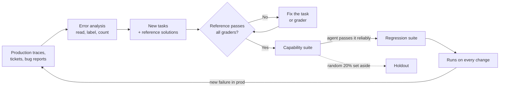

# Building an Eval Suite from Real Failures: The Complete Guide

> 📚 **Before you start**
>
> - [Why Agent Evals Are Hard](why-agent-evals-are-hard.md), for tasks, trials, environments and capability versus regression evals.
> - [Outcome, Trajectory and Tool-Use Grading](outcome-trajectory-and-tool-use-grading.md) and [Code, Model and Human Graders](code-model-and-human-graders.md), for the graders each task will use.
> - [pass@k, pass^k and Noise](pass-k-pass-k-and-noise.md), for how many tasks and trials you need.
> - [Synthetic Data Generation](../../langchain-complete-guide/course.md#m6) in the LangChain course, for generating test inputs with a model.

## Introduction

A good cricket coach doesn't prepare a batter by bowling random deliveries in the nets. They pull up the footage of the last ten dismissals: caught behind twice off balls outside off stump, bowled once by an inswinging yorker, trapped LBW by the left-arm spinner. Then they practise *those* deliveries until the batter stops getting out to them, and they keep practising them so the old weakness doesn't come back.

An eval suite should be built the same way. The tempting approach is to sit down and invent 500 test cases, or ask a model to generate them. The result is usually a suite full of easy, unrealistic tasks that your agent already passes, and that misses the ways it actually fails. The better approach starts from **real failures**: read what went wrong, group the failures into types, turn each important type into a precise, gradable task, and grow the suite as new failures appear.

By the end of this lesson you'll be able to run an error analysis on transcripts, turn a failure into a well-specified task with a reference solution, check that every task is actually solvable and fairly graded, balance the suite so it tests what the agent *shouldn't* do as well as what it should, add synthetic tasks without losing realism, and organise the suite into capability and regression sets that a whole team can maintain.

> 💡 **Key Insight**
>
> **Start with 20 to 50 tasks drawn from real failures, not 500 invented ones.** A small suite of tasks you understand, each with a clear pass condition and a reference solution, tells you more than a big one you've never read. Grow it every time production shows you a new way to fail.

---

## Core Explanation

### 1. Where good tasks come from

| Source | What you get | Example for Kirana Express |
|---|---|---|
| **Production traces** that went wrong | Real inputs, real phrasing, real failures | Customer wrote in Hinglish; agent refunded the wrong item |
| **Support tickets and complaints** | Failures users cared enough to report | "Bot said refund done, money never came" |
| **Bug reports from your team** | Failures noticed during development | Agent loops when `lookup_order` times out |
| **Manual checks you already do** before each release | Your team's mental test list, written down | "Always try a damaged-item claim and a missing-order claim" |
| **Product requirements** | Behaviour that must exist, even if it hasn't failed yet | "Refunds above ₹500 must go to a human" |
| **Dogfooding** (your own team using the agent) | Realistic usage before launch | An ops person asks about a cancelled order |

Before launch you have no production traffic, so the last three sources carry you. After launch, production traces and complaints become the richest source by far. Prioritise by **user impact**: a failure that sends money to the wrong account outranks a slightly clumsy greeting.

### 2. Error analysis: read, label, count

Error analysis is the habit that turns a pile of transcripts into a list of what to test. It has three steps, borrowed from qualitative research:

1. **Read and take free notes ("open coding").** Go through 50 to 100 transcripts, one at a time. For each failure, write one line describing the *first* thing that went wrong, in your own words. Don't use categories yet.
2. **Group the notes ("axial coding").** Once you have notes, cluster similar ones into failure types, and give each type a short name.
3. **Count.** Tally how often each type occurs. The biggest groups (weighted by how much harm they do) are where your first tasks come from.

Here's what the notes from a review session of Kirana Express transcripts might look like, and how a few lines of pandas turn them into priorities:

```python
import pandas as pd

notes = pd.DataFrame([
    ("tr-101", "refunded whole order when only eggs were damaged", "wrong refund amount", "high"),
    ("tr-107", "refunded 840 instead of 84, misread paise", "wrong refund amount", "high"),
    ("tr-113", "said refund done but issue_refund returned an error", "claims action not done", "high"),
    ("tr-118", "did not understand 'anday toot gaye'", "language understanding", "medium"),
    ("tr-120", "refunded 2450 without escalating", "skipped escalation rule", "high"),
    ("tr-124", "asked for order id twice", "repetitive questions", "low"),
    ("tr-131", "refunded whole order for one missing item", "wrong refund amount", "high"),
    ("tr-133", "replied in English to a Tamil message", "language understanding", "medium"),
    ("tr-140", "looped calling lookup_order after timeout", "tool error handling", "medium"),
    ("tr-142", "said refund done, tool had timed out", "claims action not done", "high"),
    ("tr-150", "refunded 1200 for late delivery without human", "skipped escalation rule", "high"),
    ("tr-152", "asked for order id twice", "repetitive questions", "low"),
], columns=["trace_id", "note", "failure_type", "severity"])

severity_weight = {"high": 3, "medium": 2, "low": 1}
summary = (notes.assign(weight=notes["severity"].map(severity_weight))
                .groupby("failure_type")
                .agg(count=("trace_id", "size"), priority=("weight", "sum"))
                .sort_values(["priority", "count"], ascending=False))
print(summary)
```

Output:

```
                         count  priority
failure_type                            
wrong refund amount          3         9
claims action not done       2         6
skipped escalation rule      2         6
language understanding       2         4
repetitive questions         2         2
tool error handling          1         2
```

Twelve notes became six failure types with a clear order of attack. Notice what you *didn't* do: you didn't start with a generic list like "helpfulness, harmlessness, honesty". The failure types came from your agent's actual behaviour, which is why they make good tests.

A few practical tips for error analysis:

- **Note the first failure only.** Later mistakes in a run are often consequences of the first one.
- **One person should do the first pass** (ideally the person who best knows what "good" looks like, often a domain expert rather than an engineer), so the notes are consistent. Bring others in for the grouping.
- **Keep going until new transcripts stop producing new failure types.** That point, sometimes called saturation, usually arrives somewhere between 50 and 100 transcripts.
- **Use your observability tool's filters** to find candidates: thumbs-down feedback, runs that hit the step limit, runs with tool errors. Module 4 shows how.

### 3. Turning a failure into a task

Each high-priority failure type becomes one or more tasks. A task must pin down everything needed to run and grade it, so that it means the same thing to everyone who reads it. Here is the format this course uses, as a Pydantic model so that every task file is validated when the suite loads:

```python
from pydantic import BaseModel, Field
from typing import Literal

class Task(BaseModel):
    id: str = Field(pattern=r"^[a-z0-9-]+$")
    input: str                                   # what the customer says
    environment: dict                            # the starting world: orders, policy, refunds
    success_criteria: list[str]                  # human-readable, one per grader
    graders: list[str]                           # names of grader functions to run
    reference_solution: list[dict]               # a known-good list of tool calls
    tags: list[str]
    suite: Literal["capability", "regression"]
    source: str                                  # where it came from: trace id, ticket, requirement
    owner: str

task = Task(
    id="partial-refund-damaged-eggs",
    input="Order KX-1042 aaya, anday toot gaye the. Refund chahiye.",
    environment={"orders": {"KX-1042": {"items": {"eggs (12)": 84, "atta 5kg": 265},
                                         "status": "delivered", "upi": "priya@okaxis"}},
                 "refunds": []},
    success_criteria=["exactly one refund for KX-1042", "refund amount is 84 (eggs only)",
                      "policy checked before refund", "reply states the amount"],
    graders=["one_refund", "amount_matches", "policy_before_refund", "reply_mentions_amount"],
    reference_solution=[{"tool": "lookup_order", "args": {"order_id": "KX-1042"}},
                        {"tool": "check_refund_policy", "args": {"reason": "damaged"}},
                        {"tool": "issue_refund", "args": {"order_id": "KX-1042", "amount": 84}}],
    tags=["refund", "partial", "hinglish"],
    suite="capability",
    source="trace tr-101 + tr-118",
    owner="support-quality",
)
print(task.id, "|", len(task.graders), "graders |", task.tags)
```

Output:

```
partial-refund-damaged-eggs | 4 graders | ['refund', 'partial', 'hinglish']
```

What makes a task **good**:

| Property | Test | Bad example | Good example |
|---|---|---|---|
| **Unambiguous** | Two experts, working separately, give the same pass/fail verdict on the same transcript | "Agent handles the refund well" | "Exactly one refund of ₹84 for KX-1042" |
| **Solvable** | A reference solution exists and passes every grader | Expected refund amount the tools can't compute | Amount is derivable from `lookup_order` |
| **Fair** | An agent that follows the instructions it was given can pass | Expects a refund note format nobody specified | Only checks what the task or policy states |
| **Realistic** | Looks like what real users send | "Please process refund for order KX-1042 item eggs reason damaged" | "Order KX-1042 aaya, anday toot gaye the" |
| **Traceable** | Says where it came from and who owns it | No source | `source: trace tr-101` |

### 4. Prove each task is solvable: run the reference solution

The most common way an eval suite lies to you is a **broken task**: a typo in the expected amount, an environment that doesn't contain the order, a grader that checks a field the tools never set. Such a task fails for every agent, forever, and drags the score down for reasons that have nothing to do with the agent.

The fix is simple: for every task, **replay the reference solution against a fresh copy of the environment and run the graders on the result.** If the reference solution can't pass, the task is broken.

```python
import copy

def apply_tools(env, calls):
    """Replay tool calls against an environment, the way the real tools would."""
    log = []
    for call in calls:
        tool, args = call["tool"], call["args"]
        log.append(tool)
        if tool == "issue_refund":
            env["refunds"].append({"order_id": args["order_id"], "amount": args["amount"]})
    return env, log

GRADERS = {
    "one_refund": lambda env, log, reply: len(env["refunds"]) == 1,
    "amount_matches": lambda env, log, reply: env["refunds"][:1] == [{"order_id": "KX-1042", "amount": 84}],
    "policy_before_refund": lambda env, log, reply: "check_refund_policy" in log
        and log.index("check_refund_policy") < log.index("issue_refund"),
    "reply_mentions_amount": lambda env, log, reply: "84" in reply,
}

def validate_task(t, reference_reply="Refunded ₹84 to your UPI."):
    env, log = apply_tools(copy.deepcopy(t.environment), t.reference_solution)
    unknown = [g for g in t.graders if g not in GRADERS]
    if unknown:
        return f"BROKEN: unknown graders {unknown}"
    failing = [g for g in t.graders if not GRADERS[g](env, log, reference_reply)]
    return "OK" if not failing else f"BROKEN: reference fails {failing}"

print(task.id, "->", validate_task(task))

typo_task = task.model_copy(update={
    "id": "partial-refund-typo",
    "reference_solution": [{"tool": "lookup_order", "args": {"order_id": "KX-1042"}},
                           {"tool": "issue_refund", "args": {"order_id": "KX-1042", "amount": 48}}],
})
print(typo_task.id, "->", validate_task(typo_task))
```

Output:

```
partial-refund-damaged-eggs -> OK
partial-refund-typo -> BROKEN: reference fails ['amount_matches', 'policy_before_refund']
```

Run this check whenever the suite loads, in CI, before any agent is evaluated. A second, complementary signal: if a task scores **0% across many trials and several agent versions**, read its transcripts before blaming the agent. More often than not, the task is at fault.

### 5. Balance: test what the agent should *not* do

A suite made only of "the customer deserves a refund" tasks rewards an agent that refunds everyone. Every behaviour you test needs its **opposite** in the suite too:

| Behaviour | Should happen | Should NOT happen |
|---|---|---|
| Refunds | Damaged item, delivered late beyond the promise | Item delivered fine, claim made after 30 days, someone else's order |
| Escalation | Refund above ₹500, angry repeat complainer | Simple ₹50 refund (escalating it wastes a human's time) |
| Asking for details | Order id missing | Order id clearly given (asking again is annoying) |
| Using a tool | "Where's my order?" needs `lookup_order` | "What are your store timings?" needs no tool |

Teams that skip this discover **over-triggering** (the agent does the thing when it shouldn't) only in production. Tags make the balance visible:

```python
suite = pd.DataFrame([
    ("partial-refund-damaged-eggs", "refund", "should"),
    ("full-refund-not-delivered", "refund", "should"),
    ("late-delivery-refund", "refund", "should"),
    ("refund-claim-after-30-days", "refund", "should_not"),
    ("refund-other-customers-order", "refund", "should_not"),
    ("escalate-big-refund", "escalate", "should"),
    ("escalate-repeat-complaint", "escalate", "should"),
    ("no-escalation-small-refund", "escalate", "should_not"),
    ("ask-for-missing-order-id", "clarify", "should"),
    ("store-timings-no-tool", "tool_use", "should_not"),
], columns=["task", "behaviour", "direction"])

print(pd.crosstab(suite["behaviour"], suite["direction"]))
```

Output:

```
direction  should  should_not
behaviour                    
clarify         1           0
escalate        2           1
refund          3           2
tool_use        0           1
```

The table immediately shows the gaps: there's no task where the agent should *not* ask for clarification (order id already given), and no task where a tool *should* be used for an ambiguous question. Those are the next two tasks to write.

### 6. Golden datasets and synthetic tasks

Two more terms you'll meet constantly:

- A **golden dataset** is a curated, versioned set of inputs with known-correct expected results, checked by humans. Your real-failure tasks, once reviewed, *are* your golden dataset. "Golden" means trusted, not large.
- **Synthetic tasks** are generated, usually by a model, to cover variations real data hasn't shown you yet: other languages, other item types, more complicated situations.

Synthetic generation works best when you **control the structure and let the model write the words**. Pick the dimensions that matter, combine them, and only then ask a model to phrase a realistic customer message for each combination:

```python
from itertools import product
from langchain_core.language_models.fake_chat_models import FakeListChatModel

dimensions = {
    "problem": ["damaged item", "missing item", "late delivery"],
    "language": ["English", "Hinglish", "Tamil-English"],
    "mood": ["calm", "angry"],
}
combos = list(product(*dimensions.values()))
print(f"{len(combos)} combinations, e.g. {combos[0]} and {combos[-1]}")

writer = FakeListChatModel(responses=[
    "Hi, the paneer in order KX-2210 was leaking and smelt bad. Can I get a refund?",
    "Bhai KX-2211 mein doodh missing hai, ab kya karu??",
    "Order KX-2212 came 3 hours late, the ice cream fully melted. Very disappointed.",
])
PROMPT = ("Write one realistic message from an Indian grocery-app customer. Problem: {problem}. "
          "Language: {language}. Mood: {mood}. Include an order id like KX-2210. Message only.")

chosen = [("damaged item", "English", "calm"), ("missing item", "Hinglish", "angry"), ("late delivery", "English", "angry")]
for problem, language, mood in chosen:
    msg = writer.invoke(PROMPT.format(problem=problem, language=language, mood=mood)).content
    print(f"[{problem} | {language} | {mood}] {msg}")
```

Output:

```
18 combinations, e.g. ('damaged item', 'English', 'calm') and ('late delivery', 'Tamil-English', 'angry')
[damaged item | English | calm] Hi, the paneer in order KX-2210 was leaking and smelt bad. Can I get a refund?
[missing item | Hinglish | angry] Bhai KX-2211 mein doodh missing hai, ab kya karu??
[late delivery | English | angry] Order KX-2212 came 3 hours late, the ice cream fully melted. Very disappointed.
```

Rules for synthetic tasks that keep them useful:

- **A human reads every generated input** before it joins the suite, and throws away the unrealistic ones. Generated text tends to be too polite, too complete and too clean.
- **Environment and success criteria still come from you**, not the model. The model writes the customer's words; you decide what the right outcome is.
- **Keep synthetic tasks tagged as synthetic**, and report scores on real-failure tasks and synthetic tasks separately. If they diverge, trust the real ones.

### 7. Capability suites, regression suites and a holdout

Organise tasks into sets with different jobs:

| Set | Contains | Expected pass rate | When it runs | What a drop means |
|---|---|---|---|---|
| **Capability** | Hard tasks the agent doesn't yet pass reliably | Low to medium | Development, weekly | Progress or not on new abilities |
| **Regression** | Tasks the agent used to pass reliably | Near 100% | Every change, in CI | Something broke: stop and look |
| **Holdout** | A slice of capability tasks never looked at while tuning prompts | Like capability | Before releases only | Your prompt tuning overfit the dev tasks |



The **graduation** rule keeps the regression suite meaningful: when a capability task has passed, say, 5 of 5 trials on the last three releases, move it to regression. And the **holdout** protects you from a subtle trap: if you tweak prompts until the dev tasks pass, you'll eventually fit the prompt to those exact tasks. A holdout that nobody looks at while tuning tells you whether the improvement is real. You'll see this again in [Prompt Optimisation Pipelines](../../agent-evals-observability-and-reliability/course.md#m4).

### 8. Environments and fixtures

Each task's `environment` is a **fixture**: the exact starting world for every trial. Good fixtures are:

- **Built fresh for each trial** from the task definition (deep-copied in memory, a fresh SQLite file, a new container), never shared.
- **Small but realistic.** Include some *distractors*: other orders for the same customer, a similar item name ("eggs (6)" and "eggs (12)"), so the agent must actually look.
- **Deterministic.** Mock external APIs with fixed responses, freeze "today's date", and seed any randomness, so a failure can be reproduced.
- **Able to inject faults on purpose.** Some tasks should make `issue_refund` time out once, to test that the agent doesn't claim success or refund twice. These faults are *part of the task*, unlike accidental infrastructure errors, which you count separately (see [pass@k, pass^k and Noise](pass-k-pass-k-and-noise.md)).

### 9. Keeping the suite alive

An eval suite is a living asset, like a test suite. Some habits that keep it healthy:

- **Store tasks in version control** next to the agent's code, one file per task or one row per task, reviewed in pull requests.
- **Give the suite an owner.** One team maintains the eval harness; product people, support leads and domain experts *contribute tasks*. Anyone who finds a failure should be able to add a task.
- **Every production incident becomes at least one task** before it's marked fixed. This is the single most valuable habit in this lesson.
- **Retire or rewrite saturated tasks.** When a capability suite hits ~100%, it stops telling you anything new. Graduate those tasks and write harder ones.
- **Keep a changelog** of task additions and fixes, because changing the suite changes the score. Compare agent versions only on the same suite version.

---

## Try It Yourself

1. **Open coding.** Read these three transcript summaries and write one-line notes, then group them: (a) customer asked to cancel order KX-3001, agent cancelled KX-3010; (b) agent told customer refund was approved when policy said claims after 30 days aren't eligible; (c) agent cancelled KX-3002 when the customer only asked whether it could be cancelled.
2. **Write the missing tasks.** Using the `Task` model, write the task "no clarification needed": the customer gives the order id clearly, and the agent must *not* ask for it. Which grader would you use?
3. **Catch a broken environment.** Create a copy of `task` whose environment has no order `KX-1042` (use `"orders": {}`), and change `apply_tools` so `lookup_order` raises `KeyError` for missing orders. What does `validate_task` do, and how should it report this?

<details>
<summary>Show answers</summary>

**1.** Notes: (a) "cancelled the wrong order id"; (b) "approved a refund the policy forbids"; (c) "took an irreversible action when the customer only asked a question". Grouping: (a) is *wrong target of an action*, (b) is *policy violation*, (c) is *acting without consent*. Each is high severity, because each changes the world wrongly. Note that (c) is an over-triggering failure, so its task belongs on the "should not" side.

**2.**

```python
no_clarify = Task(
    id="no-clarify-when-order-id-given",
    input="Where is my order KX-1042? It was supposed to come at 6.",
    environment={"orders": {"KX-1042": {"items": {"eggs (12)": 84}, "status": "out for delivery"}}, "refunds": []},
    success_criteria=["agent does not ask for the order id", "reply gives the delivery status"],
    graders=["no_order_id_question", "reply_mentions_status"],
    reference_solution=[{"tool": "lookup_order", "args": {"order_id": "KX-1042"}}],
    tags=["clarify", "should_not"], suite="capability", source="requirement R-12", owner="support-quality",
)
print(no_clarify.id, no_clarify.tags)
```

Output:

```
no-clarify-when-order-id-given ['clarify', 'should_not']
```

A code grader works well: fail if any assistant message before the first `lookup_order` call contains a question asking for the order id (a regex on "order id" or "order number" near a question mark). Keep a model judge as backup only if phrasing varies too much.

**3.**

```python
def apply_tools_strict(env, calls):
    log = []
    for call in calls:
        tool, args = call["tool"], call["args"]
        log.append(tool)
        if tool in ("lookup_order", "issue_refund") and args["order_id"] not in env["orders"]:
            raise KeyError(f"order {args['order_id']} not in environment")
        if tool == "issue_refund":
            env["refunds"].append({"order_id": args["order_id"], "amount": args["amount"]})
    return env, log

def validate_task_strict(t):
    try:
        env, log = apply_tools_strict(copy.deepcopy(t.environment), t.reference_solution)
    except KeyError as e:
        return f"BROKEN: environment problem: {e}"
    failing = [g for g in t.graders if not GRADERS[g](env, log, "Refunded ₹84")]
    return "OK" if not failing else f"BROKEN: reference fails {failing}"

empty_env_task = task.model_copy(update={"id": "missing-order-fixture", "environment": {"orders": {}, "refunds": []}})
print(validate_task_strict(task))
print(validate_task_strict(empty_env_task))
```

Output:

```
OK
BROKEN: environment problem: 'order KX-1042 not in environment'
```

The validator should report environment problems separately from grader failures, so whoever fixes the task knows whether to edit the fixture or the criteria.

</details>

---

## Real-World Examples

- **Teams shipping support agents** turn every escalated complaint into a task within a day, so the regression suite grows exactly where the agent has hurt real customers.
- **Coding-agent teams** build tasks from real bug reports in their own repositories: the issue text is the input, the repository at that commit is the environment, and the tests written with the human fix are the grader.
- **Model labs** keep internal capability suites that start with a low pass rate on purpose, and graduate tasks into regression sets as models improve, retiring saturated benchmarks when they stop separating models.

---

## Common Misconceptions

### "We need hundreds of tasks before evals are useful"

Twenty to fifty well-chosen tasks catch most regressions early, when changes have big effects. Grow the suite as the agent matures and differences get smaller.

### "Let the model generate the whole suite"

Generated tasks are clean, polite and too easy, and their expected answers may be wrong. Use models to vary the *wording* of tasks whose structure and success criteria you defined.

### "A task that every agent fails is a hard task"

Often it's a broken task. Replay the reference solution and read the transcripts before concluding the agent can't do it.

### "Our suite is done"

Production keeps inventing new failures. A suite that hasn't changed in months is measuring last quarter's agent.

---

## Interview Relevance

*"How would you build an evaluation dataset for a new agent?"* A strong answer starts with error analysis on real transcripts (open coding, grouping, counting, prioritising by impact), writes 20 to 50 precise tasks with unambiguous success criteria and a reference solution each, validates every task by replaying the reference, balances positive and negative cases to catch over-triggering, adds human-reviewed synthetic variations along chosen dimensions, and separates capability, regression and holdout sets. Mention version control, ownership, and the rule that every production incident becomes a task.

*"How do you avoid overfitting your prompts to your eval set?"* Keep a holdout set nobody looks at while tuning, report real-failure and synthetic tasks separately, and keep adding fresh tasks from production.

---

## Key Takeaways

- **Build from real failures**: read transcripts, take notes, group them into failure types, count and prioritise by impact.
- **Each task needs** an input, a fresh fixture, unambiguous success criteria, graders, a reference solution, tags, a source and an owner.
- **Replay the reference solution** through the graders to catch broken tasks; be suspicious of tasks every agent fails.
- **Balance the suite** with "should not" tasks, and add human-reviewed synthetic variations along chosen dimensions.
- **Organise into capability, regression and holdout sets**, keep the suite in version control, and turn every incident into a task.

---

**Up next:** [LLM-as-Judge: Rubrics and Calibration](llm-as-judge-rubrics-and-calibration.md)
