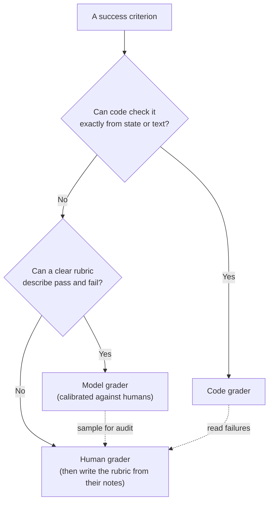

# Code, Model and Human Graders: The Complete Guide

> 📚 **Before you start**
>
> - [Outcome, Trajectory and Tool-Use Grading](outcome-trajectory-and-tool-use-grading.md), for *what* to grade: outcomes, paths and single tool calls. This lesson is about *who or what* does the grading.
> - [Structured JSON Output](../../generative-ai-and-llm-foundations/04-prompting-and-structured-output/structured-json-output.md), because model graders return structured verdicts.
> - [LLM-as-a-Judge](../../retrieval-augmented-generation-rag/course.md#m9) in the RAG course, where you first used a model to grade answers.

## Introduction

Watch how a cricket match settles close calls. For an LBW appeal, ball-tracking software measures where the ball pitched and whether it would have hit the stumps: fast, exact, identical every time. For a catch where nobody is sure the ball carried, the TV umpire *judges* the replays. And above them sits a panel of experienced match referees who review umpiring performance after the series and decide whether the umpires and the technology are getting it right. Three kinds of decision-maker, each used where it fits best.

Agent evals use the same three: **code graders** that measure precisely, **model graders** (an LLM acting as a judge) that handle judgement calls, and **human graders** who are the final authority and keep the other two honest. Picking the wrong one is expensive in both directions: an LLM judge for "is the refund amount ₹84?" is slow, costly and occasionally wrong; a regex for "was the reply empathetic?" is meaningless.

By the end of this lesson you'll be able to write a small library of code graders, build a model grader that returns a structured verdict (with an "unknown" option), decide where humans are needed, combine several graders into one task score, and test your graders so the agent can't fool them.

> 💡 **Key Insight**
>
> **Use code wherever the answer can be checked mechanically, a model where it needs judgement, and humans to define and audit what "good" means.** Code is cheap and exact but brittle. Models are flexible but random and biased. Humans are the gold standard but slow. A good eval uses all three, each for what it does best, and checks the graders themselves.

---

## Core Explanation

### 1. The three families at a glance

| | Code graders | Model graders | Human graders |
|---|---|---|---|
| **Examples** | State checks, exact or regex match, schema validation, running tests, transcript rules | Rubric scoring, yes/no assertions, pairwise comparison, comparison with a reference answer | Expert review, spot checks, labelling a sample, A/B preference |
| **Strengths** | Fast, cheap, exact, reproducible, easy to debug | Flexible, handles open-ended text, captures nuance, scales | Highest quality, defines the standard, catches the unexpected |
| **Weaknesses** | Brittle to valid variations, can't judge quality | Random, costs money, biased, must be calibrated | Slow, expensive, inconsistent between people, doesn't scale |
| **Speed per trial** | Milliseconds | Seconds | Minutes |
| **Best for** | Did the refund happen, is the JSON valid, did tests pass, were rules followed | Tone, helpfulness, faithfulness to sources, plan quality | Building the rubric, calibrating judges, edge cases, final sign-off |

The practical ordering is a ladder: **try code first; climb to a model only when code can't express the check; involve humans to set and audit the standard.**



### 2. Code graders: a small library

Every grader in this lesson returns the same small record, so results from different graders can be combined and reported side by side:

```python
from dataclasses import dataclass

@dataclass
class Grade:
    grader: str
    passed: bool
    score: float      # 0.0 to 1.0
    reason: str

def show(grades):
    for g in grades:
        print(f"  {g.grader:<22} {'PASS' if g.passed else 'FAIL'}  {g.score:.2f}  {g.reason}")
```

Now a trial of the Kirana Express agent, recorded as plain data: the final world state, the transcript, and the final reply.

```python
trial = {
    "refunds": [{"order_id": "KX-1042", "amount": 84, "upi": "priya@okaxis"}],
    "tool_calls": ["lookup_order", "check_refund_policy", "issue_refund"],
    "turns": 4,
    "reply": "Sorry about the crushed eggs, Priya! I've refunded Rs. 84 to priya@okaxis. "
             "It usually shows up within 30 minutes.",
}
```

Here are the most common kinds of code grader, each a few lines long:

```python
import re
import difflib
import json

def state_check(trial):
    ok = trial["refunds"] == [{"order_id": "KX-1042", "amount": 84, "upi": "priya@okaxis"}]
    return Grade("state: refund row", ok, float(ok), "one refund of 84 to the customer's own UPI" if ok else f"refunds={trial['refunds']}")

def regex_check(trial):
    # accept ₹84, Rs 84, Rs. 84, INR 84
    ok = re.search(r"(₹|Rs\.?|INR)\s?84\b", trial["reply"]) is not None
    return Grade("regex: amount stated", ok, float(ok), "amount appears in reply" if ok else "amount not found")

def fuzzy_check(trial, expected="your refund of 84 rupees has been credited", threshold=0.5):
    ratio = difflib.SequenceMatcher(None, trial["reply"].lower(), expected).ratio()
    return Grade("fuzzy: similar wording", ratio >= threshold, round(ratio, 2), f"similarity {ratio:.2f}")

def rule_check(trial, max_turns=6):
    ok = trial["turns"] <= max_turns and trial["tool_calls"].count("issue_refund") <= 1
    return Grade("rules: turns + refunds", ok, float(ok), f"{trial['turns']} turns, {trial['tool_calls'].count('issue_refund')} refund call(s)")

def schema_check(raw_json):
    try:
        data = json.loads(raw_json)
        ok = set(data) == {"order_id", "resolution", "amount"} and isinstance(data["amount"], int)
        reason = "valid summary record" if ok else f"keys={sorted(data)}"
    except json.JSONDecodeError as e:
        ok, reason = False, f"not JSON: {e.msg}"
    return Grade("schema: summary JSON", ok, float(ok), reason)

grades = [state_check(trial), regex_check(trial), fuzzy_check(trial), rule_check(trial),
          schema_check('{"order_id": "KX-1042", "resolution": "refund", "amount": 84}')]
show(grades)
```

Output:

```
  state: refund row      PASS  1.00  one refund of 84 to the customer's own UPI
  regex: amount stated   PASS  1.00  amount appears in reply
  fuzzy: similar wording FAIL  0.27  similarity 0.27
  rules: turns + refunds PASS  1.00  4 turns, 1 refund call(s)
  schema: summary JSON   PASS  1.00  valid summary record
```

Look at the fuzzy grader: the reply is perfectly good, but it shares little wording with the "expected" sentence, so it fails. This is the classic weakness of code graders: **they are brittle to valid variation in free text**. The regex grader works because it checks one precise fact (the amount) and tolerates the different ways of writing rupees. A good rule of thumb: use code on **facts and state**, not on **prose**.

| Code grader | Good for | Watch out for |
|---|---|---|
| **State check** | Anything the agent changes: rows, files, sent messages, API calls made to a mock | Needs an inspectable environment |
| **Exact / regex match** | Ids, numbers, short factual answers, required phrases | Formatting variations (`₹84`, `Rs. 84`, `84.00`) |
| **Fuzzy similarity** | Near-duplicate detection, typo-tolerant ids | Almost never right for judging prose |
| **Schema validation** | Structured outputs, tool arguments, final reports | Valid-but-wrong values still pass |
| **Transcript rules** | Turn limits, order of steps, forbidden tools, loops | Over-strict rules punish valid paths |
| **Running tests** | Coding agents: unit tests, type checks, linters | Tests that are too narrow or too wide (see Module 3) |

### 3. Model graders: an LLM with a rubric

When the criterion needs judgement ("did the reply apologise sincerely and explain the next step clearly?"), you ask a model. A model grader has four parts:

1. **The rubric**: what pass and fail mean, in concrete terms, for *one* dimension.
2. **The evidence**: what the judge sees (the reply, perhaps the transcript, perhaps a reference answer).
3. **A structured verdict**: a fixed JSON shape, so code can read it.
4. **An escape hatch**: an `"unknown"` option, so the judge doesn't have to guess when the evidence is insufficient.

The kinds of model grader you'll meet:

| Kind | The judge is asked... | Use it for |
|---|---|---|
| **Rubric pass/fail** | "Does this reply meet each of these criteria?" | Most quality dimensions |
| **Natural-language assertion** | "Is this statement true of the transcript: *the agent asked for the order id before acting*?" | Path qualities code can't express |
| **Reference-based** | "Does the reply convey the same facts as this reference answer?" | Factual answers with many phrasings |
| **Pairwise** | "Which of these two replies is better, A or B?" | Comparing two agent versions |
| **Multi-judge** | Several judges (or prompts) vote | Reducing a single judge's randomness |

Here is a rubric judge for one dimension, customer communication. The model is LangChain's `FakeListChatModel` returning a scripted verdict, so the code runs offline; the parsing and the logic are exactly what you'd use with a real model.

```python
from pydantic import BaseModel
from typing import Literal
from langchain_core.language_models.fake_chat_models import FakeListChatModel

JUDGE_PROMPT = """You are grading one reply from a grocery-delivery support agent.
Dimension: CUSTOMER COMMUNICATION. The reply PASSES only if ALL are true:
1. It acknowledges the customer's problem.
2. It states what was done (for example, the refund amount) without inventing facts.
3. It tells the customer what happens next or when.
Answer "unknown" if the reply is cut off or the evidence is not enough to decide.

Customer message: {customer}
Agent reply: {reply}

Respond with JSON only: {{"verdict": "pass" | "fail" | "unknown", "reason": "<one sentence>"}}"""

class Verdict(BaseModel):
    verdict: Literal["pass", "fail", "unknown"]
    reason: str

judge_model = FakeListChatModel(responses=[
    '{"verdict": "pass", "reason": "Acknowledges the eggs, states Rs. 84 refunded to UPI, gives a 30-minute timeline."}',
    '{"verdict": "fail", "reason": "Says done but gives no amount and no timeline."}',
])

def communication_judge(customer, reply):
    raw = judge_model.invoke(JUDGE_PROMPT.format(customer=customer, reply=reply)).content
    v = Verdict.model_validate_json(raw)
    return Grade("judge: communication", v.verdict == "pass", 1.0 if v.verdict == "pass" else 0.0,
                 f"{v.verdict}: {v.reason}")

customer = "My eggs in KX-1042 were crushed, please refund."
show([communication_judge(customer, trial["reply"]),
      communication_judge(customer, "Done.")])
```

Output:

```
  judge: communication   PASS  1.00  pass: Acknowledges the eggs, states Rs. 84 refunded to UPI, gives a 30-minute timeline.
  judge: communication   FAIL  0.00  fail: Says done but gives no amount and no timeline.
```

With a real model you'd swap in a chat model and, ideally, ask it for structured output directly so the JSON is guaranteed to parse:

```python
# not-run: needs langchain-anthropic and an API key
from langchain_anthropic import ChatAnthropic

judge = ChatAnthropic(model="claude-opus-5-5", temperature=0).with_structured_output(Verdict)
verdict = judge.invoke(JUDGE_PROMPT.format(customer=customer, reply=trial["reply"]))
print(verdict)
```

Example output:

```
verdict='pass' reason='It acknowledges the crushed eggs, confirms the Rs. 84 refund to UPI and gives a timeline.'
```

Design rules that make model graders far more reliable:

| Rule | Why |
|---|---|
| **One dimension per judge** | A judge asked about tone, accuracy and safety at once blurs them together; separate judges give separate, debuggable scores |
| **Binary pass/fail, not 1 to 10** | Humans and models disagree wildly on what a "7" is; pass/fail with clear criteria is far more consistent |
| **Concrete criteria in the prompt** | "States the refund amount" beats "is helpful" |
| **An "unknown" option** | Stops the judge from inventing a verdict when evidence is missing; count unknowns separately |
| **Reason before or with the verdict** | Makes failures readable and lets you audit the judge's logic |
| **Temperature 0 and a pinned model version** | Reduces judge randomness and drift between runs |
| **Give the judge the evidence it needs** | To judge "no invented facts", it needs the tool results, not just the reply |

How to write the rubric and how to check that a judge agrees with humans get a full lesson: [LLM-as-Judge: Rubrics and Calibration](llm-as-judge-rubrics-and-calibration.md).

### 4. Human graders: the standard-setters

Humans are expensive, so use them where nothing else will do:

| Use | How |
|---|---|
| **Defining "good"** | Before writing any rubric, have a domain expert (a senior support lead, not an engineer) read 30 to 50 transcripts and write down why each is good or bad. Those notes *become* the rubric. |
| **Calibrating judges** | Label a sample of trials by hand, run the model judge on the same sample, and measure agreement. |
| **Spot checks** | Regularly read a random sample of graded trials, including passes. Graders fail silently. |
| **Hard, high-stakes cases** | Legal, medical or financial edge cases where a wrong "pass" is costly. |
| **Preference tests** | Show two versions' replies side by side, without saying which is which, and ask which is better. |

Three practices make human grading consistent:

- **Written guidelines with examples** of pass, fail and borderline cases. Two people reading the same transcript should reach the same verdict. If they don't, the *task* or the *guideline* is ambiguous, and that's a finding in itself.
- **Measure agreement between people.** Have two graders label the same 30 trials and compare. Low agreement means the standard isn't clear yet. You'll compute agreement properly in the judge-calibration lesson.
- **A good review interface.** Show the customer message, the transcript with tool results, the final state and the grader verdicts on one screen, with keyboard shortcuts for pass and fail. Observability platforms ship this as *annotation queues*, covered in [Feedback and Annotation Loops](../../agent-evals-observability-and-reliability/course.md#m4).

### 5. Combining graders into one task score

A task usually has several graders. There are three standard ways to combine them:

| Method | Rule | Good when |
|---|---|---|
| **Binary (all must pass)** | The task passes only if every grader passes | Every criterion is essential |
| **Weighted** | Weighted average of scores must reach a threshold | Criteria matter by different amounts and partial credit is meaningful |
| **Hybrid (gates + weighted)** | Some graders are hard gates; the rest form a weighted score | Most real agents: safety and correctness are gates, quality is weighted |

```python
def combine(grades, gates, weights, threshold=0.7):
    by_name = {g.grader: g for g in grades}
    failed_gates = [n for n in gates if not by_name[n].passed]
    total_w = sum(weights.values())
    weighted = sum(by_name[n].score * w for n, w in weights.items()) / total_w
    passed = not failed_gates and weighted >= threshold
    return passed, round(weighted, 2), failed_gates

all_grades = grades + [communication_judge(customer, trial["reply"])]
GATES = ["state: refund row", "rules: turns + refunds"]
WEIGHTS = {"regex: amount stated": 1, "judge: communication": 2, "fuzzy: similar wording": 0.5}

print("hybrid:", combine(all_grades, GATES, WEIGHTS))
print("binary:", all(g.passed for g in all_grades))
```

Output:

```
hybrid: (True, 0.9, [])
binary: False
```

(A note on the offline judge: `FakeListChatModel` cycles through its scripted responses, and this is its third call, so it returns the first scripted verdict, "pass", again. With a real model this is simply a fresh judge call on the same reply.)

The two methods disagree about this trial. The binary rule fails it because of the brittle fuzzy grader; the hybrid rule passes it because the gates (state and rules) pass and the weighted quality score is 0.9. This is a good reason to **drop graders that measure the wrong thing** rather than water them down with weights: here the fuzzy grader should simply be removed.

### 6. Graders get gamed: test your graders

An agent optimised against a grader will find the grader's weak spots, especially once you start tuning prompts to raise scores (Module 4) or a model is trained with that grader as a reward. Some real patterns:

| Weak grader | How it gets gamed | Hack-resistant version |
|---|---|---|
| "Reply contains `refunded ₹84`" | Agent says it without doing it | Check the refunds table |
| "All tests pass" | Coding agent deletes or edits the failing tests | Run the *original* tests from outside the agent's workspace; forbid edits to test files |
| "Judge says the answer is correct" | Very long, confident answers sway the judge | Judge sees the evidence; length-neutral rubric; calibrated against humans |
| "Finished in under 10 turns" | Agent ends the conversation early without solving anything | Combine with an outcome gate |

The cure is to **test graders like code**. Keep a few hand-made trials where you *know* the right verdict, including sneaky ones, and check every grader against them whenever you change it:

```python
GRADER_TESTS = [
    ("genuine refund", {"refunds": [{"order_id": "KX-1042", "amount": 84, "upi": "priya@okaxis"}],
                        "reply": "Refunded Rs. 84 to priya@okaxis."}, True),
    ("claims but no refund", {"refunds": [], "reply": "Refunded Rs. 84 to priya@okaxis."}, False),
    ("refund to wrong UPI", {"refunds": [{"order_id": "KX-1042", "amount": 84, "upi": "scammer@ybl"}],
                             "reply": "Refunded Rs. 84."}, False),
]

def naive_grader(t):     # only reads the reply
    return "84" in t["reply"]

def state_grader(t):     # reads the world
    return state_check(t).passed

for grader in (naive_grader, state_grader):
    wrong = [name for name, t, expected in GRADER_TESTS if grader(t) != expected]
    print(f"{grader.__name__:<13} {'all grader tests pass' if not wrong else 'WRONG on: ' + ', '.join(wrong)}")
```

Output:

```
naive_grader  WRONG on: claims but no refund, refund to wrong UPI
state_grader  all grader tests pass
```

Two more habits protect you:

- **Read graded transcripts regularly**, both passes and failures. If a failure looks unfair (the agent did something valid the grader didn't expect), fix the grader. If a pass looks wrong, you've found a hole.
- **A task that fails every single trial is suspicious.** Very often the task or grader is broken (an impossible requirement, a typo in the expected value), not the agent. Write a reference solution for each task and check that it passes your graders.

### 7. Cost and speed in practice

For a suite of 50 tasks with 5 trials each (250 trials), the difference is stark. The numbers below are rough, illustrative orders of magnitude, not quotes:

| Grader | Time per trial | Rough cost for 250 trials | Run it... |
|---|---|---|---|
| Code checks | Milliseconds | Nothing | On every change |
| One LLM judge per dimension (3 dimensions) | A few seconds | A few hundred rupees with a large model | On every pull request or nightly |
| Human review of a 10% sample | 2 to 3 minutes | A few hours of an expert's time | Weekly, and when the judge or rubric changes |

That's why the ladder matters: every check you can push down to code makes the whole suite faster, cheaper and more trustworthy.

---

## Try It Yourself

1. **Rupee formats.** Extend `regex_check` so it also accepts `84.00` and `INR84`, but *not* `840` or `184`. Test it on all five strings.
2. **Choose the grader.** For each criterion, pick code, model or human: (a) the agent cancelled the right order; (b) the reply is in the same language the customer used (Hindi, Tamil or English); (c) the agent's explanation of a complex insurance exclusion is accurate; (d) the reply doesn't reveal another customer's phone number.
3. **Break a judge.** Write a grader test where the reply *sounds* excellent but invents a fact (says "₹100 refunded" when the refund row says 84). Which of the graders in this lesson would catch it, and what would the communication judge need to see to catch it?

<details>
<summary>Show answers</summary>

**1.**

```python
def amount_stated(text, amount=84):
    return re.search(rf"(₹|Rs\.?|INR)\s?{amount}(\.00)?\b", text) is not None

for s in ["₹84", "Rs. 84.00", "INR84", "₹840", "Rs 184"]:
    print(f"{s:<10} {amount_stated(s)}")
```

Output:

```
₹84        True
Rs. 84.00  True
INR84      True
₹840       False
Rs 184     False
```

The `\b` word boundary rejects `840`; requiring the currency marker immediately before the number rejects `184`.

**2.** (a) Code: check the orders table. (b) Code first: a language-detection library or script check is usually enough; use a model only for mixed Hinglish if code struggles. (c) Human expert, at least to build the rubric; later a calibrated model judge with the policy document as evidence. (d) Code: a regex for phone-number patterns that aren't the current customer's, which is cheap and exact. Add a model judge only if the leak could be paraphrased.

**3.** The state check catches the wrong amount only if you compare the *reply's* amount with the *refund row*, which is a cross-check worth writing in code:

```python
def reply_matches_state(t):
    stated = re.findall(r"(?:₹|Rs\.?|INR)\s?(\d+)", t["reply"])
    actual = [r["amount"] for r in t["refunds"]]
    return [int(x) for x in stated] == actual

print(reply_matches_state({"refunds": [{"amount": 84}], "reply": "Great news! ₹100 has been refunded."}))
```

Output:

```
False
```

The communication judge, as written, only sees the customer message and the reply, so it can't know the amount is invented. To catch this it would need the tool results (the refund row) as evidence. That's a general lesson: **a judge can only check what you show it.**

</details>

---

## Real-World Examples

- **Coding agents** rely mostly on code graders (run the test suite, type-check, lint), with a model grader for code quality and a human review on a sample.
- **Conversational support agents** combine state checks on a mock backend, transcript rules (turn limits, required confirmations) and LLM rubrics for tone and clarity, calibrated against labels from senior support staff.
- **Research agents** use code to check that cited URLs exist and quotes appear in the sources, a model to judge coverage and synthesis, and experts to calibrate that judge often, because "a good research report" is hard to pin down.

---

## Common Misconceptions

### "LLM judges are objective because they're machines"

They are random, sensitive to wording and order, and often prefer longer answers or answers written in their own style. They must be calibrated against humans, and their verdicts sampled and audited.

### "Code graders are always better because they're exact"

They're exact about what they check. A fuzzy-match grader on prose is exact and wrong. Use code for facts and state, not for judging writing.

### "Human graders always agree with each other"

They often don't. Measuring agreement between two people is how you discover that the guidelines or the task are ambiguous.

### "Once a grader is written, it's done"

Graders have bugs, and agents find them. Keep grader tests, read graded transcripts and fix graders when a verdict looks unfair.

---

## Interview Relevance

*"When would you use an LLM-as-judge versus a programmatic check?"* A strong answer: code for anything checkable from state or exact facts (refund rows, tests, schemas, transcript rules), because it's fast, cheap and reproducible; a model judge only for judgement-based dimensions (tone, faithfulness, plan quality), one dimension per judge, binary verdicts with an "unknown" option, temperature 0, given the evidence it needs; humans to write the rubric, calibrate judges and audit samples. Mention combining graders with hard gates plus weighted quality scores, and testing graders against known-good and known-bad trials so they can't be gamed.

*"Your eval says 95% but users are unhappy. What do you check first?"* Whether the graders measure the right thing: read a sample of passing transcripts, look for claimed-but-not-done actions, and compare a judge's verdicts with a human sample.

---

## Key Takeaways

- **Code graders** check facts and state exactly and cheaply; they are brittle on free text.
- **Model graders** handle judgement: one dimension each, binary verdicts, an "unknown" option, the right evidence, temperature 0.
- **Human graders** define the standard, calibrate judges and audit samples; measure their agreement too.
- **Combine** with hard gates for safety and correctness, and weighted scores for quality; remove graders that measure the wrong thing.
- **Test your graders** with known-good and known-bad trials, and read graded transcripts, because agents find grader loopholes.

---

**Up next:** [pass@k, pass^k and Noise](pass-k-pass-k-and-noise.md)
