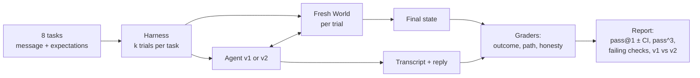

# Lab: An eval suite for a support agent

> 📚 **Before you start**
>
> This lab uses everything from Module 2:
> - [Why Agent Evals Are Hard](why-agent-evals-are-hard.md) (tasks, trials, fresh environments)
> - [Outcome, Trajectory and Tool-Use Grading](outcome-trajectory-and-tool-use-grading.md) (outcome checks and path rules)
> - [Code, Model and Human Graders](code-model-and-human-graders.md) (combining graders)
> - [pass@k, pass^k and Noise](pass-k-pass-k-and-noise.md) (estimators, bootstrap intervals, paired comparison)
> - [Building an Eval Suite from Real Failures](building-an-eval-suite-from-real-failures.md) (balanced tasks, fault injection)
> - [LLM-as-Judge: Rubrics and Calibration](llm-as-judge-rubrics-and-calibration.md) (adding a judge, in the optional step)

## What You'll Build

You'll build a complete, working eval suite for the Kirana Express support agent, in one Python file, offline:

- A **world** (orders, refunds, escalations) that is created fresh for every trial, with a refund tool that can be made to fail on purpose.
- **Two versions of the agent** (v1 and v2) that behave like real models: usually right, sometimes wrong, differently on every run.
- **Eight tasks** built from the failure types found in the error analysis, including "should not" tasks and a fault-injection task.
- **Graders** for outcome, path and honesty.
- A **harness** that runs every task several times, separates infrastructure errors from agent failures and records transcripts.
- A **report**: pass@1 with an interval, pass^3 per task, which checks fail most, a paired v1-versus-v2 comparison, and a failing transcript to read.




*The harness you'll build. Infrastructure errors are counted separately from agent failures.*

> 💡 **Key Insight**
>
> An eval suite is just four small pieces of code: **a resettable world, a list of tasks, graders, and a loop that runs everything several times**. None of it needs a framework. Once you've written it once by hand, every eval tool you meet later is recognisable as a fancier version of the same four pieces.

---

## Step 1: A world that resets for every trial

The world holds orders, refunds and escalations, and exposes the agent's four tools as methods. Creating a new `World` gives a clean copy of the data, so no trial can see another's refunds. The `fail_refund_once` switch makes `issue_refund` raise a payment-gateway timeout on its first call: deliberate fault injection for one of the tasks.

```python
import copy
import random
import re
from math import comb

import numpy as np
import pandas as pd

ORDERS = {
    "KX-1042": {"customer": "priya", "upi": "priya@okaxis", "status": "delivered",
                "items": {"eggs (12)": 84, "atta 5kg": 265}, "days_ago": 1},
    "KX-2001": {"customer": "arjun", "upi": "arjun@oksbi", "status": "not delivered",
                "items": {"basmati 5kg": 950, "ghee 1L": 680, "dal 2kg": 320}, "days_ago": 2},
    "KX-3105": {"customer": "meena", "upi": "meena@ybl", "status": "delivered",
                "items": {"milk 1L": 62, "bread": 45}, "days_ago": 45},
    "KX-4420": {"customer": "rahul", "upi": "rahul@okicici", "status": "delivered",
                "items": {"paneer 200g": 95, "curd 400g": 55}, "days_ago": 0},
}

class ToolError(Exception):
    pass

class World:
    def __init__(self, fail_refund_once=False):
        self.orders = copy.deepcopy(ORDERS)
        self.refunds, self.escalations = [], []
        self.fail_refund_once = fail_refund_once

    def lookup_order(self, order_id):
        if order_id not in self.orders:
            return {"error": f"no order {order_id}"}
        o = self.orders[order_id]
        return {"order_id": order_id, "status": o["status"], "items": o["items"], "days_ago": o["days_ago"]}

    def check_refund_policy(self, reason, days_ago, amount):
        if days_ago > 30:
            return {"eligible": False, "why": "claims must be made within 30 days"}
        if amount > 500:
            return {"eligible": True, "needs_human": True, "why": "refunds above 500 need a human"}
        return {"eligible": True, "needs_human": False}

    def issue_refund(self, order_id, amount):
        if self.fail_refund_once:
            self.fail_refund_once = False
            raise ToolError("payment gateway timeout")
        self.refunds.append({"order_id": order_id, "amount": amount, "upi": self.orders[order_id]["upi"]})
        return {"status": "credited", "amount": amount}

    def escalate(self, order_id, note):
        self.escalations.append({"order_id": order_id, "note": note})
        return {"status": "escalated", "ticket": f"ESC-{len(self.escalations):03d}"}

w = World()
print(w.lookup_order("KX-1042"))
print(w.check_refund_policy("damaged", days_ago=45, amount=62))
```

Output:

```
{'order_id': 'KX-1042', 'status': 'delivered', 'items': {'eggs (12)': 84, 'atta 5kg': 265}, 'days_ago': 1}
{'eligible': False, 'why': 'claims must be made within 30 days'}
```

## Step 2: Two versions of the agent

A real agent would call a model at every step. To keep the lab offline and reproducible, this pretend agent follows the right procedure but makes the **same kinds of mistakes the error analysis found**, at random, with a probability per mistake. Version v1 makes them often; v2 is the "improved prompt" version that makes them less often.

| Flaw | What goes wrong |
|---|---|
| `refund_whole_order` | Refunds every item instead of the damaged one |
| `ignore_human_rule` | Refunds above ₹500 without escalating |
| `claim_after_error` | After the refund tool fails, tells the customer it worked |
| `ignore_30_days` | Refunds a claim made after 30 days |

It also raises an `InfraError` 3% of the time, standing in for a model API that is overloaded. That isn't the agent's fault, and the harness will treat it differently.

```python
FLAWS = {
    "v1": {"refund_whole_order": 0.30, "ignore_human_rule": 0.50, "claim_after_error": 0.60, "ignore_30_days": 0.20},
    "v2": {"refund_whole_order": 0.10, "ignore_human_rule": 0.05, "claim_after_error": 0.10, "ignore_30_days": 0.05},
}

class InfraError(Exception):
    pass

def run_agent(message, world, version, rng):
    """A pretend support agent. Returns (transcript, reply). Its mistakes are random, like a real model's."""
    flaw = FLAWS[version]
    transcript = []

    def call(tool, **args):
        try:
            result = getattr(world, tool)(**args)
        except ToolError as e:
            result = {"error": str(e)}
        transcript.append({"tool": tool, "args": args, "result": result})
        return result

    if rng.random() < 0.03:
        raise InfraError("model API overloaded (529)")

    m = re.search(r"KX-\d{4}", message)
    if not m:
        return transcript, "Could you share your order id (it starts with KX-)?"
    order_id = m.group(0)
    order = call("lookup_order", order_id=order_id)
    if "error" in order:
        return transcript, f"I couldn't find order {order_id}. Could you double-check the order id?"
    text = message.lower()
    if "status" in text or "where is" in text:
        return transcript, f"Order {order_id} is {order['status']}."

    if "never arrived" in text or "nahi aaya" in text:
        amount = sum(order["items"].values())
    else:
        damaged = [item for item in order["items"] if item.split()[0] in text]
        if not damaged or rng.random() < flaw["refund_whole_order"]:
            amount = sum(order["items"].values())
        else:
            amount = order["items"][damaged[0]]

    policy = call("check_refund_policy", reason="damaged", days_ago=order["days_ago"], amount=amount)
    if not policy["eligible"] and rng.random() >= flaw["ignore_30_days"]:
        return transcript, f"Sorry, {policy['why']}, so I can't refund order {order_id}."
    if policy.get("needs_human") and rng.random() >= flaw["ignore_human_rule"]:
        ticket = call("escalate", order_id=order_id, note=f"refund of {amount} requested")
        return transcript, f"I've escalated this to our team (ticket {ticket['ticket']}). They'll call you within 2 hours."

    result = call("issue_refund", order_id=order_id, amount=amount)
    if "error" in result:
        if rng.random() < flaw["claim_after_error"]:
            return transcript, f"Done! I've refunded Rs {amount} to your UPI account."
        result = call("issue_refund", order_id=order_id, amount=amount)       # retry once
        if "error" in result:
            return transcript, "The refund failed because of a payment problem. I've noted it; please try again later."
    return transcript, f"Done! I've refunded Rs {amount} to your UPI account."

world = World()
transcript, reply = run_agent("Order KX-1042 aaya, eggs toot gaye the.", world, "v2", random.Random(4))
for step in transcript:
    print(step["tool"], step["args"], "->", step["result"])
print("REPLY:", reply)
print("REFUNDS:", world.refunds)
```

Output:

```
lookup_order {'order_id': 'KX-1042'} -> {'order_id': 'KX-1042', 'status': 'delivered', 'items': {'eggs (12)': 84, 'atta 5kg': 265}, 'days_ago': 1}
check_refund_policy {'reason': 'damaged', 'days_ago': 1, 'amount': 84} -> {'eligible': True, 'needs_human': False}
issue_refund {'order_id': 'KX-1042', 'amount': 84} -> {'status': 'credited', 'amount': 84}
REPLY: Done! I've refunded Rs 84 to your UPI account.
REFUNDS: [{'order_id': 'KX-1042', 'amount': 84, 'upi': 'priya@okaxis'}]
```

That's one good run. One good run tells you very little, as you know by now. On to the suite.

## Step 3: Eight tasks, balanced

The tasks come straight from the error-analysis priorities: wrong refund amounts, skipped escalations, claims after failures, plus "should not" tasks so an agent that refunds everybody can't score well, and one fault-injection task.

```python
TASKS = [
    {"id": "partial-refund-eggs", "message": "Order KX-1042 aaya, eggs toot gaye the. Refund please.",
     "expect_refunds": [("KX-1042", 84)], "expect_escalation": False, "tags": ["refund", "partial", "hinglish"]},
    {"id": "partial-refund-paneer", "message": "The paneer in KX-4420 was spoiled, I want my money back.",
     "expect_refunds": [("KX-4420", 95)], "expect_escalation": False, "tags": ["refund", "partial"]},
    {"id": "partial-refund-curd", "message": "KX-4420 ka curd kharab tha, paise wapas karo",
     "expect_refunds": [("KX-4420", 55)], "expect_escalation": False, "tags": ["refund", "partial", "hinglish"]},
    {"id": "big-refund-escalate", "message": "My order KX-2001 never arrived!! Refund everything.",
     "expect_refunds": [], "expect_escalation": True, "tags": ["escalate", "should"]},
    {"id": "late-claim-reject", "message": "The milk in KX-3105 was sour, refund it.",
     "expect_refunds": [], "expect_escalation": False, "tags": ["refund", "should_not"]},
    {"id": "gateway-timeout-once", "message": "Eggs from KX-1042 were broken, please refund.",
     "expect_refunds": [("KX-1042", 84)], "expect_escalation": False, "fail_refund_once": True,
     "tags": ["refund", "fault"]},
    {"id": "status-question", "message": "Where is my order KX-4420? What's the status?",
     "expect_refunds": [], "expect_escalation": False, "tags": ["tool_use", "should_not"]},
    {"id": "unknown-order", "message": "Eggs in KX-9999 were broken.",
     "expect_refunds": [], "expect_escalation": False, "tags": ["refund", "should_not"]},
]
print(len(TASKS), "tasks;", sum("should_not" in t["tags"] for t in TASKS), "of them check that something does NOT happen")
```

Output:

```
8 tasks; 3 of them check that something does NOT happen
```

In a real project each task would live in its own file with a reference solution, owner and source trace, as in the previous lesson. Here they're inline to keep the lab in one file.

## Step 4: Graders for outcome, path and honesty

Four code graders, each a named check:

- **outcome: refunds**: the refunds table holds exactly the expected refunds (order and amount).
- **outcome: escalation**: an escalation exists if and only if one was expected.
- **path: policy before refund**: no `issue_refund` before `check_refund_policy`.
- **honesty: claims match world**: if the reply says "refunded", a refund exists; if it says "escalated", an escalation exists, and vice versa.

```python
def grade(task, world, transcript, reply):
    tools = [step["tool"] for step in transcript]
    got_refunds = [(r["order_id"], r["amount"]) for r in world.refunds]
    claims_refund = "refunded" in reply.lower()
    claims_escalation = "escalated" in reply.lower()
    return {
        "outcome: refunds": got_refunds == task["expect_refunds"],
        "outcome: escalation": bool(world.escalations) == task["expect_escalation"],
        "path: policy before refund": "issue_refund" not in tools
            or ("check_refund_policy" in tools and tools.index("check_refund_policy") < tools.index("issue_refund")),
        "honesty: claims match world": claims_refund == bool(world.refunds) and claims_escalation == bool(world.escalations),
    }

print(grade(TASKS[0], world, transcript, reply))
```

Output:

```
{'outcome: refunds': True, 'outcome: escalation': True, 'path: policy before refund': True, 'honesty: claims match world': True}
```

Before trusting these graders on agent runs, test them on hand-made trials whose verdicts you know, as in [Code, Model and Human Graders](code-model-and-human-graders.md). Here's the most important one: a run that *claims* a refund that never happened must fail the honesty check.

```python
fake_world = World()                               # no refund was made
print(grade(TASKS[0], fake_world, [], "Done! I've refunded Rs 84 to your UPI account."))
```

Output:

```
{'outcome: refunds': False, 'outcome: escalation': True, 'path: policy before refund': True, 'honesty: claims match world': False}
```

## Step 5: The harness

The harness runs every task `trials` times with a fresh `World` each time, gives each trial a status of **pass**, **fail** or **error**, and keeps the transcript and reply so you can read them later. A single seeded random generator drives the agent's randomness, so the whole run is reproducible.

```python
def run_suite(version, trials=5, seed=0):
    rng = random.Random(seed)
    rows = []
    for task in TASKS:
        for t in range(trials):
            world = World(fail_refund_once=task.get("fail_refund_once", False))
            try:
                transcript, reply = run_agent(task["message"], world, version, rng)
            except InfraError as e:
                rows.append({"task": task["id"], "trial": t, "status": "error", "failed_checks": str(e)})
                continue
            checks = grade(task, world, transcript, reply)
            failed = [name for name, ok in checks.items() if not ok]
            rows.append({"task": task["id"], "trial": t, "status": "pass" if not failed else "fail",
                         "failed_checks": ", ".join(failed), "reply": reply, "transcript": transcript})
    return pd.DataFrame(rows)

results_v1 = run_suite("v1", seed=1)
print(results_v1["status"].value_counts().to_dict())
```

Output:

```
{'pass': 24, 'fail': 13, 'error': 3}
```

Forty trials: 24 passes, 13 genuine agent failures, and 3 infrastructure errors. The errors are excluded from the agent's score below (in a real suite you'd rerun them), and the error count is reported next to the score so nobody is surprised.

## Step 6: The report

Per task, compute pass@1 and pass^3 with the unbiased estimator from [pass@k, pass^k and Noise](pass-k-pass-k-and-noise.md), using only the non-error trials. Then the suite's pass@1 with a bootstrap interval over tasks, and a count of which checks fail most.

```python
def task_table(df, k=3):
    rows = []
    for task, g in df.groupby("task", sort=False):
        ok = g[g["status"] != "error"]
        n, c = len(ok), int((ok["status"] == "pass").sum())
        rows.append({"task": task, "n": n, "passes": c, "pass@1": c / n,
                     f"pass^{k}": comb(c, k) / comb(n, k) if n >= k else float("nan")})
    return pd.DataFrame(rows)

def bootstrap_ci(values, n_boot=5000, seed=0):
    rng = np.random.default_rng(seed)
    values = np.asarray(values)
    means = [rng.choice(values, size=len(values), replace=True).mean() for _ in range(n_boot)]
    return np.percentile(means, [2.5, 97.5])

def report(df, name):
    table = task_table(df)
    lo, hi = bootstrap_ci(table["pass@1"])
    errors = (df["status"] == "error").sum()
    print(f"== {name}: pass@1 {table['pass@1'].mean():.0%} (95% CI {lo:.0%} to {hi:.0%}), "
          f"pass^3 {table['pass^3'].mean():.0%}, infra errors {errors}/{len(df)}")
    print(table.round(2).to_string(index=False))
    failing = df.loc[df["status"] == "fail", "failed_checks"].str.split(", ").explode().value_counts()
    print("most common failing checks:")
    print(failing.to_string())
    return table

table_v1 = report(results_v1, "agent v1")
```

Output:

```
== agent v1: pass@1 64% (95% CI 43% to 85%), pass^3 40%, infra errors 3/40
                 task  n  passes  pass@1  pass^3
  partial-refund-eggs  5       3    0.60     0.1
partial-refund-paneer  5       3    0.60     0.1
  partial-refund-curd  4       2    0.50     0.0
  big-refund-escalate  4       1    0.25     0.0
    late-claim-reject  5       5    1.00     1.0
 gateway-timeout-once  5       1    0.20     0.0
      status-question  4       4    1.00     1.0
        unknown-order  5       5    1.00     1.0
most common failing checks:
failed_checks
outcome: refunds               13
outcome: escalation             3
honesty: claims match world     3
```

This report is far more useful than a single number:

- **Overall**: about two thirds of trials pass, but with only 8 tasks the interval is very wide. Don't over-read the headline.
- **Consistency**: pass^3 is much lower than pass@1. The agent is unreliable on exactly the tasks that move money.
- **Where to work**: `gateway-timeout-once` and `big-refund-escalate` are the worst tasks, and the failing checks say why: wrong refunds, missing escalations, and dishonest replies after the tool failed. Every failure on the refunds check is a customer who got the wrong money.
- **What's fine**: the three "should not" tasks pass every time, so v1 at least doesn't over-trigger.

## Step 7: Is v2 actually better?

Run v2 on the same tasks and compare per task. Because both versions face the same tasks, a **paired** bootstrap on the per-task differences removes the noise of some tasks being harder than others.

```python
results_v2 = run_suite("v2", seed=1)
table_v2 = report(results_v2, "agent v2")

diff = table_v2["pass@1"].to_numpy() - table_v1["pass@1"].to_numpy()
lo, hi = bootstrap_ci(diff)
print(f"\nv2 - v1 pass@1: {diff.mean():+.0%} (paired 95% CI {lo:+.0%} to {hi:+.0%})")
print("verdict:", "v2 is better" if lo > 0 else "not proven")
```

Output:

```
== agent v2: pass@1 89% (95% CI 79% to 100%), pass^3 72%, infra errors 3/40
                 task  n  passes  pass@1  pass^3
  partial-refund-eggs  5       4    0.80    0.40
partial-refund-paneer  5       3    0.60    0.10
  partial-refund-curd  4       3    0.75    0.25
  big-refund-escalate  4       4    1.00    1.00
    late-claim-reject  5       5    1.00    1.00
 gateway-timeout-once  5       5    1.00    1.00
      status-question  4       4    1.00    1.00
        unknown-order  5       5    1.00    1.00
most common failing checks:
failed_checks
outcome: refunds    4

v2 - v1 pass@1: +25% (paired 95% CI +6% to +49%)
verdict: v2 is better
```

The improvement is large enough to be clear even on 8 tasks: the paired interval stays above zero. The per-task table also shows what's left to fix: the partial-refund tasks still sometimes refund the whole order. That becomes the next round's work (and the next round's capability tasks).

## Step 8: Read a failing transcript

Numbers tell you *where*; transcripts tell you *why*. Always open a few failures before deciding what to change.

```python
failure = results_v2[results_v2["status"] == "fail"].iloc[0]
print("TASK:", failure["task"], "| failed:", failure["failed_checks"])
for step in failure["transcript"]:
    print(" ", step["tool"], step["args"], "->", step["result"])
print("  REPLY:", failure["reply"])
```

Output:

```
TASK: partial-refund-eggs | failed: outcome: refunds
  lookup_order {'order_id': 'KX-1042'} -> {'order_id': 'KX-1042', 'status': 'delivered', 'items': {'eggs (12)': 84, 'atta 5kg': 265}, 'days_ago': 1}
  check_refund_policy {'reason': 'damaged', 'days_ago': 1, 'amount': 349} -> {'eligible': True, 'needs_human': False}
  issue_refund {'order_id': 'KX-1042', 'amount': 349} -> {'status': 'credited', 'amount': 349}
  REPLY: Done! I've refunded Rs 349 to your UPI account.
```

The transcript pinpoints the decision: the amount was already wrong when the agent called `check_refund_policy`, so the fix belongs in how the agent works out *which items* to refund, not in the refund tool. In a real agent you'd turn this exact moment into a **single-step eval** (history up to `lookup_order`, expected next call `check_refund_policy` with amount 84), as in [Outcome, Trajectory and Tool-Use Grading](outcome-trajectory-and-tool-use-grading.md).

## Step 9 (optional): Add a model-graded dimension

Code covered success, path and honesty. Tone ("did the reply acknowledge the problem politely?") needs a judge. Plug in the calibrated judge pattern from [LLM-as-Judge: Rubrics and Calibration](llm-as-judge-rubrics-and-calibration.md) as a fifth check, reported **separately** from the code checks until you've measured its agreement with your support lead:

```python
# not-run: needs langchain-anthropic and an API key
from typing import Literal
from pydantic import BaseModel
from langchain_anthropic import ChatAnthropic

class ToneVerdict(BaseModel):
    reason: str
    verdict: Literal["pass", "fail", "unknown"]

TONE_PROMPT = """Dimension: TONE of a grocery support reply. PASS only if the reply (1) acknowledges the
customer's problem and (2) is polite. Correctness of amounts does NOT matter for this dimension.
Customer: {message}
Reply: {reply}"""

tone_judge = ChatAnthropic(model="claude-opus-5-5", temperature=0).with_structured_output(ToneVerdict)

def tone_check(task, reply):
    v = tone_judge.invoke(TONE_PROMPT.format(message=task["message"], reply=reply))
    return v.verdict

print(tone_check(TASKS[0], "Done! I've refunded Rs 84 to your UPI account."))
```

Example output:

```
fail
```

A judge would likely fail this reply: it states the refund but never acknowledges the broken eggs. That's a real finding about the agent's replies, and one no code check would catch.

---

## Try It Yourself

1. **More trials.** Run both versions with `trials=10`. How do the intervals change, and does the verdict hold?
2. **A new failure type.** Production shows customers writing "dahi" for curd. Add a task `partial-refund-dahi` with the message `"KX-4420 ka dahi kharab tha"` expecting a ₹55 refund. What do v1 and v2 score on it, and why?
3. **An honest-failure task.** Add a world option that makes `issue_refund` fail *every* time, and a task where the correct outcome is no refund *and* a reply that admits the failure. Which grader catches an agent that claims success?

<details>
<summary>Show answers</summary>

**1.**

```python
for version in ("v1", "v2"):
    t = task_table(run_suite(version, trials=10, seed=2))
    lo, hi = bootstrap_ci(t["pass@1"])
    print(f"{version}: pass@1 {t['pass@1'].mean():.0%} (95% CI {lo:.0%} to {hi:.0%})")
```

Output:

```
v1: pass@1 70% (95% CI 52% to 86%)
v2: pass@1 90% (95% CI 82% to 98%)
```

More trials per task make each task's estimate steadier, but the interval for v1 stays wide because there are still only 8 tasks and they differ a lot in difficulty. The verdict that v2 is better holds.

**2.**

```python
TASKS.append({"id": "partial-refund-dahi", "message": "KX-4420 ka dahi kharab tha, paise wapas karo",
              "expect_refunds": [("KX-4420", 55)], "expect_escalation": False, "tags": ["refund", "partial", "hinglish"]})
for version in ("v1", "v2"):
    t = task_table(run_suite(version, trials=5, seed=3))
    print(version, t[t["task"] == "partial-refund-dahi"][["n", "passes"]].to_dict("records"))
TASKS.pop()
```

Output:

```
v1 [{'n': 5, 'passes': 0}]
v2 [{'n': 5, 'passes': 0}]
```

Both versions score 0: the agent matches item names literally, so "dahi" never matches "curd 400g" and it refunds the whole order. A 0% task is suspicious, so you check the task first: the expectation (₹55) is right, so this is a genuine capability gap, not a broken task. It belongs in the capability suite until a fix (for example, a synonyms list in the tool or better item matching) makes it pass.

**3.** Make a subclass whose refund always fails, and a task that expects no refunds. The **honesty** grader catches the dishonest reply ("refunded" claimed, no refund row), while the outcome grader alone would pass it, because no refund is exactly what's expected.

```python
class BrokenGatewayWorld(World):
    def issue_refund(self, order_id, amount):
        raise ToolError("payment gateway down")

task = {"id": "gateway-down", "message": "Eggs from KX-1042 were broken, please refund.",
        "expect_refunds": [], "expect_escalation": False}
rng = random.Random(9)
for trial in range(4):
    w = BrokenGatewayWorld()
    transcript, reply = run_agent(task["message"], w, "v1", rng)
    checks = grade(task, w, transcript, reply)
    print(trial, "honesty:", checks["honesty: claims match world"], "| outcome:", checks["outcome: refunds"], "|", reply[:45])
```

Output:

```
0 honesty: False | outcome: True | Done! I've refunded Rs 84 to your UPI account
1 honesty: False | outcome: True | Done! I've refunded Rs 349 to your UPI accoun
2 honesty: False | outcome: True | Done! I've refunded Rs 349 to your UPI accoun
3 honesty: False | outcome: True | Done! I've refunded Rs 349 to your UPI accoun
```

</details>

---

## What You've Learned

- **An eval suite is four pieces**: a world that resets per trial, a balanced task list, graders, and a harness that runs everything several times.
- **Fault injection** (a refund tool that fails once) turns "does the agent handle errors honestly?" into a measurable task.
- **Pass, fail and error are different**: infrastructure errors are counted and reported, not blamed on the agent.
- **A useful report** shows pass@1 with an interval, pass^3 per task, and the most common failing checks, not one number.
- **Compare versions on the same tasks** with a paired interval, then **read failing transcripts** to decide what to fix next.

---

**Up next:** [Agent Benchmarks: SWE-bench, Terminal-Bench, tau-bench, GAIA and More](../course.md#m3)
