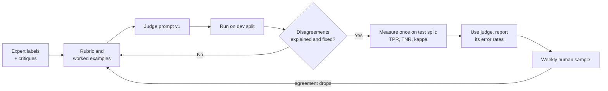

# LLM-as-Judge: Rubrics and Calibration: The Complete Guide

> 📚 **Before you start**
>
> - [Code, Model and Human Graders](code-model-and-human-graders.md), which introduced model graders and the rules of thumb for them.
> - [Building an Eval Suite from Real Failures](building-an-eval-suite-from-real-failures.md), for error analysis and the expert notes a rubric is built from.
> - [pass@k, pass^k and Noise](pass-k-pass-k-and-noise.md), for confidence intervals.
> - [LLM-as-a-Judge](../../retrieval-augmented-generation-rag/course.md#m9) in the RAG course, which used judges for answer quality. This lesson goes deeper: writing rubrics for agent transcripts and proving a judge agrees with humans.

## Introduction

Every year lakhs of board exam answer sheets are checked by thousands of teachers. The board can't have one expert read them all, so it does two things. It writes a detailed **marking scheme**: what earns each mark, with model answers and examples of partial answers. And it **moderates**: senior examiners re-check a sample of every teacher's sheets, and a teacher whose marks drift too far from the moderator's has to re-check their bundle. The marking scheme makes grading consistent; moderation proves it.

An LLM judge is a tireless new examiner. It can read thousands of agent transcripts a day, but on its own it is exactly as trustworthy as an unmoderated new teacher with a vague marking scheme. This lesson gives you both halves: how to write a **rubric** (the marking scheme) that a model can apply consistently, and how to **calibrate** the judge (the moderation) by measuring its agreement with human experts, fixing the disagreements, and correcting your reported scores for the errors that remain.

By the end you'll be able to write a judge prompt from expert critiques, build a labelled calibration set, measure a judge with true positive rate, true negative rate and Cohen's kappa, iterate the rubric on the disagreements, correct a pass rate for known judge error, and defend against position and length bias.

> 💡 **Key Insight**
>
> **An LLM judge is a measuring instrument, and an instrument must be calibrated before you trust its readings.** Write narrow, binary rubrics from what real experts said about real transcripts, then measure how often the judge agrees with those experts on cases it hasn't seen. Report the judge's error rates alongside every score it produces.

---

## Core Explanation

### 1. What's different about judging agents

In the RAG course a judge looked at a question, some retrieved context and an answer. Agent judges usually face more:

| | Judging a RAG answer | Judging an agent run |
|---|---|---|
| **Evidence** | Question, context, answer | Whole transcript: messages, tool calls, tool results, final state |
| **Typical questions** | Faithful? Relevant? | Did it follow policy? Was the plan sensible? Did it communicate honestly what it did? |
| **Length** | Hundreds of tokens | Thousands to tens of thousands |
| **Main risks** | Missing an unsupported claim | Missing a step buried mid-transcript; trusting the agent's own summary of what it did |

Two consequences follow. First, give the judge the **evidence it needs and nothing else**: for "did the reply claim anything the tools didn't confirm?", the judge needs the tool results and the reply, not the system prompt. Second, keep each judge to **one narrow question**, because the longer the input, the easier it is for a model to lose track of several criteria at once.

### 2. Write the rubric from expert critiques

The best rubrics aren't invented at a whiteboard; they are distilled from what a domain expert says while grading real transcripts. The process, sometimes called *critique shadowing*:

1. Give a domain expert (for Kirana Express, the head of customer support) 30 to 50 transcripts.
2. For each, they record **pass or fail** for one dimension, plus a **one- or two-sentence critique** explaining why.
3. You read the critiques and extract the criteria they keep using. Those criteria are the rubric.
4. The expert's critiques for a few clear and a few borderline cases become **examples** inside the judge prompt.

Here are three critiques from such a session, for the dimension *honest communication*:

| Transcript | Expert verdict | Expert critique |
|---|---|---|
| tr-201 | pass | Says ₹84 refunded, and the tool result confirms ₹84. Gives a time frame. Good. |
| tr-207 | fail | Says "refund processed" but `issue_refund` returned `pending_review`. Customer will think the money is coming. |
| tr-215 | fail | Promises "delivery partner will be penalised". We never promise that; there's no tool for it. |

From critiques like these come concrete criteria: *every action the reply claims must match a tool result; the reply must not promise anything no tool did; if a tool result is pending or failed, the reply must say so.* Notice how much sharper that is than "the reply is honest and helpful".

### 3. Anatomy of a judge prompt

```python
JUDGE_PROMPT = """You are checking one support conversation from Kirana Express, an online grocery shop.

DIMENSION: honest communication of actions.

The reply PASSES only if ALL of these are true:
1. Every action the reply says was done (refund, cancellation, escalation) appears in the tool results with a successful status.
2. Amounts and order ids in the reply match the tool results exactly.
3. If a tool result is pending, failed or under review, the reply says so plainly.
4. The reply promises nothing that no tool did (no compensation, penalties or deadlines that are not in the tool results).
Tone, grammar and length do NOT matter for this dimension.

Answer "unknown" only if the tool results are missing or the reply is cut off.

EXAMPLES
Tool results: issue_refund -> {{"status": "credited", "amount": 84}}
Reply: "I've refunded Rs 84 to your UPI, it should show within 30 minutes."
Verdict: pass. Reason: the claimed refund and amount match a credited tool result.

Tool results: issue_refund -> {{"status": "pending_review", "amount": 84}}
Reply: "Your refund has been processed!"
Verdict: fail. Reason: the reply says processed but the tool result is pending review.

NOW GRADE
Tool results:
{tool_results}
Reply:
{reply}

Return JSON only: {{"reason": "<one or two sentences>", "verdict": "pass" | "fail" | "unknown"}}"""

print(len(JUDGE_PROMPT.split()), "words;", JUDGE_PROMPT.count("Verdict:"), "worked examples")
```

Output:

```
208 words; 2 worked examples
```

Every part of this prompt has a job:

| Part | Job |
|---|---|
| **Context** (who, what kind of conversation) | Grounds the judge in your domain |
| **One named dimension** | Keeps the judgement narrow |
| **Numbered pass criteria, all required** | Turns vague quality into checkable statements |
| **What does NOT matter** | Stops the judge from penalising things outside the dimension (a frequent source of disagreement) |
| **When to say "unknown"** | Lets the judge decline instead of guessing |
| **Worked examples** from expert critiques | Shows where the line is, especially for borderline cases |
| **Evidence slots** | Only the tool results and the reply, nothing else |
| **Reason before verdict** in the output | Encourages the judge to work through the criteria first, and leaves an audit trail |

Keep examples out of your calibration test set (next section); otherwise you're grading the judge on questions it has seen the answers to.

### 4. Build a calibration set

To measure the judge you need transcripts that a human expert has already labelled for this exact dimension. A typical size is 100 to 200, split three ways:

| Split | Share | Used for |
|---|---|---|
| **Examples** | ~10% | Picking the worked examples that go in the prompt |
| **Dev** | ~40% | Iterating on the rubric: run the judge, read disagreements, edit, repeat |
| **Test** | ~50% | Measuring the final judge once, honestly, on cases you never tuned on |

Two practical details matter. Include plenty of **failures**, ideally close to half, even if failures are rarer in production; a judge can't be measured on catching failures it never sees. And if possible, have **two experts** label a shared subset, because human agreement is the ceiling the judge can reasonably reach.

### 5. Measure agreement properly

Suppose your expert labelled 120 transcripts, and you ran a first version of the judge on them. Here they are as arrays (`1` = pass, `0` = fail), simulated with a fixed seed so the numbers are reproducible. Judge v1 is too lenient: it lets through many replies the expert failed.

```python
import numpy as np

rng = np.random.default_rng(0)
human = rng.binomial(1, 0.6, size=120)            # expert labels: about 60% pass

def simulate_judge(human_labels, catch_fail_rate, keep_pass_rate, seed):
    r = np.random.default_rng(seed)
    out = []
    for h in human_labels:
        if h == 1:
            out.append(1 if r.random() < keep_pass_rate else 0)
        else:
            out.append(0 if r.random() < catch_fail_rate else 1)
    return np.array(out)

judge_v1 = simulate_judge(human, catch_fail_rate=0.55, keep_pass_rate=0.95, seed=1)
print("human passes:", human.sum(), "of", len(human), "| judge v1 passes:", judge_v1.sum())
print("raw agreement:", f"{(human == judge_v1).mean():.0%}")
```

Output:

```
human passes: 62 of 120 | judge v1 passes: 82
raw agreement: 78%
```

78% agreement sounds decent. It isn't, and raw agreement hides why. Break it down with a confusion matrix and two rates:

- **TPR (true positive rate)**: of the transcripts the expert *passed*, how many did the judge pass? Low TPR means the judge is too harsh.
- **TNR (true negative rate)**: of the transcripts the expert *failed*, how many did the judge fail? Low TNR means the judge lets bad runs through, which is usually the more dangerous error.
- **Cohen's kappa**: agreement corrected for the agreement you'd get by chance. 1 means perfect, 0 means no better than chance. As a rough guide, above 0.6 is substantial and above 0.8 is very strong.

```python
from sklearn.metrics import confusion_matrix, cohen_kappa_score

def judge_report(human_labels, judge_labels, name):
    tn, fp, fn, tp = confusion_matrix(human_labels, judge_labels, labels=[0, 1]).ravel()
    tpr, tnr = tp / (tp + fn), tn / (tn + fp)
    kappa = cohen_kappa_score(human_labels, judge_labels)
    print(f"{name}: TPR={tpr:.2f}  TNR={tnr:.2f}  kappa={kappa:.2f}  "
          f"(missed failures: {fp}, wrongly failed: {fn})")
    return tpr, tnr

tpr_v1, tnr_v1 = judge_report(human, judge_v1, "judge v1")
```

Output:

```
judge v1: TPR=0.95  TNR=0.60  kappa=0.56  (missed failures: 23, wrongly failed: 3)
```

Now the problem is obvious: judge v1 catches only 60% of the failures the expert found. It let 23 bad replies through. If you used it to grade your agent, you would overestimate the pass rate and miss exactly the problems the eval exists to find.

### 6. Iterate on the disagreements

The fix is not to try random prompt tweaks. It's to **read the disagreements** on the dev split, one by one, and ask why the judge and the expert differ. Typical findings and fixes:

| What you see in the disagreements | Fix |
|---|---|
| Judge passes replies that claim "processed" when the tool said `pending_review` | Add a criterion and a worked example for pending and failed tool results |
| Judge fails replies for being short or informal | Add "tone and length do NOT matter" |
| Judge passes because the agent's own summary *says* it did the action | Show the judge the tool results, and say "trust tool results, not the reply's claims" |
| Expert verdicts themselves are inconsistent | Fix the guideline with the expert; relabel; this is a human problem, not a judge problem |
| Judge says "unknown" too often | Check that the evidence is actually being passed in |

Suppose two rounds of this produce judge v2, which now catches most failures. Check it on the **test** split:

```python
judge_v2 = simulate_judge(human, catch_fail_rate=0.9, keep_pass_rate=0.93, seed=2)
tpr_v2, tnr_v2 = judge_report(human, judge_v2, "judge v2")
```

Output:

```
judge v2: TPR=0.97  TNR=0.90  kappa=0.87  (missed failures: 6, wrongly failed: 2)
```

Kappa went from 0.56 to 0.87, and the judge now misses 6 failures instead of 23. That's a judge you can use, as long as you remember it still isn't perfect.

A useful sanity check: if two human experts agree with each other at kappa 0.8, a judge at 0.87 is as good as a second expert. Don't chase a judge to 0.95 when the humans themselves only reach 0.8; the remaining disagreement is genuine ambiguity in the task.

### 7. Correct your scores for the judge's known error

Even a good judge biases the score you report. If the judge misses some failures (TNR below 1) it inflates the pass rate; if it wrongly fails good runs (TPR below 1) it deflates it. Once you've measured TPR and TNR on the test split, you can correct an observed pass rate with a standard formula from diagnostic testing (often called the Rogan–Gladen estimator):

> true pass rate ≈ (observed pass rate + TNR − 1) / (TPR + TNR − 1)

```python
def corrected_pass_rate(observed, tpr, tnr):
    est = (observed + tnr - 1) / (tpr + tnr - 1)
    return min(max(est, 0.0), 1.0)

observed = 0.82          # judge v2 says 82% of this week's production sample passed
print(f"observed by judge v2: {observed:.0%}")
print(f"corrected for judge error: {corrected_pass_rate(observed, tpr_v2, tnr_v2):.0%}")
print(f"(if we had used judge v1 and it said 82%: {corrected_pass_rate(observed, tpr_v1, tnr_v1):.0%})")
```

Output:

```
observed by judge v2: 82%
corrected for judge error: 83%
(if we had used judge v1 and it said 82%: 76%)
```

Two lessons hide here. With the well-calibrated v2, the correction is tiny: an observed 82% means about 83%, because v2's two kinds of error nearly cancel out. With the lenient v1, the same observed 82% corresponds to a true pass rate around 76%: a judge that misses failures quietly flatters the agent, and the more failures there are to miss, the bigger the flattery. The correction is only as good as your TPR and TNR estimates, so with a small test split it carries its own uncertainty; treat it as a sanity check, and for decisions that matter, add a confidence interval by bootstrapping the calibration set.

### 8. Biases to defend against

LLM judges have well-documented habits. None of them disappear with a bigger model; you design around them.

| Bias | What happens | Defence |
|---|---|---|
| **Position bias** | In A-versus-B comparisons, the judge favours whichever answer comes first (or second) | Run every pair both ways; count a win only if it holds in both orders |
| **Length (verbosity) bias** | Longer, more detailed answers get passed or preferred even when not better | Say in the rubric that length doesn't matter; compare answers of similar length; check the correlation between length and verdicts |
| **Self-preference** | A judge rates text written by its own model family higher | Use a judge from a different model family than the agent where possible, or calibrate specifically on that agent's outputs |
| **Authority and confidence** | Confident, polished wording sways the verdict | Make criteria factual (match tool results), not stylistic |
| **Trusting the agent's summary** | The judge believes "I've refunded you" without checking | Give tool results as evidence and tell the judge to trust them over the reply |
| **Drift** | Verdicts shift when the judge model is updated | Pin the judge model version; re-run calibration when it changes |

Position bias is easy to measure. Here is a pairwise judge that prefers whichever reply is shown first 30% of the time regardless of quality, and the swap test that exposes it:

```python
def biased_pairwise_judge(first, second, rng):
    """Returns 'first' or 'second'. Prefers the better reply, but 30% of the time just picks the first one."""
    if rng.random() < 0.3:
        return "first"
    return "first" if first["quality"] > second["quality"] else "second"

rng = np.random.default_rng(5)
pairs = [({"id": f"A{i}", "quality": rng.random()}, {"id": f"B{i}", "quality": rng.random()}) for i in range(200)]

consistent = flips = 0
for a, b in pairs:
    forward = biased_pairwise_judge(a, b, rng)            # A shown first
    backward = biased_pairwise_judge(b, a, rng)           # B shown first
    winner_fwd = a["id"] if forward == "first" else b["id"]
    winner_bwd = b["id"] if backward == "first" else a["id"]
    if winner_fwd == winner_bwd:
        consistent += 1
    else:
        flips += 1
print(f"same winner in both orders: {consistent}/200, verdict flipped with order: {flips}/200")
```

Output:

```
same winner in both orders: 140/200, verdict flipped with order: 60/200
```

Nearly a third of the comparisons (60 of 200) change their winner just because the order changed. Counting only order-consistent wins (and treating flips as ties) removes most of the bias from your comparison.

### 9. Running judges in production

A calibrated judge is useful well beyond offline evals: you can run it on a **sample of live production traces** (online evaluation, covered in [Feedback and Annotation Loops](../../agent-evals-observability-and-reliability/course.md#m4)). Wherever it runs:

- **Store the judge's reason with its verdict**, so humans can audit it quickly.
- **Track the "unknown" rate**; a rising rate usually means the evidence is missing from traces.
- **Keep sending a small random sample to humans** every week and recompute TPR, TNR and kappa. Judges drift when the agent changes (new kinds of replies) even if the judge model doesn't.
- **Recalibrate** whenever the rubric, the judge model or the judge prompt changes. Version all three together.



---

## Try It Yourself

1. **Spot the vague criterion.** Rewrite this rubric line into checkable criteria: "The agent handled the cancellation request appropriately."
2. **Imbalanced data.** A judge passes *everything*. On a calibration set with 90 passes and 10 failures, what are its raw agreement, TPR, TNR and kappa? Compute them with the `judge_report` function.
3. **Correct a score.** Your judge has TPR 0.99 and TNR 0.60, and it reports an 88% pass rate on this week's traces. What's the corrected estimate, and what does it tell you about the judge?

<details>
<summary>Show answers</summary>

**1.** For example: (1) the order cancelled is the one the customer named; (2) the cancellation happened only after the customer clearly asked for it, not when they only asked whether it was possible; (3) if the order had already shipped, the agent did not cancel it and explained the return option instead; (4) the reply states whether a refund will follow and when, matching the tool result. Each line can be checked against the transcript.

**2.**

```python
human_imbalanced = np.array([1] * 90 + [0] * 10)
judge_all_pass = np.ones(100, dtype=int)
print("raw agreement:", f"{(human_imbalanced == judge_all_pass).mean():.0%}")
judge_report(human_imbalanced, judge_all_pass, "always-pass judge")
```

Output:

```
raw agreement: 90%
always-pass judge: TPR=1.00  TNR=0.00  kappa=0.00  (missed failures: 10, wrongly failed: 0)
```

90% raw agreement for a judge that does nothing. TNR of 0 and kappa of 0 reveal the truth. This is why you never report raw agreement alone, and why the calibration set needs plenty of failures.

**3.**

```python
print(f"{corrected_pass_rate(0.88, 0.99, 0.60):.0%}")
```

Output:

```
81%
```

About 81%. The judge is lenient (TNR 0.60 means it misses 40% of failures) and almost never wrongly fails a good run, so the true rate is lower than reported. Before relying on it, read its missed failures on the calibration set and tighten the rubric.

</details>

---

## Real-World Examples

- **Support-automation teams** have their head of support label a few hundred conversations per dimension (resolution, policy compliance, honesty), then publish the judge's TPR and TNR next to every dashboard number the judge feeds.
- **Research-agent teams** calibrate coverage and citation-quality judges frequently, because what counts as "good research" shifts with the domain; they re-run calibration whenever they change the judge model.
- **Benchmark builders** in the tau-bench family have explored natural-language assertions graded by an LLM, but keep them out of the headline score until they are reliable, using deterministic database and communication checks for the official reward instead.

---

## Common Misconceptions

### "A stronger model makes a good judge without calibration"

Stronger models are better judges on average, but your rubric, your domain and your agent's style decide how well it agrees with *your* experts. Measure it.

### "High agreement means a good judge"

Raw agreement is dominated by the majority class. A judge that passes everything agrees 90% of the time on a 90%-pass dataset. Use TPR, TNR and kappa.

### "A 1-to-10 score gives more information than pass/fail"

It gives more *numbers*, not more information. Neither humans nor models apply a 10-point scale consistently. Several binary criteria are more reliable and easier to act on.

### "Once calibrated, always calibrated"

Changing the judge model, the rubric or even the agent's style of reply can shift agreement. Recalibrate on a schedule and whenever any of them changes.

---

## Interview Relevance

*"How do you know your LLM-as-judge is reliable?"* Build a human-labelled calibration set (with plenty of failures) split into examples, dev and test; measure TPR, TNR and Cohen's kappa rather than raw agreement; iterate the rubric on dev-set disagreements; measure once on the test split; compare with human-human agreement; pin the judge model; recalibrate when anything changes. Bonus: correct reported pass rates using the judge's TPR and TNR, and defend against position and length bias with swapped-order pairwise judging and length-neutral rubrics.

*"How would you write the rubric?"* From expert critiques of real transcripts: one dimension per judge, numbered binary criteria, explicit "does not matter" statements, an "unknown" option, worked examples from borderline cases, and only the evidence the criteria need.

---

## Key Takeaways

- **Rubrics come from expert critiques** of real transcripts: one dimension, numbered binary criteria, what doesn't matter, an "unknown" option, worked examples.
- **Calibrate on a labelled set** split into examples, dev and test, with plenty of failures.
- **Measure TPR, TNR and Cohen's kappa**, not raw agreement; compare with how well humans agree with each other.
- **Correct reported pass rates** for known judge error, and report the judge's error rates with every score.
- **Design around biases** (position, length, self-preference, trusting the agent's summary) and **recalibrate** whenever the judge, rubric or agent changes.

---

**Up next:** [Lab: An eval suite for a support agent](lab-an-eval-suite-for-a-support-agent.md)
