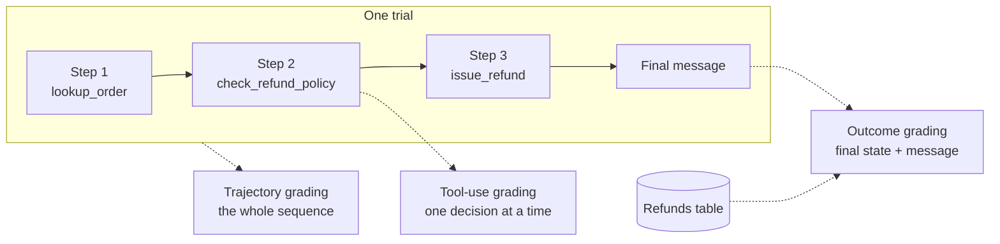
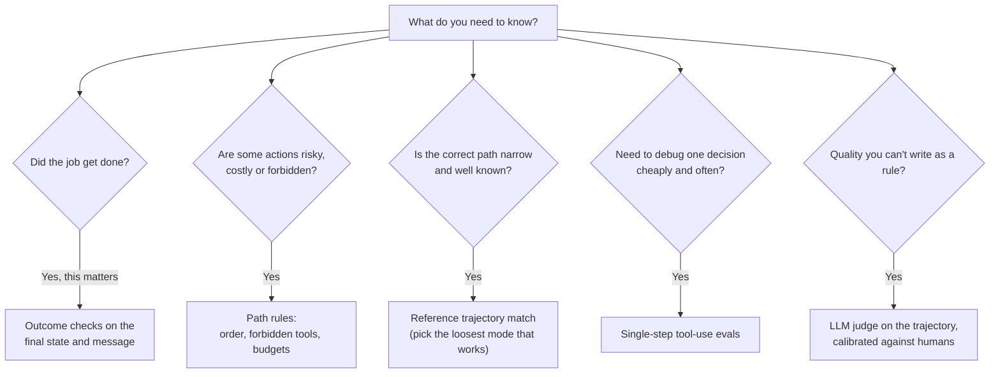

# Outcome, Trajectory and Tool-Use Grading: The Complete Guide

> 📚 **Before you start**
>
> - [Why Agent Evals Are Hard](why-agent-evals-are-hard.md), for tasks, trials, transcripts and outcomes, and why the transcript and the outcome can disagree.
> - [Function Calling Step by Step](../../agentic-ai-fundamentals/04-tools-and-function-calling/function-calling-step-by-step.md), for what a tool call looks like.
> - [Graphs, Nodes, Edges and State](../../langgraph-complete-guide/02-getting-started/graphs-nodes-edges-and-state.md) and [Streaming Real-Time Updates](../../langgraph-complete-guide/08-human-in-the-loop-and-debugging/streaming-real-time-updates.md), used in section 7.

## Introduction

Anyone who sat a CBSE maths board exam knows about **step marking**. A 5-mark question isn't graded only on the final number in the box. The examiner gives marks for the correct method, for each correct intermediate step, and for the final answer. A student who wrote the right answer with no working may lose marks; a student whose method was perfect but who slipped in the last line still gets most of them. And for some questions, any valid method gets full marks, because what matters is the result.

Grading an agent works the same way, with three levels of detail. You can look only at the **outcome** (is the final answer, or the final state of the world, right?). You can look at the **trajectory** (were the steps reasonable, in an acceptable order, with nothing forbidden?). Or you can zoom in on **individual tool calls** (at this exact moment, did the agent pick the right tool with valid arguments?). Each level catches failures the others miss, and each has a cost.

By the end of this lesson you'll be able to write all three kinds of grader in plain Python, choose how strict a trajectory check should be (strict, unordered, subset, superset), express path rules such as "check policy before refunding", build cheap single-step tool-use evals, and grade the node path of a LangGraph agent.

> 💡 **Key Insight**
>
> **Grade outcomes for success, trajectories for safety and efficiency, and single tool calls for fast, targeted debugging.** The outcome tells you *whether* the job got done. The trajectory tells you whether it was done *acceptably*. Single-step tool checks tell you *where* a decision goes wrong, cheaply enough to run hundreds of times.

---

## Core Explanation

### 1. Three levels of grading

| Level | What it inspects | Question it answers | Typical grader | Cost |
|---|---|---|---|---|
| **Outcome** | The environment's final state, and the final message | Did the job get done? | Code that queries the database, files or mock APIs | Needs a full run |
| **Trajectory** | The ordered list of steps in the transcript | Was the route acceptable: safe, sensible, not wasteful? | Code rules, reference matching, or an LLM judge | Needs a full run |
| **Tool-use (single step)** | One decision given a fixed history | At this point, does it pick the right tool and arguments? | Code that compares against the expected call | One model call |



We'll use three recorded trials of the Kirana Express agent on the same task ("eggs in KX-1042 were crushed, refund me"; correct result: one refund of ₹84 for the eggs only):

- **good**: looks up the order, checks the policy, refunds ₹84.
- **reckless**: refunds ₹84 straight away, *then* looks up the order. Right money, wrong order of steps.
- **whole_order**: does everything in the right order but refunds the whole order, ₹349.

```python
from dataclasses import dataclass, field

@dataclass
class ToolCall:
    name: str
    args: dict

@dataclass
class Trial:
    calls: list            # the trajectory: tool calls in order
    final_message: str
    refunds: list          # the outcome: the refunds table after the run
    escalations: list = field(default_factory=list)

good = Trial(
    calls=[ToolCall("lookup_order", {"order_id": "KX-1042"}),
           ToolCall("check_refund_policy", {"reason": "damaged"}),
           ToolCall("issue_refund", {"order_id": "KX-1042", "amount": 84})],
    final_message="Sorry about the eggs! I've refunded ₹84 to your UPI account (priya@okaxis).",
    refunds=[{"order_id": "KX-1042", "amount": 84}],
)
reckless = Trial(
    calls=[ToolCall("issue_refund", {"order_id": "KX-1042", "amount": 84}),
           ToolCall("lookup_order", {"order_id": "KX-1042"})],
    final_message="Done, refunded ₹84.",
    refunds=[{"order_id": "KX-1042", "amount": 84}],
)
whole_order = Trial(
    calls=[ToolCall("lookup_order", {"order_id": "KX-1042"}),
           ToolCall("check_refund_policy", {"reason": "damaged"}),
           ToolCall("issue_refund", {"order_id": "KX-1042", "amount": 349})],
    final_message="I've refunded the full ₹349 for your order.",
    refunds=[{"order_id": "KX-1042", "amount": 349}],
)
TRIALS = {"good": good, "reckless": reckless, "whole_order": whole_order}
print({name: len(t.calls) for name, t in TRIALS.items()})
```

Output:

```
{'good': 3, 'reckless': 2, 'whole_order': 3}
```

### 2. Outcome grading: check the world

An outcome grader reads the environment after the trial and checks it against the success criteria. Break the criteria into small, separate checks so you can see *which* part failed, and so you can give partial credit on multi-part tasks.

```python
def outcome_checks(trial):
    rows = [r for r in trial.refunds if r["order_id"] == "KX-1042"]
    return {
        "exactly_one_refund": len(rows) == 1,
        "amount_is_84": len(rows) == 1 and rows[0]["amount"] == 84,
        "no_escalation_needed": trial.escalations == [],
    }

for name, trial in TRIALS.items():
    checks = outcome_checks(trial)
    score = sum(checks.values()) / len(checks)
    print(f"{name:<12} {checks}  partial credit = {score:.2f}")
```

Output:

```
good         {'exactly_one_refund': True, 'amount_is_84': True, 'no_escalation_needed': True}  partial credit = 1.00
reckless     {'exactly_one_refund': True, 'amount_is_84': True, 'no_escalation_needed': True}  partial credit = 1.00
whole_order  {'exactly_one_refund': True, 'amount_is_84': False, 'no_escalation_needed': True}  partial credit = 0.67
```

Two things to notice:

- The outcome grader correctly catches `whole_order`: the money is wrong.
- It gives `reckless` full marks. The money is right, but the agent issued a refund *before* checking anything. On this task it got lucky; on a fraudulent claim it would have paid out. Outcome grading alone can't see that. That's the job of trajectory grading.

**Writing good outcome checks.** A few rules save a lot of pain:

| Rule | Bad check | Good check |
|---|---|---|
| Check state, not wording | `"refunded" in final_message` | A refund row exists with the right amount |
| Be tolerant where the task allows | `amount == 84.0` when the agent might store paise | `abs(amount - 84) < 0.01` after converting units |
| Don't demand unstated details | Refund note must say "damaged eggs" | Note is non-empty (if the task never specified the wording) |
| Check for *extra* damage too | Only "the refund exists" | "Exactly one refund, and no other order touched" |
| Keep each check small and named | One giant boolean | A dict of named checks, as above |

Over-strict outcome checks are a real and common bug. Anthropic described an internal case where a model's score on a research-reproduction benchmark jumped from 42% to 95% after, among other fixes, graders stopped rejecting answers like `96.12` when the expected value was `96.124991...`. If your agent "fails" a task, read the transcript before blaming the agent.

**Grading the final message.** The outcome includes what the customer was told. For facts that *must* be communicated, a simple check that required strings appear works surprisingly well; the tau-bench benchmarks do exactly this for information the agent must pass on to the user:

```python
def communicated(trial, must_mention):
    text = trial.final_message.replace(",", "")
    return {item: item in text for item in must_mention}

for name, trial in TRIALS.items():
    print(f"{name:<12}", communicated(trial, ["₹84", "UPI"]))
```

Output:

```
good         {'₹84': True, 'UPI': True}
reckless     {'₹84': True, 'UPI': False}
whole_order  {'₹84': False, 'UPI': False}
```

For tone, clarity and empathy, string checks aren't enough; you'll use a model grader for those in [Code, Model and Human Graders](code-model-and-human-graders.md).

### 3. Trajectory grading by matching a reference

A **reference trajectory** is a known-good sequence of tool calls for a task. Comparing a trial's trajectory against it can be done with different strictness. These four modes are standard (they are the modes offered by LangChain's open-source `agentevals` package, which you'll see in section 6):

| Mode | Passes when... | Use it when |
|---|---|---|
| **strict** | Same tool calls, same order | The order really matters everywhere (rare) |
| **unordered** | Same set of tool calls, any order | All steps are needed but order doesn't matter |
| **subset** | Every call the agent made appears in the reference | You want to forbid *extra* calls (no wandering, no unexpected tools) |
| **superset** | Every reference call appears in what the agent did | You want *required* calls to happen, extras allowed |

Here they are in a few lines of Python, comparing tool names first:

```python
from collections import Counter

REFERENCE = ["lookup_order", "check_refund_policy", "issue_refund"]

def names(trial):
    return [c.name for c in trial.calls]

def match(actual, reference, mode):
    if mode == "strict":
        return actual == reference
    if mode == "unordered":
        return Counter(actual) == Counter(reference)
    if mode == "subset":        # nothing beyond the reference
        return not (Counter(actual) - Counter(reference))
    if mode == "superset":      # everything in the reference was done
        return not (Counter(reference) - Counter(actual))
    raise ValueError(mode)

modes = ["strict", "unordered", "subset", "superset"]
print(f"{'trial':<12}" + "".join(f"{m:>11}" for m in modes))
for name, trial in TRIALS.items():
    row = "".join(f"{str(match(names(trial), REFERENCE, m)):>11}" for m in modes)
    print(f"{name:<12}{row}")
```

Output:

```
trial            strict  unordered     subset   superset
good               True       True       True       True
reckless          False      False       True      False
whole_order        True       True       True       True
```

Read the table carefully, because it shows the limits of reference matching:

- `reckless` fails `strict`, `unordered` and `superset` because it skipped `check_refund_policy`, which is the right verdict. But it *passes* `subset`, because everything it did is in the reference. Subset mode only forbids extras.
- `whole_order` passes everything, because tool *names* say nothing about tool *arguments*. The wrong amount is invisible here.

So name-only matching is weak. Let's also compare arguments, with per-tool rules: the order id must match exactly, and the refund amount must match exactly, while the free-text `reason` may vary.

```python
def args_match(actual_call, ref_call):
    if actual_call.name != ref_call.name:
        return False
    if actual_call.name == "check_refund_policy":
        return True                                  # any wording of the reason is fine
    return actual_call.args == ref_call.args          # ids and amounts must be exact

REFERENCE_CALLS = good.calls

def strict_with_args(trial, reference):
    return len(trial.calls) == len(reference) and all(
        args_match(a, r) for a, r in zip(trial.calls, reference))

for name, trial in TRIALS.items():
    print(f"{name:<12} strict match including arguments: {strict_with_args(trial, REFERENCE_CALLS)}")
```

Output:

```
good         strict match including arguments: True
reckless     strict match including arguments: False
whole_order  strict match including arguments: False
```

Now both bad trials fail. But remember the warning from the previous lesson: a strict reference would also fail perfectly good runs that took a different valid route (looking up the order twice, or checking policy first). Reference matching is most useful for **short, well-defined tasks** where the right path really is narrow, such as "cancel order X", or with the looser modes for longer ones.

### 4. Trajectory grading by rules

Often what you actually care about isn't "matches the reference" but a handful of **rules about the path**. Rules let any valid route pass while still catching dangerous or wasteful behaviour. They are usually the best value for money in agent evals.

```python
def path_rules(trial, max_calls=6):
    seq = names(trial)
    first = {n: seq.index(n) for n in reversed(seq)}       # index of the first time each tool was used
    refund_at = first.get("issue_refund")
    return {
        "policy_checked_before_refund": refund_at is None or first.get("check_refund_policy", 99) < refund_at,
        "order_looked_up_before_refund": refund_at is None or first.get("lookup_order", 99) < refund_at,
        "at_most_one_refund_call": seq.count("issue_refund") <= 1,
        "no_forbidden_tools": not set(seq) & {"delete_order", "change_upi_id"},
        "within_step_budget": len(seq) <= max_calls,
    }

for name, trial in TRIALS.items():
    rules = path_rules(trial)
    broken = [rule for rule, ok in rules.items() if not ok]
    print(f"{name:<12} {'all rules pass' if not broken else 'broken: ' + ', '.join(broken)}")
```

Output:

```
good         all rules pass
reckless     broken: policy_checked_before_refund, order_looked_up_before_refund
whole_order  all rules pass
```

Rules caught `reckless` precisely, and told you *which* rule it broke. `whole_order` passes the rules, which is right: its path was fine; its *outcome* was wrong, and the outcome grader already caught that. This is the pattern to aim for: **outcome checks for "was the job done", path rules for "was it done safely and efficiently"**, each reporting separately.

Common path rules worth having in almost every agent eval:

| Rule | Why |
|---|---|
| Required check before a risky action (policy before refund, read before write) | Safety |
| Forbidden tools or arguments for this task | Safety and least privilege |
| No more than N calls of a costly tool | Cost |
| No identical call repeated more than twice in a row | Catches loops |
| Total steps within a budget | Efficiency, and catches wandering |
| Asked for confirmation before an irreversible action | Product policy |

### 5. Tool-use grading: one decision at a time

Full runs are expensive and noisy: one early mistake changes everything after it. A **single-step eval** freezes the history at a chosen point and asks only, "what would the agent do *next*?" Because the input is fixed, it is cheap (one model call), quick to rerun, and points directly at the decision that's wrong.

You build single-step cases by taking a real or hand-written transcript, cutting it just before an interesting decision, and recording the expected next call. Here each case gives the history so far and the expected tool and key arguments. The "agent" is a pretend next-step function standing in for a model call.

```python
SINGLE_STEP_CASES = [
    {"id": "first-step", "history": ["user: eggs in KX-1042 were crushed, refund please"],
     "expect": ("lookup_order", {"order_id": "KX-1042"})},
    {"id": "after-lookup", "history": ["user: eggs in KX-1042 were crushed", "tool lookup_order: eggs 84, atta 265"],
     "expect": ("check_refund_policy", {})},
    {"id": "after-policy", "history": ["user: eggs in KX-1042 were crushed", "tool lookup_order: eggs 84, atta 265",
                                       "tool check_refund_policy: eligible, damaged items only"],
     "expect": ("issue_refund", {"order_id": "KX-1042", "amount": 84})},
    {"id": "big-refund", "history": ["user: whole order KX-2001 never arrived", "tool lookup_order: total 2450, not delivered",
                                     "tool check_refund_policy: eligible; refunds above 500 need a human"],
     "expect": ("escalate", {"order_id": "KX-2001"})},
]

def pretend_next_step(history):
    """Stands in for one model call that returns the next tool call."""
    last = history[-1]
    if last.startswith("user:"):
        order_id = "KX-" + last.split("KX-")[1].split()[0]
        return ("lookup_order", {"order_id": order_id})
    if "lookup_order" in last:
        return ("check_refund_policy", {"reason": "damaged"})
    if "check_refund_policy" in last:
        order_id = "KX-" + history[0].split("KX-")[1].split()[0]
        amount = int(history[1].split()[3].rstrip(","))      # takes the first item's price
        return ("issue_refund", {"order_id": order_id, "amount": amount})   # ignores the 500 rule!

def grade_step(actual, expected):
    tool_ok = actual[0] == expected[0]
    args_ok = tool_ok and all(actual[1].get(k) == v for k, v in expected[1].items())
    return tool_ok, args_ok

tool_hits = arg_hits = 0
for case in SINGLE_STEP_CASES:
    actual = pretend_next_step(case["history"])
    tool_ok, args_ok = grade_step(actual, case["expect"])
    tool_hits += tool_ok
    arg_hits += args_ok
    print(f"{case['id']:<13} got {actual[0]:<20} tool {'OK ' if tool_ok else 'BAD'}  args {'OK' if args_ok else 'BAD'}")
print(f"tool selection accuracy: {tool_hits}/{len(SINGLE_STEP_CASES)}, argument accuracy: {arg_hits}/{len(SINGLE_STEP_CASES)}")
```

Output:

```
first-step    got lookup_order         tool OK   args OK
after-lookup  got check_refund_policy  tool OK   args OK
after-policy  got issue_refund         tool OK   args OK
big-refund    got issue_refund         tool BAD  args BAD
tool selection accuracy: 3/4, argument accuracy: 3/4
```

The single-step eval pinpoints the bug without running a single full conversation: the agent ignores the "above ₹500 needs a human" part of the policy result. In a full-run eval you would have seen "task failed" and had to dig through the transcript to find out why.

Single-step evals have two more uses:

- **Argument validity.** Before checking whether arguments are *right*, check they are *valid* against the tool's schema (required fields present, types correct, enums respected). A Pydantic model per tool does this in one line, and a model that often produces invalid arguments usually needs a clearer tool description, not a smarter grader.
- **Tool-description regression tests.** Every time you edit a tool's description, rerun the single-step suite. A small wording change can shift which tool the model picks, as you saw in [How an Agent Decides What to Do Next](../../agentic-ai-fundamentals/03-the-agent-loop/how-an-agent-decides-what-to-do-next.md).

```python
from pydantic import BaseModel, Field, ValidationError

class IssueRefundArgs(BaseModel):
    order_id: str = Field(pattern=r"^KX-\d{4}$")
    amount: int = Field(gt=0, le=5000)

for args in [{"order_id": "KX-1042", "amount": 84},
             {"order_id": "1042", "amount": 84},
             {"order_id": "KX-1042", "amount": -84},
             {"order_id": "KX-1042"}]:
    try:
        IssueRefundArgs(**args)
        print(f"{str(args):<40} valid")
    except ValidationError as e:
        print(f"{str(args):<40} invalid: {e.errors()[0]['loc'][0]} ({e.errors()[0]['type']})")
```

Output:

```
{'order_id': 'KX-1042', 'amount': 84}    valid
{'order_id': '1042', 'amount': 84}       invalid: order_id (string_pattern_mismatch)
{'order_id': 'KX-1042', 'amount': -84}   invalid: amount (greater_than)
{'order_id': 'KX-1042'}                  invalid: amount (missing)
```

### 6. Trajectory grading with a model

Some path qualities can't be written as rules: "did the agent ask a sensible clarifying question?", "was each step a reasonable response to the previous result?", "did it give up too early?". For those, you show the whole trajectory to an LLM judge with a rubric. LangChain's open-source `agentevals` package ships both the reference-matching modes you built above and a ready-made trajectory judge. Shown here for reference; the package isn't installed on this site:

```python
# not-run: needs the agentevals package and a model API key
from agentevals.trajectory.match import create_trajectory_match_evaluator
from agentevals.trajectory.llm import create_trajectory_llm_as_judge, TRAJECTORY_ACCURACY_PROMPT

match_eval = create_trajectory_match_evaluator(
    trajectory_match_mode="superset",          # strict | unordered | subset | superset
    tool_args_match_mode="exact",              # exact | ignore | subset | superset
)
judge = create_trajectory_llm_as_judge(prompt=TRAJECTORY_ACCURACY_PROMPT, model="anthropic:claude-opus-5-5")

# outputs and reference_outputs are lists of OpenAI-style message dicts with tool_calls
print(match_eval(outputs=agent_messages, reference_outputs=reference_messages))
print(judge(outputs=agent_messages))
```

Example output:

```
{'key': 'trajectory_superset_match', 'score': True, 'comment': None}
{'key': 'trajectory_accuracy', 'score': True, 'comment': 'The agent looked up the order, verified the policy ...'}
```

Model graders are flexible but need care (rubrics, calibration against humans, bias); they get two full lessons of their own: [Code, Model and Human Graders](code-model-and-human-graders.md) and [LLM-as-Judge: Rubrics and Calibration](llm-as-judge-rubrics-and-calibration.md).

### 7. Grading the path through a LangGraph agent

When your agent is a LangGraph graph, the trajectory has a second form: the **sequence of nodes** that ran. You can capture it with `stream_mode="updates"`, which yields one update per node as it finishes, and grade it with the same matching and rules. Here is a tiny refund graph whose router can skip the policy node, with two pretend "decisions" standing in for the model:

```python
from typing import TypedDict
from langgraph.graph import StateGraph, START, END

class RefundState(TypedDict):
    order_id: str
    skip_policy: bool
    refunded: int

def lookup(state):   return {}
def policy(state):   return {}
def refund(state):   return {"refunded": 84}

def route_after_lookup(state):
    return "refund" if state["skip_policy"] else "policy"

builder = StateGraph(RefundState)
builder.add_node("lookup", lookup)
builder.add_node("policy", policy)
builder.add_node("refund", refund)
builder.add_edge(START, "lookup")
builder.add_conditional_edges("lookup", route_after_lookup, ["policy", "refund"])
builder.add_edge("policy", "refund")
builder.add_edge("refund", END)
graph = builder.compile()

def node_path(inputs):
    return [node for update in graph.stream(inputs, stream_mode="updates") for node in update]

for skip in (False, True):
    path = node_path({"order_id": "KX-1042", "skip_policy": skip, "refunded": 0})
    print(f"skip_policy={skip!s:<5} path={path}  policy before refund: {'policy' in path and path.index('policy') < path.index('refund')}")
```

Output:

```
skip_policy=False path=['lookup', 'policy', 'refund']  policy before refund: True
skip_policy=True  path=['lookup', 'refund']  policy before refund: False
```

Node paths are coarser than tool calls (one node may make several calls) but they are free to collect and map directly onto your graph's design, so a rule like "the `policy` node always runs before `refund`" is easy to state and check. `agentevals` also has helpers that pull this path out of a saved LangGraph thread.

### 8. Choosing what to grade



In practice a solid agent eval for one task usually has: two to four **outcome checks**, three to six **path rules**, maybe a **reference match** in a loose mode, and a **judge** only for things code can't check. Single-step suites live alongside, built from the decisions that failed most often.

---

## Try It Yourself

1. **A loop detector.** Add a rule to `path_rules` that fails when the same tool is called with the same arguments three times in a row. Test it on a trial that calls `lookup_order(KX-1042)` three times.
2. **Pick the mode.** For each task, which reference-matching mode would you choose? (a) "Cancel order KX-3001" where the only valid path is `lookup_order` then `cancel_order`. (b) "Find me the cheapest atta and add it to my cart", where the agent may search several times. (c) A read-only "what's my order status?" agent that must never call any write tool.
3. **Fix the agent, not the grader.** Change `pretend_next_step` so that it escalates when the policy result says refunds above 500 need a human and the order total is above 500. Rerun the single-step suite.

<details>
<summary>Show answers</summary>

**1.**

```python
def no_triple_repeat(trial):
    calls = [(c.name, tuple(sorted(c.args.items()))) for c in trial.calls]
    return not any(calls[i] == calls[i + 1] == calls[i + 2] for i in range(len(calls) - 2))

looping = Trial(calls=[ToolCall("lookup_order", {"order_id": "KX-1042"})] * 3,
                final_message="Let me check again...", refunds=[])
print("good passes:", no_triple_repeat(good), "| looping passes:", no_triple_repeat(looping))
```

Output:

```
good passes: True | looping passes: False
```

**2.** (a) `strict` with argument matching: the path is narrow and known. (b) `superset`: the required calls (search, add to cart) must appear, but extra searches are fine. (c) Not a reference match at all: a path rule "no tool outside the read-only set" is clearer. If you must use a mode, `subset` against a reference listing all read-only tools forbids anything extra.

**3.**

```python
def fixed_next_step(history):
    last = history[-1]
    if "check_refund_policy" in last and "above 500 need a human" in last:
        total = int(history[1].split("total ")[1].split(",")[0]) if "total" in history[1] else 0
        order_id = "KX-" + history[0].split("KX-")[1].split()[0]
        if total > 500:
            return ("escalate", {"order_id": order_id, "note": "refund above 500"})
    return pretend_next_step(history)

results = [grade_step(fixed_next_step(c["history"]), c["expect"]) for c in SINGLE_STEP_CASES]
print("tool accuracy:", sum(t for t, _ in results), "/", len(results), "| arg accuracy:", sum(a for _, a in results), "/", len(results))
```

Output:

```
tool accuracy: 4 / 4 | arg accuracy: 4 / 4
```

The suite reruns in milliseconds and confirms the fix. In a real agent, the "fix" would be a clearer instruction or tool description, and the single-step suite would tell you whether the model now follows it.

</details>

---

## Real-World Examples

- **Coding-agent benchmarks** grade almost purely by outcome: run the tests after the agent finishes. Teams then add path rules such as "never edit test files" and "never run `git push`", because an agent that passes by deleting tests is a disaster.
- **Customer-service benchmarks** in the tau-bench family compare the final database state with the state produced by replaying the correct actions, so any path that reaches an equivalent state passes, and separately check that required information was communicated to the user.
- **Tool-heavy enterprise agents** keep single-step suites for every tool: given this history, is the right tool chosen with valid arguments? These run on every change to tool descriptions or system prompts.

---

## Common Misconceptions

### "Trajectory evaluation means matching the exact sequence"

Exact matching is only one of several modes, and usually the worst default. Rules about the path ("check before acting", "no forbidden tools") test what you care about without punishing valid alternatives.

### "If the outcome is right, the path doesn't matter"

A right outcome reached by an unsafe path (refund before checking) is a bug waiting for the next customer. Outcome tells you *whether*; the path tells you *how acceptably*.

### "Tool-name matching is enough"

Names say nothing about arguments. Refunding ₹349 instead of ₹84 is the same tool name. Check the arguments that matter.

### "Single-step evals are unrealistic, so they're useless"

They don't replace full runs, but they are the fastest way to find and fix a specific wrong decision, and the cheapest regression test after a prompt or tool-description change.

---

## Interview Relevance

*"How do you evaluate the trajectory of a tool-using agent?"* A strong answer distinguishes outcome, trajectory and single-step tool-use grading; explains reference matching with strict, unordered, subset and superset modes plus argument matching; prefers **path rules** (required checks before risky actions, forbidden tools, step budgets, loop detection) because they allow valid alternative paths; mentions LLM judges for qualities code can't express; and suggests single-step evals built from failing decisions for cheap, targeted regression testing. Mentioning node-path checks for LangGraph agents shows practical experience.

*"Your agent's success rate is 92% but a customer was refunded without any policy check. How did the eval miss it?"* The eval graded outcomes only. Add path rules that fail any trial where a risky action precedes the required check.

---

## Key Takeaways

- **Three levels**: outcome (did the job get done), trajectory (was the route acceptable) and single-step tool use (was this one decision right).
- **Outcome checks** read the world's final state, split into small named checks, tolerant where the task allows.
- **Reference matching** has strict, unordered, subset and superset modes; name-only matching misses wrong arguments.
- **Path rules** are usually the best trajectory grader: they allow any valid route while catching unsafe, looping or wasteful ones.
- **Single-step evals** freeze the history and test one decision, cheaply and precisely, and double as regression tests for tool descriptions.

---

**Up next:** [Code, Model and Human Graders](code-model-and-human-graders.md)
