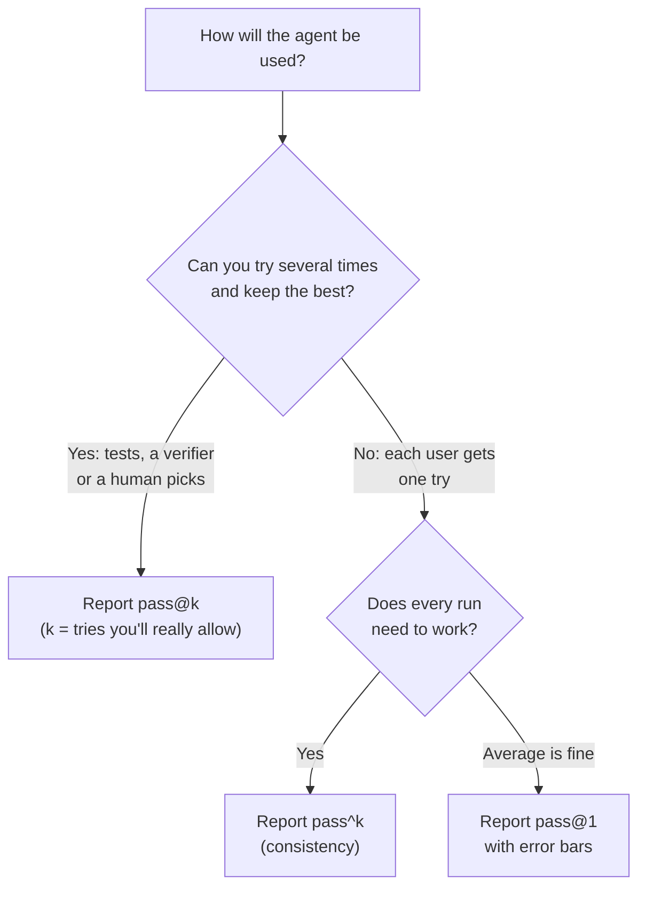

# pass@k, pass^k and Noise: The Complete Guide

> 📚 **Before you start**
>
> - [Why Agent Evals Are Hard](why-agent-evals-are-hard.md), which showed that the same task can pass in one trial and fail in the next.
> - [Code, Model and Human Graders](code-model-and-human-graders.md), for how a single trial gets its pass or fail.
> - [Statistics for Data Science › Distributions](../../statistics-for-data-science/course.md#m6) (the binomial distribution) and [Estimation](../../statistics-for-data-science/course.md#m7) (confidence intervals). This lesson explains what it needs, but those lessons go deeper.

## Introduction

Mumbai's dabbawalas are famous for one number: they almost never fail to deliver a lunchbox. What makes that number impressive isn't that a lunchbox *can* reach the right office. It's that it reaches the right office **every single day**. A delivery service that succeeds 90% of the time sounds good until you realise that, over a five-day week, you'd go hungry on at least one day more often than not.

Agents have the same two faces. Sometimes you only need the agent to succeed **at least once** in a few tries: a coding agent can try three fixes, and you keep whichever passes the tests. Sometimes you need it to succeed **every time**: a support agent talks to thousands of customers, and each one gets exactly one try. These two needs are measured by two different numbers, **pass@k** and **pass^k**, and they can tell opposite stories about the same agent.

And behind every number sits **noise**. Run the same agent on the same 50 tasks twice and the score moves by several points without anything changing. This lesson shows you how to compute pass@k and pass^k properly from repeated trials, how to put error bars on any eval score, how to tell a real improvement from luck, and where noise in agent evals comes from.

> 💡 **Key Insight**
>
> **pass@k** asks "does at least one of k tries succeed?" and goes *up* with k. **pass^k** asks "do all k tries succeed?" and goes *down* with k. They split apart fast, so choose the one that matches how the agent is used. And never report a score without its noise: on a 50-task suite, a 3-point difference is usually indistinguishable from luck.

---

## Core Explanation

### 1. Start with the per-trial success rate

Run a task `n` times and count `c` successes. The simplest number is the **per-trial success rate** `c / n`. Averaged over all the tasks in a suite, it is what most people call the agent's "score", also written **pass@1**: the chance that a single try succeeds.

But pass@1 hides an important question: *how are the successes spread?* An agent that gets every task right 75% of the time and an agent that gets three quarters of the tasks right 100% of the time and the rest never, both have pass@1 = 75%. To a user they are completely different products. pass@k and pass^k expose the difference.

### 2. pass@k: at least one success in k tries

If one try succeeds with probability `p`, the chance that **at least one of k independent tries** succeeds is one minus the chance that all k fail:

> pass@k = 1 − (1 − p)^k

### 3. pass^k: all k tries succeed

The chance that **all k tries** succeed is:

> pass^k = p^k

(Read "pass^k" as "pass to the power k". The name was popularised by the tau-bench benchmark for customer-service agents, where consistency is the whole point.)

Here is how they split for an agent with a 75% per-trial success rate:

```python
p = 0.75
print(" k   pass@k   pass^k")
for k in [1, 2, 3, 5, 10]:
    print(f"{k:>2}   {1 - (1 - p) ** k:6.1%}   {p ** k:6.1%}")
```

Output:

```
 k   pass@k   pass^k
 1    75.0%    75.0%
 2    93.8%    56.2%
 3    98.4%    42.2%
 5    99.9%    23.7%
10   100.0%     5.6%
```

At k = 1 they're the same. By k = 3, the "at least once" view says the agent is nearly perfect (98%), while the "every time" view says it handles fewer than half of three-customer streaks (42%). Same agent, same data.



### 4. Estimating them properly from n trials

In practice you don't know `p`; you have `n` trials and `c` successes per task. You might try plugging `c/n` into the formulas above, but that gives a *biased* estimate when `n` is small. The standard fix counts combinations directly. For a task with `n` trials and `c` successes:

- **pass@k** = 1 − C(n−c, k) / C(n, k): one minus the chance that k trials picked at random from your n are *all* failures. This is the unbiased estimator introduced in OpenAI's 2021 Codex paper for code generation.
- **pass^k** = C(c, k) / C(n, k): the chance that k trials picked at random from your n are *all* successes. This is the estimator tau-bench uses.

Here `C(a, b)` is "a choose b", the number of ways to pick b items from a. Python has it as `math.comb`. You need `n ≥ k`; in practice run at least as many trials as the largest k you report.

```python
from math import comb

def pass_at_k(n, c, k):
    """Chance that at least one of k trials (drawn from n, c of them correct) succeeds."""
    if n - c < k:
        return 1.0
    return 1 - comb(n - c, k) / comb(n, k)

def pass_hat_k(n, c, k):
    """Chance that all k trials (drawn from n, c of them correct) succeed."""
    return comb(c, k) / comb(n, k)

n, c = 8, 6
for k in [1, 2, 3]:
    print(f"n={n}, c={c}, k={k}:  pass@k={pass_at_k(n, c, k):.3f}  pass^k={pass_hat_k(n, c, k):.3f}"
          f"   naive p^k={(c / n) ** k:.3f}")
```

Output:

```
n=8, c=6, k=1:  pass@k=0.750  pass^k=0.750   naive p^k=0.750
n=8, c=6, k=2:  pass@k=0.964  pass^k=0.536   naive p^k=0.562
n=8, c=6, k=3:  pass@k=1.000  pass^k=0.357   naive p^k=0.422
```

The naive version overstates pass^3 here (0.42 against 0.36). The difference shrinks as `n` grows, but with the 5 to 10 trials typical of agent evals it matters.

**Suite-level numbers are averages over tasks.** Compute pass@k or pass^k *per task*, then average across tasks. Don't pool all trials into one big `c/n` first; that throws away exactly the per-task structure these metrics exist to capture.

### 5. Same pass@1, different agents

Now the payoff. Two versions of the Kirana Express agent are each run 8 times on the same 10 tasks:

- **Agent A, "a bit shaky everywhere"**: passes 6 of 8 trials on every task.
- **Agent B, "solid but with blind spots"**: passes all 8 trials on six tasks, but only 2, 2, 4 and 4 on the other four (say, the tasks involving partial refunds).

```python
agent_a = [6] * 10
agent_b = [8, 8, 8, 8, 8, 8, 2, 2, 4, 4]
N = 8

def suite_metric(successes, metric, k):
    return sum(metric(N, c, k) for c in successes) / len(successes)

print(f"{'':<8}{'pass@1':>8}{'pass@3':>8}{'pass^3':>8}{'pass^8':>8}")
for name, s in [("Agent A", agent_a), ("Agent B", agent_b)]:
    print(f"{name:<8}{suite_metric(s, pass_at_k, 1):>8.2f}{suite_metric(s, pass_at_k, 3):>8.2f}"
          f"{suite_metric(s, pass_hat_k, 3):>8.2f}{suite_metric(s, pass_hat_k, 8):>8.2f}")
```

Output:

```
          pass@1  pass@3  pass^3  pass^8
Agent A     0.75    1.00    0.36    0.00
Agent B     0.75    0.91    0.61    0.60
```

Identical pass@1. But:

- If you can retry and keep the best (pass@3), **Agent A looks better**: every task gets solved at least once in three tries.
- If every customer gets one try and you care that the agent is dependable (pass^3, pass^8), **Agent B is far better**: on 60% of tasks it *never* fails, while Agent A fails at least once on every task sooner or later.

Agent B also tells you exactly where to work: four tasks that fail most of the time. Agent A's problem is diffuse randomness, which is often harder to fix (lower temperature, clearer instructions, a verification step). **Always look at the per-task breakdown, not only the average.**

### 6. Noise: every score is an estimate

Suppose your suite has 50 tasks and the agent's true pass@1 is 70%. Run the suite once and you'll get *some* number near 70%, but which one depends on luck. Let's simulate running the very same agent ten times (one trial per task each time):

```python
import numpy as np

rng = np.random.default_rng(42)
true_p, n_tasks = 0.70, 50
scores = [rng.binomial(1, true_p, n_tasks).mean() for _ in range(10)]
print("ten runs of the SAME agent:", [f"{s:.0%}" for s in scores])
print(f"lowest {min(scores):.0%}, highest {max(scores):.0%}")
```

Output:

```
ten runs of the SAME agent: ['64%', '82%', '76%', '62%', '70%', '72%', '70%', '70%', '60%', '84%']
lowest 60%, highest 84%
```

Nothing changed between those runs, yet the score ranged over 24 points. If you'd made a prompt change between the run that scored 60% and the one that scored 84%, you'd have been sure it was a huge win.

The spread follows from the binomial distribution. For `n` independent pass/fail results with success rate `p`, the **standard error** of the observed rate is about `sqrt(p (1 − p) / n)`, and a rough 95% interval is ±2 standard errors:

```python
for n in [20, 50, 100, 200, 500, 1000]:
    se = (0.7 * 0.3 / n) ** 0.5
    print(f"{n:>5} tasks: 70% ± {1.96 * se:5.1%}")
```

Output:

```
   20 tasks: 70% ± 20.1%
   50 tasks: 70% ± 12.7%
  100 tasks: 70% ±  9.0%
  200 tasks: 70% ±  6.4%
  500 tasks: 70% ±  4.0%
 1000 tasks: 70% ±  2.8%
```

Quadrupling the number of tasks only halves the error bar. This is why small suites are fine early in development, when changes produce big jumps (a fix that takes you from 40% to 75% is visible on 20 tasks), but mature agents need large suites to see small improvements.

### 7. Better error bars: Wilson intervals and the bootstrap

The "±1.96 standard errors" interval behaves badly near 0% and 100% and with few tasks. Two better tools:

**The Wilson interval** is the standard choice for a single pass rate. `statsmodels` computes it:

```python
from statsmodels.stats.proportion import proportion_confint

for passes, n in [(35, 50), (48, 50), (9, 10)]:
    lo, hi = proportion_confint(passes, n, alpha=0.05, method="wilson")
    print(f"{passes}/{n} = {passes / n:.0%}   95% Wilson interval: {lo:.0%} to {hi:.0%}")
```

Output:

```
35/50 = 70%   95% Wilson interval: 56% to 81%
48/50 = 96%   95% Wilson interval: 87% to 99%
9/10 = 90%   95% Wilson interval: 60% to 98%
```

"9 out of 10" sounds great; the honest summary is "somewhere between 60% and 98%".

**The bootstrap over tasks** handles the common agent-eval setup of several trials per task. Trials of the same task are *not* independent: an agent that finds a task hard fails it repeatedly. Treating 50 tasks × 5 trials as 250 independent results makes the error bars look far too small. Instead, resample **tasks** (with all their trials), recompute the score, and repeat:

```python
def bootstrap_ci(per_task_scores, n_boot=5000, seed=0):
    rng = np.random.default_rng(seed)
    scores = np.asarray(per_task_scores)
    means = [rng.choice(scores, size=len(scores), replace=True).mean() for _ in range(n_boot)]
    return np.percentile(means, [2.5, 97.5])

# 50 tasks, 5 trials each: per-task success rates (some tasks easy, some hard)
rng = np.random.default_rng(7)
task_difficulty = rng.beta(2, 1, size=50)                  # each task has its own true pass rate
per_task = rng.binomial(5, task_difficulty) / 5            # observed rate per task from 5 trials
lo, hi = bootstrap_ci(per_task)
naive_se = (per_task.mean() * (1 - per_task.mean()) / 250) ** 0.5
print(f"pass@1 = {per_task.mean():.1%}")
print(f"bootstrap over tasks:      {lo:.1%} to {hi:.1%}")
print(f"naive (250 independent):   {per_task.mean() - 1.96 * naive_se:.1%} to {per_task.mean() + 1.96 * naive_se:.1%}")
```

Output:

```
pass@1 = 60.4%
bootstrap over tasks:      52.0% to 68.8%
naive (250 independent):   54.3% to 66.5%
```

The honest interval (bootstrap over tasks) is wider than the naive one. Extra trials per task reduce noise from the agent's randomness, but they can't make up for having only 50 tasks.

### 8. Is version B really better than version A?

The question you actually ask every week is "did my change help?". The right way to answer it is a **paired comparison**: run both versions on the *same* tasks, compute the per-task difference, and bootstrap *that*. Pairing removes the noise that comes from some tasks simply being harder than others.

```python
rng = np.random.default_rng(3)
n_tasks, trials = 50, 5
difficulty = rng.beta(2, 1, size=n_tasks)
version_a = rng.binomial(trials, difficulty) / trials
version_b = rng.binomial(trials, np.clip(difficulty + 0.03, 0, 1)) / trials   # truly 3 points better

diff = version_b - version_a
lo, hi = bootstrap_ci(diff)
print(f"A = {version_a.mean():.1%}, B = {version_b.mean():.1%}, B - A = {diff.mean():+.1%}")
print(f"95% interval for B - A: {lo:+.1%} to {hi:+.1%}")
print("Conclusion:", "B is better" if lo > 0 else "can't tell them apart yet")
```

Output:

```
A = 68.8%, B = 69.2%, B - A = +0.4%
95% interval for B - A: -6.0% to +7.2%
Conclusion: can't tell them apart yet
```

Version B really is better (we built it 3 points better), yet this run measured only +0.4%, and on 50 tasks with 5 trials each the interval for the difference stretches from −6 to +7 points, comfortably including zero. The honest conclusion is "probably better, not proven". To detect a 3-point gain reliably you'd need more tasks, or you'd accept the change on other grounds (it fixed specific failures you can see in transcripts).

For a quick significance test on pass/fail results of the same tasks, the **McNemar test** (which looks only at tasks where the two versions disagree) is the classic choice; you'll use it in [Regression Testing Prompts and Model Upgrades](../../agent-evals-observability-and-reliability/course.md#m5).

### 9. Where the noise comes from

| Source | What it looks like | What to do |
|---|---|---|
| **Model sampling** | Same task, different paths and results | Several trials per task; report intervals |
| **Judge randomness** | An LLM judge flips its verdict on the same transcript | Temperature 0, pinned judge model, calibration, majority vote for borderline cases |
| **Environment and infrastructure** | Container out of memory, mock API timeout, rate limit | Log infrastructure errors separately and exclude or rerun them; fix resource limits |
| **Shared state** | Earlier trials leave files or rows that help or hurt later ones | Fresh, isolated environment per trial |
| **Time and provider load** | Scores drift by time of day or day of week | Run comparisons at the same time; spread big runs over days |
| **Task bugs** | Ambiguous or impossible tasks fail randomly | Reference solutions; fix or drop tasks that are 0% for every agent |

Infrastructure deserves special attention in agent evals because agents *use* the infrastructure. In a 2026 study, Anthropic varied only how container CPU and memory limits were enforced on Terminal-Bench 2.0 and saw scores move by about **6 percentage points** between the strictest and the most generous setup, with infrastructure-error rates falling from about 5.8% of tasks to 0.5%. Their advice: treat resource settings as part of the experiment, report them, and be sceptical of leaderboard gaps below about 3 points unless the setups are known to match.

A practical habit: give every trial a status of **pass**, **fail** or **error**, where *error* means the infrastructure broke (timeout, crash, rate limit) before the agent could finish. Report the error rate next to the score, and rerun errored trials rather than counting them as agent failures.

### 10. How many tasks and trials?

There's no universal number, but these rules hold up:

| Situation | Suggested setup |
|---|---|
| Early development, big changes | 20 to 50 tasks, 1 to 3 trials each |
| Comparing prompt or model versions | Same tasks for both, 3 to 5 trials each, paired bootstrap |
| Reporting consistency (pass^k) | At least k trials per task, usually 5 to 10 |
| Detecting small (2 to 3 point) improvements | Hundreds of tasks |
| Regression suite in CI | Tasks the agent passes reliably, 1 to 3 trials, alert on any failure that repeats |

---

## Try It Yourself

1. **Read the two numbers.** An agent has per-trial success 90%. What are pass@5 and pass^5? If it serves 5 requests from the same customer in a day, how likely is that customer to see at least one failure?
2. **Estimator check.** For a task with 10 trials and 7 successes, compute pass@3 and pass^3 with the unbiased estimators, and compare them with the naive versions using p = 0.7.
3. **A/A test.** Using `rng = np.random.default_rng(11)`, simulate *two runs of the same agent* (true per-task difficulty from `rng.beta(2, 1, 50)`, 5 trials each) and compute the paired bootstrap interval of the difference. What should it contain, and does it?

<details>
<summary>Show answers</summary>

**1.**

```python
p = 0.9
print(f"pass@5 = {1 - (1 - p) ** 5:.5f}, pass^5 = {p ** 5:.3f}, at least one failure = {1 - p ** 5:.1%}")
```

Output:

```
pass@5 = 0.99999, pass^5 = 0.590, at least one failure = 41.0%
```

A 90% agent sounds strong, but a customer with 5 requests has a 41% chance of hitting at least one failure. This is why consistency metrics matter for customer-facing agents.

**2.**

```python
n, c, k = 10, 7, 3
print(f"unbiased pass@3={pass_at_k(n, c, k):.3f}, pass^3={pass_hat_k(n, c, k):.3f}")
print(f"naive    pass@3={1 - 0.3 ** 3:.3f}, pass^3={0.7 ** 3:.3f}")
```

Output:

```
unbiased pass@3=0.992, pass^3=0.292
naive    pass@3=0.973, pass^3=0.343
```

The naive formulas understate pass@3 and overstate pass^3 a little. With 10 trials the gap is modest; with 4 or 5 trials it grows.

**3.**

```python
rng = np.random.default_rng(11)
difficulty = rng.beta(2, 1, 50)
run1 = rng.binomial(5, difficulty) / 5
run2 = rng.binomial(5, difficulty) / 5
lo, hi = bootstrap_ci(run2 - run1)
print(f"difference {(run2 - run1).mean():+.1%}, 95% interval {lo:+.1%} to {hi:+.1%}")
```

Output:

```
difference -2.0%, 95% interval -8.8% to +4.8%
```

Because both runs are the same agent, the true difference is 0, and the interval should contain 0, which it does. An A/A test like this is a great way to learn how much your own suite moves on its own before you trust any A/B result.

</details>

---

## Real-World Examples

- **Coding benchmarks** often report pass@1, and sometimes pass@k with k samples, because a developer (or a test suite) can pick the one that works.
- **Customer-service benchmarks** in the tau-bench family report pass^k precisely because a business needs the agent to handle the same kind of request correctly every time, and they show pass^k falling steeply with k even for strong models.
- **Model and agent leaderboards** increasingly publish confidence intervals, number of trials and the harness and resource configuration, because gaps of 1 to 3 points are often within noise.

---

## Common Misconceptions

### "pass@k is the more rigorous metric because it uses more trials"

pass@k *rewards* retries. It's the right metric only when you really can retry and select the best result. For one-shot, customer-facing use, it flatters the agent; pass^k or pass@1 is the honest number.

### "More trials per task fix the noise"

They reduce noise from the agent's randomness on each task, but your suite is still only as representative as its number of tasks. Fifty tasks × 20 trials is still fifty tasks.

### "A 3-point improvement is an improvement"

On a 50-task suite, the same agent can move by more than 10 points between runs. Report intervals, use paired comparisons, and run an A/A test to learn your suite's noise.

### "Errors are just failures"

A trial that died because the container ran out of memory says nothing about the agent. Count infrastructure errors separately and rerun them.

---

## Interview Relevance

*"What's the difference between pass@k and pass^k, and when would you use each?"* pass@k is the probability that at least one of k attempts succeeds (1 − (1 − p)^k; estimate with 1 − C(n−c, k)/C(n, k)) and suits settings with a verifier or human selection; pass^k is the probability that all k succeed (p^k; estimate with C(c, k)/C(n, k)) and suits customer-facing agents where consistency matters. Mention that both are computed per task, then averaged, and that two agents can share pass@1 but differ wildly on both.

*"Your new prompt scores 74% versus 71% for the old one. Ship it?"* A strong answer asks how many tasks and trials, computes a paired bootstrap interval or McNemar test on the same tasks, checks infrastructure error rates, reads the transcripts of tasks that changed, and treats the result as inconclusive if the interval includes zero.

---

## Key Takeaways

- **pass@k** (at least one success in k) rises with k; **pass^k** (all k succeed) falls with k; at k = 1 both equal the per-trial success rate.
- **Use the unbiased estimators** 1 − C(n−c, k)/C(n, k) and C(c, k)/C(n, k), computed per task and then averaged.
- **Same pass@1 can hide very different agents**; always look at the per-task breakdown.
- **Every score has noise**: use Wilson intervals for a single rate and a bootstrap over tasks for multi-trial suites; compare versions with paired tests.
- **Separate infrastructure errors from agent failures**, keep environments clean, and be sceptical of small gaps.

---

**Up next:** [Building an Eval Suite from Real Failures](building-an-eval-suite-from-real-failures.md)
