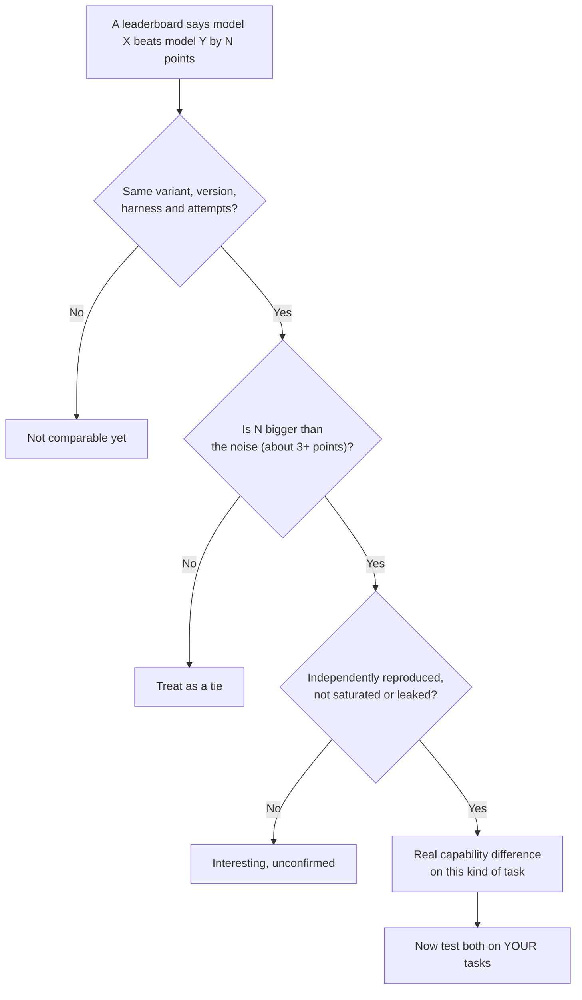

# Agent Benchmarks: SWE-bench, Terminal-Bench, tau-bench, GAIA and More: The Complete Guide

> 📚 **Before you start**
>
> - [Lab: An eval suite for a support agent](../02-evaluating-agents/lab-an-eval-suite-for-a-support-agent.md), because a public benchmark is the same four pieces you built there (world, tasks, graders, harness), just shared by everyone.
> - [Outcome, Trajectory and Tool-Use Grading](../02-evaluating-agents/outcome-trajectory-and-tool-use-grading.md) and [pass@k, pass^k and Noise](../02-evaluating-agents/pass-k-pass-k-and-noise.md), for how benchmarks grade and report.
> - [Coding Agents and Harness Engineering](../../coding-agents-and-harness-engineering/course.md) and [Computer-Use, Browser and Voice Agents](../../computer-use-browser-and-voice-agents/course.md), for the kinds of agents the coding and computer-use benchmarks test.

## Introduction

Every year, lakhs of students sit JEE and NEET. These exams matter because everyone takes the *same* paper under the *same* rules, so a rank in Kota means the same thing as a rank in Kozhikode. But every coaching-centre teacher also knows their limits: a rank says little about whether a student will be a good engineer or doctor, papers can leak, and a student can be drilled on past papers until they ace the pattern without understanding the subject.

Public agent benchmarks are the JEE of AI agents. SWE-bench, Terminal-Bench, tau-bench, GAIA, OSWorld and BrowseComp are shared exams that let anyone compare models and agents on identical tasks with identical graders. Model announcements quote them, leaderboards rank by them, and interviewers expect you to know them. But like an entrance exam, each one measures something narrow, in a particular way, under particular conditions. Read a score without knowing those details and you will draw the wrong conclusion.

This lesson walks through the major agent benchmarks in five families: what each task looks like, how it is graded, what the score does and doesn't tell you. It closes with a checklist for reading any leaderboard and advice on when a public benchmark is useful for *your* agent.

> 💡 **Key Insight**
>
> **A benchmark score measures one model, inside one harness, on one environment, graded one way.** Change the scaffold, the resource limits, the number of attempts or the grader, and the score changes. Treat leaderboards as a coarse map of capabilities, then measure your own agent on your own tasks.

---

## Core Explanation

### 1. The landscape in one picture

![Agent benchmarks grouped into five families, each with how it is graded. Coding in a repository: SWE-bench and its Verified, Pro and Multilingual variants, graded by running the repository's tests. Coding in a terminal: Terminal-Bench 2.0, graded by tests on the final container state. Conversations with tools and policies: tau-bench, tau2 and tau3, graded by comparing the final database with a target and checking required information was communicated, with consistency reported as pass^k. General assistants: GAIA and BrowseComp, graded by exact match on a short answer. Computer and web use: OSWorld and WebArena, graded by scripts that inspect the final state of the desktop or website. A harness layer underneath: Harbor, Inspect and each benchmark's own runner](/img/diagrams/agent-evals-observability-and-reliability/benchmark-landscape.svg)
*Five families of agent benchmark. Almost all of them grade the outcome, not the path.*

Notice the pattern from Module 2: nearly every serious agent benchmark grades the **outcome** (tests pass, database matches, answer matches, final screen state is right) rather than the trajectory. That's what makes them reproducible at scale.

### 2. SWE-bench: fix real GitHub issues

**What it is.** SWE-bench, introduced by Princeton researchers in 2023, takes real issues from popular open-source Python repositories (Django, scikit-learn, sympy, requests and others). For each task, the agent gets the repository checked out at the commit just before the issue was fixed, plus the issue text, and must change the code so the issue is resolved.

**How it's graded.** The benchmark keeps the tests that were added or changed in the real fix. After the agent finishes, the harness applies those tests and runs two groups:

- **FAIL_TO_PASS**: tests that failed before the real fix and passed after it. They must now pass: the issue is fixed.
- **PASS_TO_PASS**: tests that passed before and after. They must still pass: nothing else broke.

A task counts as **resolved** only if both groups pass. Here's the grading logic in a few lines, given a dictionary of test results from running the suite in the agent's repository:

```python
def swe_bench_resolved(results, fail_to_pass, pass_to_pass):
    """results maps test name -> 'PASSED' or 'FAILED' after the agent's patch."""
    fixed = all(results.get(t) == "PASSED" for t in fail_to_pass)
    nothing_broke = all(results.get(t) == "PASSED" for t in pass_to_pass)
    return fixed and nothing_broke

F2P = ["test_parse_date_with_timezone"]
P2P = ["test_parse_date_basic", "test_parse_date_iso", "test_format_date"]

attempts = {
    "good patch": {"test_parse_date_with_timezone": "PASSED", "test_parse_date_basic": "PASSED",
                   "test_parse_date_iso": "PASSED", "test_format_date": "PASSED"},
    "fixes issue, breaks formatting": {"test_parse_date_with_timezone": "PASSED", "test_parse_date_basic": "PASSED",
                                       "test_parse_date_iso": "PASSED", "test_format_date": "FAILED"},
    "no real fix": {"test_parse_date_with_timezone": "FAILED", "test_parse_date_basic": "PASSED",
                    "test_parse_date_iso": "PASSED", "test_format_date": "PASSED"},
}
for name, results in attempts.items():
    print(f"{name:<32} resolved = {swe_bench_resolved(results, F2P, P2P)}")
```

Output:

```
good patch                       resolved = True
fixes issue, breaks formatting   resolved = False
no real fix                      resolved = False
```

**The variants.** The original set has 2,294 tasks. Several subsets and successors exist:

| Variant | Size | What's different |
|---|---|---|
| **SWE-bench (full)** | 2,294 | The original; many tasks turned out to be underspecified or to have unfair tests |
| **SWE-bench Lite** | 300 | A cheaper subset for quick runs |
| **SWE-bench Verified** | 500 | Human-screened by professional developers (released with OpenAI in 2024) to remove unclear or unfair tasks; for two years the headline coding-agent number |
| **SWE-bench Multilingual** | 300 | Tasks from 42 repositories in 9 programming languages |
| **SWE-bench Multimodal** | 480 | Issues that involve visual elements, such as screenshots of a broken UI |
| **SWE-bench Pro** (from Scale AI) | 1,865 | Longer tasks (about 107 lines over 4 files on average) from copyleft-licensed and private commercial repositories, with a held-out set, partly to resist contamination |

**What the score tells you.** "The agent can make a correct, test-passing code change for this kind of issue in this kind of repository." **What it doesn't.** Whether the code is maintainable, whether the agent can work in *your* codebase, or whether it can handle tasks without existing tests. Also, scores on SWE-bench Verified climbed from around 40% to over 80% in about two years, and in February 2026 OpenAI announced it would stop reporting SWE-bench Verified: an audit of frequently failed problems found that many had flawed tests, and models showed signs of having seen the tasks during training. They recommended SWE-bench Pro instead. That story is the subject of the next lesson, [Contamination and Eval Awareness](contamination-and-eval-awareness.md).

### 3. Terminal-Bench: get real work done at the command line

**What it is.** Terminal-Bench tests agents that work in a terminal: compiling software, configuring servers, training a small model, fixing a broken build, recovering data. Version 2.0 (described in a January 2026 paper) has **89 tasks**, selected from over 200 community submissions, each reviewed for several hours.

**What a task contains.** An instruction in plain English, a Docker image that sets up the environment, a test script, a reference ("oracle") solution, and a time limit.

**How it's graded.** The tests check the **final state of the container**, not the commands the agent typed. Any sequence of commands that produces the right end state passes. Every task was checked to be *specific* (the tests only pass for an acceptable end state), *solvable* (the oracle solution passes) and resistant to shortcuts.

**The harness.** Terminal-Bench 2.0 runs through **Harbor**, a framework for running agent evaluations in containers at scale (dozens of sandboxes in parallel on cloud providers). Harbor can plug in different agents, such as Claude Code, Codex CLI, OpenHands or the benchmark's own reference agent, Terminus, so the same tasks compare *agents*, not only models.

**What to watch.** Terminal tasks install packages, compile code and use memory, so the **container's resources are part of the test**. As you saw in [pass@k, pass^k and Noise](../02-evaluating-agents/pass-k-pass-k-and-noise.md), Anthropic measured about a 6-point swing on Terminal-Bench 2.0 just from how strictly CPU and memory limits were enforced. At launch, frontier agents solved under 65% of tasks.

### 4. tau-bench: customer service with policies and a simulated user

**What it is.** tau-bench (written τ-bench), from Sierra, tests the kind of agent this course has been building: a customer-service agent with tools, a database and a written policy, talking to a customer. The customer is **simulated by another LLM**, given a hidden goal and persona, so every trial is a fresh conversation.

| Version | Domains | What it added |
|---|---|---|
| **τ-bench** (2024) | Airline, retail | Policy-following tool agents with a simulated user; introduced pass^k |
| **τ²-bench** (2025) | + telecom | *Dual control*: the user also has tools and must take actions on their own device (for example toggling a phone setting), so the agent must guide the user, not just act itself |
| **τ³-bench** (2026, same repository) | + banking with knowledge retrieval, voice | Retrieval over a document base, full-duplex voice conversations |

**How it's graded.** By default in the airline, retail and telecom domains, the reward is the product of two checks:

- **DB**: replay the *correct* actions on a fresh environment to get a target database state, and compare the agent's final database with it. Any path that ends in an equivalent state passes.
- **COMMUNICATE**: every piece of required information (say, a refund amount) must appear in the agent's messages to the user.

```python
import hashlib, json

def db_hash(db):
    return hashlib.sha256(json.dumps(db, sort_keys=True).encode()).hexdigest()[:12]

def tau_style_reward(agent_db, target_db, agent_messages, communicate_info):
    db_ok = db_hash(agent_db) == db_hash(target_db)
    comm_ok = all(any(info in m for m in agent_messages) for info in communicate_info)
    return int(db_ok) * int(comm_ok)

target = {"reservations": {"R1": {"flight": "AI-302", "cabin": "economy", "status": "cancelled"}}}
agent_a = {"reservations": {"R1": {"status": "cancelled", "cabin": "economy", "flight": "AI-302"}}}  # same state, other key order
agent_b = {"reservations": {"R1": {"flight": "AI-302", "cabin": "economy", "status": "active"}}}

print("A:", tau_style_reward(agent_a, target, ["Cancelled. Refund of 4520 will reach you in 7 days."], ["4520"]))
print("B:", tau_style_reward(agent_b, target, ["I have cancelled it, refund 4520."], ["4520"]))
print("A, silent on amount:", tau_style_reward(agent_a, target, ["Done, cancelled."], ["4520"]))
```

Output:

```
A: 1
B: 0
A, silent on amount: 0
```

Agent B *said* it cancelled but the database disagrees: reward 0, exactly the "saying is not doing" check from Module 2.

**Why it matters.** tau-bench reports **pass^k**, and it showed that even strong agents that solve a task once often fail it on a repeat attempt. For customer-facing work, that consistency number is the one to look at.

**What to watch.** The simulated user is itself an LLM, so some failures are the *simulator's* fault (it forgets its goal or invents details). The benchmark's maintainers fix tasks between versions; their v1.0.1 release (July 2026) changed some banking tasks, and scores from before and after are not comparable. Always note the version.

### 5. GAIA and BrowseComp: general assistants and deep research

**GAIA** ("General AI Assistants", from Meta, Hugging Face and others, 2023) has about **466 questions** that are easy for a human with a browser and some tools, but need several steps for an AI: reading a PDF, searching the web, doing arithmetic on what it found, sometimes looking at an image or a spreadsheet. Questions come in **three levels** by how many steps and tools they need. Answers are short (a number, a name, a short list), so grading is an exact match after normalisation. The answers for the test set are kept private on the leaderboard, which reduces leaking.

**BrowseComp** (from OpenAI, April 2025) has **1,266 questions** designed to be *hard to find but easy to check*: the answer is a short fact buried deep in the web, reachable only through persistent, creative searching. It measures research-agent persistence rather than reasoning over a given document.

Short-answer benchmarks live or die by normalisation. "1,200", "1200" and "1200.0" must match; "Mumbai" and "mumbai." must match; but "12" must not match "120". Here's a scorer in that spirit:

```python
import re

def normalise(ans):
    ans = ans.strip().lower().rstrip(".")
    number = ans.replace(",", "").replace("₹", "").replace("$", "").strip()
    try:
        return f"{float(number):g}"                      # 1200, 1200.0, 1,200 -> 1200
    except ValueError:
        return re.sub(r"\s+", " ", re.sub(r"[^\w\s,]", "", ans))

def exact_match(prediction, truth):
    p, t = normalise(prediction), normalise(truth)
    if "," in t:                                       # list answers: compare item by item
        return [normalise(x) for x in p.split(",")] == [normalise(x) for x in t.split(",")]
    return p == t

cases = [("1,200", "1200"), ("₹1200.0", "1200"), ("Mumbai.", "mumbai"), ("12", "120"),
         ("Pune, Nagpur", "pune,nagpur"), ("The answer is 1200", "1200")]
for pred, truth in cases:
    print(f"{pred!r:<22} vs {truth!r:<14} -> {exact_match(pred, truth)}")
```

Output:

```
'1,200'                vs '1200'         -> True
'₹1200.0'              vs '1200'         -> True
'Mumbai.'              vs 'mumbai'       -> True
'12'                   vs '120'          -> False
'Pune, Nagpur'         vs 'pune,nagpur'  -> True
'The answer is 1200'   vs '1200'         -> False
```

The last case shows why these benchmarks ask for **only** the final answer in a fixed format. An agent that wraps its answer in a sentence is marked wrong; in your own evals, decide whether that's what you want, or extract the answer first.

### 6. OSWorld and WebArena: operate computers and websites

These benchmarks test the computer-use and browser agents from the [Computer-Use, Browser and Voice Agents](../../computer-use-browser-and-voice-agents/course.md) course.

| Benchmark | Environment | Tasks | Graded by |
|---|---|---|---|
| **OSWorld** (2024; a cleaned-up OSWorld-Verified followed in 2025) | Real desktop operating systems in virtual machines, mostly Ubuntu, with real apps (office suite, browser, file manager, image editor) | About 369 tasks such as "convert this spreadsheet's dates to ISO format and save as CSV" | A script per task that inspects the final state: the saved file, the app's settings, the browser's state |
| **WebArena** (2023) | Self-hosted copies of realistic websites: a shop, a forum, a code host, a content-management system, maps | 812 tasks such as "find the cheapest order last month and request a refund" | Checks on the site's final state or the returned answer |

Both are expensive to run (virtual machines, many steps, screenshots) and sensitive to the environment: screen resolution, timing and website state all matter. They are the best public evidence of how well a model can *operate* software, but scores move a lot with the agent harness (how screenshots are taken, which accessibility information is given, how many steps are allowed).

### 7. Harnesses: the machinery under the benchmarks

You built a small eval harness in the lab. Public benchmarks need industrial-strength versions:

| Harness | From | What it does |
|---|---|---|
| **Harbor** | Terminal-Bench team | Runs containerised agent tasks in parallel on cloud sandboxes; hosts Terminal-Bench 2.0 and adapters for other benchmarks |
| **Inspect** | UK AI Security Institute | Open-source Python framework for writing evals (datasets, solvers, scorers, sandboxes, logs) with many benchmarks implemented |
| **Benchmark-specific runners** | Each benchmark | SWE-bench's Docker-based evaluation, tau-bench's `tau2` command line, OSWorld's VM controller |

Two consequences matter when you read results. First, **the same model scores differently in different harnesses**: a strong scaffold with good tools and retry logic can add many points. That's why SWE-bench added a view where every model runs in the same minimal agent. Second, if you want to compare *your* agent on a public benchmark, you'll usually run it through one of these harnesses, and you should report which one, with which settings.

### 8. How to read a leaderboard

Before believing that "X beats Y on benchmark Z", ask these questions:

| Question | Why it matters |
|---|---|
| **Which variant and version?** | Verified vs Pro, τ² vs τ³, v1.0 vs v1.0.1 can differ by tens of points |
| **Which harness or scaffold?** | A bigger scaffold can matter as much as a better model |
| **How many attempts?** | pass@1 vs pass@5 vs best-of-N with a selector are different numbers |
| **What compute budget?** | Thinking budget, step limits, time limits, container resources |
| **How many tasks, and what's the interval?** | Gaps of 1 to 3 points are often inside the noise |
| **Who ran it?** | Self-reported results can't always be reproduced; independently run results are stronger evidence |
| **Is the benchmark saturated or contaminated?** | Near-100% scores and tasks found on the open web make differences meaningless |



### 9. Using benchmarks for your own work

Public benchmarks are useful for:

- **Shortlisting models**: if your agent fixes code, a model that does poorly on SWE-bench Pro and Terminal-Bench is unlikely to do well for you.
- **Testing your harness**: running your agent scaffold on a public benchmark (through Harbor or Inspect) tells you whether your scaffold helps or hurts compared with published numbers.
- **Borrowing methods**: tau-bench's "replay correct actions to get a target state" and GAIA's "short, normalised answers" are good patterns for your own suites.

They are **not** a substitute for your own eval suite. Your users, your tools, your policies and your failure types aren't in any public benchmark. The lab you built in Module 2 is the eval that tells you whether *your* agent works.

---

## Try It Yourself

1. **Classify the benchmark.** Which benchmark family would best predict performance for: (a) an agent that books railway tickets on a website; (b) an agent that triages GitHub issues and opens fixes; (c) a bank's chatbot that must follow a written refund policy?
2. **Harden the scorer.** Extend `normalise` so that "1.2k" matches "1200" and "Rs. 1,200" matches "1200", without making "12" match "120".
3. **A partial-credit trap.** In `swe_bench_resolved`, a patch passes FAIL_TO_PASS but breaks one of 300 PASS_TO_PASS tests. Some people argue for partial credit. Write down one argument for and one against, from the point of view of a team that ships the agent's patches.

<details>
<summary>Show answers</summary>

**1.** (a) Web agents: WebArena-style tasks (and OSWorld if it uses desktop apps). (b) Coding in a repository: SWE-bench Pro and Multilingual, plus Terminal-Bench for environment setup. (c) tau-bench: policies, tools, a simulated customer and pass^k for consistency.

**2.**

```python
def normalise_v2(ans):
    a = ans.strip().lower().rstrip(".")
    a = re.sub(r"^(rs\.?|inr|₹)\s*", "", a)
    m = re.fullmatch(r"([\d.,]+)\s*k", a)
    if m:
        a = str(float(m.group(1).replace(",", "")) * 1000)
    return normalise(a)

for pred, truth in [("1.2k", "1200"), ("Rs. 1,200", "1200"), ("12", "120")]:
    print(f"{pred!r:<12} vs {truth!r:<7} -> {normalise_v2(pred) == normalise_v2(truth)}")
```

Output:

```
'1.2k'       vs '1200'  -> True
'Rs. 1,200'  vs '1200'  -> True
'12'         vs '120'   -> False
```

**3.** For partial credit: the patch did fix the issue, and a score that distinguishes "fixed but broke one test" from "did nothing" gives more signal when comparing agents. Against: a team merging this patch ships a regression; for anyone deploying the agent, a patch that breaks an existing test is a failed task, and binary scoring keeps the benchmark aligned with what users experience. Most benchmarks choose binary for exactly this reason.

</details>

---

## Real-World Examples

- **Model launch posts** typically quote SWE-bench (now increasingly SWE-bench Pro), Terminal-Bench, a tau-bench domain, OSWorld and BrowseComp, often with footnotes about scaffolds, attempts and compute. Those footnotes are where the real comparison lives.
- **Agent companies** run public benchmarks through Harbor or Inspect to check that a change to their scaffold (better tools, smarter context management) improves results across many tasks, not only on their own suite.
- **Enterprise teams** borrow tau-bench's design (simulated users, target database states, pass^k) to build private benchmarks of their own support workflows.

---

## Common Misconceptions

### "A benchmark score is a property of the model"

It's a property of the model, the harness, the environment, the number of attempts and the grader together. Change any of them and the score moves.

### "Higher on the leaderboard means better for my use case"

Only if your use case looks like the benchmark. A model that tops a research benchmark may be mediocre at following your refund policy.

### "Benchmarks check that agents did things the right way"

Almost all of them check the end state only. An agent that reaches the right state through a risky path still scores. Your own evals need the path rules.

### "Old benchmarks are still informative"

When top scores cluster near the ceiling, or tasks have leaked into training data, differences stop meaning much. Benchmarks have a lifespan.

---

## Interview Relevance

*"Which agent benchmarks do you know, and what do they measure?"* A strong answer groups them: SWE-bench (real GitHub issues, graded by FAIL_TO_PASS and PASS_TO_PASS tests; Verified, Pro, Multilingual variants), Terminal-Bench 2.0 (89 terminal tasks in containers, graded by tests on the final state, run via Harbor), tau-bench family (policy-following customer service with a simulated user, graded by database state and required communication, reporting pass^k), GAIA and BrowseComp (short verifiable answers requiring multi-step tool use or deep browsing), OSWorld and WebArena (computer and web use, graded by end-state scripts).

*"Model A scores 2 points higher than model B on SWE-bench. Does that matter?"* Check variant, harness, attempts, compute and resources; 2 points is often within noise and infrastructure variance; consider contamination; then test both on your own tasks.

---

## Key Takeaways

- **Five families**: coding in repositories (SWE-bench), coding in terminals (Terminal-Bench), policy-following conversations (tau-bench), general assistants and research (GAIA, BrowseComp), computer and web use (OSWorld, WebArena).
- **Almost all grade the outcome**: tests on the final code or container, the final database, a short exact answer, the final screen or site state.
- **Harnesses matter**: Harbor, Inspect and benchmark runners, plus scaffolds and resources, move scores as much as models do.
- **Read leaderboards critically**: variant, version, harness, attempts, compute, noise, independence, saturation and contamination.
- **Use benchmarks to shortlist and borrow methods**, and your own suite to decide.

---

**Up next:** [Contamination and Eval Awareness](contamination-and-eval-awareness.md)
