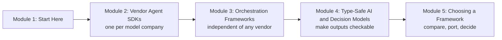

# How This Course Works

## Introduction

Walk into any big Indian railway station and you will find a dozen ways to get to the same city: Rajdhani, Shatabdi, a sleeper express, a Vande Bharat, an overnight bus outside the gate. They all move you from A to B. They differ in speed, price, comfort, how often they run and how stuck you are once you board. A seasoned traveller doesn't ask "which train is best?" They ask "which one fits *this* trip?"

Agent frameworks are the same. By October 2026 there are vendor SDKs from Anthropic, OpenAI, Google, Microsoft and AWS; orchestration frameworks such as LangGraph, Deep Agents, CrewAI, LlamaIndex, smolagents, Mastra and the Vercel AI SDK; type-first libraries such as Pydantic AI, Instructor and DSPy; and a brand-new kind of model, the **decision model**, that answers typed questions with probabilities instead of writing text. Each one promises to make agents easy. Each one runs the same loop you already built by hand in [Agentic AI Fundamentals](../../agentic-ai-fundamentals/course.md): ask the model, run the tool it asked for, feed back the result, stop when done.

This course is your guided tour. You will see what each framework actually looks like in code, what it adds on top of the plain loop, where it shines and where it hurts. Then you will learn to make your agents **type-safe**, so the parts that must never be wrong are checked by code, and finally you will learn how to **choose** a framework, and how to leave one without rewriting everything.

> 💡 **Key Insight**
>
> Every framework in this course is a different packaging of the same agent loop: **model, tools, state, stop rules**. Learn to see that loop inside each one and you can pick up any framework in an afternoon, judge it in a day, and replace it when you need to.

---

## What You Will Learn

By the end of this course you will be able to:

- **Build an agent with each major vendor SDK**: the Claude Agent SDK, the OpenAI Agents SDK, Google's Agent Development Kit, Microsoft Agent Framework, and AWS Strands Agents running on Bedrock AgentCore.
- **Use the main orchestration frameworks**: LangChain Deep Agents, CrewAI crews and flows, LlamaIndex agents and workflows, smolagents code agents, and TypeScript agents with Mastra and the Vercel AI SDK.
- **Explain why type safety matters** when probabilistic model output meets deterministic code, and enforce it with Pydantic, Pydantic AI and Instructor.
- **Use decision models** such as TypeSafe AI's Jev, which return typed answers with probabilities and confidence instead of text, and gate actions on that confidence.
- **Program instead of prompt** with DSPy signatures, modules and optimisers.
- **Build a typed routing layer** that sends each request to the right handler, asks for confirmation when unsure, and never passes an invalid object downstream.
- **Compare frameworks on one task**, reason about lock-in, and build the same agent in three ways behind one shared test suite.

### The course at a glance

*The four modules after Start Here. Read top to bottom: first the SDKs from model vendors, then independent frameworks, then the typed layer that makes any of them safer, then how to choose.*

**Module 2** covers the SDKs that model companies publish. They are usually the quickest way to use that company's newest features, and most now work with other providers' models too.

**Module 3** covers frameworks that don't belong to a model company. Each has a distinct idea: a ready-made harness, a team of role-playing agents, an event-driven workflow, agents that act by writing code, or agents written in TypeScript.

**Module 4** is about the boundary where model output enters your program. You will move from "parse the JSON and hope" to validated objects, typed agents, decision models that return probabilities, and programs whose prompts are optimised automatically.

**Module 5** pulls everything together: one task built in several frameworks, a clear-eyed look at lock-in, and a lab where three implementations pass the same tests.

---

## How Every Lesson Is Built

| Section | What it gives you |
|---|---|
| **Before you start** | Links to the earlier lessons this one depends on. |
| **Introduction** | Why the topic matters, with an everyday example. |
| **Key Insight** | The one idea to remember. |
| **Core Explanation** | The topic step by step, with diagrams, tables and code. |
| **Try It Yourself** | Exercises, with answers hidden in a fold. |
| **Real-World Examples** | How teams use the idea. |
| **Common Misconceptions** | Mistakes almost everyone makes, corrected. |
| **Interview Relevance** | What interviewers ask and what a strong answer covers. |
| **Key Takeaways** | A one-minute summary for revision. |

Labs replace the middle sections with numbered build steps.

---

## What You Need Before Starting

- **The agent loop and tool calling.** Read [The Agent Loop: Decide, Act, Observe](../../agentic-ai-fundamentals/03-the-agent-loop/the-agent-loop-decide-act-observe.md), [Function Calling Step by Step](../../agentic-ai-fundamentals/04-tools-and-function-calling/function-calling-step-by-step.md) and the [Lab: Tool-using agent from scratch](../../agentic-ai-fundamentals/04-tools-and-function-calling/lab-tool-using-agent-from-scratch.md). Everything here is compared against that hand-built loop.
- **The framework map.** [Overview of Agentic Frameworks](../../agentic-ai-fundamentals/06-multi-agent-systems-and-the-ecosystem/overview-of-agentic-frameworks.md) introduced the families of frameworks. This course goes inside each one.
- **LangGraph.** The [LangGraph Complete Guide](../../langgraph-complete-guide/course.md) is the reference framework of this platform. Several lessons compare against its graphs, state, checkpointers and interrupts.
- **MCP.** Many SDKs connect to tools through the Model Context Protocol. The [Model Context Protocol (MCP)](../../model-context-protocol-mcp/course.md) course explains hosts, clients, servers and tools.
- **Structured output and Pydantic.** [Structured JSON Output](../../generative-ai-and-llm-foundations/04-prompting-and-structured-output/structured-json-output.md) showed how to ask a model for JSON. Module 4 builds on it. If you have not met Pydantic yet, [Structured Output with Pydantic and JSON Schema](../../langchain-complete-guide/course.md#m5) introduces it; Module 4 also explains every Pydantic feature it uses.
- **Python async.** Most SDKs are asynchronous. [async and await for API Calls](../../python-programming/10-concurrency-for-ai-apps/async-and-await-for-api-calls.md) covers what you need.

### Do I need API keys or installs?

No, not to follow along. Runnable examples on this site use only the packages in the site's `requirements-lessons.txt` (LangGraph, LangChain Core, Pydantic and a few others) plus small **pretend models** written in plain Python, so every example runs offline and prints exactly what the lesson shows.

Each framework's real code is shown in blocks marked `# not-run`, written against the version that was current in October 2026 and checked against its official documentation and package source. Those blocks need the framework installed and an API key. Where a model name appears, it is `claude-opus-5-5`; every framework in this course can also use other providers' models.

### A note on versions

These libraries release every week or two. The versions this course was written against were:

| Library | Version (October 2026) |
|---|---|
| `claude-agent-sdk` (Python) | 0.2.x |
| `openai-agents` | 0.24 |
| `google-adk` | 2.x (2.0 went GA for Python on 19 May 2026) |
| `agent-framework` (Microsoft) | 1.x (1.0 GA on 3 April 2026) |
| `strands-agents` / `bedrock-agentcore` | 1.x |
| `deepagents` | 0.7 |
| `crewai` | 1.15 |
| `llama-index-core` | 0.14 |
| `smolagents` | 1.26 |
| `ai` (Vercel AI SDK) / `@mastra/core` | 7.x / 1.x |
| `pydantic-ai` | 2.x |
| `instructor` | 1.17 |
| `dspy` | 3.4 |
| `typesafe-sdk` (Jev) | 0.7 |

The *ideas* in each lesson change slowly. Exact parameter names change faster, so when a lesson's code and the library's docs disagree, trust the docs and look for the idea.

---

## How to Get the Most Out of It

1. **Find the loop.** In every framework, ask: where is the model called, where are tools run, where is state kept, and what stops the loop? Write the answers down; they make comparisons easy.
2. **Run the pretend versions first.** Each lesson recreates the framework's key idea in a few lines of plain Python. Once that makes sense, the real API is just naming.
3. **Keep one test task.** Pick a small task you care about (say, "triage a customer complaint and draft a reply") and imagine building it in each framework as you read. Module 5 asks you to do exactly that.
4. **Be suspicious of benchmarks in launch posts.** Several lessons quote vendors' own numbers. They are labelled as claims. Your own evaluation on your own data is the only benchmark that counts.

---

## Common Misconceptions

### "I need to learn every framework"

You need to understand the loop and recognise how each framework packages it. After this course, a new framework is a one-evening read, not a new subject.

### "Vendor SDKs only work with that vendor's models"

Most now accept other providers through adapters (LiteLLM, model routers or built-in clients). They are still *best* at their own vendor's features, which is a form of lock-in Module 5 discusses.

### "Type safety is a TypeScript thing"

In agent systems, type safety means "the object your code receives is guaranteed to have the shape and values it expects". In Python that is Pydantic validation, typed agents and decision models with fixed answer types. Module 4 is all about it.

---

## Key Takeaways

- **Every framework packages the same loop**: model, tools, state and stop rules, plus extras such as persistence, tracing and multi-agent patterns.
- **Module 2** covers vendor SDKs, **Module 3** independent orchestration frameworks, **Module 4** type safety and decision models, **Module 5** choosing and portability.
- **No API key is needed to follow along**: runnable code uses pretend models; real framework code is shown in `# not-run` blocks checked against the October 2026 versions.
- **Versions move fast**: learn the idea, then check the docs for exact names.

---

**Up next:** [Claude Agent SDK](../02-vendor-agent-sdks/claude-agent-sdk.md)
