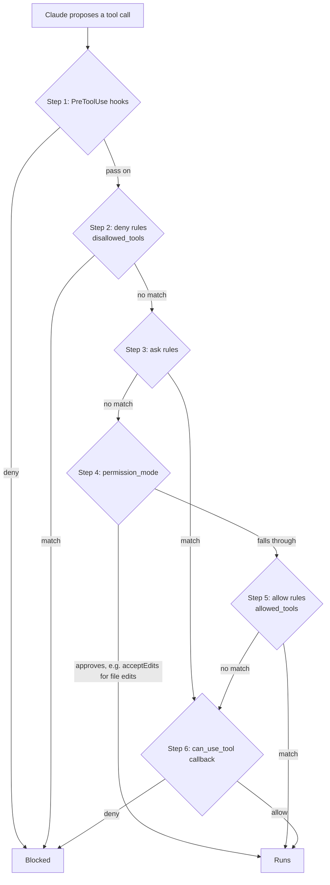

# Claude Agent SDK: The Complete Guide

> 📚 **Before you start**
>
> - [How This Course Works](../01-start-here/how-this-course-works.md), for the "find the loop" habit this module uses.
> - [Lab: Tool-using agent from scratch](../../agentic-ai-fundamentals/04-tools-and-function-calling/lab-tool-using-agent-from-scratch.md), the hand-built loop every SDK here is compared with.
> - [Hosts, Clients and Servers](../../model-context-protocol-mcp/course.md#m2), because the SDK adds your own tools as an MCP server.
> - [async and await for API Calls](../../python-programming/10-concurrency-for-ai-apps/async-and-await-for-api-calls.md), since the SDK is asynchronous.

## Introduction

Imagine you run a small CA firm in Pune. Every March, juniors spend days opening hundreds of client folders, reading bank statements, checking which TDS certificates are missing and writing a status note per client. You could build an agent for this from scratch: a loop, a "read file" tool, a "list folder" tool, a "write note" tool, permission checks so it never deletes anything, a way to resume when the laptop sleeps... Or you could start from an agent that already reads files, searches folders, runs commands, asks permission before risky actions and remembers its session, and just point it at the job.

That second option is the **Claude Agent SDK**. It packages the agent loop that powers Claude Code, Anthropic's coding agent, as a library you can call from Python or TypeScript. You get the loop, a set of built-in tools, permission controls, hooks, subagents, sessions and MCP support, and you add your own tools and rules.

By the end of this lesson you will know how the SDK is put together, how to run a one-off task with `query()`, how to hold a conversation with `ClaudeSDKClient`, how to add your own tools, how to control what the agent may do with permission modes, `can_use_tool` and hooks, how to use subagents, sessions and structured output, and when this SDK is (and isn't) the right choice.

> 💡 **Key Insight**
>
> Most SDKs give you a loop and ask you to bring tools. The Claude Agent SDK gives you a **working general-purpose agent** (files, shell, search, web) and asks you to **narrow and steer** it: choose which tools exist, which run without asking, which are blocked, and what your hooks check. Building with it is mostly *subtracting and guarding*, not adding.

---

## Core Explanation

### 1. What it is, in one picture


*Your code configures and listens; the bundled runtime runs the loop and the tools.*

Three facts explain most of how the SDK behaves:

| Fact | What it means for you |
|---|---|
| **The runtime is the Claude Code CLI, bundled inside the package** | `pip install claude-agent-sdk` brings the CLI with it (Python 3.10+). Your program starts it as a subprocess and talks to it. |
| **Everything comes back as a stream of messages** | You iterate over assistant messages, tool results and a final result message, the way you watched `stop_reason` in your own loop. |
| **Your own tools are an in-process MCP server** | You write a Python function, wrap it with `@tool`, and the SDK exposes it to Claude through MCP without a separate process. |

There is a TypeScript version too (`@anthropic-ai/claude-agent-sdk`) with the same concepts. This lesson uses Python.

How does this compare with your hand-built agent?

| Your loop from the fundamentals course | Claude Agent SDK |
|---|---|
| `while` loop over `stop_reason` | Runs inside the bundled runtime |
| Tools you wrote (`search_books`, ...) | Built-in tools (`Read`, `Write`, `Edit`, `Bash`, `Glob`, `Grep`, `WebSearch`, `WebFetch` and more) plus your own `@tool` functions |
| `harness_check()` allowlist | `allowed_tools`, `disallowed_tools`, `permission_mode`, `can_use_tool`, hooks |
| `MAX_STEPS` | `max_turns` and `max_budget_usd` |
| A `messages` list in memory | Sessions saved to disk that you can resume or fork |
| A supervisor function | Subagents defined with `AgentDefinition` |

### 2. Your first call: `query()`

`query()` is for one-off tasks: send a prompt, receive the messages, done. It is an `async` generator.

```python
# not-run: needs claude-agent-sdk installed and an ANTHROPIC_API_KEY
import anyio
from claude_agent_sdk import query, ClaudeAgentOptions, AssistantMessage, TextBlock, ResultMessage

options = ClaudeAgentOptions(
    model="claude-opus-5-5",
    system_prompt="You are an assistant for a CA firm. Be brief and precise.",
    cwd="/home/meera/clients/2026",
    allowed_tools=["Read", "Glob", "Grep"],   # these run without asking
    max_turns=8,
)

async def main():
    async for message in query(prompt="Which client folders have no Form 16 PDF?", options=options):
        if isinstance(message, AssistantMessage):
            for block in message.content:
                if isinstance(block, TextBlock):
                    print(block.text)
        elif isinstance(message, ResultMessage):
            print("turns:", message.num_turns, "cost: $", message.total_cost_usd)

anyio.run(main)
```

Example output:

```
I'll list the client folders first, then search each one for a Form 16 file.
Three folders have no Form 16 PDF: Deshpande_Traders, K_Iyer, and Sutar_Logistics.
turns: 4 cost: $ 0.0412
```

Notice what you did *not* write: no file-reading tool, no folder-listing tool, no loop. The agent used its built-in `Glob` and `Read` tools.

### 3. Reading the message stream

The stream is the SDK's equivalent of watching your own loop. The main message types are:

| Message | When it arrives | Useful fields |
|---|---|---|
| `SystemMessage` | At the start (and on some events) | `subtype`, `data` (for example the session id) |
| `AssistantMessage` | Each time Claude writes | `content`: a list of `TextBlock`, `ToolUseBlock`, `ThinkingBlock` |
| `UserMessage` | When tool results go back to Claude | `content` with `ToolResultBlock`s |
| `ResultMessage` | Once, at the end | `result`, `is_error`, `num_turns`, `total_cost_usd`, `session_id`, `structured_output` |

To make this concrete without an API key, here is a tiny pretend stream built from plain dataclasses that mirror those types, and a function that summarises a run the way you would in production logging.

```python
from dataclasses import dataclass, field

@dataclass
class TextBlock:
    text: str

@dataclass
class ToolUseBlock:
    id: str
    name: str
    input: dict

@dataclass
class AssistantMessage:
    content: list

@dataclass
class ResultMessage:
    subtype: str
    num_turns: int
    is_error: bool
    session_id: str
    total_cost_usd: float
    result: str = ""

pretend_stream = [
    AssistantMessage([TextBlock("Listing client folders."),
                      ToolUseBlock("t1", "Glob", {"pattern": "*/"})]),
    AssistantMessage([ToolUseBlock("t2", "Grep", {"pattern": "Form16", "path": "."})]),
    AssistantMessage([TextBlock("Three folders have no Form 16.")]),
    ResultMessage("success", 3, False, "sess-7f2a", 0.0412, "Three folders have no Form 16."),
]

def summarise(stream):
    tools_used = []
    for msg in stream:
        if isinstance(msg, AssistantMessage):
            tools_used += [b.name for b in msg.content if isinstance(b, ToolUseBlock)]
        elif isinstance(msg, ResultMessage):
            status = "FAILED" if msg.is_error else "ok"
            return f"{status} in {msg.num_turns} turns, tools={tools_used}, session={msg.session_id}"

print(summarise(pretend_stream))
```

Output:

```
ok in 3 turns, tools=['Glob', 'Grep'], session=sess-7f2a
```

Keep the `session_id`: section 8 uses it to resume.

### 4. Conversations: `ClaudeSDKClient`

`query()` is one-shot. When you need a back-and-forth conversation, follow-up questions, interrupts, or your own tools and hooks, use `ClaudeSDKClient` as an async context manager:

```python
# not-run: needs claude-agent-sdk and an API key
from claude_agent_sdk import ClaudeSDKClient, ClaudeAgentOptions

async def chat():
    options = ClaudeAgentOptions(model="claude-opus-5-5", allowed_tools=["Read", "Glob"])
    async with ClaudeSDKClient(options=options) as client:
        await client.query("Summarise the GST notices in ./notices")
        async for msg in client.receive_response():
            print(msg)
        await client.query("Which of those has the earliest reply deadline?")   # same conversation
        async for msg in client.receive_response():
            print(msg)
```

The client also exposes `interrupt()` to stop a running turn, and `set_permission_mode()` and `set_model()` to change settings mid-conversation.

### 5. Adding your own tools

Built-in tools cover files, shell and web. Business actions (looking up a client in your practice software, raising an invoice) are your own tools. You write an `async` function that receives the arguments as a dictionary and returns MCP-style content, wrap it with `@tool(name, description, input_schema)`, put it in an in-process server with `create_sdk_mcp_server`, and register that server in `mcp_servers`.

```python
# not-run: needs claude-agent-sdk and an API key
from claude_agent_sdk import tool, create_sdk_mcp_server, ClaudeAgentOptions, ClaudeSDKClient

@tool("pending_tds", "List TDS certificates still missing for a client PAN.", {"pan": str})
async def pending_tds(args):
    missing = PRACTICE_DB.missing_tds(args["pan"])          # your own code
    return {"content": [{"type": "text", "text": ", ".join(missing) or "none"}]}

practice = create_sdk_mcp_server(name="practice", version="1.0.0", tools=[pending_tds])

options = ClaudeAgentOptions(
    model="claude-opus-5-5",
    mcp_servers={"practice": practice},
    allowed_tools=["mcp__practice__pending_tds", "Read"],
)
```

Two details trip people up:

- **The tool's full name** is `mcp__<server key>__<tool name>`, here `mcp__practice__pending_tds`. That is the name you put in `allowed_tools`.
- **The handler is plain Python**, so test it without any model:

```python
import asyncio

PRACTICE = {"ABCPD1234K": ["Q2 26Q", "Q3 26Q"], "XYZPS9876L": []}

async def pending_tds(args):
    missing = PRACTICE.get(args["pan"], [])
    return {"content": [{"type": "text", "text": ", ".join(missing) or "none"}]}

for pan in ["ABCPD1234K", "XYZPS9876L"]:
    reply = asyncio.run(pending_tds({"pan": pan}))
    print(pan, "->", reply["content"][0]["text"])
```

Output:

```
ABCPD1234K -> Q2 26Q, Q3 26Q
XYZPS9876L -> none
```

You can also connect external MCP servers (stdio or HTTP) in the same `mcp_servers` dictionary, exactly as you did in the MCP course.

### 6. Controlling what the agent may do

This is the most important section, because the agent starts with powerful tools. The SDK's documentation describes a fixed order of checks for every tool call:



The levers, from coarse to fine:

| Lever | What it does |
|---|---|
| `tools` | Which built-in tools exist at all. Tools left out are not shown to Claude. |
| `disallowed_tools` | Deny rules. A bare name such as `"Bash"` removes the tool from the request entirely; a scoped rule such as `"Bash(rm *)"` blocks only matching calls, in every mode. |
| `allowed_tools` | Allow rules: tools that run **without asking**. It is an auto-approve list, not a list of what exists. |
| `permission_mode` | The default stance: `"default"`, `"acceptEdits"` (auto-approve file edits in the working directory), `"plan"` (explore and plan, no edits without approval), `"dontAsk"` (anything that would prompt is denied), `"bypassPermissions"` (approve almost everything; use only in a sandbox), `"auto"` (a classifier model reviews risky actions). |
| `can_use_tool` | Your async callback for calls nothing earlier resolved. Returns `PermissionResultAllow` (optionally with `updated_input`) or `PermissionResultDeny(message=...)`. |
| `hooks` | Your functions the runtime calls at fixed points, such as `PreToolUse` and `PostToolUse`. A `PreToolUse` hook runs first and its deny applies even in `bypassPermissions` mode. |
| `max_turns`, `max_budget_usd` | Hard stops on length and spend. |

Two common bugs come from this order:

- **Treating `allowed_tools` as a security boundary.** It only means "don't ask me about these". Unlisted tools still exist, and in `bypassPermissions` mode they are approved anyway. To stop a tool, use `disallowed_tools`, `tools` or a hook.
- **Putting checks in `can_use_tool` for tools you also auto-approved.** A call approved earlier (by an allow rule or the mode) never reaches the callback. Checks that must run on *every* call belong in a `PreToolUse` hook.

For a locked-down headless agent, a good default is a short `allowed_tools` list plus `permission_mode="dontAsk"`: listed tools run, everything that would have needed a prompt is denied.

Here is a `PreToolUse` hook that blocks dangerous shell commands. The hook signature is `(input_data, tool_use_id, context)`, and a deny looks like this:

```python
import asyncio

BLOCKED = ["rm -rf", "git push --force", "curl "]

async def guard_bash(input_data, tool_use_id, context):
    if input_data["tool_name"] != "Bash":
        return {}                                   # no opinion
    command = input_data["tool_input"].get("command", "")
    for pattern in BLOCKED:
        if pattern in command:
            return {"hookSpecificOutput": {
                "hookEventName": "PreToolUse",
                "permissionDecision": "deny",
                "permissionDecisionReason": f"blocked pattern: {pattern.strip()}",
            }}
    return {}

calls = [
    {"tool_name": "Bash", "tool_input": {"command": "ls clients/"}},
    {"tool_name": "Bash", "tool_input": {"command": "rm -rf clients/old"}},
    {"tool_name": "Read", "tool_input": {"file_path": "notes.md"}},
]
for call in calls:
    decision = asyncio.run(guard_bash(call, "t1", None))
    verdict = decision.get("hookSpecificOutput", {}).get("permissionDecisionReason", "no objection")
    print(f"{call['tool_name']:<5} {verdict}")
```

Output:

```
Bash  no objection
Bash  blocked pattern: rm -rf
Read  no objection
```

And this is how you would register it, together with a `can_use_tool` callback:

```python
# not-run: needs claude-agent-sdk and an API key
from claude_agent_sdk import ClaudeAgentOptions, HookMatcher, PermissionResultAllow, PermissionResultDeny

async def ask_policy(tool_name, tool_input, context):
    if tool_name == "Write" and not tool_input["file_path"].startswith("/home/meera/clients/notes/"):
        return PermissionResultDeny(message="You may only write inside clients/notes/.")
    return PermissionResultAllow()

options = ClaudeAgentOptions(
    model="claude-opus-5-5",
    allowed_tools=["Read", "Glob", "Grep"],
    disallowed_tools=["WebFetch"],
    permission_mode="default",
    can_use_tool=ask_policy,
    hooks={"PreToolUse": [HookMatcher(matcher="Bash", hooks=[guard_bash])]},
    max_turns=20,
    max_budget_usd=1.00,
)
```

Notice the pattern from [How an Agent Decides What to Do Next](../../agentic-ai-fundamentals/03-the-agent-loop/how-an-agent-decides-what-to-do-next.md): the model proposes, your code disposes. The SDK simply gives you more places to dispose.

### 7. Subagents

A subagent is a helper agent with its own instructions, its own tool list and, crucially, its **own fresh context window**. The main agent delegates a self-contained job ("check every folder for missing PAN cards") and receives only the summary, so its own context stays small. You define them with `AgentDefinition`:

```python
# not-run: needs claude-agent-sdk and an API key
from claude_agent_sdk import ClaudeAgentOptions, AgentDefinition

options = ClaudeAgentOptions(
    model="claude-opus-5-5",
    agents={
        "document-checker": AgentDefinition(
            description="Checks one client folder for missing tax documents. Use for per-client checks.",
            prompt="You audit a single client folder. Report missing documents as a bullet list.",
            tools=["Read", "Glob"],
            model="haiku",            # an alias or a full model id
        ),
    },
)
```

The `description` matters most: like a tool description, it is what the main agent reads when deciding whether to delegate. Multi-agent design gets a full course later in [Multi-Agent Systems and Agent Protocols](../../multi-agent-systems-and-agent-protocols/course.md#m2).

### 8. Sessions, structured output and project settings

**Sessions.** Every run has a `session_id` (in the `ResultMessage`). Pass `resume=session_id` to continue it later, and add `fork_session=True` to branch off a copy instead of extending the original, which is handy for trying two approaches from the same starting point.

**Structured output.** Set `output_format` to a JSON Schema and the final answer arrives as data in `ResultMessage.structured_output`:

```python
# not-run: needs claude-agent-sdk and an API key
schema = {
    "type": "object",
    "properties": {
        "missing_form16": {"type": "array", "items": {"type": "string"}},
        "folders_checked": {"type": "integer"},
    },
    "required": ["missing_form16", "folders_checked"],
}
options = ClaudeAgentOptions(model="claude-opus-5-5", output_format={"type": "json_schema", "schema": schema})
# ... later, on the ResultMessage:
# result.structured_output -> {"missing_form16": ["Deshpande_Traders", "K_Iyer"], "folders_checked": 112}
```

Module 4 of this course shows how to turn such a dictionary into a validated Python object.

**Project settings.** With `setting_sources=["project"]`, the runtime loads the project's `CLAUDE.md` memory file, skills and settings from the working directory, just as Claude Code does. You met these files in [Memory Files: CLAUDE.md and AGENTS.md](../../context-engineering-and-agent-memory/04-memory-systems/memory-files-claude-md-and-agents-md.md). The `skills` option controls which Agent Skills are available, and `sandbox` configures sandboxed command execution.

### 9. When to use it, and when not to

| Good fit | Poor fit |
|---|---|
| Agents that work with **files, code, documents and the shell**: research, audits, data clean-up, coding tasks | Simple one-call extraction (use a plain API call with structured output) |
| You want a **capable agent today** and prefer narrowing it to building tools from zero | You need fine-grained control of every step as an explicit graph (LangGraph fits better) |
| Long tasks that benefit from **subagents, compaction and resumable sessions** | Your team must run on a non-Anthropic model as the main brain |
| You already use Claude Code and want the same behaviour in a product or CI job | Ultra-low-latency decisions (a decision model, Module 4, is faster) |

Anthropic also offers hosted agent infrastructure (Managed Agents) where the loop runs on Anthropic's side; the SDK is the self-hosted, in-your-process option. Running agents in production is covered in [Shipping Agents to Production](../../shipping-agents-to-production/course.md#m2).

---

## Try It Yourself

1. **Extend the hook.** Make `guard_bash` also block any command containing `sudo`, and return the reason `"blocked pattern: sudo"`.
2. **Summarise errors.** Add a failing `ResultMessage("error_max_turns", 8, True, "sess-9", 0.20)` to a copy of `pretend_stream` (replacing the last item) and run `summarise` on it.
3. **Name the tool.** Your MCP server is registered as `mcp_servers={"gst": server}` and the tool is `@tool("file_return", ...)`. What string goes in `allowed_tools`, and why does putting it there *not* make the tool safe?

<details>
<summary>Show answers</summary>

**1.**

```python
BLOCKED.append("sudo")
print(asyncio.run(guard_bash({"tool_name": "Bash", "tool_input": {"command": "sudo apt update"}}, "t9", None)))
```

Output:

```
{'hookSpecificOutput': {'hookEventName': 'PreToolUse', 'permissionDecision': 'deny', 'permissionDecisionReason': 'blocked pattern: sudo'}}
```

**2.**

```python
failing = pretend_stream[:-1] + [ResultMessage("error_max_turns", 8, True, "sess-9", 0.20)]
print(summarise(failing))
```

Output:

```
FAILED in 8 turns, tools=['Glob', 'Grep'], session=sess-9
```

**3.** `"mcp__gst__file_return"`. `allowed_tools` only means "run without asking". If filing a return is risky, keep it out of `allowed_tools` so it goes through `can_use_tool` (or a human approval step), and validate its inputs inside the tool itself.

</details>

---

## Real-World Examples

- **Internal research and audit agents.** Teams point the SDK at a folder of contracts, invoices or logs, allow only read tools, and ask for a structured report via `output_format`.
- **CI jobs.** A headless agent runs in a pipeline to triage failing tests or update documentation, with `max_turns` and `max_budget_usd` as hard limits. [Running Coding Agents in GitHub Actions](../../coding-agents-and-harness-engineering/03-coding-agents-on-github/running-coding-agents-in-github-actions.md) shows the workflow side.
- **Customer-facing assistants with business tools.** The built-in file and shell tools are switched off with `tools`, and only in-process `@tool` functions (order lookup, refund request) are exposed, each guarded by `can_use_tool`.

---

## Common Misconceptions

### "allowed_tools is the list of tools the agent can use"

It is the list of tools that run without a permission prompt. Other tools still exist and fall through to `permission_mode` and `can_use_tool`. Use `tools` or `disallowed_tools` to remove or block tools.

### "The SDK is just a wrapper around the Messages API"

It runs a full agent runtime (the same one as Claude Code) with built-in tools, context compaction, sessions and subagents. A plain Messages API call does none of that.

### "Hooks are prompts"

Hooks are **your code**, run by the runtime at fixed points. They are deterministic: a hook that denies `rm -rf` denies it every time, which a sentence in the system prompt cannot promise.

---

## Interview Relevance

*"How would you build a document-processing agent with the Claude Agent SDK, and how would you keep it safe?"* A strong answer describes `query()` for one-off jobs and `ClaudeSDKClient` for conversations; custom tools as an in-process MCP server with `@tool` and `create_sdk_mcp_server`; the permission layers (`tools`, `allowed_tools` as auto-approve only, `disallowed_tools`, `permission_mode`, `can_use_tool`, `PreToolUse` hooks); hard limits with `max_turns` and `max_budget_usd`; subagents for parallel, context-isolated work; sessions with `resume` and `fork_session`; and `output_format` for machine-readable results. Mention that the SDK bundles the Claude Code runtime, so its behaviour matches Claude Code.

---

## Key Takeaways

- **The Claude Agent SDK is Claude Code's agent loop as a library**, with built-in file, shell and web tools.
- **`query()` is one-shot; `ClaudeSDKClient` holds a conversation** and supports interrupts, custom tools and hooks.
- **Your tools are an in-process MCP server**, named `mcp__<server>__<tool>`.
- **Safety is layered**: `tools`, `disallowed_tools`, hooks, `allowed_tools` (auto-approve only), `permission_mode`, `can_use_tool`, plus `max_turns` and `max_budget_usd`.
- **Subagents, sessions and `output_format`** cover delegation, resumption and machine-readable results.

---

**Up next:** [OpenAI Agents SDK](openai-agents-sdk.md)
