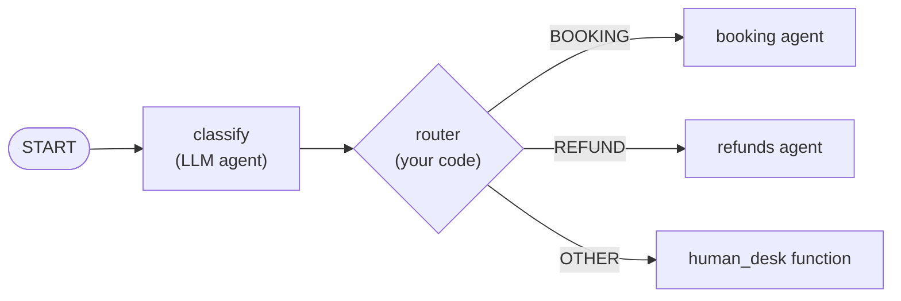

# Google Agent Development Kit (ADK): The Complete Guide

> 📚 **Before you start**
>
> - [OpenAI Agents SDK](openai-agents-sdk.md), for agents, handoffs and the shared SDK anatomy.
> - [Conditional Workflows](../../langgraph-complete-guide/03-workflow-patterns-in-langgraph/conditional-workflows.md), because ADK 2.0 also models work as a graph with routed edges.
> - [Persistence and Checkpointers](../../langgraph-complete-guide/06-chatbots-and-persistence/persistence-and-checkpointers.md), for why sessions are stored outside the agent.

## Introduction

Think of how a big wedding gets organised in an Indian family. There is a coordinator (usually a calm uncle) who knows who does what. The caterer, the decorator and the pandit are specialists. Some steps happen in a fixed order (engagement, haldi, mehendi, wedding), some happen in parallel (decoration while cooking), and some depend on a decision ("if it rains, move the sangeet indoors"). Nobody writes this down as free-form chat. It is a plan with people, steps and branches.

**Google's Agent Development Kit (ADK)** is built for exactly that mix. It has **agents** (an LLM with instructions and tools, like the specialists), and since version 2.0 it has a **graph-based Workflow runtime** where agents, tools and plain functions are nodes connected by edges, including routed edges ("if it rains, go here"). It also brings a developer web UI, an evaluation command and one-command deployment to Google Cloud.

By the end of this lesson you will be able to define ADK agents with function tools, run them with a `Runner` and a session service, share data between agents through session state, compose agents into a `Workflow` graph with routing, use non-Gemini models such as Claude, and use the `adk` command line to test, evaluate and deploy.

> 💡 **Key Insight**
>
> ADK 2.0 treats **everything as a node in a graph**: an LLM agent, a tool, or a plain Python function. You choose, edge by edge, where the model is allowed to decide (an agent node) and where your code decides (a function node that emits a route). That makes ADK a hybrid of an agent SDK and a workflow engine like LangGraph.

---

## Core Explanation

### 1. The pieces

| Piece | What it is | Where you met the idea |
|---|---|---|
| `Agent` (also called `LlmAgent`) | `name`, `model`, `instruction`, `description`, `tools`, `sub_agents`, `output_key`, `output_schema`, callbacks | A system prompt with tools |
| Function tools | Plain Python functions in `tools=[...]`; ADK builds the schema from type hints and the docstring | Your `@tool` registry |
| `Workflow` | A graph of nodes (agents, functions, tools) with `edges`, including routing dictionaries | LangGraph `StateGraph` |
| `Runner` | Runs an agent or workflow for a user and session, streaming `Event`s | Your loop |
| Session service | Stores each conversation's events and **state** (in memory, SQLite, a database, or Vertex AI) | Checkpointers |
| Callbacks | `before_model_callback`, `after_tool_callback` and friends: your code at fixed points | Hooks |
| `adk` CLI | `adk run`, `adk web`, `adk eval`, `adk deploy` | Tooling around the loop |

Install with `pip install google-adk` (Python 3.11 or newer for the 2.x line). ADK also exists for Java, Kotlin, Go and TypeScript. Version 2.0 became generally available for Python on 19 May 2026; `pip install "google-adk~=1.0"` keeps the older line if you depend on it.

### 2. A first agent with a tool

ADK's convention is a folder per agent with an `agent.py` that defines `root_agent`. The CLI discovers it by that name.

```python
# not-run: needs google-adk and a Gemini API key (GOOGLE_API_KEY)
# file: train_helper/agent.py
from google.adk import Agent

def find_trains(source: str, destination: str, date: str) -> dict:
    """Find trains between two stations on a date (YYYY-MM-DD).

    Returns a list of trains with name, departure time and seats left.
    """
    return RAILWAY_API.search(source, destination, date)      # your code

root_agent = Agent(
    name="train_helper",
    model="gemini-3.5-flash",
    description="Helps travellers find trains in India.",
    instruction="Find trains with find_trains. Mention the departure time and seats left. Be brief.",
    tools=[find_trains],
)
```

Then, from the folder above it:

```bash
adk run train_helper        # chat in the terminal
adk web .                   # open the developer web UI with traces of every event
```

Example output:

```
[user]: Pune to Mumbai tomorrow morning?
[train_helper]: Deccan Queen (12124) leaves Pune at 07:15, 64 seats left. Pragati Express (12126) leaves at 07:50, 12 seats left.
```

The function's **docstring is the tool description** and its **type hints are the schema**, so write them for the model, exactly as you learned in [Designing Good Tools](../../agentic-ai-fundamentals/04-tools-and-function-calling/designing-good-tools.md). If you leave out `model`, ADK uses its default Gemini model (`gemini-3.5-flash` in the current release).

### 3. Running from your own code: Runner, sessions and events

Outside the CLI you create a `Runner`, a session service and a session, then send a message. The runner yields **events**: model text, tool calls, tool results, state changes.

```python
# not-run: needs google-adk and an API key
import asyncio
from google.adk.runners import Runner
from google.adk.sessions import InMemorySessionService
from google.genai import types

async def main():
    sessions = InMemorySessionService()
    runner = Runner(app_name="trains", agent=root_agent, session_service=sessions)
    session = await sessions.create_session(app_name="trains", user_id="asha")
    message = types.Content(role="user", parts=[types.Part(text="Pune to Mumbai tomorrow morning?")])
    async for event in runner.run_async(user_id="asha", session_id=session.id, new_message=message):
        if event.is_final_response():
            print(event.content.parts[0].text)

asyncio.run(main())
```

Swap `InMemorySessionService` for a SQLite, database or Vertex AI session service and the same conversation survives restarts. For quick tests, `InMemoryRunner(agent=...)` creates the in-memory services for you.

### 4. Session state and `output_key`

Every session has a **state** dictionary. An agent with `output_key="plan"` saves its final answer into `state["plan"]`, and later agents can read it in their instructions with a `{plan}` placeholder. This is how ADK passes data between steps without stuffing everything into the chat history.

```python
# not-run: needs google-adk and an API key
planner = Agent(name="planner", instruction="Plan a 2-day Mysuru trip for the user.", output_key="plan")
budgeter = Agent(name="budgeter", instruction="Estimate the cost in rupees of this plan:\n{plan}", output_key="budget")
```

Here is the same mechanism in plain Python, so you can see exactly what happens to state:

```python
import re

def run_agent(agent, state, pretend_reply):
    prompt = re.sub(r"\{(\w+)\}", lambda m: str(state[m.group(1)]), agent["instruction"])
    if agent.get("output_key"):
        state[agent["output_key"]] = pretend_reply
    return prompt

state = {}
planner = {"instruction": "Plan a 2-day Mysuru trip.", "output_key": "plan"}
budgeter = {"instruction": "Estimate the cost in rupees of this plan: {plan}", "output_key": "budget"}

run_agent(planner, state, "Day 1 palace and Chamundi Hills; Day 2 Srirangapatna")
prompt_seen = run_agent(budgeter, state, "About 6,500 rupees for two people")
print("Budgeter saw:", prompt_seen)
print("State keys:", sorted(state))
```

Output:

```
Budgeter saw: Estimate the cost in rupees of this plan: Day 1 palace and Chamundi Hills; Day 2 Srirangapatna
State keys: ['budget', 'plan']
```

### 5. Multi-agent: sub-agents and transfer

Give an agent `sub_agents=[...]` and it can **transfer** the conversation to one of them, similar to a handoff in the OpenAI Agents SDK. Each sub-agent's `description` is what the parent reads to decide.

```python
# not-run: needs google-adk and an API key
booking = Agent(name="booking", description="Books and cancels train tickets.", instruction="...", tools=[book, cancel])
refunds = Agent(name="refunds", description="Answers refund and TDR questions.", instruction="...", tools=[refund_status])
root_agent = Agent(name="rail_desk", instruction="Greet the traveller and route them to the right desk.",
                   sub_agents=[booking, refunds])
```

ADK 1.x also had `SequentialAgent`, `ParallelAgent` and `LoopAgent` for fixed orders. They still exist, but in 2.0 the recommended way to fix the order of work is a `Workflow`.

### 6. Workflows: agents as nodes in a graph

A `Workflow` is built from `edges`. An edge tuple such as `("START", a, b)` means "start, then run a, then b". A node can be an `Agent`, a function, or a tool. A function node can return `Event(route="...")`, and a **routing dictionary** maps each route value to the next node.

```python
# not-run: needs google-adk and an API key
from google.adk import Agent, Event, Workflow

classify = Agent(name="classify", instruction="Reply with one word: booking, refund or other.",
                 output_key="kind")

def router(node_input: str):
    """Send the request down the right branch based on the classifier's word."""
    word = node_input.strip().lower()
    if word == "refund":
        return Event(route="REFUND")
    if word == "booking":
        return Event(route="BOOKING")
    return Event(route="OTHER")

def human_desk(node_input: str):
    return Event(output="Connecting you to a person at the help desk.")

root_agent = Workflow(
    name="rail_workflow",
    edges=[
        ("START", classify, router),
        (router, {"BOOKING": booking, "REFUND": refunds, "OTHER": human_desk}),
    ],
)
```



The difference from section 5 is **who decides the branch**. With `sub_agents`, the model chooses whether to transfer. In this workflow, the model only classifies and **your function** picks the route, so the control flow is deterministic and testable. Route values can be strings, numbers or booleans. Workflows also support fan-out and fan-in, loops, retries, nested workflows and pausing for human input.

To make the routing idea concrete, here is a tiny graph runner in plain Python with the same shape: chains, a router that returns a route value, and a routing dictionary.

```python
def classify(text):
    return "refund" if "refund" in text.lower() or "tdr" in text.lower() else (
        "booking" if "book" in text.lower() else "other")

def router(word):
    return {"route": word.upper()}

def booking(text):  return "Booking desk: which date and class?"
def refunds(text):  return "Refund desk: please share your PNR."
def human(text):    return "Connecting you to a person."

EDGES = [("START", classify, router), (router, {"BOOKING": booking, "REFUND": refunds, "OTHER": human})]

def run_workflow(edges, user_text):
    chain = edges[0][1:]
    value = user_text
    for node in chain:
        value = node(value)
    routes = next(edge[1] for edge in edges if edge[0] is router)
    next_node = routes[value["route"]]
    return next_node.__name__, next_node(user_text)

for text in ["I want to book Pune to Goa", "Filed TDR, where is my refund?", "Lost my bag on the train"]:
    print(run_workflow(EDGES, text))
```

Output:

```
('booking', 'Booking desk: which date and class?')
('refunds', 'Refund desk: please share your PNR.')
('human', 'Connecting you to a person.')
```

### 7. Using Claude and other models

ADK is optimised for Gemini but model-agnostic. Two common routes:

```python
# not-run: needs google-adk with the anthropic extra and an ANTHROPIC_API_KEY
from google.adk import Agent
from google.adk.models.anthropic_llm import AnthropicLlm
from google.adk.models.lite_llm import LiteLlm

direct = Agent(name="helper", model=AnthropicLlm(model="claude-opus-5-5"), instruction="...")
via_litellm = Agent(name="helper", model=LiteLlm(model="anthropic/claude-opus-5-5"), instruction="...")
```

A plain string starting with `claude-` is resolved to Claude **served through Vertex AI**, which needs a Google Cloud project; the two classes above call Anthropic's API.

### 8. Callbacks, evaluation and deployment

**Callbacks** let your code run around model and tool calls. A `before_tool_callback` can inspect arguments and return a result to skip the real tool (for example, to block a cancellation without approval). For risky tools ADK also has a built-in **tool confirmation** flow that pauses for a human. In 2.0, prefer callbacks over overriding internal methods; overriding legacy methods such as `_run_async_impl()` is silently ignored.

**Evaluation** is built in. You save test conversations as an eval set and run:

```bash
adk eval train_helper train_helper/smoke.evalset.json
```

Evals check both the **final response** and the **tool trajectory** (which tools were called, in which order). The ideas behind this are taught in [Agent Evals, Observability and Reliability](../../agent-evals-observability-and-reliability/course.md#m2).

**Deployment** is a command away: `adk deploy cloud_run <agent-folder>` (or `adk deploy docker`), or deploy to **Vertex AI Agent Engine**, Google's managed runtime for agents.

### 9. When to use it

| Good fit | Poor fit |
|---|---|
| Teams on **Google Cloud and Gemini** who want deployment, evals and a dev UI in one kit | Teams that want the smallest possible library |
| Apps that mix **LLM decisions with deterministic routing** in one graph | Pure coding or file agents (the Claude Agent SDK is ready-made for that) |
| Multi-language organisations (Python, Java, Go, TypeScript, Kotlin) | Projects that must avoid any cloud-vendor tooling |

---

## Try It Yourself

1. **Add a branch.** Add a `"CANCEL"` route to the plain-Python workflow: `classify` returns `"cancel"` when the text contains "cancel", and a `cancel_desk` function answers `"Cancellation desk: share your PNR."`.
2. **Chain state.** Add a third pretend agent `"packer"` with instruction `"Packing list for: {plan} within {budget}"` and print the prompt it sees.
3. **Who decides?** In the `rail_desk` agent with `sub_agents` and in `rail_workflow`, who chooses the refund desk for "Where is my TDR refund?" Which one would you unit-test without a model?

<details>
<summary>Show answers</summary>

**1.**

```python
_old_classify = classify

def classify(text):
    return "cancel" if "cancel" in text.lower() else _old_classify(text)

def cancel_desk(text): return "Cancellation desk: share your PNR."

EDGES = [("START", classify, router),
         (router, {"BOOKING": booking, "REFUND": refunds, "OTHER": human, "CANCEL": cancel_desk})]
print(run_workflow(EDGES, "Please cancel my Shatabdi ticket"))
```

Output:

```
('cancel_desk', 'Cancellation desk: share your PNR.')
```

**2.**

```python
packer = {"instruction": "Packing list for: {plan} within {budget}", "output_key": "packing"}
print(run_agent(packer, state, "Cotton clothes, umbrella, comfortable shoes"))
```

Output:

```
Packing list for: Day 1 palace and Chamundi Hills; Day 2 Srirangapatna within About 6,500 rupees for two people
```

**3.** With `sub_agents`, the **model** decides to transfer, guided by each sub-agent's `description`. In the workflow, the model only classifies; your `router` **function** picks the branch. The router is plain code, so you can unit-test it with fixed inputs, exactly like the plain-Python version above.

</details>

---

## Real-World Examples

- **Customer service on Google Cloud.** A classifier agent plus a routed workflow sends requests to booking, billing or human desks, with sessions stored in a database and deployment to Cloud Run.
- **Data analysis assistants.** An agent with BigQuery tools answers questions about warehouse data, with `adk eval` sets guarding against regressions when the prompt changes.
- **Multi-step content pipelines.** A workflow runs research, drafting and review agents in order, fans out to translators in parallel, and pauses for an editor's approval.

---

## Common Misconceptions

### "ADK only works with Gemini"

It is optimised for Gemini, but `AnthropicLlm`, `LiteLlm` and other model classes let you use Claude and many other models.

### "Sub-agents and workflows are the same"

Sub-agent transfer is a **model** decision. Workflow routing can be a **code** decision. Use code where the rule is known, and the model where judgement is needed.

### "ADK 1.x tutorials still apply unchanged"

Most agent code carries over, but 2.0 changed the execution model to a graph of nodes, added fields to events, and ignores overrides of legacy internal methods. Check the 2.0 migration notes.

---

## Interview Relevance

*"How would you structure a multi-agent app in Google ADK?"* A strong answer covers `Agent` with function tools (docstrings as descriptions), a `Runner` with a session service, state and `output_key` for passing data, `sub_agents` for model-driven transfer, a 2.0 `Workflow` with routed edges for deterministic control, callbacks and tool confirmation for safety, `adk eval` for response and trajectory checks, and deployment to Cloud Run or Vertex AI Agent Engine. Mention that ADK is model-agnostic via `LiteLlm` and `AnthropicLlm`.

---

## Key Takeaways

- **ADK agents** are `Agent(name, model, instruction, tools, ...)`; plain functions become tools via docstrings and type hints.
- **Runner plus session service** runs agents per user and session and streams events; **state** with `output_key` passes data between steps.
- **ADK 2.0 is graph-based**: a `Workflow` connects agents, functions and tools, and function nodes route with `Event(route=...)`.
- **Model-agnostic**: Gemini by default, Claude via `AnthropicLlm` or `LiteLlm`.
- **Tooling is a strength**: `adk web`, `adk eval` and `adk deploy`.

---

**Up next:** [Microsoft Agent Framework](microsoft-agent-framework.md)
