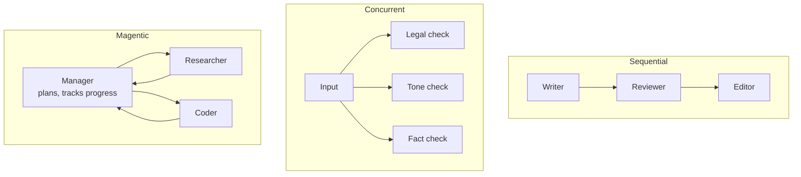

# Microsoft Agent Framework: The Complete Guide

> 📚 **Before you start**
>
> - [Google Agent Development Kit (ADK)](google-agent-development-kit-adk.md), for agents as nodes in a workflow graph.
> - [OpenAI Agents SDK](openai-agents-sdk.md), for handoffs and agent configuration.
> - [Trends in Multi-Agent AI](../../agentic-ai-fundamentals/06-multi-agent-systems-and-the-ecosystem/trends-in-multi-agent-ai.md), where AutoGen-style conversations between agents first appeared.

## Introduction

When two big Indian banks merge, customers don't get two apps forever. For a while both exist, then one app takes the best of each, the old ones are frozen, and everyone is moved across. **Microsoft Agent Framework** is that kind of merger. Microsoft had two popular open-source projects: **Semantic Kernel**, an enterprise SDK for calling models and plugins from C# and Python, and **AutoGen**, a research framework where agents talk to each other to solve tasks. Agent Framework is their successor, built by the same teams. It reached a public preview in October 2025, a release candidate in February 2026, and **general availability (1.0) on 3 April 2026**, for both .NET and Python.

It gives you simple agents (a chat client plus instructions plus tools), **typed workflows** where steps called *executors* pass messages along edges, and ready-made **orchestration patterns**: sequential, concurrent, group chat, handoff and Magentic. It also speaks the open protocols, MCP for tools, A2A for agent-to-agent and AG-UI for front-ends, and plugs into Microsoft Foundry and Azure.

By the end of this lesson you will be able to create an agent with tools and sessions, choose a chat client (OpenAI, Azure, Foundry, Anthropic and others), build a workflow from executors and edges, use the built-in orchestrations, and decide when this framework fits.

> 💡 **Key Insight**
>
> Agent Framework separates **agents** (open-ended, the model decides) from **workflows** (explicit, typed message passing between executors, your graph decides). Its workflows check, before running, that each edge connects an output type to a matching input type, so a whole class of wiring mistakes is caught at build time instead of in production.

---

## Core Explanation

### 1. The pieces

| Piece | What it is |
|---|---|
| Chat client | A provider adapter: `OpenAIChatClient`, Azure OpenAI and Foundry clients, `AnthropicClient`, Gemini, Ollama, and more |
| `Agent` | `Agent(client=..., instructions=..., name=..., tools=[...])`; call `await agent.run(...)` |
| Tools | Plain Python functions with type hints (`Annotated[str, "description"]`), MCP tools, OpenAPI tools |
| `AgentSession` | Conversation state across runs, created with `agent.create_session()` |
| Middleware | Code that wraps agent runs and function calls (logging, policy checks, redaction) |
| Workflow | A graph of **executors** connected by **edges**, built with `WorkflowBuilder`; supports checkpoints and human-in-the-loop requests |
| Orchestrations | Prebuilt multi-agent patterns: `SequentialBuilder`, `ConcurrentBuilder`, `GroupChatBuilder`, `HandoffBuilder`, `MagenticBuilder` |
| DevUI | A local web UI to chat with agents and watch workflows run |

Install the core package with `pip install agent-framework-core` and add provider packages as needed (for example `agent-framework-openai`, `agent-framework-foundry`, `agent-framework-anthropic`), or install the umbrella package `agent-framework`.

### 2. An agent with tools

```python
# not-run: needs agent-framework with the anthropic integration and an ANTHROPIC_API_KEY
import asyncio
from typing import Annotated
from agent_framework import Agent
from agent_framework.anthropic import AnthropicClient

def gst_rate(item: Annotated[str, "A product category, such as 'packaged paneer' or 'laptop'."]) -> str:
    """Return the GST slab for a product category."""
    return GST_TABLE.lookup(item)                       # your code

agent = Agent(
    client=AnthropicClient(model="claude-opus-5-5"),
    name="TaxHelper",
    instructions="Answer GST questions for small shop owners. Always cite the slab you used.",
    tools=[gst_rate],
)

async def main():
    result = await agent.run("What GST applies to packaged paneer?")
    print(result.text)

asyncio.run(main())
```

Example output:

```
Packaged and labelled paneer falls in the 5% GST slab.
```

Swap the client and nothing else changes: `OpenAIChatClient()`, an Azure or Foundry client, or a local Ollama client. The agent loop (call model, run tool, feed result back) is handled by the client's function-calling layer.

**Sessions** keep a conversation going:

```python
# not-run: needs agent-framework and an API key
session = agent.create_session()
await agent.run("I sell paneer and ghee.", session=session)
await agent.run("What's the GST on the second one?", session=session)   # knows "the second one" is ghee
```

**Typed output.** Pass a Pydantic model as `response_format` in the run options and read `result.value`:

```python
# not-run: needs agent-framework and an API key
from pydantic import BaseModel

class GstAnswer(BaseModel):
    item: str
    rate_percent: float

result = await agent.run("GST on ghee?", options={"response_format": GstAnswer})
print(result.value.rate_percent)
```

### 3. Workflows: executors, edges and types

An **executor** is a unit of work that receives a message, does something (call an agent, run code, call an API) and sends messages on, or yields a final output. The quickest way to write one is the `@executor` decorator on an async function that takes the message and a `WorkflowContext`:

```python
# not-run: needs agent-framework
from agent_framework import WorkflowBuilder, WorkflowContext, executor

@executor(id="normalise")
async def normalise(text: str, ctx: WorkflowContext[str]):
    await ctx.send_message(text.strip().lower())

@executor(id="detect_language")
async def detect_language(text: str, ctx: WorkflowContext[str]):
    await ctx.yield_output("hindi" if "kya" in text or "hai" in text else "english")

workflow = (WorkflowBuilder(start_executor=normalise)
            .add_edge(normalise, detect_language)
            .build())

events = await workflow.run("  Mera order kab aayega, kya status hai?  ")
print(events.get_outputs())
```

Example output:

```
['hindi']
```

The type parameter in `WorkflowContext[str]` declares what an executor sends. When you call `build()`, the builder validates the graph: there is a start executor, every edge connects known executors, and the types flowing along edges are compatible. Agents can be dropped straight into a workflow as executors too. Edges can carry conditions (`add_edge(a, b, condition=...)`), and there are fan-out, fan-in and switch-case edge groups for branching.

Here is the build-time type check in plain Python, so you can see why it is valuable:

```python
from dataclasses import dataclass

@dataclass
class Step:
    name: str
    takes: type
    sends: type

def build(steps, edges):
    by_name = {s.name: s for s in steps}
    problems = []
    for src, dst in edges:
        a, b = by_name[src], by_name[dst]
        if not issubclass(a.sends, b.takes):
            problems.append(f"{src} sends {a.sends.__name__} but {dst} takes {b.takes.__name__}")
    return "graph ok" if not problems else "build failed: " + "; ".join(problems)

steps = [Step("normalise", str, str), Step("count_words", str, int), Step("detect_language", str, str)]
print(build(steps, [("normalise", "detect_language")]))
print(build(steps, [("count_words", "detect_language")]))
```

Output:

```
graph ok
build failed: count_words sends int but detect_language takes str
```

A wiring bug like the second one would otherwise surface only when a real message hits that edge.

### 4. Ready-made orchestrations

Most multi-agent apps use one of a handful of patterns, so the framework ships them as builders (from the `agent-framework-orchestrations` package, imported via `agent_framework.orchestrations`):



| Builder | Pattern | Typical use |
|---|---|---|
| `SequentialBuilder(participants=[a, b, c])` | Each agent receives the conversation so far and adds to it | Draft, review, polish |
| `ConcurrentBuilder` | Same input to several agents in parallel, results aggregated | Several independent checks |
| `GroupChatBuilder` | Agents take turns in one shared chat, a manager picks the next speaker | Brainstorming, debate |
| `HandoffBuilder` | Agents transfer control to each other, as in the OpenAI SDK | Support desks |
| `MagenticBuilder` | A manager agent plans, assigns sub-tasks, tracks a progress ledger and replans | Open-ended research or coding tasks |

```python
# not-run: needs agent-framework and agent-framework-orchestrations, plus an API key
from agent_framework.orchestrations import SequentialBuilder

workflow = SequentialBuilder(participants=[writer, reviewer, editor]).build()
events = await workflow.run("Write a 3-line WhatsApp message announcing our Diwali sale.")
```

**Magentic** comes from Microsoft Research's Magentic-One system and is the most autonomous pattern; it trades predictability for flexibility. Patterns like these are compared in depth in [Multi-Agent Systems and Agent Protocols](../../multi-agent-systems-and-agent-protocols/course.md#m2).

### 5. Production features

- **Checkpointing.** Workflows can save checkpoints to storage and resume from a `checkpoint_id`, the same idea as LangGraph checkpointers.
- **Human in the loop.** A workflow can pause with a request for information and continue when the response arrives (`workflow.run(responses=...)`).
- **Middleware.** Wrap every agent run or function call for logging, PII redaction or policy checks.
- **Observability.** Built-in OpenTelemetry tracing.
- **Protocols.** MCP tools (stdio and streamable HTTP), A2A to talk to agents in other frameworks, AG-UI for streaming to front-ends.
- **Declarative agents.** Agents and workflows can be described in YAML and loaded at runtime.
- **Two languages.** The same concepts exist in .NET (C#) and Python, which matters in enterprises with large C# codebases.

### 6. If you used Semantic Kernel or AutoGen

| You had | You now use |
|---|---|
| Semantic Kernel `Kernel` + plugins | A chat client + `Agent` with function tools |
| Semantic Kernel process framework | Workflows with executors and edges |
| AutoGen `AssistantAgent` | `Agent` |
| AutoGen group chat, Magentic-One | `GroupChatBuilder`, `MagenticBuilder` |

Both older projects remain available, but new features land in Agent Framework, and Microsoft publishes migration guides for each.

### 7. When to use it

| Good fit | Poor fit |
|---|---|
| **.NET or mixed .NET/Python** organisations | Small Python-only prototypes where a lighter SDK suffices |
| Azure and Microsoft Foundry deployments | Teams avoiding Microsoft ecosystems entirely (it works elsewhere, but its strengths are there) |
| Workflows where **typed, validated wiring** and checkpoints matter | Pure file and code agents (Claude Agent SDK) |
| Teams migrating from Semantic Kernel or AutoGen | |

---

## Try It Yourself

1. **Catch another bug.** Add a step `Step("format_reply", int, str)` and check the edges `[("normalise", "count_words"), ("count_words", "format_reply")]`. Then try `[("normalise", "format_reply")]`.
2. **Pick a pattern.** For each task, choose sequential, concurrent, group chat, handoff or Magentic: (a) run legal, tone and spelling checks on an ad; (b) route a bank customer to cards, loans or fraud; (c) translate, then proofread, then format a notice.
3. **Find the loop.** In section 2, where is the loop that calls the model, runs `gst_rate` and calls the model again?

<details>
<summary>Show answers</summary>

**1.**

```python
steps.append(Step("format_reply", int, str))
print(build(steps, [("normalise", "count_words"), ("count_words", "format_reply")]))
print(build(steps, [("normalise", "format_reply")]))
```

Output:

```
graph ok
build failed: normalise sends str but format_reply takes int
```

**2.** (a) Concurrent: three independent checks on the same input. (b) Handoff: the customer talks to whichever desk takes over. (c) Sequential: each step needs the previous step's output.

**3.** Inside the chat client's function-invocation layer, which `Agent` wraps around the client. It sends the conversation and tool definitions to the model, runs any requested function, appends the result and calls the model again until it gets a final answer, just like your hand-built loop.

</details>

---

## Real-World Examples

- **Enterprise assistants on Azure.** A C# back end hosts agents with Foundry models, MCP tools for internal systems, middleware for PII redaction, and OpenTelemetry traces into existing monitoring.
- **Document review pipelines.** A concurrent orchestration runs compliance, tone and accuracy agents over each contract and merges their findings.
- **Migrations.** Teams with Semantic Kernel plugins or AutoGen group chats move to Agent Framework to get typed workflows and checkpointing without changing their mental model much.

---

## Common Misconceptions

### "It only works with Azure OpenAI"

Chat clients exist for OpenAI, Azure, Foundry, Anthropic, Gemini, Ollama and more. Azure is a strength, not a requirement.

### "Workflows and orchestrations are different engines"

The orchestration builders produce ordinary workflows. They are prebuilt graphs of agent executors you could also wire by hand.

### "Semantic Kernel and AutoGen are dead"

They still exist and are maintained, but Agent Framework is where new work happens, and Microsoft recommends it for new projects.

---

## Interview Relevance

*"What is Microsoft Agent Framework and how does it differ from AutoGen?"* A strong answer says it is the successor to both Semantic Kernel and AutoGen (GA 1.0 in April 2026, .NET and Python); agents are a chat client plus instructions and tools; workflows are typed graphs of executors and edges validated at build time, with checkpoints and human-in-the-loop requests; orchestration builders cover sequential, concurrent, group chat, handoff and Magentic patterns; and it supports MCP, A2A, AG-UI and OpenTelemetry.

---

## Key Takeaways

- **Agent Framework merges Semantic Kernel and AutoGen** into one SDK for .NET and Python, GA since 3 April 2026.
- **Agents** are `Agent(client=..., instructions=..., tools=[...])` with sessions, middleware and typed output via `response_format`.
- **Workflows** connect executors with typed edges, validated when you call `build()`.
- **Orchestration builders** provide sequential, concurrent, group chat, handoff and Magentic patterns.
- **Open protocols** (MCP, A2A, AG-UI) and OpenTelemetry make it interoperable beyond Azure.

---

**Up next:** [AWS Strands Agents and Bedrock AgentCore](aws-strands-agents-and-bedrock-agentcore.md)
