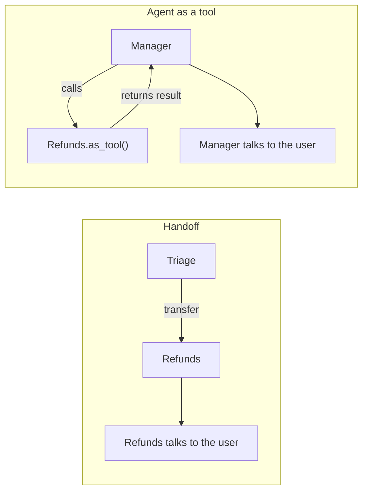

# OpenAI Agents SDK: The Complete Guide

> 📚 **Before you start**
>
> - [Claude Agent SDK](claude-agent-sdk.md), the first vendor SDK in this module; this lesson contrasts with it.
> - [What are Multi-Agent Systems?](../../agentic-ai-fundamentals/06-multi-agent-systems-and-the-ecosystem/what-are-multi-agent-systems.md), for the idea of specialist agents passing work between them.
> - [Structured JSON Output](../../generative-ai-and-llm-foundations/04-prompting-and-structured-output/structured-json-output.md), because agents here can return typed objects.

## Introduction

Call the customer care line of a big Indian bank and you meet a very old multi-agent system. The IVR asks what you need. Press 1 for cards, 2 for loans, 3 for netbanking. You are **handed off** to a specialist desk that has its own script and its own tools. Somewhere in the background, a rule stops the call if you start reading out your full card number. And the next time you call, the system remembers your last complaint number.

The **OpenAI Agents SDK** is built around exactly these ideas: small **agents** with instructions and tools, **handoffs** that pass the conversation to a specialist, **guardrails** that can stop a run, **sessions** that remember history, and **tracing** that records every step. It is deliberately small. Where the Claude Agent SDK hands you a capable general agent to narrow down, the OpenAI Agents SDK hands you a few clean primitives to compose.

By the end of this lesson you will be able to define agents and function tools, run them with `Runner`, return typed output, split work across agents with handoffs or agents-as-tools, add input, output and tool guardrails, pause for human approval, keep conversation history with sessions, and know where sandbox agents, voice agents and non-OpenAI models fit.

> 💡 **Key Insight**
>
> The SDK has very few concepts, and they compose: **an Agent is configuration** (instructions, tools, handoffs, guardrails, output type), **the Runner is the loop**, and a **handoff is just a tool call that switches which Agent's configuration the loop uses next**. Once you see handoffs as "change the active agent", the whole multi-agent story becomes simple.

---

## Core Explanation

### 1. The primitives

![What every SDK gives you around the model: a runner or loop, tools and MCP, guardrails and permissions, sessions or memory, multi-agent support, tracing and evals, all around an Agent that bundles a model, instructions, tools and an output type. Below, what each vendor adds: Claude Agent SDK built-in file, shell and web tools, hooks, skills and subagents; OpenAI Agents SDK handoffs, tripwire guardrails, sandbox agents and voice; Google ADK a graph Workflow, the adk web dev UI, built-in evals and Agent Engine; Microsoft Agent Framework typed workflows, Magentic and group chat, .NET and Python, Foundry; Strands plus AgentCore a model-driven loop with a managed runtime, memory, gateway and identity](/img/diagrams/agent-frameworks-and-sdks/vendor-sdk-anatomy.svg)
*Every vendor SDK in this module packages the same anatomy. The bottom row is what makes each one different.*

| Primitive | What it is | Your hand-built equivalent |
|---|---|---|
| `Agent` | Name, `instructions`, `tools`, `handoffs`, guardrails, `output_type`, `model` | The system prompt plus tool list you passed to the API |
| `Runner` | Runs the loop: call model, run tools or handoffs, repeat until a final output | Your `while` loop |
| `@function_tool` | Turns a Python function into a tool; the schema comes from the type hints and docstring | Your `@tool` decorator and registry |
| Handoff | Lets one agent transfer the conversation to another | A supervisor function choosing a worker |
| Guardrail | A check that runs on input, output or a tool call and can trip a wire to stop the run | `harness_check()` |
| Session | Stores conversation history between runs | Your `messages` list saved somewhere |
| Tracing | Records every model call, tool call and handoff | `print()` logging |

Install with `pip install openai-agents` (Python 3.10+). It is also available for TypeScript as `@openai/agents`.

### 2. Hello, agent

```python
# not-run: needs openai-agents and an API key
from agents import Agent, Runner

agent = Agent(
    name="Grocery helper",
    instructions="You help customers of an online grocery store in Bengaluru. Be short and friendly.",
)
result = Runner.run_sync(agent, "Do you deliver on Sunday mornings?")
print(result.final_output)
```

Example output:

```
Yes! We deliver on Sundays from 7 am to 1 pm. Order by 10 pm Saturday for a morning slot.
```

`Runner.run_sync` is the blocking form. In async code use `await Runner.run(agent, input)`, and for token-by-token output use `Runner.run_streamed`. The loop stops when the agent produces a **final output**: plain text by default, or an object of `output_type` if you set one. It also stops with an error after `max_turns` (10 by default), your safety net against loops.

**Which model?** The default is an OpenAI model, but the SDK is provider-agnostic. With the LiteLLM extra installed (`pip install "openai-agents[litellm]"`) you can pass a prefixed model string:

```python
# not-run: needs openai-agents[litellm] and an Anthropic API key
agent = Agent(name="Grocery helper", instructions="...", model="litellm/anthropic/claude-opus-5-5")
```

Features that are specific to OpenAI's Responses API (hosted tools such as file search, and server-side conversation state) only work with OpenAI models.

### 3. Tools and typed output

A function tool is a normal Python function with type hints and a docstring. The SDK builds the JSON schema for you, in strict mode by default.

```python
# not-run: needs openai-agents and an API key
from pydantic import BaseModel
from agents import Agent, Runner, function_tool

@function_tool
def order_status(order_id: str) -> str:
    """Look up the delivery status of an order.

    Args:
        order_id: The order number, like BLR-48213.
    """
    return ORDERS.status(order_id)           # your code

class SupportReply(BaseModel):
    category: str            # "delivery", "refund", "other"
    reply: str
    needs_human: bool

agent = Agent(
    name="Support",
    instructions="Answer delivery questions using the tools.",
    tools=[order_status],
    output_type=SupportReply,
)
result = Runner.run_sync(agent, "Where is my order BLR-48213?")
print(result.final_output.category, result.final_output.needs_human)
```

Example output:

```
delivery False
```

With `output_type` set, `result.final_output` is a validated `SupportReply` object, not a string. You will see much more of this pattern in Module 4.

### 4. Handoffs: changing the active agent

A **handoff** lets an agent pass the conversation to another agent. Under the hood the SDK shows each handoff to the model as a tool named like `transfer_to_<agent_name>`. When the model calls it, the Runner switches the active agent and carries on with the same conversation.

```python
# not-run: needs openai-agents and an API key
refunds = Agent(name="Refunds", handoff_description="Handles refunds and missing items.",
                instructions="Collect the order id and the missing items, then raise a refund.",
                tools=[raise_refund])
delivery = Agent(name="Delivery", handoff_description="Handles delivery slots and late orders.",
                 instructions="Help with delivery timing.", tools=[order_status])
triage = Agent(name="Triage",
               instructions="Work out what the customer needs and hand off to the right desk.",
               handoffs=[refunds, delivery])

result = Runner.run_sync(triage, "The paneer was missing from my order BLR-48213")
print(result.last_agent.name)
```

Example output:

```
Refunds
```

The `handoff_description` plays the same role as a tool description: it is what the triage agent reads to choose.

To see the mechanism with no SDK at all, here is a pretend version. The pretend model picks a handoff for the triage agent and answers for the specialists; the runner switches the active agent when a handoff is chosen.

```python
AGENTS = {
    "Triage":   {"handoffs": ["Refunds", "Delivery"]},
    "Refunds":  {"handoffs": []},
    "Delivery": {"handoffs": []},
}

def pretend_model(agent_name, message):
    if agent_name == "Triage":
        target = "Refunds" if ("missing" in message or "refund" in message) else "Delivery"
        return {"handoff": target}
    if agent_name == "Refunds":
        return {"final": "Sorry about that! A refund for the missing item is on its way."}
    return {"final": "Your order is out for delivery and should arrive by 6 pm."}

def run(start_agent, message, max_turns=10):
    active, trail = start_agent, [start_agent]
    for _ in range(max_turns):
        step = pretend_model(active, message)
        if "handoff" in step:
            assert step["handoff"] in AGENTS[active]["handoffs"], "handoff not allowed"
            active = step["handoff"]
            trail.append(active)
            continue
        return active, step["final"], trail
    raise RuntimeError("max turns exceeded")

for msg in ["The paneer was missing from my order", "When will my order arrive?"]:
    last, answer, trail = run("Triage", msg)
    print(" -> ".join(trail), "|", answer)
```

Output:

```
Triage -> Refunds | Sorry about that! A refund for the missing item is on its way.
Triage -> Delivery | Your order is out for delivery and should arrive by 6 pm.
```

### 5. Handoffs vs agents-as-tools

There are two ways for agents to work together, and choosing well matters:



| | Handoff | Agent as tool (`agent.as_tool(tool_name, tool_description)`) |
|---|---|---|
| Who talks to the user next | The specialist | The original agent |
| Conversation history | The specialist sees the conversation | The sub-agent gets only the input the manager passes |
| Good for | Routing a customer to the right desk | A manager that consults several experts and writes one answer |

### 6. Guardrails: tripwires that stop a run

A guardrail is a function that inspects the input (or the final output, or a tool call) and returns `GuardrailFunctionOutput(output_info=..., tripwire_triggered=True/False)`. If the tripwire is triggered, the run stops and the SDK raises an exception, such as `InputGuardrailTripwireTriggered`.

```python
# not-run: needs openai-agents and an API key
from agents import (Agent, Runner, GuardrailFunctionOutput, InputGuardrailTripwireTriggered,
                    input_guardrail)

@input_guardrail
async def no_card_numbers(ctx, agent, user_input):
    digits = sum(ch.isdigit() for ch in str(user_input))
    return GuardrailFunctionOutput(output_info={"digits": digits}, tripwire_triggered=digits >= 12)

support = Agent(name="Support", instructions="...", input_guardrails=[no_card_numbers])

try:
    Runner.run_sync(support, "My card 4111 1111 1111 1111 was charged twice")
except InputGuardrailTripwireTriggered:
    print("Please don't share full card numbers. Our team will never ask for them.")
```

Input guardrails run alongside the first model call by default, so a cheap check can stop an expensive agent early. Output guardrails check the final answer. Tool guardrails (`tool_input_guardrails` and `tool_output_guardrails` on a function tool) check individual tool calls. A guardrail can itself be a small agent, for example a fast classifier that flags off-topic requests.

The same tripwire idea in plain Python:

```python
class TripwireTriggered(Exception):
    pass

def card_number_guardrail(text):
    digits = sum(ch.isdigit() for ch in text)
    return {"output_info": {"digits": digits}, "tripwire_triggered": digits >= 12}

def run_with_guardrails(text, guardrails):
    for check in guardrails:
        verdict = check(text)
        if verdict["tripwire_triggered"]:
            raise TripwireTriggered(f"{check.__name__}: {verdict['output_info']}")
    return "agent runs normally"

for text in ["Order BLR-48213 is late", "Card 4111 1111 1111 1111 charged twice"]:
    try:
        print(run_with_guardrails(text, [card_number_guardrail]))
    except TripwireTriggered as err:
        print("stopped by", err)
```

Output:

```
agent runs normally
stopped by card_number_guardrail: {'digits': 16}
```

### 7. Human approval for risky tools

Mark a tool with `needs_approval=True` and the run **pauses** before calling it. The result carries the pending calls in `result.interruptions`; you turn the result into a `RunState`, approve or reject each item, and run again from that state.

```python
# not-run: needs openai-agents and an API key
@function_tool(needs_approval=True)
def raise_refund(order_id: str, amount_inr: int) -> str:
    """Raise a refund for an order."""
    return PAYMENTS.refund(order_id, amount_inr)

result = await Runner.run(refunds, "Refund 240 rupees for BLR-48213")
if result.interruptions:
    state = result.to_state()
    for item in result.interruptions:
        if supervisor_says_yes(item):          # your UI or policy
            state.approve(item)
        else:
            state.reject(item)
    result = await Runner.run(refunds, state)
print(result.final_output)
```

This is the same pause-and-resume idea as LangGraph's `interrupt()`, which you used in [Pausing with interrupt and Resuming with Command](../../langgraph-complete-guide/08-human-in-the-loop-and-debugging/pausing-with-interrupt-and-resuming-with-command.md).

### 8. Sessions, tracing and the rest

**Sessions** store history so each run continues the conversation:

```python
# not-run: needs openai-agents and an API key
from agents import SQLiteSession

session = SQLiteSession("customer-98450", "support_history.db")
Runner.run_sync(support, "My order BLR-48213 is late", session=session)
Runner.run_sync(support, "Can you check it again?", session=session)   # remembers which order
```

Other session backends exist (Redis, SQLAlchemy, and server-side conversations when using OpenAI models).

**Tracing** is on by default and sends traces to OpenAI's dashboard; you can disable it or export to other tools through trace processors. Observability tools get their own course: [Agent Evals, Observability and Reliability](../../agent-evals-observability-and-reliability/course.md#m4).

**MCP.** Pass MCP servers with `mcp_servers=[...]` on the agent, and their tools appear alongside your function tools.

**Sandbox agents.** A `SandboxAgent` works inside a container-like workspace described by a `Manifest` (for example, a Git repository checked out at a branch). It can inspect files, run commands and apply patches over long tasks, and the workspace can be snapshotted and restored. Sandbox clients cover a local Unix sandbox, Docker, and hosted providers. This was added in an April 2026 update and brings the SDK closer to what the Claude Agent SDK does out of the box.

**Voice and realtime.** `RealtimeAgent` and `VoicePipeline` build speech agents; they are covered in [Computer-Use, Browser and Voice Agents](../../computer-use-browser-and-voice-agents/course.md).

### 9. When to use it

| Good fit | Poor fit |
|---|---|
| Customer-facing assistants with **clear specialist desks** (triage plus handoffs) | Agents that mostly need to read and edit files out of the box (Claude Agent SDK is ready-made for that) |
| You want **few concepts** and readable code | Complex, long-lived workflows with branches, loops and checkpoints you must see as a graph |
| Guardrails that should **stop a run** cheaply and early | Teams that need deep support for a non-OpenAI provider's special features |
| Teams already on OpenAI models and its tracing dashboard | |

---

## Try It Yourself

1. **Add a desk.** Add a `"Payments"` agent to `AGENTS` (reachable from Triage) that answers `"Your UPI payment is being verified."`, and route messages containing `"UPI"` to it.
2. **Stop a loop.** Change `pretend_model` so Triage always hands off to `"Triage"` itself (allow it in `AGENTS`). What does `run` do?
3. **Guardrail for abuse.** Write `abuse_guardrail(text)` that trips when the text contains the word `"idiot"` (any case), and run both guardrails on `"You IDIOT, where is my order?"`.

<details>
<summary>Show answers</summary>

**1.**

```python
AGENTS["Payments"] = {"handoffs": []}
AGENTS["Triage"]["handoffs"].append("Payments")
_old_model = pretend_model

def pretend_model(agent_name, message):
    if agent_name == "Triage" and "UPI" in message:
        return {"handoff": "Payments"}
    if agent_name == "Payments":
        return {"final": "Your UPI payment is being verified."}
    return _old_model(agent_name, message)

print(run("Triage", "My UPI payment failed but money was debited"))
```

Output:

```
('Payments', 'Your UPI payment is being verified.', ['Triage', 'Payments'])
```

**2.**

```python
AGENTS["Triage"]["handoffs"].append("Triage")

def pretend_model(agent_name, message):
    return {"handoff": "Triage"}

try:
    run("Triage", "hello", max_turns=5)
except RuntimeError as err:
    print("stopped:", err)
pretend_model = _old_model
```

Output:

```
stopped: max turns exceeded
```

This is why the real Runner has `max_turns` (default 10): a confused model can bounce forever.

**3.**

```python
def abuse_guardrail(text):
    hit = "idiot" in text.lower()
    return {"output_info": {"abusive": hit}, "tripwire_triggered": hit}

try:
    run_with_guardrails("You IDIOT, where is my order?", [card_number_guardrail, abuse_guardrail])
except TripwireTriggered as err:
    print("stopped by", err)
```

Output:

```
stopped by abuse_guardrail: {'abusive': True}
```

</details>

---

## Real-World Examples

- **Support triage.** A triage agent hands off to billing, delivery or technical agents, each with its own tools; a guardrail blocks requests that share card numbers or are off-topic.
- **Research assistants.** A manager agent calls a "web researcher" and a "summariser" as tools and writes the final report itself, keeping one voice towards the user.
- **Repository maintenance.** A sandbox agent checks out a repository, runs the tests and proposes a patch, with the workspace snapshotted so a human can inspect it.

---

## Common Misconceptions

### "Handoffs and agents-as-tools are the same thing"

After a handoff, the specialist owns the conversation. With an agent as a tool, the calling agent stays in charge and only receives the sub-agent's result.

### "Guardrails are prompts that ask the model to behave"

Guardrails are code (sometimes calling a small model) that run outside the agent and can **stop** the run by raising an exception.

### "It only works with OpenAI models"

The core loop works with other providers through LiteLLM or any-llm adapters, or a custom model provider. OpenAI-specific hosted tools need OpenAI models.

---

## Interview Relevance

*"Design a customer-support agent with the OpenAI Agents SDK."* A strong answer names the primitives (Agent, Runner, function tools, handoffs, guardrails, sessions, tracing), uses a triage agent with `handoffs` and clear `handoff_description`s, explains handoffs versus `as_tool`, puts an input guardrail with a tripwire in front, marks money-moving tools with `needs_approval=True` and explains the interrupt-approve-resume flow, uses `output_type` for typed results, keeps history in a session, and relies on `max_turns` plus tracing for safety and debugging.

---

## Key Takeaways

- **Agents are configuration, the Runner is the loop**, and the loop ends at a final output or after `max_turns` (default 10).
- **Handoffs switch the active agent**; agents-as-tools keep the caller in charge.
- **Guardrails trip wires**: they run on input, output or tool calls and stop the run with an exception.
- **`needs_approval=True`** pauses before a risky tool; approve or reject from the `RunState` and run again.
- **Sessions, tracing, MCP, sandbox and voice agents** round out a small, composable SDK.

---

**Up next:** [Google Agent Development Kit (ADK)](google-agent-development-kit-adk.md)
