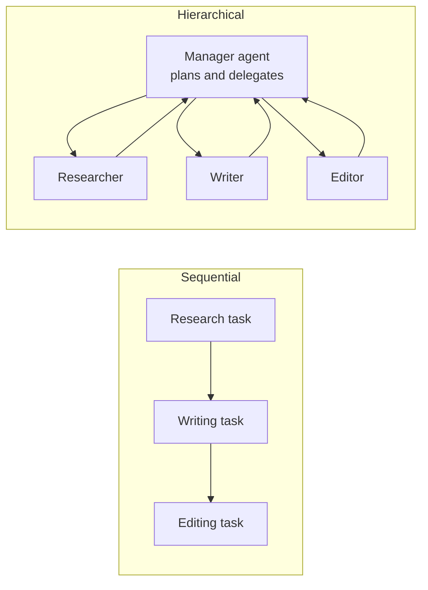
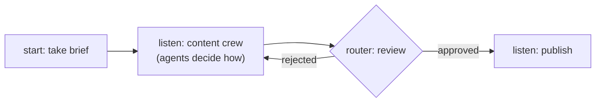

# CrewAI Crews and Flows: The Complete Guide

> 📚 **Before you start**
>
> - [LangChain Deep Agents](langchain-deep-agents.md), the previous framework, for contrast with a single long-running agent.
> - [What are Multi-Agent Systems?](../../agentic-ai-fundamentals/06-multi-agent-systems-and-the-ecosystem/what-are-multi-agent-systems.md), for teams of agents with roles.
> - [Conditional Workflows](../../langgraph-complete-guide/03-workflow-patterns-in-langgraph/conditional-workflows.md), because flows route between steps the same way.

## Introduction

A small digital agency in Jaipur gets a brief: "launch posts for a new kulhad chai café". The owner doesn't write everything herself. A **researcher** finds what local customers talk about, a **copywriter** drafts posts, an **editor** checks tone and Hindi spellings. Each person has a role, a goal and a way of working, and the work moves from one desk to the next. Around them is a **process**: brief comes in, research, draft, review, and if the client rejects, go back to drafting.

**CrewAI** gives you both halves of that picture. A **crew** is a team of role-playing agents (role, goal, backstory) who carry out **tasks**, either in sequence or under a manager agent. A **flow** is the process around them: ordinary Python methods connected by `@start`, `@listen` and `@router` decorators, sharing a typed state, where you decide exactly what runs when. Crews give autonomy; flows give control; real apps usually put crews inside flows.

By the end of this lesson you will be able to define agents, tasks and crews, get typed task output with guardrails, choose sequential or hierarchical processes, build event-driven flows with routing and state, and set up a CrewAI project.

> 💡 **Key Insight**
>
> CrewAI's two halves map onto the spectrum from Module 1: a **crew lets the models decide** how to collaborate on a goal; a **flow lets your code decide** which step runs next. Use crews for the fuzzy parts (research, writing) and flows for everything that has a rule (routing, retries, approvals, saving results).

---

## Core Explanation

### 1. Agents, tasks and crews

```python
# not-run: needs crewai and an ANTHROPIC_API_KEY
from crewai import Agent, Task, Crew, Process, LLM

llm = LLM(model="anthropic/claude-opus-5-5")

researcher = Agent(
    role="Local market researcher",
    goal="Find what tea drinkers in {city} care about",
    backstory="You have run small-business research in Rajasthan for ten years.",
    tools=[web_search],                     # your tool
    llm=llm,
)
writer = Agent(
    role="Social media copywriter",
    goal="Write short, warm launch posts for {cafe}",
    backstory="You write in simple English with a little Hindi, never more than 40 words a post.",
    llm=llm,
)

research = Task(
    description="Research tea habits and favourite snacks in {city}. List 5 insights.",
    expected_output="Five bullet points, each with one insight.",
    agent=researcher,
)
posts = Task(
    description="Using the research, write 3 Instagram posts announcing {cafe}.",
    expected_output="Three numbered posts under 40 words each.",
    agent=writer,
    context=[research],                     # receives the research task's output
)

crew = Crew(agents=[researcher, writer], tasks=[research, posts], process=Process.sequential)
result = crew.kickoff(inputs={"city": "Jaipur", "cafe": "Kulhad Corner"})
print(result.raw)
```

Example output:

```
1. Winter evenings + kulhad chai + pyaaz kachori = perfect. Kulhad Corner opens on MI Road this Friday!
2. ...
```

The pieces:

| Piece | Key fields | What it means |
|---|---|---|
| `Agent` | `role`, `goal`, `backstory`, `tools`, `llm` | A persona. Role, goal and backstory become part of its system prompt. |
| `Task` | `description`, `expected_output`, `agent`, `context`, `output_pydantic`, `guardrail` | A unit of work with a clear definition of done |
| `Crew` | `agents`, `tasks`, `process` | The team and how it works together |
| `kickoff(inputs=...)` | | Fills `{placeholders}` in roles, goals and descriptions, then runs |

`expected_output` matters more than beginners expect: it is the task's definition of "done", and vague expectations produce vague results.

### 2. Processes: sequential or hierarchical



- **`Process.sequential`** runs tasks in the listed order, passing outputs forward. Predictable and cheap.
- **`Process.hierarchical`** adds a manager (set `manager_llm` or a custom `manager_agent`) that decides which agent handles what and reviews results. Flexible, but uses more tokens and is harder to predict.

A crew can also be given `planning=True`, which asks a model to plan the tasks before running them, and `memory` to remember across runs.

### 3. Typed task output and guardrails

Set `output_pydantic` on a task to get a validated object, and a `guardrail` function to check the output before it is accepted. A guardrail returns `(True, value)` to accept or `(False, "reason")` to send the task back to the agent with feedback.

```python
# not-run: needs crewai and an API key
from pydantic import BaseModel

class Post(BaseModel):
    text: str
    hashtags: list[str]

class PostSet(BaseModel):
    posts: list[Post]

def under_40_words(output):
    for post in output.pydantic.posts:
        if len(post.text.split()) > 40:
            return (False, f"Post too long ({len(post.text.split())} words). Keep each under 40.")
    return (True, output)

posts = Task(description="...", expected_output="Three posts", agent=writer,
             output_pydantic=PostSet, guardrail=under_40_words)
result = crew.kickoff(inputs={...})
print(result.pydantic.posts[0].hashtags)
```

The guardrail is plain code, so you can test the rule without any model:

```python
from types import SimpleNamespace

def under_40_words(output):
    for post in output.pydantic.posts:
        n = len(post.text.split())
        if n > 40:
            return (False, f"Post too long ({n} words). Keep each under 40.")
    return (True, output)

def fake_output(*texts):
    posts = [SimpleNamespace(text=t, hashtags=["#chai"]) for t in texts]
    return SimpleNamespace(pydantic=SimpleNamespace(posts=posts))

short = fake_output("Kulhad chai and hot kachori, this Friday on MI Road.")
long = fake_output("chai " * 45)
print(under_40_words(short)[0])
print(under_40_words(long))
```

Output:

```
True
(False, 'Post too long (45 words). Keep each under 40.')
```

### 4. Flows: your code decides the order

A **flow** is a class whose methods are steps. Decorators connect them:

| Decorator | Meaning |
|---|---|
| `@start()` | Runs when the flow is kicked off |
| `@listen(step)` | Runs after `step` finishes, receiving its return value |
| `@router(step)` | Runs after `step` and returns a **label**; listeners on that label run next |
| `or_(a, b)`, `and_(a, b)` | Trigger when any or all of several steps or labels have fired |

State lives in `self.state`, which can be a Pydantic model for type safety, and `@persist` saves it so a flow can resume.

```python
# not-run: needs crewai and an API key
from pydantic import BaseModel
from crewai.flow.flow import Flow, start, listen, router, or_

class LaunchState(BaseModel):
    cafe: str = ""
    drafts: str = ""
    approved: bool = False
    attempts: int = 0

class LaunchFlow(Flow[LaunchState]):
    @start()
    def take_brief(self):
        self.state.cafe = "Kulhad Corner"

    @listen(or_(take_brief, "rejected"))
    def write_posts(self):
        self.state.attempts += 1
        self.state.drafts = content_crew.kickoff(inputs={"cafe": self.state.cafe}).raw

    @router(write_posts)
    def review(self):
        if client_approves(self.state.drafts) or self.state.attempts >= 3:
            return "approved"
        return "rejected"

    @listen("approved")
    def publish(self):
        schedule_posts(self.state.drafts)

LaunchFlow().kickoff()
```

To see exactly how `@start`, `@listen` and `@router` drive execution, here is a miniature flow engine in plain Python. The real engine also handles parallel listeners, `and_`, persistence and async steps; the routing idea is the same.

```python
def start(fn):
    fn.trigger = "__start__"; return fn

def listen(*triggers):
    def wrap(fn):
        fn.listens_to = [t if isinstance(t, str) else t.__name__ for t in triggers]
        return fn
    return wrap

def router(after):
    def wrap(fn):
        fn.listens_to = [after.__name__]; fn.is_router = True
        return fn
    return wrap

class MiniFlow:
    def kickoff(self, max_steps=20):
        methods = [getattr(self, n) for n in dir(self) if callable(getattr(self, n)) and not n.startswith("_")]
        fired = [m.__name__ for m in methods if getattr(m, "trigger", None) == "__start__"]
        log = []
        while fired and len(log) < max_steps:
            event = fired.pop(0)
            step = getattr(self, event, None)
            if step is not None:
                result = step()
                log.append(event)
                if getattr(step, "is_router", False):
                    log.append(f"-> {result}")
                    event = result
            for m in methods:
                if event in getattr(m, "listens_to", []):
                    fired.append(m.__name__)
        return log

class LaunchFlow(MiniFlow):
    def __init__(self, verdicts):
        self.verdicts, self.attempts = list(verdicts), 0

    @start
    def take_brief(self): pass

    @listen("take_brief", "rejected")
    def write_posts(self): self.attempts += 1

    @router(write_posts)
    def review(self): return self.verdicts.pop(0)

    @listen("approved")
    def publish(self): pass

print(LaunchFlow(["rejected", "approved"]).kickoff())
```

Output:

```
['take_brief', 'write_posts', 'review', '-> rejected', 'write_posts', 'review', '-> approved', 'publish']
```

The flow loops back to `write_posts` when the review says "rejected", and moves to `publish` when it says "approved". That is a **router** at work: the step returns a label, and the label decides the next step.

### 5. Crews inside flows

The pattern CrewAI recommends for production is: **flow on the outside, crews on the inside**.



The flow owns state, branching, retries and side effects; each crew owns one fuzzy, creative chunk of work. This keeps the expensive, unpredictable part small and surrounded by deterministic code.

### 6. Projects and the CLI

`crewai create crew <name>` scaffolds a project. Current versions create a **JSON-first** project: agents in `agents/*.jsonc` files and tasks plus crew settings in `crew.jsonc`, which `crewai run` loads directly. If you prefer the older layout with `crew.py`, `config/agents.yaml` and `config/tasks.yaml`, add `--classic`. `crewai create flow <name>` scaffolds a flow project. CrewAI connects to most model providers through its `LLM` class (model strings such as `"anthropic/claude-opus-5-5"`), and also supports MCP tools, knowledge sources and training and testing commands.

### 7. When to use it

| Good fit | Poor fit |
|---|---|
| Content, research and analysis work that maps naturally to **roles** | Low-latency, high-volume decisions (each agent turn costs tokens) |
| Teams that want a readable, high-level description of agents and tasks | Strict step-by-step control everywhere (use flows heavily, or LangGraph) |
| Fast prototypes of multi-agent ideas, then hardening with flows | Situations where you can't afford role-play overhead in the prompt |

---

## Try It Yourself

1. **Cap retries.** Change the mini `LaunchFlow.review` so that after 2 attempts it returns `"approved"` regardless, and run it with verdicts `["rejected", "rejected", "rejected"]`.
2. **Add a step.** Add a `notify_owner` step that listens to `"approved"` as well, and check that both `publish` and `notify_owner` run.
3. **Expected output.** Rewrite this vague task so its "done" is checkable: `Task(description="Write about our café", expected_output="Good content")`.

<details>
<summary>Show answers</summary>

**1.**

```python
class CappedFlow(LaunchFlow):
    @router(LaunchFlow.write_posts)
    def review(self):
        verdict = self.verdicts.pop(0)
        return "approved" if self.attempts >= 2 else verdict

print(CappedFlow(["rejected", "rejected", "rejected"]).kickoff())
```

Output:

```
['take_brief', 'write_posts', 'review', '-> rejected', 'write_posts', 'review', '-> approved', 'publish']
```

**2.**

```python
class NotifyingFlow(LaunchFlow):
    @listen("approved")
    def notify_owner(self): pass

print(NotifyingFlow(["approved"]).kickoff())
```

Output:

```
['take_brief', 'write_posts', 'review', '-> approved', 'notify_owner', 'publish']
```

**3.** For example: `description="Write 3 Instagram posts announcing Kulhad Corner's opening on MI Road, Jaipur, this Friday"`, `expected_output="Three numbered posts, each under 40 words, each ending with 2 hashtags"`. Now a guardrail can check it.

</details>

---

## Real-World Examples

- **Marketing content pipelines.** A flow takes a brief, a research-and-writing crew drafts, a router sends drafts back until approved, and the final step schedules posts.
- **Sales research.** A crew of a company researcher and an email writer prepares personalised outreach; a flow loops over a list of leads and saves results to a CRM.
- **Report generation.** A hierarchical crew where a manager assigns sections of a quarterly report to analyst agents.

---

## Common Misconceptions

### "A backstory is just decoration"

Role, goal and backstory become part of each agent's prompt and shape its tone and choices. Keep them short and specific.

### "Hierarchical is always better than sequential"

The manager adds tokens, latency and unpredictability. Use it only when the order of work really can't be fixed in advance.

### "Flows are for non-AI code only"

Flows are where you put any step whose order you know, including LLM calls and whole crews. They are CrewAI's answer to graph workflows.

---

## Interview Relevance

*"When would you use CrewAI, and how do crews and flows differ?"* A strong answer explains agents (role, goal, backstory, tools, llm), tasks (description, expected output, context, `output_pydantic`, guardrails) and crews (sequential or hierarchical process, `kickoff(inputs=...)`), then flows (`@start`, `@listen`, `@router`, `or_`/`and_`, typed state, `@persist`). It says crews give autonomy and flows give control, and that production systems usually run crews inside flows.

---

## Key Takeaways

- **Crews are role-playing teams**: agents with role, goal and backstory carry out tasks with clear expected outputs.
- **Processes**: sequential is predictable; hierarchical adds a manager agent.
- **`output_pydantic` and `guardrail`** make task results typed and checkable.
- **Flows are code-driven**: `@start`, `@listen`, `@router` and shared state decide what runs next.
- **Put crews inside flows**: autonomy where it helps, control everywhere else.

---

**Up next:** [LlamaIndex Agents and Workflows](llamaindex-agents-and-workflows.md)
