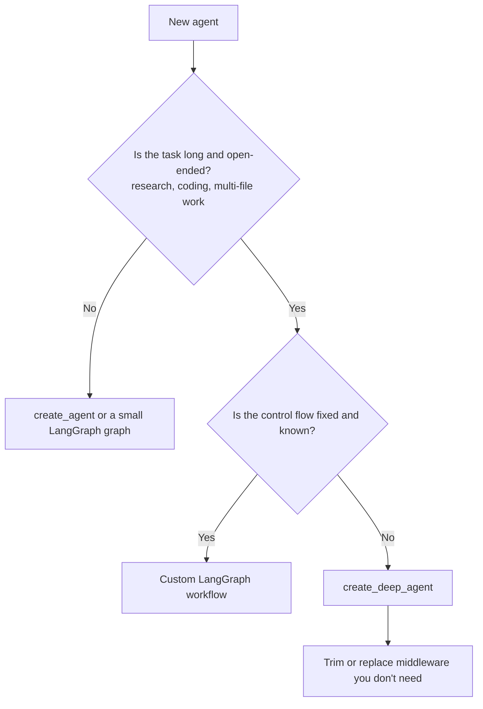

# LangChain Deep Agents: The Complete Guide

> 📚 **Before you start**
>
> - [Claude Agent SDK](../02-vendor-agent-sdks/claude-agent-sdk.md), the "ready-made agent" idea that Deep Agents brings to LangChain.
> - [Building Agents](../../langgraph-complete-guide/05-workflows-and-agents/building-agents.md) and [Persistence and Checkpointers](../../langgraph-complete-guide/06-chatbots-and-persistence/persistence-and-checkpointers.md), because a deep agent *is* a LangGraph graph.
> - [Offloading Context to Files and Scratchpads](../../context-engineering-and-agent-memory/03-just-in-time-context/offloading-context-to-files-and-scratchpads.md), the idea behind its virtual filesystem.

## Introduction

Ask a fresh intern to "prepare a market report on electric scooters in tier-2 Indian cities" and two kinds of intern appear. The first keeps everything in their head, reads twenty articles in a row, forgets the first ten, and hands in a muddle. The second opens a notes file, writes a plan, saves findings to separate files as they go, asks a colleague to research charging infrastructure in parallel, and assembles the report from the notes at the end. The second intern is not smarter. They just have better **working habits**.

A plain tool-calling loop is the first intern. It works for five-step tasks and falls apart on fifty-step ones, because everything lives in one growing context window. **Deep Agents**, from the LangChain team, packages the second intern's habits into an **agent harness**: a virtual filesystem for notes and offloaded results, subagents with their own fresh context, automatic summarisation of long histories, skills and memory files, and human approval for chosen tools. It is built on LangGraph, so you keep streaming, checkpoints and interrupts.

By the end of this lesson you will know how a deep agent is assembled, what each built-in tool does, how backends decide where files really live, how to add subagents, skills, memory and approvals, and when a deep agent is better than a hand-made LangGraph agent.

> 💡 **Key Insight**
>
> A deep agent is not a new kind of model or loop. It is the same tool-calling loop **plus a stack of middleware** that gives it long-task habits: write things down (files), delegate (subagents), compress (summaries), recall (memory, skills) and pause (approvals). You get the habits for free and can remove or replace any of them.

---

## Core Explanation

### 1. Where it sits in the LangChain stack

![Five cards: Deep Agents, a ready-made harness with files, subagents, summaries, skills and approvals; CrewAI, agents with roles doing tasks as a crew, with flows adding code-driven steps and state; LlamaIndex, steps reacting to typed events and agents over your documents; smolagents, where the model writes Python as its action and an executor runs it; Mastra plus the AI SDK, TypeScript agents with Zod-typed tools, workflows and UI streaming. Under them, the unit each one thinks in: a long task, a role, an event, a code snippet, a typed step. At the bottom, a spectrum from the model deciding more to your code deciding more](/img/diagrams/agent-frameworks-and-sdks/orchestration-styles.svg)
*Module 3 at a glance. Each framework is built around a different unit of work. This lesson covers the first card.*

LangChain now has three layers that compose:

| Layer | What it is | Use it when |
|---|---|---|
| **LangGraph** | The graph runtime: state, nodes, edges, checkpoints, interrupts | The agent loop itself isn't the right shape; you need a custom graph |
| **LangChain `create_agent`** | A minimal agent harness on LangGraph with a middleware system | You want a standard tool-calling agent with a few extras |
| **Deep Agents** (`create_deep_agent`) | An opinionated harness on top of `create_agent` with long-task middleware bundled in | You want planning-free long tasks to "just work": files, subagents, summaries, skills |

Because the layers compose, any compiled LangGraph graph can be plugged into a deep agent as a subagent.

### 2. Your first deep agent

```python
# not-run: needs deepagents and langchain-anthropic, plus an ANTHROPIC_API_KEY
from deepagents import create_deep_agent

def web_search(query: str) -> str:
    """Search the web and return the top results as text."""
    return SEARCH_API.search(query)                # your code

agent = create_deep_agent(
    model="anthropic:claude-opus-5-5",
    tools=[web_search],
    system_prompt="You are a market researcher. Save findings to files, then write /report.md.",
)
result = agent.invoke({"messages": [{"role": "user",
                       "content": "EV scooter adoption in tier-2 Indian cities, 2024-2026"}]})
print(result["messages"][-1].content)
print(sorted(result["files"]))       # files the agent wrote in its virtual filesystem
```

Example output:

```
The report is in /report.md. Key finding: adoption grew fastest where public charging...
['/notes/charging.md', '/notes/prices.md', '/notes/sales.md', '/report.md']
```

`create_deep_agent` returns a compiled LangGraph graph, so everything you learned in the LangGraph course applies: `invoke`, `stream`, a `checkpointer` for persistence, and `thread_id` in the config.

### 3. The built-in tools

Out of the box, a deep agent gets these tools in addition to yours:

| Tool | What it does |
|---|---|
| `ls`, `glob`, `grep` | List, pattern-match and search files |
| `read_file` | Read a file (large files can be read in pages) |
| `write_file`, `edit_file`, `delete` | Create, change and remove files |
| `task` | Launch a subagent with a task description and receive its final answer |
| `execute` | Run shell commands, **only** when the backend is a sandbox |

Planning with a to-do list (`write_todos`) used to be on by default. **Since version 0.7, task planning is opt-in**: add `TodoListMiddleware` from `langchain.agents.middleware` to `middleware=[...]` if you want it. Strong recent models often plan well without it.

### 4. The virtual filesystem, by hand

Why give an agent files at all? Because a tool result that is 30,000 tokens long can be **saved to a file and referred to by name**, and a plan or a list of findings can live outside the context window and be re-read when needed. That is exactly the offloading pattern from the context engineering course.

By default the files live in the graph's **state** (a dictionary that is checkpointed with everything else). Here is the idea in plain Python:

```python
class VirtualFS:
    def __init__(self):
        self.files = {}

    def write_file(self, path, content):
        self.files[path] = content
        return f"wrote {len(content)} chars to {path}"

    def read_file(self, path, offset=0, limit=60):
        if path not in self.files:
            return f"error: {path} not found. Use ls to see files."
        return self.files[path][offset:offset + limit]

    def edit_file(self, path, old, new):
        text = self.files.get(path, "")
        if text.count(old) != 1:
            return f"error: '{old}' must appear exactly once in {path}"
        self.files[path] = text.replace(old, new)
        return f"edited {path}"

    def ls(self, prefix="/"):
        return sorted(p for p in self.files if p.startswith(prefix))

fs = VirtualFS()
print(fs.write_file("/notes/prices.md", "Entry scooters cost 75k-1.1L rupees after subsidy in 2026."))
print(fs.edit_file("/notes/prices.md", "75k", "80k"))
print(fs.read_file("/notes/prices.md", limit=30))
print(fs.read_file("/notes/missing.md"))
print(fs.ls("/notes"))
```

Output:

```
wrote 58 chars to /notes/prices.md
edited /notes/prices.md
Entry scooters cost 80k-1.1L r
error: /notes/missing.md not found. Use ls to see files.
['/notes/prices.md']
```

Notice two habits the real tools share: **paged reads** (so one read can't flood the context) and **exact-match edits** (an edit fails loudly if the target text is ambiguous). Errors are phrased to help the model recover, as you learned in [Designing Good Tools](../../agentic-ai-fundamentals/04-tools-and-function-calling/designing-good-tools.md).

### 5. Backends: where files really live

The filesystem tools talk to a **backend**, and you choose which:

| Backend | Files live in | Good for |
|---|---|---|
| `StateBackend` (default) | The LangGraph state, per thread | Scratch notes for one run; checkpointed with the thread |
| `FilesystemBackend(root_dir=...)` | A real folder on disk | Agents that work on a project's files |
| `StoreBackend` | A LangGraph store, shared across threads | Long-term notes and memories |
| `CompositeBackend` | Different backends per path prefix | For example `/memories/` in a store, everything else in state |
| Sandbox backends | A remote or local sandbox | Running code with `execute` safely |

The Deep Agents project describes its security model as "trust the LLM": the agent can do anything its tools and backend allow. So **enforce boundaries in the backend and tools** (a sandbox, a restricted folder, `permissions` rules), not by asking the model to behave.

### 6. Subagents: delegate with a fresh context

The `task` tool launches a **subagent**: a separate agent that starts with an empty context, does one job and returns only its final answer. The main agent's context stays small however much reading the subagent does.

```python
# not-run: needs deepagents and an API key
charging_researcher = {
    "name": "charging-researcher",
    "description": "Researches EV charging infrastructure in one city. Give it the city name.",
    "system_prompt": "Find public charging points and plans for the given city. Reply in 5 bullets with sources.",
    "tools": [web_search],
}
agent = create_deep_agent(model="anthropic:claude-opus-5-5", tools=[web_search],
                          subagents=[charging_researcher])
```

A built-in general-purpose subagent is also available, so the main agent can delegate even when you define none. The token-saving effect is easy to see with numbers:

```python
def context_tokens(main_steps, subagent_reads, use_subagent, summary_tokens=400):
    if use_subagent:
        return main_steps + summary_tokens          # only the summary comes back
    return main_steps + sum(subagent_reads)          # every page read lands in the main context

reads = [6000, 4500, 8000, 5200]                     # four long web pages about charging
print("without subagent:", context_tokens(3000, reads, False))
print("with subagent:   ", context_tokens(3000, reads, True))
```

Output:

```
without subagent: 26700
with subagent:    3400
```

### 7. Long-task habits: summaries, memory, skills, approvals

```python
# not-run: needs deepagents and an API key
from deepagents import create_deep_agent
from deepagents.backends import FilesystemBackend
from langgraph.checkpoint.memory import InMemorySaver

agent = create_deep_agent(
    model="anthropic:claude-opus-5-5",
    tools=[web_search, send_email],
    backend=FilesystemBackend(root_dir="/srv/research"),
    memory=["/AGENTS.md"],                    # loaded into the system prompt at start-up
    skills=["/skills/"],                      # folders with SKILL.md, loaded on demand
    interrupt_on={"send_email": True},        # pause for human approval before this tool
    checkpointer=InMemorySaver(),             # needed to pause and resume
)
```

- **Summarisation** is on by default: when the conversation grows too long, older turns are summarised and large tool outputs are offloaded to files.
- **Memory** files (`AGENTS.md`) give the agent standing instructions, as you saw in [Memory Files: CLAUDE.md and AGENTS.md](../../context-engineering-and-agent-memory/04-memory-systems/memory-files-claude-md-and-agents-md.md).
- **Skills** are folders with a `SKILL.md` that the agent loads only when relevant. They are taught in depth in [Tools, Agent Skills and Code Execution](../../tools-agent-skills-and-code-execution/course.md#m4).
- **`interrupt_on`** pauses before chosen tools so a human can approve, edit or reject the call, using LangGraph's interrupt mechanism. You resume with `Command(resume=...)`, exactly as in [Pausing with interrupt and Resuming with Command](../../langgraph-complete-guide/08-human-in-the-loop-and-debugging/pausing-with-interrupt-and-resuming-with-command.md).
- **`response_format`** gives a structured final answer, and `middleware=[...]` lets you add or replace any piece.

### 8. Deep agent or custom LangGraph agent?



| Choose Deep Agents when | Choose a custom LangGraph graph when |
|---|---|
| The task needs many steps and lots of reading | The steps and branches are known in advance |
| You want subagents, files and summaries without building them | You need exact control and minimal tokens per step |
| Any tool-calling model should work, including open-weight ones | You need a non-agent shape (pipelines, evaluators, map-reduce) |

---

## Try It Yourself

1. **Safer reads.** Make `read_file` add `"... (truncated, use offset)"` when the file is longer than `offset + limit`. Test it on the prices note with `limit=20`.
2. **Ambiguous edit.** Write `"5 bullets. 5 sources."` to `/notes/format.md` and try `edit_file(..., "5", "6")`. What happens and why is that good behaviour?
3. **When does a subagent stop paying off?** With `summary_tokens=400` and `main_steps=3000`, what is the context with and without a subagent for a single read of 300 tokens?

<details>
<summary>Show answers</summary>

**1.**

```python
def read_file_paged(fs, path, offset=0, limit=60):
    text = fs.read_file(path, offset, limit)
    if path in fs.files and len(fs.files[path]) > offset + limit:
        text += "... (truncated, use offset)"
    return text

print(read_file_paged(fs, "/notes/prices.md", limit=20))
```

Output:

```
Entry scooters cost ... (truncated, use offset)
```

**2.**

```python
fs.write_file("/notes/format.md", "5 bullets. 5 sources.")
print(fs.edit_file("/notes/format.md", "5", "6"))
```

Output:

```
error: '5' must appear exactly once in /notes/format.md
```

The edit refuses because it can't know which "5" you meant. The model has to give a longer, unique snippet, which prevents silent wrong edits.

**3.**

```python
print(context_tokens(3000, [300], False), context_tokens(3000, [300], True))
```

Output:

```
3300 3400
```

For small reads the subagent costs more (and adds latency and an extra model run). Delegate when the work is large or parallel, not for every lookup.

</details>

---

## Real-World Examples

- **Research agents** that search, save notes per subtopic, delegate deep dives to subagents and compile a report file.
- **Coding and data agents** on a `FilesystemBackend` or a sandbox backend with `execute`, with `interrupt_on` guarding commits or emails.
- **Personal assistants** with a `CompositeBackend`: scratch files per conversation, and a `/memories/` folder in a long-term store.

---

## Common Misconceptions

### "Deep Agents is a different framework from LangGraph"

It is a LangGraph graph built by a function. Everything (checkpointers, streaming, interrupts, LangSmith tracing) works the same way.

### "The virtual filesystem is my real disk"

Only with `FilesystemBackend` or a sandbox backend. By default files live in graph state and vanish with the thread unless checkpointed.

### "Deep agents always write a to-do list"

Not since 0.7. Planning is opt-in through `TodoListMiddleware`.

---

## Interview Relevance

*"What makes an agent 'deep', and how would you build one?"* A strong answer says: the same tool-calling loop plus harness features for long tasks: a filesystem to offload context, subagents with isolated context windows, summarisation, memory and skills, and human-in-the-loop interrupts. Name `create_deep_agent`, its built-in tools (`ls`, `read_file`, `write_file`, `edit_file`, `glob`, `grep`, `task`, and `execute` with sandbox backends), backends (state, filesystem, store, composite, sandbox), `interrupt_on` with a checkpointer, and that boundaries must be enforced in tools and backends because the model is trusted to use whatever it is given.

---

## Key Takeaways

- **Deep Agents is a harness on LangChain's `create_agent`, built on LangGraph**, returning a normal compiled graph.
- **Built-in tools** give files, search, subagent delegation (`task`) and, with sandboxes, shell execution.
- **Backends decide where files live**: state (default), disk, store, composite or sandbox.
- **Subagents keep the main context small**; delegate big or parallel work, not tiny lookups.
- **Summaries, memory, skills and `interrupt_on`** are bundled; planning with to-dos is opt-in since 0.7.

---

**Up next:** [CrewAI Crews and Flows](crewai-crews-and-flows.md)
