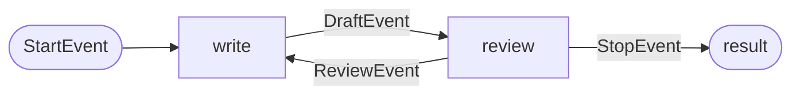
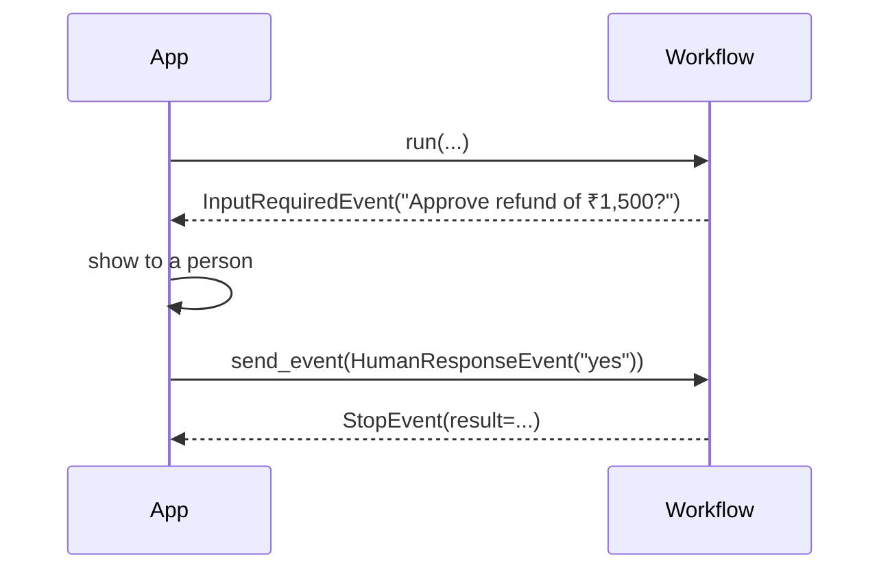

# LlamaIndex Agents and Workflows: The Complete Guide

> 📚 **Before you start**
>
> - [CrewAI Crews and Flows](crewai-crews-and-flows.md), whose flows react to steps finishing; LlamaIndex steps react to typed events.
> - [Async and Await for API Calls](../../python-programming/10-concurrency-for-ai-apps/async-and-await-for-api-calls.md), because every LlamaIndex workflow step is an `async def`.
> - [Retrieval-Augmented Generation](../../retrieval-augmented-generation-rag/course.md#m2), since LlamaIndex grew out of connecting models to your documents.

## Introduction

Think of the token display at a busy Bengaluru passport office. Nobody walks you from counter to counter. You get a token, and when your token type is called, the right counter takes you: "document check" tokens go to counters 1 to 4, "biometrics" tokens to 5 to 8. Each counter does its job and hands you a **new** token for the next stage. The building runs on events, not on a fixed script.

**LlamaIndex** started as the library for connecting LLMs to your data (loaders, indexes, query engines) and now has an agent layer built on exactly this idea. A **workflow** is a set of **steps**; each step says, through its type hints, which **event** it accepts and which events it can emit. The engine looks at each new event and runs whichever step accepts it. Its ready-made agents (`FunctionAgent`, `ReActAgent`, `CodeActAgent`) and the multi-agent `AgentWorkflow` are themselves workflows built on this engine.

By the end of this lesson you will be able to build an event-driven workflow with shared state, use prebuilt agents with tools and query engines, hand off between agents with `AgentWorkflow`, stream progress events and pause for human input.

> 💡 **Key Insight**
>
> In LlamaIndex, **the type of an event decides what runs next**. A step declared as `async def check(self, ev: DraftEvent) -> ReviewEvent | StopEvent` will run every time a `DraftEvent` appears, and the engine checks at startup that every event some step emits has a step that accepts it. Routing is just "return a different event type".

---

## Core Explanation

### 1. Events and steps

The core pieces live in `llama_index.core.workflow` (re-exported from the standalone `llama-index-workflows` package):

| Piece | What it is |
|---|---|
| `Event` | A Pydantic model carrying data between steps. Subclass it for your own events. |
| `StartEvent` / `StopEvent` | The input to `run(...)` and the final result (`StopEvent(result=...)`) |
| `@step` | Marks an `async` method as a step. Its parameter type says what it accepts; its return type says what it emits. |
| `Context` | Per-run shared state (`ctx.store.get` / `ctx.store.set`), plus `send_event`, `collect_events` and `write_event_to_stream` |
| `Workflow(timeout=...)` | The class you subclass. The default timeout is 45 seconds; `None` disables it. |

```python
# not-run: needs llama-index-core and llama-index-llms-anthropic, plus an API key
from llama_index.core.workflow import Workflow, step, Event, StartEvent, StopEvent, Context
from llama_index.llms.anthropic import Anthropic

llm = Anthropic(model="claude-opus-5-5")

class DraftEvent(Event):
    draft: str

class ReviewEvent(Event):
    feedback: str

class ReplyFlow(Workflow):
    @step
    async def write(self, ctx: Context, ev: StartEvent | ReviewEvent) -> DraftEvent:
        if isinstance(ev, StartEvent):
            await ctx.store.set("complaint", ev.complaint)
            hint = ""
        else:
            hint = ev.feedback
        tries = await ctx.store.get("tries", default=0)
        await ctx.store.set("tries", tries + 1)
        complaint = await ctx.store.get("complaint")
        prompt = f"Reply politely to this complaint: {complaint}. {hint}"
        return DraftEvent(draft=str(await llm.acomplete(prompt)))

    @step
    async def review(self, ctx: Context, ev: DraftEvent) -> ReviewEvent | StopEvent:
        if "sorry" in ev.draft.lower() or await ctx.store.get("tries") >= 3:
            return StopEvent(result=ev.draft)
        return ReviewEvent(feedback="Start with an apology.")

result = await ReplyFlow(timeout=60).run(complaint="My passport appointment was cancelled twice.")
print(result)
```

`run(complaint=...)` creates a `StartEvent` with a `complaint` field. `write` accepts a `StartEvent` **or** a `ReviewEvent`, so the loop back from review needs no special wiring: returning a `ReviewEvent` is the loop.

### 2. How the engine routes: a miniature version

The real engine runs steps concurrently, validates the graph, handles timeouts, retries and serialised state. The core trick, routing on type hints, fits in a few lines of plain Python:

```python
import asyncio
from dataclasses import dataclass
from typing import get_type_hints, get_args

@dataclass
class StartEvent: complaint: str
@dataclass
class DraftEvent: draft: str
@dataclass
class ReviewEvent: feedback: str
@dataclass
class StopEvent: result: str

def accepts(fn):
    hint = get_type_hints(fn)["ev"]
    return get_args(hint) or (hint,)

class MiniWorkflow:
    async def run(self, **kwargs):
        steps = [getattr(self, n) for n in dir(self) if n.startswith("step_")]
        queue, self.store = [StartEvent(**kwargs)], {}
        while queue:
            ev = queue.pop(0)
            if isinstance(ev, StopEvent):
                return ev.result
            for s in steps:
                if isinstance(ev, accepts(s)):
                    print(f"{type(ev).__name__:12} -> {s.__name__}")
                    queue.append(await s(ev))

class ReplyFlow(MiniWorkflow):
    async def step_write(self, ev: StartEvent | ReviewEvent) -> DraftEvent:
        self.store["tries"] = self.store.get("tries", 0) + 1
        if isinstance(ev, StartEvent):
            self.store["complaint"] = ev.complaint
            return DraftEvent("We have rebooked you for Monday.")
        return DraftEvent("Sorry for the trouble. We have rebooked you for Monday.")

    async def step_review(self, ev: DraftEvent) -> ReviewEvent | StopEvent:
        if "sorry" in ev.draft.lower():
            return StopEvent(ev.draft)
        return ReviewEvent("Start with an apology.")

print(asyncio.run(ReplyFlow().run(complaint="Appointment cancelled twice")))
```

Output:

```
StartEvent   -> step_write
DraftEvent   -> step_review
ReviewEvent  -> step_write
DraftEvent   -> step_review
Sorry for the trouble. We have rebooked you for Monday.
```

Nothing in the code says "after review, go back to write". The `ReviewEvent` type does that.



### 3. Fan-out and fan-in

A step can emit several events at once with `ctx.send_event(...)`, and a later step can wait for all of them with `ctx.collect_events(ev, [TypeA] * n)`, which returns `None` until enough have arrived. That is how you check three documents in parallel and then merge the results. The `num_workers` argument on `@step` lets one step run several copies concurrently.

```python
# not-run: needs llama-index-core
class CheckEvent(Event):
    doc: str

class CheckedEvent(Event):
    doc: str
    ok: bool

class DocCheck(Workflow):
    @step
    async def fan_out(self, ctx: Context, ev: StartEvent) -> CheckEvent:
        await ctx.store.set("n", len(ev.docs))
        for doc in ev.docs:
            ctx.send_event(CheckEvent(doc=doc))

    @step(num_workers=4)
    async def check(self, ev: CheckEvent) -> CheckedEvent:
        return CheckedEvent(doc=ev.doc, ok=await looks_valid(ev.doc))

    @step
    async def gather(self, ctx: Context, ev: CheckedEvent) -> StopEvent | None:
        results = ctx.collect_events(ev, [CheckedEvent] * await ctx.store.get("n"))
        if results is None:
            return None
        return StopEvent(result={r.doc: r.ok for r in results})
```

### 4. Prebuilt agents and tools

You rarely write the agent loop yourself. LlamaIndex ships three agents in `llama_index.core.agent.workflow`:

| Agent | How it acts |
|---|---|
| `FunctionAgent` | Uses the model's native tool calling. The usual choice for Claude, GPT and Gemini. |
| `ReActAgent` | Writes "Thought / Action / Observation" text and parses it; works with models that lack tool calling |
| `CodeActAgent` | Writes code as its action, run by a function you supply (the idea behind the next lesson) |

Plain Python functions become tools automatically (their name, type hints and docstring form the schema), and any **query engine** over your documents can become a tool with `QueryEngineTool.from_defaults(query_engine, name=..., description=...)`. That makes "agent that answers from our documents" very short:

```python
# not-run: needs llama-index-core, llama-index-llms-anthropic, an embedding model and an API key
from llama_index.core import VectorStoreIndex, SimpleDirectoryReader
from llama_index.core.agent.workflow import FunctionAgent
from llama_index.core.tools import QueryEngineTool
from llama_index.core.workflow import Context

docs = SimpleDirectoryReader("passport_rules/").load_data()
rules = QueryEngineTool.from_defaults(
    VectorStoreIndex.from_documents(docs).as_query_engine(),
    name="passport_rules",
    description="Answers questions about passport documents and fees.",
)

def appointment_slots(city: str) -> list[str]:
    """Return open appointment slots for a city."""
    return ["Mon 10:00", "Tue 15:30"]

agent = FunctionAgent(
    tools=[rules, appointment_slots],
    llm=llm,
    system_prompt="You help people renew passports. Check the rules before answering.",
)
ctx = Context(agent)                                  # keeps chat memory across runs
response = await agent.run(user_msg="Which documents do I need, and any slots in Pune?", ctx=ctx)
print(str(response))
```

`agent.run(...)` returns a handler you can `await` for the final answer, or iterate with `handler.stream_events()` to see `AgentStream` (tokens), `ToolCall` and `ToolCallResult` events as they happen. Passing `output_cls=SomePydanticModel` to an agent asks for a typed final answer.

### 5. Multi-agent: `AgentWorkflow`

`AgentWorkflow(agents=[...], root_agent="...")` connects several agents. Each agent gets a handoff tool to the agents listed in its `can_handoff_to`, and agents can share a state dictionary (`initial_state`) that tools read and write through the `Context`. In a multi-agent workflow every agent must have a `name` and a `description`, because those are what the other agents see when choosing whom to hand off to.

```python
# not-run: needs llama-index-core and an API key
from llama_index.core.agent.workflow import AgentWorkflow, FunctionAgent

intake = FunctionAgent(name="intake", description="Understands the request and routes it.",
                       system_prompt="Work out what the citizen needs.", llm=llm,
                       can_handoff_to=["documents", "booking"])
documents = FunctionAgent(name="documents", description="Explains required documents.",
                          tools=[rules], llm=llm)
booking = FunctionAgent(name="booking", description="Finds and books appointment slots.",
                        tools=[appointment_slots], llm=llm)

workflow = AgentWorkflow(agents=[intake, documents, booking], root_agent="intake",
                         initial_state={"city": None})
print(await workflow.run(user_msg="I lost my passport and need a new one in Pune"))
```

### 6. Pausing for a human

A step can return an `InputRequiredEvent`. It goes out on the event stream; your app shows it to a person and sends back a `HumanResponseEvent` with `handler.ctx.send_event(...)`, which a waiting step accepts. Because the run's `Context` can be serialised, a workflow can also stop completely and resume later from saved state.



### 7. When to use it

| Good fit | Poor fit |
|---|---|
| Agents that mostly answer from **your documents** (it has the richest set of loaders, indexes and query engines) | Teams who want a declarative graph diagram of every path (LangGraph's explicit edges show it more directly) |
| Event-driven processes with loops, fan-out and human input | Very simple single-call apps, where it is more machinery than you need |
| Python teams already using LlamaIndex for RAG | Teams standardised on TypeScript (there is a TS version, but the Python one leads) |

---

## Try It Yourself

1. **Add a step.** In the mini workflow, add a `TranslateEvent` so that `step_review` emits it instead of stopping, and a `step_translate` that returns `StopEvent("[Hindi] " + draft)`. Run it.
2. **Find the bug.** A step is declared `async def done(self, ev: FinalEvent) -> StopEvent`, but no step ever returns a `FinalEvent`. What does LlamaIndex do, and when?
3. **Pick the agent.** You are using an open-weights model through a server that doesn't support tool calling. Which prebuilt agent do you choose?

<details>
<summary>Show answers</summary>

**1.**

```python
@dataclass
class TranslateEvent: draft: str

class TranslatingFlow(ReplyFlow):
    async def step_review(self, ev: DraftEvent) -> ReviewEvent | TranslateEvent:
        if "sorry" in ev.draft.lower():
            return TranslateEvent(ev.draft)
        return ReviewEvent("Start with an apology.")

    async def step_translate(self, ev: TranslateEvent) -> StopEvent:
        return StopEvent("[Hindi] " + ev.draft)

print(asyncio.run(TranslatingFlow().run(complaint="Appointment cancelled twice")))
```

Output:

```
StartEvent   -> step_write
DraftEvent   -> step_review
ReviewEvent  -> step_write
DraftEvent   -> step_review
TranslateEvent -> step_translate
[Hindi] Sorry for the trouble. We have rebooked you for Monday.
```

**2.** The workflow's event graph is validated on the first `run()` (or when you call `workflow.validate()`): an event that some step accepts but nothing produces, or one that is produced but nothing accepts, raises a `WorkflowValidationError` before any step runs. You find the wiring mistake immediately, not halfway through a run.

**3.** `ReActAgent`, which drives tools through plain-text "Thought / Action / Observation" and parses the reply, so it doesn't need native tool calling.

</details>

---

## Real-World Examples

- **Document-heavy assistants.** Insurance, legal and policy help desks where an agent searches policy documents through query-engine tools and cites them.
- **Report generation.** A workflow fans out research over many sources, collects the results and writes a report, streaming progress events to a UI.
- **Approval-gated processes.** Refund or claim workflows that pause with `InputRequiredEvent` until a person approves.

---

## Common Misconceptions

### "LlamaIndex is only for RAG"

It began there, but its workflow engine is a general event-driven orchestrator, and its agents are built on it.

### "Steps run in the order you write them"

The order in the class doesn't matter. Steps run when an event they accept appears.

### "You must write `ReAct` prompts yourself"

`FunctionAgent` uses native tool calling; `ReActAgent` builds the prompt and parser for you.

---

## Interview Relevance

*"How does LlamaIndex orchestrate agents?"* A strong answer explains event-driven workflows: steps are `async` methods whose type hints declare accepted and emitted events, `StartEvent` and `StopEvent` begin and end a run, `Context` holds shared state and supports fan-out (`send_event`) and fan-in (`collect_events`), and validation catches missing wiring at startup. It then names `FunctionAgent`, `ReActAgent` and `CodeActAgent`, query-engine tools for RAG, `AgentWorkflow` with handoffs and shared state, event streaming and human input events.

---

## Key Takeaways

- **Workflows run on typed events**: a step runs when an event it accepts appears, and routing means returning a different event type.
- **`Context`** carries per-run state and supports fan-out and fan-in.
- **Prebuilt agents** (`FunctionAgent`, `ReActAgent`, `CodeActAgent`) are workflows too.
- **Query engines become tools**, which makes document-grounded agents short to write.
- **`AgentWorkflow`** adds named agents, handoffs and shared state; `InputRequiredEvent` pauses for people.

---

**Up next:** [smolagents and Code Agents](smolagents-and-code-agents.md)
