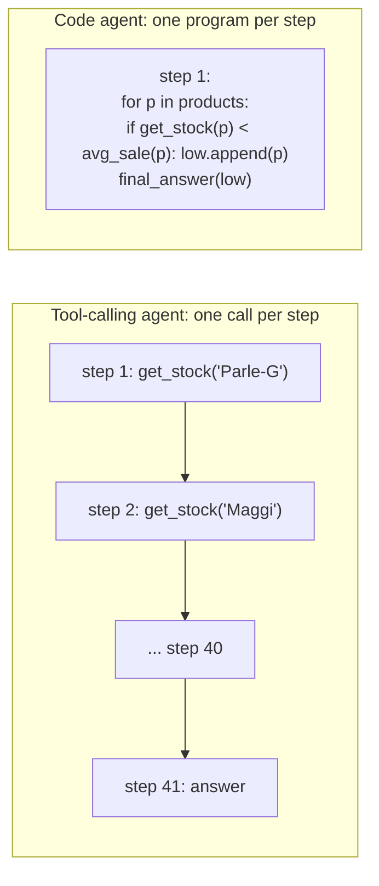
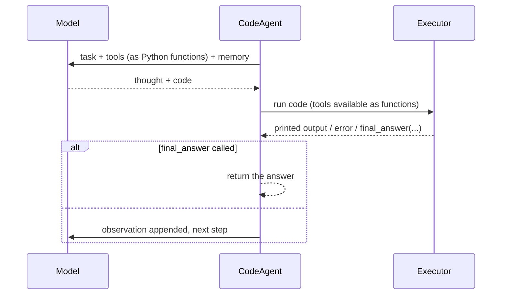

# smolagents and Code Agents: The Complete Guide

> 📚 **Before you start**
>
> - [LlamaIndex Agents and Workflows](llamaindex-agents-and-workflows.md), which mentioned `CodeActAgent`; this lesson explains the idea properly.
> - [Tools, Agent Skills and Code Execution](../../tools-agent-skills-and-code-execution/course.md), for why running model-written code needs a sandbox.
> - [ReAct](../../agentic-ai-fundamentals/05-reasoning-patterns/react.md), for the think-act-observe loop that code agents also follow.

## Introduction

A kirana shop owner in Indore wants to know which of 40 products to reorder. She could ask her nephew one question at a time: "What's the stock of Parle-G?" ... "And Maggi?" ... forty round trips. Or the nephew could open a spreadsheet and write one formula: "for each product, if stock is below the weekly average sale, list it". One step instead of forty, and the logic is right there to check.

That is the bet behind **code agents**. A normal tool-calling agent asks the model for one JSON tool call per step. A **code agent** asks the model to write a short **Python snippet** that can call several tools, loop, branch and do arithmetic, then runs that snippet and shows the model the result. Hugging Face's **smolagents** is the best-known framework built around this idea: a small library whose main class, `CodeAgent`, does exactly that, with a `ToolCallingAgent` for the classic JSON style.

By the end of this lesson you will know how a code agent's loop works, how to write smolagents tools and agents, how executors keep model-written code contained, and when code actions beat JSON tool calls.

> 💡 **Key Insight**
>
> In a code agent, **the action is a program**. That lets one step do what would take many JSON tool calls, and lets the model use loops, variables and maths it is bad at doing in its head. The price is that you are now **running code a model wrote**, so where and how that code runs becomes the most important design decision.

---

## Core Explanation

### 1. JSON tool calls versus code actions



| | Tool-calling agent | Code agent |
|---|---|---|
| Action format | One JSON tool call | A Python snippet |
| Several tools in one step | Only with parallel tool calls, no logic between them | Yes, with loops and conditions |
| Maths and data handling | The model does it in text, or you add tools | Plain Python |
| Safety | Only your tools can run | Arbitrary code can run, so it needs an executor with limits |
| Best for | Simple, well-defined tools; strict control | Multi-step data tasks, many small tool calls |

### 2. The smolagents loop

```python
# not-run: needs smolagents[litellm] and an ANTHROPIC_API_KEY
from smolagents import CodeAgent, LiteLLMModel, tool

@tool
def get_stock(product: str) -> int:
    """Return units in stock for a product.

    Args:
        product: The product name, for example "Parle-G".
    """
    return STOCK[product]

@tool
def weekly_sales(product: str) -> float:
    """Return average units sold per week.

    Args:
        product: The product name.
    """
    return SALES[product]

model = LiteLLMModel(model_id="anthropic/claude-opus-5-5")
agent = CodeAgent(tools=[get_stock, weekly_sales], model=model, max_steps=10)
print(agent.run("Which products have less than one week of stock left? Products: " + ", ".join(STOCK)))
```

Example output:

```
['Maggi', 'Tata Salt']
```

Each step, the model writes a short "thought" and a code block. smolagents parses the code, runs it in the **executor**, and adds the printed output (or the error) to memory as the observation. The run ends when the code calls `final_answer(...)` or after `max_steps` (default 20).



Key pieces of the API (smolagents 1.26):

| Piece | Notes |
|---|---|
| `@tool` | Turns a function into a tool. Type hints and a docstring with an `Args:` section are required; they become the description the model sees. |
| `CodeAgent(tools, model, ...)` | Options include `additional_authorized_imports`, `executor_type`, `planning_interval`, `max_steps`, `managed_agents`, `instructions`, `stream_outputs` |
| `ToolCallingAgent(tools, model)` | The JSON tool-call style, same loop |
| Models | `InferenceClientModel` (Hugging Face inference providers), `LiteLLMModel` (100+ providers, for example `"anthropic/claude-opus-5-5"`), `OpenAIModel`, `TransformersModel` for local models |
| `agent.run(task, ...)` | Returns the final answer; `return_full_result=True` gives a result object with steps and token usage |
| Built-in tools | `WebSearchTool`, `VisitWebpageTool`, `WikipediaSearchTool` and others in `smolagents.default_tools`; `add_base_tools=True` adds a default set |

Tools can also come from MCP servers (`ToolCollection.from_mcp(...)`) or be shared on the Hugging Face Hub (`push_to_hub`, `load_tool`).

### 3. How code is kept contained

Running model-written code is risky. smolagents offers two layers.

**The local executor** (`executor_type="local"`, the default) doesn't hand the code to Python's `exec`. It walks the code's syntax tree and interprets it itself, allowing only a list of safe modules (`collections`, `datetime`, `itertools`, `math`, `queue`, `random`, `re`, `stat`, `statistics`, `time`, `unicodedata`), plus whatever you add in `additional_authorized_imports`. It also caps the number of operations and loop iterations. The smolagents docs are clear that this is **not** a security boundary against a determined attacker; it catches mistakes and obvious misuse.

**Remote sandboxes** run the code somewhere else entirely: `executor_type` can be `"e2b"`, `"modal"`, `"docker"` or `"blaxel"`. Use one of these whenever the task or its inputs are not fully trusted.

To see the idea of the local executor, here is a toy version. It parses the code, refuses imports outside an allow-list and a few dangerous names, then runs it with only the tools and `final_answer` available:

```python
import ast

ALLOWED_IMPORTS = {"math", "statistics"}
BLOCKED_NAMES = {"open", "exec", "eval", "__import__", "compile", "globals"}

class FinalAnswer(Exception):
    pass

def check(code):
    for node in ast.walk(ast.parse(code)):
        if isinstance(node, (ast.Import, ast.ImportFrom)):
            names = [a.name for a in node.names] if isinstance(node, ast.Import) else [node.module]
            for name in names:
                if name.split(".")[0] not in ALLOWED_IMPORTS:
                    return f"import of {name!r} is not allowed"
        if isinstance(node, ast.Name) and node.id in BLOCKED_NAMES:
            return f"use of {node.id!r} is not allowed"
        if isinstance(node, ast.Attribute) and node.attr.startswith("__"):
            return f"dunder attribute {node.attr!r} is not allowed"
    return None

def run_action(code, tools):
    problem = check(code)
    if problem:
        return f"Error: {problem}"
    def final_answer(value):
        raise FinalAnswer(value)
    env = {"__builtins__": {"print": print, "len": len, "round": round, "sorted": sorted},
           **tools, "final_answer": final_answer}
    try:
        exec(code, env)
    except FinalAnswer as done:
        return f"FINAL: {done.args[0]}"
    except Exception as e:
        return f"Error: {type(e).__name__}: {e}"
    return "ok (no final answer yet)"

STOCK = {"Parle-G": 120, "Maggi": 15, "Tata Salt": 8, "Surf Excel": 30}
SALES = {"Parle-G": 60, "Maggi": 40, "Tata Salt": 12, "Surf Excel": 10}
tools = {"get_stock": STOCK.get, "weekly_sales": SALES.get, "products": list(STOCK)}

model_code = """
low = []
for p in products:
    if get_stock(p) < weekly_sales(p):
        low.append(p)
final_answer(sorted(low))
"""
print(run_action(model_code, tools))
print(run_action("import os\nos.remove('shop.db')", tools))
print(run_action("open('/etc/passwd').read()", tools))
print(run_action("print(get_stock('Maggi') / 0)", tools))
```

Output:

```
FINAL: ['Maggi', 'Tata Salt']
Error: import of 'os' is not allowed
Error: use of 'open' is not allowed
Error: ZeroDivisionError: division by zero
```

One snippet answered the whole question, using four products and eight tool calls. The bad snippets are stopped before they run, and the runtime error comes back as an observation the model can fix on the next step. A real sandbox goes much further (separate process or machine, no network, resource limits), which is why remote executors exist.

### 4. Multi-agent and planning

- **Managed agents.** Give an agent a `name` and `description`, then pass it in another agent's `managed_agents=[...]`. The manager can call it like a function from its code.
- **Planning.** `planning_interval=3` makes the agent stop every three steps to write or update a plan, which helps on long tasks.
- **Final answer checks.** `final_answer_checks=[fn, ...]` runs your functions on the proposed answer; if one fails, the agent keeps working instead of returning.

### 5. When to use it

| Good fit | Poor fit |
|---|---|
| Data and maths heavy tasks; many small tool calls | Untrusted inputs without a remote sandbox |
| Teams using Hugging Face models and the Hub | Strict, auditable workflows (the action is free-form code) |
| Research prototypes; small codebase you can read in an afternoon | Large production systems needing durable state and approvals out of the box |

The code-action idea is not unique to smolagents: LlamaIndex has `CodeActAgent`, DSPy has a `CodeAct` module, and Anthropic's own guidance on calling MCP tools from code follows the same reasoning. What smolagents adds is a small, readable library built around it.

---

## Try It Yourself

1. **Add a guard.** Extend `check` so that `while True:` loops are refused. Test it with `"while True:\n    pass"`.
2. **Compare step counts.** For 40 products, how many model calls would a tool-calling agent need without parallel calls, and how many could a code agent need?
3. **Choose an executor.** Your code agent will read CSV files uploaded by customers. Which `executor_type` would you pick and why?

<details>
<summary>Show answers</summary>

**1.**

```python
_old_check = check

def check(code):
    for node in ast.walk(ast.parse(code)):
        if isinstance(node, ast.While) and isinstance(node.test, ast.Constant) and node.test.value is True:
            return "infinite 'while True' loops are not allowed"
    return _old_check(code)

print(run_action("while True:\n    pass", tools))
print(run_action(model_code, tools))
```

Output:

```
Error: infinite 'while True' loops are not allowed
FINAL: ['Maggi', 'Tata Salt']
```

**2.** Roughly 80 tool calls (stock and sales for each product), so about 81 model calls including the answer. A code agent can do it in 1 model call if its first snippet is correct, or 2 to 3 with a mistake to fix.

**3.** A remote sandbox such as `"e2b"`, `"modal"` or `"docker"`. Uploaded files are untrusted input, so they could contain text that steers the model into writing harmful code, and the local executor is not a security boundary.

</details>

---

## Real-World Examples

- **Data analysis agents.** An agent loads a CSV with pandas inside a sandbox, computes summaries and plots, and returns a chart.
- **Web research.** A code agent calls a search tool several times in a loop, collects snippets into a list and summarises them in one step.
- **Benchmarks.** Hugging Face has used smolagents code agents for open research agents on hard question-answering benchmarks, where code actions reduced the number of steps.

---

## Common Misconceptions

### "Code agents are only for coding tasks"

They write code as a way of acting. The task can be anything: shopping lists, travel planning, research.

### "The local executor is a sandbox"

It limits imports and operations, but it runs in your process. Use a remote executor for untrusted work.

### "Code actions are always better"

For one simple tool call, JSON is clearer and easier to control. Code actions shine when a step needs several calls and some logic.

---

## Interview Relevance

*"What is a code agent, and what are the risks?"* A strong answer explains that the model writes Python as its action, which can combine many tool calls with loops and maths in one step, and that smolagents' `CodeAgent` parses and runs this code, feeding output or errors back. It covers the local AST-based executor with an import allow-list and its limits, remote executors (E2B, Modal, Docker, Blaxel), and when JSON tool calling is still the better choice.

---

## Key Takeaways

- **Code agents act by writing Python**, so one step can do many tool calls plus logic.
- **smolagents** provides `CodeAgent` and `ToolCallingAgent`, `@tool` with docstring-based descriptions, and many model back-ends.
- **The local executor interprets code with an allow-list**; it is a guard rail, not a security boundary.
- **Use remote executors** (`e2b`, `modal`, `docker`, `blaxel`) for untrusted inputs.
- **Managed agents, planning intervals and final answer checks** extend the basic loop.

---

**Up next:** [TypeScript Agents: Mastra and the Vercel AI SDK](typescript-agents-mastra-and-the-vercel-ai-sdk.md)
