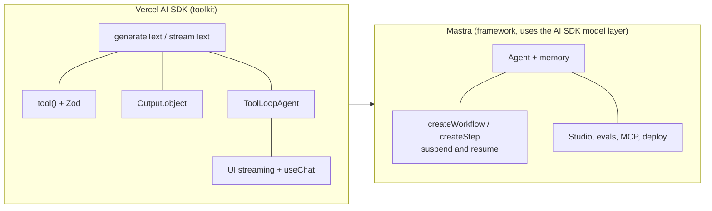

# TypeScript Agents: Mastra and the Vercel AI SDK: The Complete Guide

> 📚 **Before you start**
>
> - [smolagents and Code Agents](smolagents-and-code-agents.md) and the other Module 3 lessons, for the Python side of the same ideas.
> - [Function Calling Step by Step](../../agentic-ai-fundamentals/04-tools-and-function-calling/function-calling-step-by-step.md), for what a tool schema is.
> - No TypeScript experience is assumed. Each snippet is explained line by line, and the one runnable example is in Python.

## Introduction

Many Indian product teams, from food delivery to fintech, build their web front ends in TypeScript. When such a team wants an AI assistant inside the app ("find me a veg biryani under ₹300 that arrives in 30 minutes"), they want the agent in the same language as the rest of their product, sharing types with the UI and streaming answers straight into a React component. Running a separate Python service just for the agent is extra work they would rather avoid.

Two libraries dominate that world. The **Vercel AI SDK** (the `ai` package) is a low-level toolkit: one function to call any model, typed tools, a tool loop and UI streaming helpers. **Mastra** is a full framework built on top of it: agents with memory, typed workflows with suspend and resume, a local studio for testing, evals and deployment. Their relationship is roughly like the Anthropic SDK and the Claude Agent SDK, or like LangChain's model layer and LangGraph.

By the end of this lesson you will be able to read and write a TypeScript agent with typed tools, control its loop, get typed output, stream it to a UI, and build a Mastra workflow.

> 💡 **Key Insight**
>
> In TypeScript agent frameworks, a **Zod schema** plays the role that a Pydantic model plays in Python: one definition gives the model a JSON schema, validates what comes back, and gives your editor a static type. Every tool input, structured output and workflow step is declared with one, so the compiler catches mismatches before you run anything.

---

## Core Explanation

### 1. Zod in one minute

```ts
import { z } from 'zod';

const Order = z.object({
  dish: z.string().describe('Name of the dish'),
  maxPriceRupees: z.number().int().positive(),
  veg: z.boolean(),
});
type Order = z.infer<typeof Order>;       // { dish: string; maxPriceRupees: number; veg: boolean }

Order.parse({ dish: 'Veg biryani', maxPriceRupees: 300, veg: true });   // ok
Order.parse({ dish: 'Veg biryani', maxPriceRupees: '300' });            // throws: expected number
```

`z.object(...)` describes a shape, `.describe(...)` adds the text the model sees, `z.infer` turns the schema into a TypeScript type, and `.parse` validates at runtime. The Python equivalent is a Pydantic `BaseModel` with `Field(description=...)`, which you will meet properly in [Why Type Safety Matters for LLM Apps](../course.md#m4).

### 2. The AI SDK: one call, any model

```ts
// not-run: needs the ai and zod packages, Node 22+, and an AI Gateway or Anthropic key
import { generateText, tool, stepCountIs } from 'ai';
import { z } from 'zod';

const result = await generateText({
  model: 'anthropic/claude-opus-5.5',          // a model id routed through the Vercel AI Gateway
  instructions: 'You help people order food. Use the tools; never invent restaurants.',
  prompt: 'Veg biryani under ₹300 in Koramangala, delivered in 30 minutes?',
  tools: {
    searchRestaurants: tool({
      description: 'Find restaurants serving a dish in an area',
      inputSchema: z.object({ dish: z.string(), area: z.string() }),
      execute: async ({ dish, area }) => searchApi(dish, area),
    }),
    deliveryTime: tool({
      description: 'Estimated delivery minutes for a restaurant',
      inputSchema: z.object({ restaurantId: z.string() }),
      execute: async ({ restaurantId }) => etaApi(restaurantId),
    }),
  },
  stopWhen: stepCountIs(5),
});

console.log(result.text);
console.log(result.steps.length, 'steps');
```

How to read it:

- `generateText` is the single entry point for text generation; `streamText` is the streaming twin.
- `model` can be a string id resolved by the **AI Gateway** (`'anthropic/claude-opus-5.5'`), or a provider object such as `anthropic('claude-opus-5-5')` from `@ai-sdk/anthropic` if you call Anthropic directly.
- `tool({ description, inputSchema, execute })` defines a tool. The SDK sends the schema to the model, validates the model's arguments against it, and calls `execute` with typed arguments.
- By default `generateText` makes **one** model call. If tools are present and you want the loop (call tools, send results back, call again), give a stop condition: `stopWhen: stepCountIs(5)`. `stepCountIs` is an alias of `isStepCount`, and `hasToolCall('name')` stops when a particular tool is called.
- `result.steps` records every step, with its tool calls and results.

The same loop, in plain Python, makes the moving parts visible. The "model" is a scripted list of replies; the important parts are schema validation before `execute` and the stop condition:

```python
from pydantic import BaseModel, ValidationError

class SearchInput(BaseModel):
    dish: str
    area: str

class EtaInput(BaseModel):
    restaurant_id: str

TOOLS = {
    "search_restaurants": (SearchInput, lambda a: [{"id": "r7", "name": "Biryani Point", "price": 280}]),
    "delivery_time": (EtaInput, lambda a: {"minutes": 25}),
}

SCRIPT = [
    {"tool": "search_restaurants", "args": {"dish": "veg biryani"}},                 # missing 'area'
    {"tool": "search_restaurants", "args": {"dish": "veg biryani", "area": "Koramangala"}},
    {"tool": "delivery_time", "args": {"restaurant_id": "r7"}},
    {"text": "Biryani Point: veg biryani ₹280, about 25 minutes."},
]

def generate_text(script, stop_when_steps):
    steps = []
    for reply in script[:stop_when_steps]:
        if "text" in reply:
            steps.append(("text", reply["text"]))
            return reply["text"], steps
        schema, execute = TOOLS[reply["tool"]]
        try:
            args = schema(**reply["args"])
            result = execute(args)
        except ValidationError as e:
            result = f"invalid input: {e.errors()[0]['loc'][0]} {e.errors()[0]['msg'].lower()}"
        steps.append((reply["tool"], result))
    return None, steps

text, steps = generate_text(SCRIPT, stop_when_steps=5)
for name, result in steps:
    print(f"{name:20} {result}")

text, steps = generate_text(SCRIPT, stop_when_steps=2)
print("stopped early, text =", text, "after", len(steps), "steps")
```

Output:

```
search_restaurants   invalid input: area field required
search_restaurants   [{'id': 'r7', 'name': 'Biryani Point', 'price': 280}]
delivery_time        {'minutes': 25}
text                 Biryani Point: veg biryani ₹280, about 25 minutes.
stopped early, text = None after 2 steps
```

The bad call never reached `execute`; the model got a validation message and fixed its arguments. With a step limit of 2, the run stops before an answer, which is why you choose the limit carefully and check for a missing answer.

### 3. Typed output, agents and UI streaming

**Typed output.** Pass `output: Output.object({ schema })` and read `result.output`, a validated, typed object:

```ts
// not-run: needs the ai and zod packages
import { generateText, Output } from 'ai';

const { output } = await generateText({
  model: 'anthropic/claude-opus-5.5',
  output: Output.object({
    schema: z.object({ dish: z.string(), maxPriceRupees: z.number(), veg: z.boolean() }),
  }),
  prompt: 'Parse this order: "ek veg biryani, 300 se kam"',
});
console.log(output.maxPriceRupees);   // typed as number
```

**Agents.** `ToolLoopAgent` packages model, instructions, tools and loop settings so you can reuse them. It loops until the model stops calling tools, a tool needs approval, or a stop condition is met (the default is 20 steps):

```ts
// not-run: needs the ai package
import { ToolLoopAgent } from 'ai';

export const foodAgent = new ToolLoopAgent({
  model: 'anthropic/claude-opus-5.5',
  instructions: 'You help people order food.',
  tools: { searchRestaurants, deliveryTime, placeOrder },
});
const { text } = await foodAgent.generate({ prompt: 'Veg biryani under ₹300?' });
```

A tool can require a person's approval before it runs (for example `placeOrder`, which spends money): the loop pauses and returns an approval request that your UI shows to the user.

**UI streaming.** In a Next.js route, `createAgentUIStreamResponse({ agent, uiMessages })` streams the agent's messages, tool calls and results to the browser, where the `useChat` hook from `@ai-sdk/react` renders them. This tight link to the front end is the main reason teams pick the AI SDK.

### 4. Mastra: agents, tools and memory

Mastra builds a framework on the AI SDK's model layer. Imports come from subpaths of `@mastra/core`:

```ts
// not-run: needs @mastra/core and zod
import { Agent } from '@mastra/core/agent';
import { createTool } from '@mastra/core/tools';
import { z } from 'zod';

const placeOrder = createTool({
  id: 'place-order',
  description: 'Place a food order and charge the saved UPI ID',
  inputSchema: z.object({ restaurantId: z.string(), dish: z.string() }),
  outputSchema: z.object({ orderId: z.string() }),
  requireApproval: true,                       // pause for the user before spending money
  execute: async ({ restaurantId, dish }) => ordersApi.create(restaurantId, dish),
});

export const foodAgent = new Agent({
  id: 'food-agent',
  name: 'Food agent',
  instructions: 'You help people order food. Confirm price and time before ordering.',
  model: 'anthropic/claude-opus-5.5',
  tools: { searchRestaurants, placeOrder },
});

const res = await foodAgent.generate('Order a veg biryani under ₹300 from the fastest place');
console.log(res.text);
```

Beyond the agent itself, Mastra adds **memory** (conversation threads and working memory backed by a storage adapter), **structured output** via `generate(..., { structuredOutput: { schema } })`, MCP clients and servers, evals and a local **studio** UI started with `mastra dev` for chatting with agents and stepping through workflows. A project is usually scaffolded with `npm create mastra@latest`, and agents and workflows are registered on a `Mastra` instance.

### 5. Mastra workflows

Workflows are where Mastra gives you control. Each step is created with `createStep`, declaring `inputSchema` and `outputSchema`; a workflow chains them with `.then()`, `.parallel()`, `.branch()`, loops (`.dountil()`, `.dowhile()`, `.foreach()`) and `.sleep()`, then `.commit()` seals it. Because every step has schemas, TypeScript checks that each step's output fits the next step's input.

```ts
// not-run: needs @mastra/core and zod
import { createStep, createWorkflow } from '@mastra/core/workflows';

const parse = createStep({
  id: 'parse',
  inputSchema: z.object({ message: z.string() }),
  outputSchema: z.object({ dish: z.string(), maxPrice: z.number() }),
  execute: async ({ inputData }) => parseOrder(inputData.message),
});

const search = createStep({
  id: 'search',
  inputSchema: z.object({ dish: z.string(), maxPrice: z.number() }),
  outputSchema: z.object({ options: z.array(z.string()) }),
  execute: async ({ inputData }) => ({ options: await searchApi(inputData.dish, inputData.maxPrice) }),
});

export const orderFlow = createWorkflow({
  id: 'order-flow',
  inputSchema: z.object({ message: z.string() }),
  outputSchema: z.object({ options: z.array(z.string()) }),
})
  .then(parse)
  .then(search)
  .commit();

const run = await orderFlow.createRun();
const result = await run.start({ inputData: { message: 'veg biryani under 300' } });
```

A step can **suspend** (for example, waiting for a user to pick an option) and the run can be **resumed** later with new data, with state saved by Mastra's storage. An agent can also be used directly as a step (`createStep(agent)`).



### 6. Choosing between them

| You want... | Pick |
|---|---|
| A chat UI with tools inside an existing Next.js app | **AI SDK** |
| Full control with the smallest dependency | **AI SDK** |
| Agents with memory, long-running workflows with suspend and resume, a local studio | **Mastra** |
| A team standard for many agents and workflows in TypeScript | **Mastra** |

Both need Node.js 22 or newer for their current major versions. Other TypeScript options include the TypeScript versions of the OpenAI Agents SDK (`@openai/agents`), the Claude Agent SDK (`@anthropic-ai/claude-agent-sdk`), LangGraph.js and Google ADK, so a team can often stay with the vendor SDK it already knows.

---

## Try It Yourself

1. **Read the schema.** What TypeScript type does `z.infer` give for `z.object({ items: z.array(z.string()), urgent: z.boolean().optional() })`?
2. **Stop on a tool.** In the Python loop above, add a `stop_on` parameter: if the model calls a tool with that name, stop right after running it. Run it with `stop_on="delivery_time"`.
3. **Pick a tool.** Which tools in a food-ordering agent should require approval, and which shouldn't?

<details>
<summary>Show answers</summary>

**1.** `{ items: string[]; urgent?: boolean | undefined }`.

**2.**

```python
def generate_text(script, stop_when_steps, stop_on=None):
    steps = []
    for reply in script[:stop_when_steps]:
        if "text" in reply:
            steps.append(("text", reply["text"]))
            return reply["text"], steps
        schema, execute = TOOLS[reply["tool"]]
        try:
            result = execute(schema(**reply["args"]))
        except ValidationError as e:
            result = f"invalid input: {e.errors()[0]['loc'][0]} {e.errors()[0]['msg'].lower()}"
        steps.append((reply["tool"], result))
        if reply["tool"] == stop_on:
            break
    return None, steps

text, steps = generate_text(SCRIPT, stop_when_steps=5, stop_on="delivery_time")
print([name for name, _ in steps])
```

Output:

```
['search_restaurants', 'search_restaurants', 'delivery_time']
```

This is what `hasToolCall('deliveryTime')` does in the AI SDK.

**3.** Approval for anything that spends money or can't be undone: placing or cancelling an order, applying a paid coupon, changing the saved address. No approval for read-only tools: searching restaurants, checking delivery time, reading the menu.

</details>

---

## Real-World Examples

- **In-app assistants.** E-commerce and food apps built on Next.js use the AI SDK to stream answers and tool results into chat components.
- **Internal tools.** Teams use Mastra workflows to process support tickets, with a suspend step that waits for an agent to approve a refund.
- **Prototypes to production.** Developers start with the AI SDK for a single feature and move to Mastra when they need memory, many agents and workflow history.

---

## Common Misconceptions

### "Agents must be written in Python"

The TypeScript ecosystem is mature: the AI SDK, Mastra, and TypeScript versions of the OpenAI, Claude, Google and LangGraph SDKs.

### "`generateText` runs an agent loop by default"

It makes one model call unless you set a stop condition such as `stopWhen: stepCountIs(5)`; `ToolLoopAgent` loops by default up to 20 steps.

### "Zod types are only for the compiler"

Zod schemas also validate at runtime, which is what protects your tools from malformed model output.

---

## Interview Relevance

*"How would you build an agent inside a TypeScript web app?"* A strong answer describes the AI SDK's `generateText`/`streamText`, `tool({ description, inputSchema, execute })` with Zod, `stopWhen` conditions, `Output.object` for typed results, `ToolLoopAgent` and UI streaming to `useChat`. It then explains when to move to Mastra: agents with memory, `createTool` with approvals, typed `createWorkflow` chains with suspend and resume, a local studio and evals.

---

## Key Takeaways

- **Zod is TypeScript's Pydantic**: one schema for the model, runtime validation and static types.
- **The AI SDK** gives one API across providers, typed tools, stop conditions, typed output and UI streaming.
- **`generateText` loops only with `stopWhen`**; `ToolLoopAgent` loops by default up to 20 steps.
- **Mastra** adds agents with memory, approvals, typed workflows with suspend and resume, and a studio.
- **Choose by need**: the AI SDK for a feature in a web app, Mastra for a team-wide agent platform.

---

**Up next:** [Why Type Safety Matters for LLM Apps](../course.md#m4)
