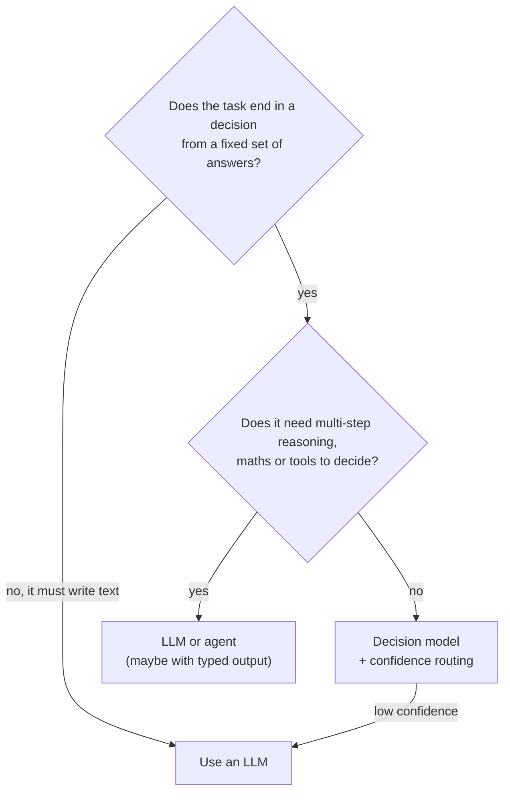

# Decision Models: Typed Answers instead of Text (Jev): The Complete Guide

> 📚 **Before you start**
>
> - [Why Type Safety Matters for LLM Apps](why-type-safety-matters-for-llm-apps.md), for the typed boundary.
> - [Pydantic AI](pydantic-ai.md) and [Instructor](instructor-and-validated-structured-output.md), which get typed answers by asking a text model to write JSON.
> - [Probability Basics](../../statistics-for-data-science/course.md#m5), helpful for reading probabilities and confidence. Everything needed is explained here.

## Introduction

At a railway reservation counter in Chennai, the clerk doesn't write an essay about your request. She reads your form and makes a handful of quick, separate decisions: Is the train right? Which class? Is it Tatkal? Is the ID valid? Each is a tick in a box. If one box is unclear, say the date is smudged, she doesn't guess; she asks you. Most of her day is **deciding**, not **writing**.

A surprising amount of LLM traffic in real products looks like that clerk's work: classify this ticket, is this message spam, how urgent is it, which tool should the agent call next, is this command safe to run. We usually ask a text-generating LLM to answer such questions by writing JSON, then validate it (as in the last two lessons). That works, but it is slow and costly for what is really a choice among a few options, and the model gives you an answer without saying how sure it is.

**Decision models** take a different route: you send content plus **typed questions**, and the model returns typed answers directly, with **probabilities** over the options, without generating text. The model the course owner asked us to cover, **Jev by TypeSafe AI**, is the best-known example as of October 2026. This lesson explains what Jev is (separating confirmed facts from vendor claims), how its question types and confidence work, how to call it, how to route on confidence, and where the idea is spreading in the wider ecosystem.


> 💡 **Key Insight**
>
> An LLM asked for JSON **writes** an answer token by token and then you check it. A decision model **scores** every allowed answer at once and gives you the distribution. The output can't be off-schema, and the probabilities let your code decide when to act automatically and when to hand the case to a bigger model or a person.

---

## Core Explanation

### 1. What is confirmed about Jev and TypeSafe AI

Jev is new (announced September 2026), so it's worth being careful about what is known. The table separates what the company's own public pages and documentation state from what is a **vendor claim** that hasn't been independently checked.

| Topic | What we can say | Source |
|---|---|---|
| Company | TypeSafe AI, founded in 2024. CEO Diogo Almeida previously worked at OpenAI (on InstructGPT, ChatGPT and GPT-4 and RLHF); co-founders Erik Gafni and Sasha Sheng. Came out of stealth on 15 September 2026 with a $40M seed round led by DCVC. | typesafe.ai; SiliconANGLE coverage of the launch |
| What Jev is | A "System One Model" (a reference to Daniel Kahneman's fast, intuitive "System 1" thinking). The name honours the economist William Stanley Jevons. It takes a **state** (text, JSON or an array) and named **typed questions**, and answers all of them in parallel from one request **without generating text**. | typesafe.ai launch post "Introducing System One Models & Jev" (15 Sep 2026); docs.typesafe.ai |
| How it's built (as described) | A new architecture with a parallel sampler, trained with what TypeSafe calls RLCD, "Reinforcement Learning for Calibrated Decisions". No paper with details was public at the time of writing. | Launch post |
| Access | Early access through a waitlist; REST API plus official Python (`typesafe-sdk`, 0.7.5) and TypeScript (`@typesafe-ai/sdk`) SDKs | docs.typesafe.ai; PyPI; npm |
| Models | `jev-latest` points to `jev-1.13.0` (stable, the SDK default); `jev-preview` points to `jev-1.14.0` (from 14 October 2026) | docs.typesafe.ai |
| Pricing | $0.042 per million input tokens; output tokens currently free | docs.typesafe.ai pricing; the API's own schema says output tokens are free of charge |
| Limits | 64k tokens per request and 32k per question by default (a `TypeSafe-Danger-Zone-Long-Context: true` header raises both to 262k); text-only state for general use; best in English; no fine-tuning; rate limits return HTTP 429 | docs.typesafe.ai |
| **Vendor claims (unverified)** | End-to-end latency of roughly 70 to 500 ms; "193.6x faster, 444.6x cheaper" than frontier LLMs on TypeSafe's own workflow evaluations; a 0% schema-mismatch rate; demos of Jev playing Doom and wikiracing | Launch post. The evaluations were designed by TypeSafe; they published the LLM wrapper used for comparison (`system-one-adapter-python`) as open source. Treat the numbers as the vendor's, not as independent benchmarks. |

Two honest notes before going further:

- **"Calibrated" is a claim, not something the docs promise.** The launch post describes Jev's decisions as calibrated (when it says 80%, it should be right about 80% of the time). The documentation is more careful: it describes `confidence` as a measure of how **concentrated** the probability distribution is, and tells you to choose thresholds by testing on your own data. Do that.
- **The "0% schema mismatch" is true by construction**, and isn't a measure of accuracy. A model that can only return one of the allowed options can never return an invalid option, but it can still return the wrong one.

### 2. The question types

A request has one `state` and a dictionary of named questions. Each question has a `type`, optional `instructions` (the question itself), and `criteria` (the allowed answers, with descriptions):

| Type | Ask it like | Answer fields |
|---|---|---|
| **Choice** | "Which team should handle this?" with criteria `{"billing": "...", "delivery": "...", ...}` | `choice` (the most likely option), `probabilities` (one per option, summing to about 1), `confidence` |
| **Score** | "How urgent is this?" with an **ordered** list of levels `["Can wait", "This week", "Today"]` | `score` (the probability-weighted average level, so it can be between levels, like 1.7), `probabilities` per level, `legend` (level number to description), `confidence` |
| **Noul** (yes/no) | "Does the customer ask for a refund?" optionally with `criteria={"true": ..., "false": ...}` | `noul`: the probability of yes, from 0 to 1. No separate confidence field. |
| **Box** | "Where is the signature on this form?" (with an image asset) | Bounding-box coordinates. Newer, image-only; requires a vision-capable model. |

"Noul" is TypeSafe's own word for a yes/no question. According to the docs, Jev allows up to 255 options in a choice and up to 10 score levels (Pydantic AI's Jev profile enforces the same limits).

Two design rules from the docs matter a lot in practice:

1. **Questions are answered in parallel and in isolation.** A question can't see another question's answer. So don't write "If it's about billing, how urgent is it?" Ask "category" and "urgency" separately and combine them in your code.
2. **Keep each question narrow and literal.** Jev 1.13 is documented to struggle with multi-step reasoning, double negatives, arithmetic (counting, date differences) and long, distracting state. It also shows a slight bias toward the first option listed. Put any calculation in your code, and test option order.

### 3. Calling Jev

**REST.** One endpoint answers everything:

```bash
# not-run: needs an early-access TypeSafe API key
curl https://api.typesafe.ai/v1/systemone \
  -H "Authorization: Bearer $TYPESAFE_API_KEY" \
  -H "Content-Type: application/json" \
  -d '{
    "model": "jev-latest",
    "state": "I was charged twice for order 4471. Please fix this today!",
    "questions": {
      "is_urgent": {"type": "noul", "instructions": "Does this message convey urgency?"}
    }
  }'
```

Example output (shape as documented; the numbers are illustrative):

```json
{"model": "jev-1.13.0",
 "answers": {"is_urgent": {"type": "noul", "noul": 0.95}},
 "usage": {"input_tokens": 296, "output_tokens": 20}}
```

Notice the response names the exact model version that answered (`jev-1.13.0`) even though you asked for the alias. Log it: when `jev-latest` moves to a new version, your thresholds may need re-checking.

**Python SDK.** `pip install typesafe-sdk`, then:

```python
# not-run: needs typesafe-sdk and an early-access API key in TYPESAFE_API_KEY
from typesafe_sdk import TypeSafeClient, Choice, Score, Noul

with TypeSafeClient() as client:                       # reads TYPESAFE_API_KEY; default model jev-latest
    response = client.system_one(
        state={"subject": "Charged twice", "message": "I was charged twice for order 4471. Please fix this today!"},
        questions={
            "team": Choice(
                instructions="Which team should handle this ticket?",
                criteria={"billing": "Payments, refunds, invoices",
                          "delivery": "Late, missing or damaged orders",
                          "account": "Login, profile, addresses",
                          "other": None},
            ),
            "urgency": Score(instructions="How urgent is this?",
                             criteria=["Can wait", "Needs attention this week", "Needs attention today"]),
            "wants_refund": Noul(instructions="Does the customer ask for money back?"),
        },
    )

team = response.choices["team"]
print(team.choice, round(team.confidence, 2), team.probabilities)
print(response.scores["urgency"].score)
print(response.nouls["wants_refund"].noul)
print(response.model, response.usage.input_tokens)
```

Example output (illustrative):

```
billing 0.91 {'billing': 0.94, 'delivery': 0.03, 'account': 0.02, 'other': 0.01}
1.86
0.97
jev-1.13.0 141
```

The SDK also has an `AsyncTypeSafeClient`, retry and timeout settings, and typed errors (`TypeSafeError`, `TypeSafeAPIError` with `status` and `request_id`, `TypeSafeRateLimitError` and others). The TypeScript SDK (`@typesafe-ai/sdk`) mirrors it.

### 4. Where confidence comes from

You don't need the vendor's code to understand `confidence`; the docs describe the formulas, and they're simple functions of the probabilities. Here is a working version, run on a pretend response that has exactly the documented shape. The pretend client is just a dictionary lookup, so the code runs anywhere; the parsing and maths are the parts you'd reuse with the real API.

```python
from typing import Annotated, Literal, Union
from pydantic import BaseModel, Field

class NoulAnswer(BaseModel):
    type: Literal["noul"]
    noul: float

class ChoiceAnswer(BaseModel):
    type: Literal["choice"]
    choice: str
    confidence: float
    probabilities: dict[str, float]

class ScoreAnswer(BaseModel):
    type: Literal["score"]
    score: float
    confidence: float
    legend: dict[str, str]
    probabilities: dict[str, float]

Answer = Annotated[Union[NoulAnswer, ChoiceAnswer, ScoreAnswer], Field(discriminator="type")]

class SystemOneResponse(BaseModel):
    model: str
    answers: dict[str, Answer]

def choice_confidence(probs):
    n, p_max = len(probs), max(probs.values())
    return (p_max - 1 / n) / (1 - 1 / n)

def score_confidence(probs):
    levels = [int(k) for k in probs]
    mode = max(levels, key=lambda k: probs[str(k)])
    spread = sum(probs[str(k)] * abs(k - mode) for k in levels)
    uniform_spread = sum(abs(k - mode) for k in levels) / len(levels)
    return max(0.0, 1 - spread / uniform_spread)

def noul_confidence(p_yes):
    return abs(2 * p_yes - 1)

raw = {
    "model": "jev-1.13.0",
    "answers": {
        "team": {"type": "choice", "choice": "billing", "confidence": 0.92,
                 "probabilities": {"billing": 0.94, "delivery": 0.03, "account": 0.02, "other": 0.01}},
        "urgency": {"type": "score", "score": 1.86, "confidence": 0.86,
                    "legend": {"0": "Can wait", "1": "This week", "2": "Today"},
                    "probabilities": {"0": 0.02, "1": 0.10, "2": 0.88}},
        "wants_refund": {"type": "noul", "noul": 0.97},
    },
}
resp = SystemOneResponse.model_validate(raw)
team, urgency, refund = resp.answers["team"], resp.answers["urgency"], resp.answers["wants_refund"]
print("team", team.choice, round(choice_confidence(team.probabilities), 2))
print("urgency expected score", round(sum(int(k) * p for k, p in urgency.probabilities.items()), 2),
      "confidence", round(score_confidence(urgency.probabilities), 2))
print("refund P(yes)", refund.noul, "confidence-like", round(noul_confidence(refund.noul), 2))
print("uniform choice ->", round(choice_confidence({"a": 0.25, "b": 0.25, "c": 0.25, "d": 0.25}), 2))
```

Output:

```
team billing 0.92
urgency expected score 1.86 confidence 0.86
refund P(yes) 0.97 confidence-like 0.94
uniform choice -> 0.0
```

Reading the formulas:

- **Choice**: confidence is 0 when every option is equally likely (the model has no idea) and 1 when one option has all the probability. It rescales the top probability so that "no better than random" is 0, whatever the number of options.
- **Score**: confidence compares how spread out the levels are around the most likely level with the spread you'd get from a uniform guess. Probability piled on one level gives a value near 1.
- **Noul**: the API gives only the probability. The formula `|2p − 1|` is a simple equivalent you can compute yourself: 0 at p = 0.5, 1 at p = 0 or 1. (It is our helper, not an API field.)

These numbers say how **decided** the model is. Whether "0.9" really means right 90% of the time on **your** tickets is something you measure.

### 5. Routing on confidence: three bands

The real value of probabilities is that your code can make different choices depending on how sure the model is. The docs recommend three bands rather than one cut-off: **act** automatically above a high threshold, **escalate** in the middle (to an LLM or a person), and treat a confident **no** as a no. Their examples use thresholds such as a confidence floor of 0.6, a higher bar such as 0.85 for risky actions (like transferring money), and for yes/no questions `NO = 0.2` and `YES = 0.8` with the middle going to review.

```python
NO, YES = 0.2, 0.8

def route(resp, act_floor=0.85, review_floor=0.6):
    team = resp.answers["team"]
    refund = resp.answers["wants_refund"].noul
    if team.confidence < review_floor:
        return "human triage (team unclear)"
    if team.confidence < act_floor:
        return f"LLM double-check, suggested team {team.choice}"
    if refund >= YES:
        return f"{team.choice}: open refund workflow"
    if refund <= NO:
        return f"{team.choice}: normal queue"
    return f"{team.choice}: ask agent to confirm refund request"

cases = {
    "clear refund": raw,
    "unsure refund": {**raw, "answers": {**raw["answers"], "wants_refund": {"type": "noul", "noul": 0.55}}},
    "unsure team": {**raw, "answers": {**raw["answers"], "team": {"type": "choice", "choice": "delivery",
                    "confidence": 0.70, "probabilities": {"billing": 0.20, "delivery": 0.77, "account": 0.02, "other": 0.01}}}},
    "no idea": {**raw, "answers": {**raw["answers"], "team": {"type": "choice", "choice": "other",
                "confidence": 0.20, "probabilities": {"billing": 0.30, "delivery": 0.20, "account": 0.10, "other": 0.40}}}},
}
for name, data in cases.items():
    print(f"{name:14} -> {route(SystemOneResponse.model_validate(data))}")
```

Output:

```
clear refund   -> billing: open refund workflow
unsure refund  -> billing: ask agent to confirm refund request
unsure team    -> LLM double-check, suggested team delivery
no idea        -> human triage (team unclear)
```

Choosing the numbers is an engineering decision, not a constant: label a few hundred real cases, look at accuracy in each confidence range, and set thresholds so the "act" band is accurate enough for the cost of a mistake.

### 6. Using Jev from frameworks

Because a decision model's output is typed by design, frameworks with typed outputs can drive it directly.

**Pydantic AI** (2.57) has a `TypeSafeModel`. An agent on `'typesafe:jev-latest'` turns its `output_type` into questions: a `bool` field becomes a yes/no, a `Literal` or `Enum` becomes a pick-one, whole-number levels with a description each become a score rubric, and each field's `description` is the question. Install with the `typesafe` extra (`pip install "pydantic-ai-slim[typesafe]"`).

```python
# not-run: needs pydantic-ai-slim[typesafe] and a TypeSafe API key
from typing import Literal
from pydantic import BaseModel, Field
from pydantic_ai import Agent

class Handling(BaseModel):
    verdict: Literal["run", "reject", "ask"] = Field(description="How to handle this shell command.")
    irreversible: bool = Field(description="Would running this destroy data or leak secrets?")

agent = Agent("typesafe:jev-latest", output_type=Handling)
result = agent.run_sync("rm -rf ./build && git push --force origin main")
print(result.output)
```

Example output (illustrative):

```
verdict='ask' irreversible=True
```

Two settings matter: `decision_boolean_threshold` (default 0.5) sets how likely "yes" must be for a `bool` to be `True`, and `decision_route_threshold` makes the agent raise `UnsureRoute` when it isn't sure which tool or output to choose. Wrap Jev and a language model in a `FallbackModel` and those unsure steps, plus any step that needs free text (an `UnfillableRoute`), go to the LLM automatically. Each field's confidence appears in the response's `provider_details`.

**DSPy** 3.4 includes an experimental `dspy.experimental.TypeSafe` client (install `dspy[typesafe]`) so DSPy signatures with typed outputs can run on Jev; you'll meet DSPy in the next lesson.

**Elsewhere** in the TypeScript world, the Vercel AI SDK 7 has an `experimental_decide` function (a decision model, a state, and named questions), and Mastra has a `Classifier` with choice, score and boolean questions that can also be used as a workflow step.

### 7. The wider "decision model" trend

Jev isn't alone for long. Within a month of its launch, as of October 2026:

| Offering | What is announced | Status |
|---|---|---|
| **OpenAI Decisions API** | `POST /v1/decisions` with model `gpt-6-luna`; question types `predicate` (yes/no), `choice` (2 to 255 options) and `score` (2 to 10 levels); $0.10 per million input tokens | Public beta |
| **Cloudflare Clef and Clef-flash** | Open-weight decision models (27B and 9B parameters, Apache 2.0, 64K context) on Workers AI, with an API compatible with the System One request format; up to 64 questions and 4 images per request. Clef-omni followed on 9 October. | Announced 1 October 2026 |
| **Pydantic AI** | `TypeSafeModel`, `OpenAIDecisionsModel` and a generic `SystemOneModel` for System-One-compatible endpoints | Released |

The idea is converging on a common shape: **state + named, typed questions → probabilities**. Code written against that shape, with your own thresholds and fallbacks, is easy to point at another provider.

### 8. When to use a decision model, and when not



| Good fit | Poor fit |
|---|---|
| High-volume classification, moderation, triage, routing | Writing replies, summaries or code |
| Agent guard rails: "is this command safe?", "which tool next?" | Questions needing calculation, counting or dates |
| Places where latency matters (inside a UI or an agent loop) | Long, multi-hop reasoning over many documents |
| Choosing when to escalate, using probabilities | Tasks where you can't test thresholds on real data |

---

## Try It Yourself

1. **Compute confidence.** Using `choice_confidence`, what is the confidence for probabilities `{"spam": 0.6, "ham": 0.4}`? And for three options `{"a": 0.6, "b": 0.2, "c": 0.2}`? Why are they different?
2. **Split a compound question.** Rewrite this badly designed question as separate questions: "If the customer is angry and it's about a late delivery, how urgent is it?"
3. **Add a band.** Change `route` so that a confident "billing" with an urgency `score` of 1.5 or more goes to `"billing: priority queue"` (when no refund is involved).

<details>
<summary>Show answers</summary>

**1.**

```python
print(round(choice_confidence({"spam": 0.6, "ham": 0.4}), 2))
print(round(choice_confidence({"a": 0.6, "b": 0.2, "c": 0.2}), 2))
```

Output:

```
0.2
0.4
```

With two options, random guessing already gives 0.5, so 0.6 is only a little better than chance. With three options, chance is 0.33, so 0.6 is further above it.

**2.** Three questions, combined in code: a **noul** "Is the customer angry or upset?", a **choice** for the topic (`late_delivery`, `billing`, ...), and a **score** for urgency with clear levels. Then: `if angry > YES and topic == "late_delivery": urgency_level = max(urgency_level, 2)`.

**3.**

```python
def route_with_priority(resp, act_floor=0.85, review_floor=0.6):
    decision = route(resp, act_floor, review_floor)
    if decision.endswith("normal queue") and resp.answers["urgency"].score >= 1.5:
        return decision.replace("normal queue", "priority queue")
    return decision

no_refund = {**raw, "answers": {**raw["answers"], "wants_refund": {"type": "noul", "noul": 0.05}}}
print(route_with_priority(SystemOneResponse.model_validate(no_refund)))
```

Output:

```
billing: priority queue
```

</details>

---

## Real-World Examples

These are the kinds of uses TypeSafe and the framework integrations describe; adoption data was not public at the time of writing.

- **Support triage.** Category, urgency and "asks for refund" answered in one fast call, with uncertain tickets sent to an LLM or an agent.
- **Agent guard rails.** Before a coding agent runs a shell command, a decision model answers "irreversible?" and "matches the user's request?"; low-confidence cases ask the user.
- **Tool routing.** Picking the next tool in an agent loop with a decision model, and only calling the expensive LLM when the pick is unsure or a tool needs free-text arguments.

---

## Common Misconceptions

### "A decision model is just a cheap LLM"

It doesn't generate text at all. It returns a distribution over the answers you defined, which is why it is fast and can't go off-schema.

### "Confidence 0.9 means 90% accurate"

Confidence describes how concentrated the distribution is. Whether it matches accuracy on your data must be measured; the docs say to tune thresholds yourself.

### "The vendor's speed and cost multipliers will hold for my workload"

They come from the vendor's own evaluations. Benchmark on your own cases, against your current LLM setup.

### "I can put the whole decision in one clever question"

Questions are answered in isolation and read literally. Ask several narrow questions and combine the answers in code.

---

## Interview Relevance

*"How would you build a fast, cheap classifier and router for an agent platform?"* A strong answer contrasts structured output from a text LLM with a decision model (Jev, OpenAI's Decisions API, Cloudflare Clef): state plus typed questions (choice, score, yes/no) returning probabilities without text generation. It explains confidence as concentration of the distribution, three-band routing with thresholds tuned on labelled data, isolation of questions, known weaknesses (arithmetic, multi-hop reasoning, option order), logging the resolved model version, and falling back to an LLM for unsure or free-text cases, for example with Pydantic AI's `FallbackModel`. It treats vendor benchmark numbers as claims to verify.

---

## Key Takeaways

- **Decision models answer typed questions with probabilities** instead of writing text; Jev by TypeSafe AI (launched 15 September 2026) is the leading example.
- **Question types**: choice, score, noul (yes/no) and box; answered in parallel and in isolation, so keep them narrow.
- **Confidence measures how decided the model is**; tune thresholds on your own labelled data and route in three bands.
- **Separate facts from claims**: speed and cost multipliers and "calibrated" are vendor claims; the API shape, pricing and limits are documented.
- **The pattern is spreading**: OpenAI's Decisions API, Cloudflare Clef, Pydantic AI, the AI SDK and Mastra all use state plus typed questions.

---

**Up next:** [DSPy: Programming, Not Prompting](dspy-programming-not-prompting.md)
