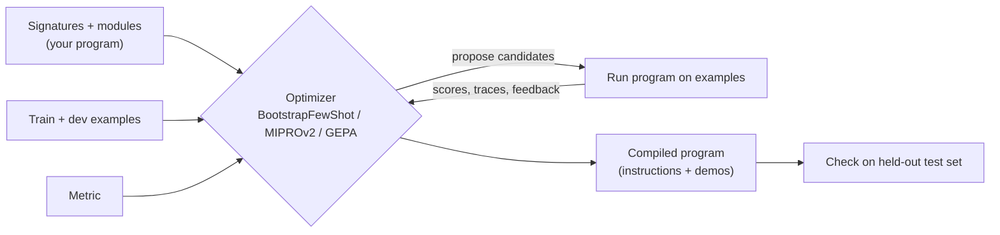

# DSPy: Programming, Not Prompting: The Complete Guide

> 📚 **Before you start**
>
> - [Decision Models: Typed Answers instead of Text (Jev)](decision-models-typed-answers-instead-of-text-jev.md), which showed why you should measure accuracy on your own labelled data.
> - [Why Type Safety Matters for LLM Apps](why-type-safety-matters-for-llm-apps.md), for typed inputs and outputs.
> - [Prompting Fundamentals](../../generative-ai-and-llm-foundations/04-prompting-and-structured-output/prompting-fundamentals.md), for few-shot examples and instructions, which DSPy writes for you.

## Introduction

A coaching centre in Kota prepares students for entrance exams. Teachers don't rewrite their explanations by gut feeling. They run weekly mock tests, see which explanations and practice problems actually raised scores, and keep those. The **test score** decides what stays in the course, not the teacher's favourite wording.

Most LLM apps are built the opposite way: someone edits a long prompt by hand, tries three examples, feels it is better, and ships. Change the model and the prompt often has to be rewritten. **DSPy** (from Stanford NLP, now at version 3.4) treats this as a programming and optimisation problem instead. You write **signatures** (typed inputs and outputs) and **modules** (how the model is used: predict, think step by step, act with tools), plus a **metric** and some examples. A DSPy **optimizer** then searches for the instructions and few-shot examples that score best on your metric, the way the coaching centre keeps what improves results.

By the end of this lesson you will be able to write signatures and modules, compose them into a program, evaluate it with a metric, and compile it with optimizers such as `BootstrapFewShot`, `MIPROv2` and `GEPA`.

> 💡 **Key Insight**
>
> In DSPy, **the prompt is a compiled artefact, not source code**. Your source is a typed signature, a module structure, a metric and data. The optimizer produces the prompt, and you can re-compile when the model, task or data changes, just as you'd retrain a model rather than hand-edit its weights.

---

## Core Explanation

### 1. Signatures: typed inputs and outputs

A signature declares **what** a step does, not how to prompt for it:

```python
# not-run: needs dspy and an ANTHROPIC_API_KEY
import dspy
from typing import Literal

dspy.configure(lm=dspy.LM("anthropic/claude-opus-5-5"))

# Short form: a string
classify = dspy.Predict("ticket -> team")

# Full form: a class with typed, described fields
class Triage(dspy.Signature):
    """Route a customer support ticket for an Indian food delivery app."""
    ticket: str = dspy.InputField()
    team: Literal["billing", "delivery", "account", "other"] = dspy.OutputField()
    urgent: bool = dspy.OutputField(desc="Does the customer need help within the hour?")

triage = dspy.Predict(Triage)
pred = triage(ticket="Paid ₹420 by UPI but the order shows unpaid, food is getting cold!")
print(pred.team, pred.urgent)
```

Example output:

```
billing True
```

The docstring becomes the task description, field names and types become the format, and the result is a `Prediction` with typed attributes. DSPy uses an **adapter** (chat-style or JSON) to turn the signature into messages and parse the reply, and validates the types.

### 2. Modules: how the model is used

Modules wrap a signature with a strategy. Swapping one for another doesn't change your signature:

| Module | What it does |
|---|---|
| `dspy.Predict` | Ask directly |
| `dspy.ChainOfThought` | Adds a `reasoning` output before the answer |
| `dspy.ReAct` | Agent loop: reason, call tools (plain Python functions), observe, repeat |
| `dspy.CodeAct` | Agent that acts by writing code (like smolagents) |
| `dspy.Refine`, `dspy.BestOfN` | Run several times and keep the best by a reward function |
| `dspy.Parallel` | Run a module over many inputs concurrently |
| `dspy.RLM` | "Recursive language model" module that explores very long inputs with code |

You compose them into a program by subclassing `dspy.Module`, just like a PyTorch model:

```python
# not-run: needs dspy and an API key
class SupportBot(dspy.Module):
    def __init__(self):
        self.triage = dspy.ChainOfThought(Triage)
        self.reply = dspy.Predict("ticket, team -> reply")

    def forward(self, ticket):
        t = self.triage(ticket=ticket)
        return dspy.Prediction(team=t.team, urgent=t.urgent,
                               reply=self.reply(ticket=ticket, team=t.team).reply)
```

### 3. Metrics and evaluation

A **metric** is a Python function that scores a prediction against an example. Data comes as `dspy.Example` objects, with `.with_inputs(...)` marking which fields are inputs:

```python
# not-run: needs dspy and an API key
trainset = [
    dspy.Example(ticket="Charged twice for one order", team="billing", urgent=False).with_inputs("ticket"),
    dspy.Example(ticket="Rider not moving for 40 minutes", team="delivery", urgent=True).with_inputs("ticket"),
    # ... a few dozen to a few hundred
]

def triage_metric(example, pred, trace=None):
    return (example.team == pred.team) + 0.5 * (example.urgent == pred.urgent)

evaluate = dspy.Evaluate(devset=devset, metric=triage_metric, num_threads=8, display_progress=True)
print(evaluate(SupportBot()))
```

The metric is the most important thing you write. It defines "better". It can be exact match, a numeric score, or even another DSPy program acting as a judge.

### 4. Optimizers: compiling the program

An optimizer takes your program, metric and training data and returns a better version of the **same** program:

```python
# not-run: needs dspy and an API key
optimizer = dspy.MIPROv2(metric=triage_metric, auto="light")
compiled = optimizer.compile(SupportBot(), trainset=trainset, valset=devset)
compiled.save("support_bot.json")          # instructions and demos, reloadable later
```

| Optimizer | What it searches |
|---|---|
| `BootstrapFewShot` | Runs the program on training examples, keeps traces that pass the metric, and uses them as few-shot demos |
| `MIPROv2` | Proposes candidate instructions and demo sets, then searches combinations efficiently (`auto="light"`, `"medium"` or `"heavy"`) |
| `GEPA` | Reflective prompt evolution: a `reflection_lm` reads failures and textual feedback from your metric and rewrites instructions, keeping a Pareto set of strong candidates |
| `SIMBA`, `KNNFewShot`, `BetterTogether` | Other search strategies and combinations |
| `BootstrapFinetune` | Turns good traces into fine-tuning data so a smaller model learns the task |

The simplest optimizer is easy to imitate. Below, a pretend model labels a ticket by copying the label of the most similar few-shot demo in its prompt (a crude stand-in for how examples steer a real model). The "optimizer" tries every pair of demos from the training set, scores each on a dev set with the metric, and keeps the best pair. That is the core loop of few-shot optimisation: **candidate prompts, measured by a metric, best one kept**.

```python
from itertools import combinations

train = [
    ("UPI payment deducted but order failed", "billing"),
    ("Refund not received after cancellation", "billing"),
    ("Delivery partner went to wrong address", "delivery"),
    ("Food arrived cold and late", "delivery"),
    ("Cannot log in, OTP never comes", "account"),
]
dev = [
    ("Money deducted twice for my order", "billing"),
    ("Order is late, rider not moving", "delivery"),
    ("OTP not received on my new number", "account"),
    ("Cancelled order but refund pending", "billing"),
]

def words(text):
    return set(text.lower().replace(",", "").split())

def pretend_model(ticket, demos):
    best = max(demos, key=lambda d: len(words(d[0]) & words(ticket)))
    return best[1]

def metric(gold, pred):
    return 1.0 if gold == pred else 0.0

def evaluate(demos):
    return sum(metric(label, pretend_model(t, demos)) for t, label in dev) / len(dev)

candidates = list(combinations(train, 2))
scored = sorted(((evaluate(c), c) for c in candidates), key=lambda x: -x[0])
print(f"{len(candidates)} candidate demo sets")
print("worst:", scored[-1][0], [label for _, label in scored[-1][1]])
best_score, best = scored[0]
print("best: ", best_score, [t for t, _ in best])

three = max(combinations(train, 3), key=evaluate)
print("best of 3 demos:", evaluate(three), [label for _, label in three])
```

Output:

```
10 candidate demo sets
worst: 0.25 ['delivery', 'delivery']
best:  0.75 ['UPI payment deducted but order failed', 'Cannot log in, OTP never comes']
best of 3 demos: 0.75 ['billing', 'delivery', 'account']
```

The choice of examples changed the dev score from 0.25 to 0.75 with the same "model", and adding a third demo did not help here. Real optimizers search far bigger spaces (instructions as well as demos, generated from your program's own successful runs) and use the model itself to propose candidates, but the principle is the same, and so is the risk: with a tiny dev set you can **overfit**, so keep a separate test set the optimizer never sees.



### 5. GEPA and feedback-driven optimisation

GEPA (in DSPy since 2025) deserves a note because it uses **text feedback**, not just a number. Its metric can return a score **and** an explanation, such as "wrong team: payment failures go to billing even when the order also failed". A reflection model reads these explanations across failed examples and rewrites the instructions accordingly. It often needs far fewer runs than search based only on scores. The metric signature takes the gold example, the prediction, and optionally the trace and which predictor is being improved, so feedback can be targeted at one step of a multi-step program.

### 6. Where DSPy fits with the rest of this module

- **Types**: signatures are DSPy's typed boundary, like Pydantic models in Pydantic AI and Instructor. DSPy can use Pydantic types in fields.
- **Decision models**: an optimised DSPy program and a decision model attack the same problem from different ends: DSPy makes a general LLM better at your task; a decision model is a specialised model for typed decisions. DSPy 3.4 can also run signatures on Jev directly through an experimental client, `dspy.configure(lm=dspy.experimental.TypeSafe())` (install `dspy[typesafe]`); `Predict` then sends typed output fields as decision questions. Both need a labelled evaluation set, and the lab next combines a typed decision step with a fallback.
- **Agents**: `dspy.ReAct` programs can be optimised end to end against a task metric, which is hard to do with hand-written agent prompts.

| Good fit | Poor fit |
|---|---|
| Tasks with a measurable metric and some labelled examples | Tasks where "good" can't be measured at all |
| Multi-step pipelines (RAG, extraction, classification) you'll re-target to new models | One-off prompts that will run a handful of times |
| Teams willing to treat prompts as build outputs | Teams that need a prompt humans can easily edit by hand |

---

## Try It Yourself

1. **Add a demo slot.** In the toy optimizer, which 2-demo set scores best if you add the dev ticket `"Wrong address on my profile"` with label `"account"`? Run it.
2. **Design a metric.** Write a metric for the triage task that gives full credit for the right team, and subtracts 0.5 if an urgent ticket is marked not urgent (a missed emergency is worse than a false alarm).
3. **Choose an optimizer.** You have 30 labelled examples, a metric that can explain its failures in words, and a limited budget. Which optimizer would you try first?

<details>
<summary>Show answers</summary>

**1.**

```python
dev.append(("Wrong address on my profile", "account"))
best = max(combinations(train, 2), key=evaluate)
print(evaluate(best), [t for t, _ in best])
```

Output:

```
0.6 ['UPI payment deducted but order failed', 'Cannot log in, OTP never comes']
```

The best pair still lacks a delivery example, so it misses the delivery ticket. Adding the new account ticket lowered the best pair's score, a reminder that tiny dev sets make scores jumpy.

**2.**

```python
def triage_metric(example, pred, trace=None):
    score = 1.0 if example.team == pred.team else 0.0
    if example.urgent and not pred.urgent:
        score -= 0.5
    return score
```

**3.** `GEPA`: it uses the textual feedback to improve instructions and typically needs fewer metric calls than score-only search, which suits a small dataset and budget. `BootstrapFewShot` is a reasonable cheap baseline to compare against.

</details>

---

## Real-World Examples

- **Classification and extraction pipelines.** Teams compile DSPy programs for ticket routing or document extraction, then re-compile when they switch to a cheaper model instead of rewriting prompts.
- **RAG systems.** Retrieval, query rewriting and answer generation as modules, optimised together against an answer-quality metric.
- **Distillation.** `BootstrapFinetune` uses a large model's successful traces to fine-tune a small one for high-volume use.

---

## Common Misconceptions

### "DSPy removes the need for prompts"

It still produces prompts; you just don't hand-write them. You can inspect them with `dspy.inspect_history()`.

### "Optimisation always helps"

Only as much as your metric and data are good. A wrong metric gets optimised just as hard as a right one.

### "DSPy is only for research"

It is used in production pipelines; compiled programs are saved as JSON and loaded like any other artefact.

---

## Interview Relevance

*"How do you make LLM prompts robust across model changes?"* A strong answer describes DSPy: typed signatures (`InputField`, `OutputField`, `Literal` types), modules (`Predict`, `ChainOfThought`, `ReAct`) composed in a `dspy.Module`, a metric and `dspy.Example` data, `dspy.Evaluate`, and optimizers (`BootstrapFewShot`, `MIPROv2`, `GEPA` with textual feedback, `BootstrapFinetune`) that compile instructions and demos. It warns about overfitting to small dev sets and keeps a held-out test set.

---

## Key Takeaways

- **Signatures declare typed inputs and outputs**; modules decide how the model is used.
- **Programs are composed modules**, like layers in a neural network.
- **The metric defines "better"**; write it carefully and evaluate on held-out data.
- **Optimizers compile prompts**: few-shot demos, instructions and even fine-tunes, chosen by the metric.
- **Re-compile instead of rewriting** when the model or task changes.

---

**Up next:** [Lab: A Typed Routing Layer for an Agent](lab-a-typed-routing-layer-for-an-agent.md)
