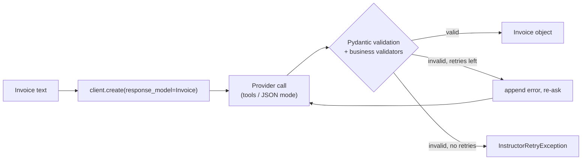

# Instructor and Validated Structured Output: The Complete Guide

> 📚 **Before you start**
>
> - [Why Type Safety Matters for LLM Apps](why-type-safety-matters-for-llm-apps.md), for validators and retrying with the error message.
> - [Pydantic AI](pydantic-ai.md), the full agent framework; this lesson covers a much smaller tool.
> - [Lab: Reliable JSON Extraction](../../generative-ai-and-llm-foundations/04-prompting-and-structured-output/lab-reliable-json-extraction.md), where you built extraction by hand.

## Introduction

A CA firm in Ahmedabad receives hundreds of supplier invoices a week as PDFs and photos. For each one, a junior accountant types the GSTIN, invoice number, date, taxable value and tax amounts into the accounting software, and the software refuses entries that don't add up. The firm wants a model to do the typing. It doesn't want an "agent"; it wants one function: invoice text in, a validated `Invoice` object out, with the same "doesn't add up, try again" rule.

That is exactly what **Instructor** does. It is a small library that wraps the client you already use (Anthropic, OpenAI, Gemini, Mistral, Ollama, LiteLLM and many more) and adds one parameter: `response_model=`. You pass a Pydantic model; you get back an instance of it. If validation fails, Instructor sends the error back to the model and retries, up to `max_retries`. It also streams partial objects and extracts lists of objects. It is the simplest way to add a typed boundary to code that already calls an LLM.

By the end of this lesson you will be able to use Instructor with any provider, write validators that encode business rules, stream partial results, extract many objects at once, pick a mode, and know when Instructor is enough and when you need a framework.

> 💡 **Key Insight**
>
> Instructor doesn't change how you call the model; it changes **what comes back**. Your existing `chat.completions.create(...)` call gains `response_model=Invoice` and `max_retries=3`, and the return value becomes a validated `Invoice`. Every business rule you can write as a Pydantic validator becomes a rule the model is forced to satisfy, or the call fails loudly.

---

## Core Explanation

### 1. The basic call

```python
# not-run: needs instructor[anthropic] and an ANTHROPIC_API_KEY
import instructor
from pydantic import BaseModel, Field

class Invoice(BaseModel):
    gstin: str = Field(description="Supplier GSTIN, 15 characters")
    invoice_no: str
    taxable_value: float = Field(ge=0)
    cgst: float = Field(ge=0)
    sgst: float = Field(ge=0)
    total: float

client = instructor.from_provider("anthropic/claude-opus-5-5")

invoice = client.chat.completions.create(
    response_model=Invoice,
    messages=[{"role": "user", "content": invoice_text}],
    max_retries=3,
)
print(invoice.invoice_no, invoice.total)
```

Example output:

```
INV/2026/0412 11800.0
```

- `instructor.from_provider("provider/model")` creates a patched client. You can also wrap an existing client (`instructor.from_openai(OpenAI())`, `instructor.from_litellm(...)`) if you already have one configured.
- `response_model` can be a Pydantic model, or simple types like `int`, `bool`, `Literal[...]` and `list[Model]`.
- `max_retries` is how many times Instructor re-asks after a validation failure. When they run out, it raises `InstructorRetryException`, which records the failed attempts.
- `client.chat.completions.create_with_completion(...)` returns both the object and the raw provider response, for logging token usage.

### 2. How Instructor works, in miniature

Under the hood, Instructor turns the model's schema into a tool definition (or a JSON schema, depending on the **mode**), asks the provider to call it, validates the arguments with Pydantic, and on failure appends the error and tries again. A miniature version with a scripted "model" shows the whole loop. The validators here are the real business rules: the GSTIN format, and tax adding up to the total.

```python
import re
from pydantic import BaseModel, Field, ValidationError, field_validator, model_validator

class Invoice(BaseModel):
    gstin: str = Field(description="Supplier GSTIN, 15 characters")
    invoice_no: str
    taxable_value: float = Field(ge=0)
    cgst: float = Field(ge=0)
    sgst: float = Field(ge=0)
    total: float

    @field_validator("gstin")
    @classmethod
    def gstin_format(cls, v):
        v = v.strip().upper()
        if not re.fullmatch(r"\d{2}[A-Z]{5}\d{4}[A-Z][1-9A-Z]Z[0-9A-Z]", v):
            raise ValueError("GSTIN must be 2 digits, 5 letters, 4 digits, a letter, a character, 'Z', a character")
        return v

    @model_validator(mode="after")
    def totals_add_up(self):
        expected = round(self.taxable_value + self.cgst + self.sgst, 2)
        if abs(expected - self.total) > 1:
            raise ValueError(f"taxable_value + cgst + sgst = {expected}, but total is {self.total}")
        return self

class FakeLLM:
    def __init__(self, replies):
        self.replies, self.seen = list(replies), []
    def complete(self, messages, schema):
        self.seen.append(messages[-1]["content"])
        return self.replies.pop(0)

def create(llm, response_model, messages, max_retries=2):
    schema = response_model.model_json_schema()
    for attempt in range(max_retries + 1):
        raw = llm.complete(messages, schema)
        try:
            return response_model.model_validate_json(raw)
        except ValidationError as e:
            errors = "; ".join(err["msg"] for err in e.errors())
            messages = messages + [{"role": "assistant", "content": raw},
                                   {"role": "user", "content": f"Validation failed: {errors}. Correct the output."}]
    raise RuntimeError(f"gave up after {max_retries + 1} attempts: {errors}")

llm = FakeLLM([
    '{"gstin": "24aabcs1429b1z5", "invoice_no": "INV/2026/0412", "taxable_value": 10000, "cgst": 900, "sgst": 900, "total": 11000}',
    '{"gstin": "24aabcs1429b1z5", "invoice_no": "INV/2026/0412", "taxable_value": 10000, "cgst": 900, "sgst": 900, "total": 11800}',
])
invoice = create(llm, Invoice, [{"role": "user", "content": "<invoice text>"}])
print(invoice)
print("feedback sent:", llm.seen[1])
```

Output:

```
gstin='24AABCS1429B1Z5' invoice_no='INV/2026/0412' taxable_value=10000.0 cgst=900.0 sgst=900.0 total=11800.0
feedback sent: Validation failed: Value error, taxable_value + cgst + sgst = 11800.0, but total is 11000.0. Correct the output.
```

The first reply had the GSTIN in lower case (normalised by the validator) and a total that didn't add up (rejected, with the exact sums in the feedback). The second reply passed. The real Instructor does the same with richer error formatting, hooks and async support.

### 3. Modes: how the structure is requested

Instructor supports several ways of getting structure out of a model, chosen per provider by default:

| Mode (examples) | How it works |
|---|---|
| `Mode.TOOLS`, `Mode.ANTHROPIC_TOOLS`, `Mode.GENAI_TOOLS` | Sends the schema as a tool the model must call. The usual default. |
| `Mode.TOOLS_STRICT`, `Mode.JSON_SCHEMA` | Uses the provider's strict or schema-constrained output, so the shape is guaranteed |
| `Mode.JSON`, `Mode.ANTHROPIC_JSON`, `Mode.MD_JSON` | Asks for JSON in the text and parses it; works with models that lack tool calling |

You can override the default with `instructor.from_provider("...", mode=instructor.Mode.JSON)`. Whatever the mode, validation and retries work the same way.

### 4. Streaming partial objects and extracting many

For long outputs, waiting for the whole object is slow. `create_partial` yields the object as it fills in, with every field optional until it arrives, so a UI can show the invoice number before the totals:

```python
# not-run: needs instructor and an API key
for partial in client.chat.completions.create_partial(response_model=Invoice, messages=msgs):
    print(partial.invoice_no, partial.total)      # None at first, then filled in
```

`create_iterable` extracts several objects from one input, yielding each as soon as it's complete. That suits "pull every line item from this bill":

```python
# not-run: needs instructor and an API key
class LineItem(BaseModel):
    description: str
    hsn_code: str
    amount: float

for item in client.chat.completions.create_iterable(response_model=LineItem, messages=msgs):
    print(item.description, item.amount)
```

To see what "partial" means, here is the idea with plain Pydantic: the same fields, all optional, validated as more JSON arrives.

```python
from typing import Optional
from pydantic import create_model

PartialInvoice = create_model("PartialInvoice", **{name: (Optional[f.annotation], None)
                                                  for name, f in Invoice.model_fields.items()})
chunks = ['{"invoice_no": "INV/2026/0412"', ', "taxable_value": 10000', ', "cgst": 900, "sgst": 900', ', "total": 11800}']
so_far = ""
for chunk in chunks:
    so_far += chunk
    closed = so_far if so_far.endswith("}") else so_far + "}"
    p = PartialInvoice.model_validate_json(closed)
    print(p.invoice_no, p.taxable_value, p.total)
```

Output:

```
INV/2026/0412 None None
INV/2026/0412 10000.0 None
INV/2026/0412 10000.0 None
INV/2026/0412 10000.0 11800.0
```

The real `Partial[...]` handles cut-off strings, nested objects and lists; the principle is the same.

### 5. More validation tools

- **`Maybe[Model]`** wraps a result with a `result` and an `error` flag, so the model can say "this isn't an invoice" instead of inventing one.
- **`llm_validator("statement", client=...)`** builds a validator that asks a model whether a value satisfies a rule written in plain language, for rules you can't code (for example "the description must not contain personal phone numbers").
- **Validation context** lets validators see extra data, such as the original text, so you can check that a quoted invoice number really appears in the source.
- **Hooks** (`client.on("completion:kwargs", fn)`, `"completion:response"`, `"parse:error"` and others) let you log every request, response and validation failure.



### 6. Instructor or a framework?

| Use Instructor when... | Use Pydantic AI or another framework when... |
|---|---|
| You need one typed call: extraction, classification, parsing | The model must call tools in a loop over several steps |
| You already have code using a provider SDK and don't want to restructure it | You need dependencies, multi-agent handoffs, durable runs |
| You want the smallest dependency that adds validation and retries | You want tests with fake models, usage limits and observability built in |

Many production systems use both: an agent framework for the conversation, and Instructor-style typed calls for individual extraction steps.

---

## Try It Yourself

1. **Catch a bad GSTIN.** Run the miniature `create` with a `FakeLLM` that always returns `"gstin": "24-AABCS"` (other fields correct). What happens after `max_retries=1`?
2. **Add a rule.** Add a validator to `Invoice` that requires `cgst == sgst` (intra-state invoices split tax equally). Test it with a reply where `cgst=900, sgst=800, total=11700`.
3. **Pick a mode.** You're using a small local model through Ollama that doesn't support tool calling. Which kind of mode do you need?

<details>
<summary>Show answers</summary>

**1.**

```python
bad = '{"gstin": "24-AABCS", "invoice_no": "X1", "taxable_value": 100, "cgst": 9, "sgst": 9, "total": 118}'
try:
    create(FakeLLM([bad, bad]), Invoice, [{"role": "user", "content": "<invoice>"}], max_retries=1)
except RuntimeError as e:
    print(e)
```

Output:

```
gave up after 2 attempts: Value error, GSTIN must be 2 digits, 5 letters, 4 digits, a letter, a character, 'Z', a character
```

**2.**

```python
class IntraStateInvoice(Invoice):
    @model_validator(mode="after")
    def equal_split(self):
        if self.cgst != self.sgst:
            raise ValueError(f"cgst ({self.cgst}) and sgst ({self.sgst}) must be equal")
        return self

try:
    IntraStateInvoice.model_validate_json('{"gstin": "24AABCS1429B1Z5", "invoice_no": "X1", "taxable_value": 10000, "cgst": 900, "sgst": 800, "total": 11700}')
except ValidationError as e:
    print(e.errors()[0]["msg"])
```

Output:

```
Value error, cgst (900.0) and sgst (800.0) must be equal
```

**3.** A JSON-in-text mode such as `Mode.JSON` or `Mode.MD_JSON`, which asks for JSON in the reply and parses it. Validation and retries still apply.

</details>

---

## Real-World Examples

- **Accounting automation.** Extracting invoice fields with validators that check GSTIN formats and that totals add up.
- **Resume and KYC parsing.** Typed extraction of names, dates and document numbers, with `Maybe` for documents that are unreadable.
- **Classification at scale.** `response_model=Literal["spam", "ham", "unsure"]` across millions of messages, with hooks logging every failure.

---

## Common Misconceptions

### "Instructor is an agent framework"

It is a thin layer for typed outputs from single calls. Loops, tools and state are up to you or a framework.

### "Retries fix everything"

Retries fix format and rule violations the model can see and correct. If the source text lacks the data, retries only waste tokens; use `Maybe` or optional fields.

### "Strict structured output makes Instructor pointless"

Strict modes guarantee shape. Instructor still adds business-rule validators, retries with feedback, partial streaming and one API across providers.

---

## Interview Relevance

*"How do you extract structured data reliably from documents with an LLM?"* A strong answer mentions a Pydantic schema with field and model validators for business rules, Instructor's `response_model` and `max_retries` (re-asking with the validation error), modes (tools, strict schema, JSON), `create_partial` and `create_iterable` for streaming and lists, `Maybe` for missing data, hooks for logging, and checking quoted values against the source using validation context.

---

## Key Takeaways

- **Instructor adds `response_model=` to your existing client** and returns validated Pydantic objects.
- **Validators are business rules**; failed validation becomes feedback for a retry.
- **Modes** choose between tool calls, strict schemas and JSON-in-text.
- **`create_partial` and `create_iterable`** stream fields and extract many objects.
- **Use Instructor for single typed calls**; reach for a framework when you need loops, tools and state.

---

**Up next:** [Decision Models: Typed Answers instead of Text (Jev)](decision-models-typed-answers-instead-of-text-jev.md)
