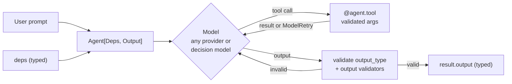

# Pydantic AI: The Complete Guide

> 📚 **Before you start**
>
> - [Why Type Safety Matters for LLM Apps](why-type-safety-matters-for-llm-apps.md), for schemas at the boundary, validators and retries.
> - [OpenAI Agents SDK](../02-vendor-agent-sdks/openai-agents-sdk.md), whose `Agent` + `Runner` design is a useful comparison.
> - [Decorators, Classmethod and Staticmethod](../../python-programming/07-object-oriented-programming/decorators-classmethod-and-staticmethod.md), since tools and instructions are registered with decorators.

## Introduction

When a Pune insurance company builds a claims assistant, three things must be right. The assistant must return a **decision the claims system can read** (approve, reject, ask for documents, with an amount). Its tools must get the **right customer's data**, never someone else's. And the team must be able to **test it** in CI without paying for model calls or waiting on the network.

**Pydantic AI** is an agent framework from the team behind Pydantic, designed around exactly these needs. Its output is a Pydantic model (or any type) that is validated, with automatic retries. Its tools receive **typed dependencies** (a database connection, the current customer's ID) through a `RunContext`, so the type checker knows what each tool can use. And it ships test models that stand in for a real LLM. It works with Anthropic, OpenAI, Google, Bedrock, Groq, Mistral and many others, and, unusually, with **decision models** such as Jev, which you will meet in [Decision Models: Typed Answers instead of Text](decision-models-typed-answers-instead-of-text-jev.md).

By the end of this lesson you will be able to define a typed agent with structured output, write tools that use dependencies, validate and retry outputs, set usage limits, test without a model, and know where Pydantic AI fits.

> 💡 **Key Insight**
>
> Pydantic AI makes the agent a **typed function**: `Agent[Deps, Output]`. You declare what goes in (the dependency type) and what comes out (the output type), and the framework, the model and your type checker all hold you to it. That's the same idea as the typed boundary from the last lesson, applied to the whole agent.

---

## Core Explanation

### 1. A typed agent in a few lines

```python
# not-run: needs pydantic-ai and an ANTHROPIC_API_KEY
from typing import Literal
from pydantic import BaseModel, Field
from pydantic_ai import Agent

class ClaimDecision(BaseModel):
    action: Literal["approve", "reject", "need_documents"]
    amount_rupees: int = Field(ge=0, description="Approved amount; 0 unless approving")
    reason: str = Field(description="One sentence the customer will see")

agent = Agent(
    "anthropic:claude-opus-5-5",
    output_type=ClaimDecision,
    instructions="You review small health insurance claims under ₹50,000.",
)

result = agent.run_sync("Claim: ₹12,400 for a two-day stay at Ruby Hall. Bills attached, discharge summary missing.")
print(result.output)
usage = result.usage()
print(usage.requests, usage.input_tokens, usage.output_tokens)
```

Example output:

```
action='need_documents' amount_rupees=0 reason='Please upload the discharge summary so we can complete the review.'
1 412 58
```

What happened:

- The model string `"anthropic:claude-opus-5-5"` picks the provider and model (`provider:model`).
- `output_type=ClaimDecision` becomes an **output tool** that the model must call with arguments matching the schema. Pydantic validates them; on failure, the error is sent back and the model retries.
- `result.output` is a real `ClaimDecision` instance, and your editor knows it.
- `run_sync` is the synchronous wrapper; `await agent.run(...)` and `agent.run_stream(...)` are the async and streaming forms.

### 2. Dependencies and tools

Tools that need data use `@agent.tool`, whose first parameter is a `RunContext`. The context carries `deps`, an object you pass at run time, typed by `deps_type`:

```python
# not-run: needs pydantic-ai and an API key
from dataclasses import dataclass
from pydantic_ai import Agent, RunContext, ModelRetry

@dataclass
class ClaimDeps:
    customer_id: str
    db: "PolicyDB"

agent = Agent("anthropic:claude-opus-5-5", deps_type=ClaimDeps, output_type=ClaimDecision,
              instructions="Check the policy before deciding.")

@agent.instructions
def who(ctx: RunContext[ClaimDeps]) -> str:
    return f"The customer's ID is {ctx.deps.customer_id}."

@agent.tool
def policy_limit(ctx: RunContext[ClaimDeps], treatment: str) -> int:
    """Remaining cover in rupees for this customer and treatment.

    Args:
        treatment: Type of treatment, for example "hospitalisation".
    """
    limit = ctx.deps.db.remaining(ctx.deps.customer_id, treatment)
    if limit is None:
        raise ModelRetry(f"Unknown treatment {treatment!r}. Use one of: hospitalisation, day-care, opd.")
    return limit

@agent.tool_plain
def gst_rate() -> float:
    """Current GST rate on health insurance premiums."""
    return 0.18

result = agent.run_sync("Claim ₹12,400 for hospitalisation.", deps=ClaimDeps("CUST-881", db))
```

Things to notice:

| Feature | What it does |
|---|---|
| `deps_type` / `deps=` | Dependency injection: tools get exactly the objects you pass, typed. Easy to swap for fakes in tests. |
| `@agent.tool` vs `@agent.tool_plain` | With or without the `RunContext` parameter |
| Docstring `Args:` | Become parameter descriptions in the tool schema the model sees |
| `@agent.instructions` | Dynamic instructions computed per run from the context |
| `ModelRetry` | Raised from a tool or validator to send a message back and let the model try again |

How does a plain Python function become a tool the model can call? Pydantic AI reads the signature and docstring, builds a JSON schema with Pydantic, and later validates the model's arguments against it. You can see the same mechanism with Pydantic alone:

```python
import inspect
from pydantic import TypeAdapter, ValidationError, create_model

def policy_limit(treatment: str, include_room_rent: bool = True) -> int:
    """Remaining cover in rupees for this customer and treatment."""
    return 38_000 if include_room_rent else 30_000

def tool_spec(fn):
    params = inspect.signature(fn).parameters
    fields = {name: (p.annotation, ... if p.default is p.empty else p.default) for name, p in params.items()}
    Args = create_model(f"{fn.__name__}_args", **fields)
    schema = Args.model_json_schema()
    return Args, {"name": fn.__name__, "description": inspect.getdoc(fn),
                  "parameters": {"properties": {k: v["type"] for k, v in schema["properties"].items()},
                                 "required": schema.get("required", [])}}

Args, spec = tool_spec(policy_limit)
print(spec)

for model_args in ({"treatment": "hospitalisation"}, {"treatment": "opd", "include_room_rent": "maybe"}):
    try:
        print("call ->", policy_limit(**Args(**model_args).model_dump()))
    except ValidationError as e:
        print("retry ->", e.errors()[0]["loc"][0], e.errors()[0]["msg"])
```

Output:

```
{'name': 'policy_limit', 'description': 'Remaining cover in rupees for this customer and treatment.', 'parameters': {'properties': {'treatment': 'string', 'include_room_rent': 'boolean'}, 'required': ['treatment']}}
call -> 38000
retry -> include_room_rent Input should be a valid boolean, unable to interpret input
```

The second call never reached the function: invalid arguments become a retry message, exactly as they do inside Pydantic AI.

### 3. Output types and validation

`output_type` accepts much more than one model:

| `output_type=` | Meaning |
|---|---|
| `str` (default) | Plain text |
| A Pydantic model, dataclass, `TypedDict`, `int`, `list[...]` | Structured output, validated |
| `[ClaimDecision, Escalation]` or a union | The model picks one of several output shapes |
| A function | The model calls it with typed arguments and its return value becomes the output |
| `ToolOutput(...)`, `NativeOutput(...)`, `PromptedOutput(...)` | Choose how structure is obtained: an output tool (the default), the provider's native structured output mode, or instructions plus parsing |

For rules a schema can't express, add an **output validator**. Raise `ModelRetry` to ask for a fix:

```python
# not-run: needs pydantic-ai
@agent.output_validator
async def within_limit(ctx: RunContext[ClaimDeps], out: ClaimDecision) -> ClaimDecision:
    if out.action == "approve" and out.amount_rupees > ctx.deps.db.remaining(ctx.deps.customer_id, "hospitalisation"):
        raise ModelRetry("Approved amount exceeds the remaining cover. Reduce it or choose need_documents.")
    return out
```

Retries are limited: by default one retry each for tools and output (`retries=` on the agent, or `retries={'tools': 3, 'output': 2}`). If the budget runs out, the run raises an error instead of returning bad data.

### 4. Guard rails on cost and loops

```python
# not-run: needs pydantic-ai
from pydantic_ai.usage import UsageLimits

result = agent.run_sync(
    "Claim ₹12,400 for hospitalisation.",
    deps=deps,
    usage_limits=UsageLimits(request_limit=5, total_tokens_limit=20_000),
)
```

`UsageLimits` stops a run (with `UsageLimitExceeded`) when it makes too many model requests (default limit 50), tool calls or tokens. Combine it with tool-level approval (`ApprovalRequired`, deferred tools) for anything that spends money.

### 5. Testing without a model

`TestModel` calls every tool and then produces output that matches your schema, all without a network call. `FunctionModel` lets you script the model's replies with your own function. `agent.override(model=...)` swaps the model inside a `with` block, so tests use the real agent and real tools:

```python
# not-run: needs pydantic-ai
from pydantic_ai.models.test import TestModel

def test_claim_agent_uses_policy_tool():
    with agent.override(model=TestModel()):
        result = agent.run_sync("Claim ₹500", deps=ClaimDeps("CUST-1", FakeDB()))
    assert isinstance(result.output, ClaimDecision)
```

Setting `models.ALLOW_MODEL_REQUESTS = False` in your test setup makes any accidental real model call fail loudly.

### 6. The bigger picture



Beyond the core, Pydantic AI includes:

- **Toolsets and MCP**: group tools, filter or rename them, and connect MCP servers as toolsets.
- **Multi-agent patterns**: call one agent from another agent's tool, or hand control between agents in your own code; `pydantic-graph` provides typed state machines for complex flows.
- **Durable execution** integrations with Temporal, DBOS and Prefect, so long runs survive restarts.
- **Observability** through OpenTelemetry, with first-class support in Pydantic Logfire.
- **Evals** through the companion `pydantic-evals` package.
- **Decision models**: `Agent("typesafe:jev-latest", output_type=...)` sends the output type to Jev as typed questions rather than asking an LLM to write JSON. The Jev lesson covers this.

### 7. When to use it

| Good fit | Poor fit |
|---|---|
| Python teams that value type checking and FastAPI-style ergonomics | Teams wanting a large set of prebuilt document loaders and indexes (LlamaIndex) |
| Agents whose output feeds other systems (claims, orders, tickets) | Visual, declarative multi-agent graphs out of the box (LangGraph, CrewAI) |
| Code that must be tested without real model calls | One-line scripts where a plain SDK call is enough |

---

## Try It Yourself

1. **Spec a tool.** Run `tool_spec` on `def book_cashless(hospital_id: str, admit_date: str, room: int = 1) -> str` (with a docstring) and check which fields are required.
2. **Choose the output type.** Your assistant either answers a question in text or files a structured `Escalation`. What `output_type` do you give the agent?
3. **Write a validator rule.** Write the condition (in words or Python) for an output validator that rejects a `reject` decision whose `reason` is shorter than 20 characters.

<details>
<summary>Show answers</summary>

**1.**

```python
def book_cashless(hospital_id: str, admit_date: str, room: int = 1) -> str:
    """Request cashless admission at a network hospital."""
    return "REQ-1"

print(tool_spec(book_cashless)[1]["parameters"])
```

Output:

```
{'properties': {'hospital_id': 'string', 'admit_date': 'string', 'room': 'integer'}, 'required': ['hospital_id', 'admit_date']}
```

**2.** A list (or union) of the possible outputs: `output_type=[str, Escalation]`. The model either replies with text or calls the `Escalation` output tool, and `result.output` is typed as `str | Escalation`.

**3.** `if out.action == "reject" and len(out.reason) < 20: raise ModelRetry("Give the customer a clear reason for rejection in one full sentence.")`

</details>

---

## Real-World Examples

- **Claims and lending decisions.** Typed outputs feed straight into core systems; dependencies carry the current customer and database session.
- **Support copilots in FastAPI apps.** Teams already using Pydantic and FastAPI add agents with the same models and validation style.
- **CI-tested agents.** `TestModel` and `FunctionModel` let teams test tool wiring and output handling on every commit.

---

## Common Misconceptions

### "Pydantic AI is just Pydantic validation for LLM output"

That's Instructor's focus (next lesson). Pydantic AI is a full agent framework: tools, dependencies, multi-step runs, streaming, toolsets, MCP and durable execution.

### "Typed output means the model can't be wrong"

It guarantees shape and your validator rules. Correctness still needs evals.

### "Dependency injection is overkill"

It is what keeps one customer's tools from touching another customer's data, and what makes testing with fakes possible.

---

## Interview Relevance

*"What does Pydantic AI give you over calling a model SDK directly?"* A strong answer covers `Agent[Deps, Output]` typing, `output_type` (models, unions, functions, and tool, native or prompted modes), validation with automatic retries and `ModelRetry`, tools with `RunContext` dependencies, `UsageLimits`, `TestModel`/`FunctionModel` with `agent.override`, MCP toolsets, durable execution and OpenTelemetry. Bonus: it can run the same typed agent on a decision model such as Jev.

---

## Key Takeaways

- **An agent is a typed function**: `deps_type` in, `output_type` out, checked by Pydantic and your type checker.
- **Tools come from functions**: signatures and docstrings become schemas; invalid arguments become retries.
- **`ModelRetry` and output validators** enforce business rules the schema can't.
- **`UsageLimits`** caps requests, tool calls and tokens.
- **Test without a model** using `TestModel`, `FunctionModel` and `agent.override`.

---

**Up next:** [Instructor and Validated Structured Output](instructor-and-validated-structured-output.md)
