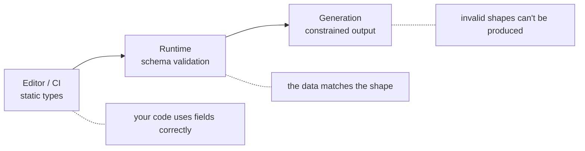

# Why Type Safety Matters for LLM Apps: The Complete Guide

> 📚 **Before you start**
>
> - [Structured JSON Output](../../generative-ai-and-llm-foundations/04-prompting-and-structured-output/structured-json-output.md), which introduced schemas, validation and constrained decoding.
> - [Pydantic Models](../../apis-and-apps-fastapi-streamlit-and-docker/course.md#m4) from the APIs course, if you want a deeper tour of Pydantic. This lesson recaps everything it uses.
> - [TypeScript Agents: Mastra and the Vercel AI SDK](../03-orchestration-frameworks/typescript-agents-mastra-and-the-vercel-ai-sdk.md), where Zod schemas guarded every tool.

## Introduction

At a bank branch in Lucknow, a cheque for "Rupees fifteen hundred only" has the figure "₹1,500" written in the box beside it. The cashier doesn't just read the words; the **form** forces the amount into a fixed box in a fixed format, and if the words and figures disagree, the cheque is rejected before any money moves. The form is the bank's **type system**: it turns a free-text instruction into fields that the rest of the bank can trust.

LLMs produce free text. Your program needs fields: an amount that is an integer, a category that is one of five values, a date that is a real date. Between the two sits a boundary. If you leave it untyped, every part of your code that touches the model's output has to guess, and the guesses fail quietly at 2 a.m. If you put a **typed boundary** there, a schema that the output must pass before your code sees it, failures become loud, early and fixable, often automatically by asking the model again.

This module is about the tools that build that boundary: Pydantic AI, Instructor, decision models such as Jev that answer typed questions directly, and DSPy, which turns typed signatures into optimised prompts. This first lesson explains the idea with plain Pydantic.


> 💡 **Key Insight**
>
> Type safety for LLM apps means **the model's output is converted into a typed object at one place, and invalid output never gets past that place**. Everything after the boundary can trust its inputs; everything before it is allowed to be messy. The validation error message is also the best possible feedback for a retry.

---

## Core Explanation

### 1. What goes wrong without types

Here is a support ticket triage step that asks a model for a category, a refund amount and an urgency flag, and parses the reply by hand. Three realistic replies:

```python
import json

replies = [
    '{"category": "billing", "refund": 1500, "urgent": true}',
    '{"category": "Billing ", "refund": "₹1,500", "urgent": "yes"}',
    'Sure! Here is the JSON: {"category": "payments", "refund": 1500}',
]

def handle_untyped(raw):
    data = json.loads(raw[raw.index("{"):])
    total = data["refund"] * 1.18                    # add GST
    queue = "billing-team" if data["category"] == "billing" else "general"
    alert = "PAGE ON-CALL" if data.get("urgent") else "normal"
    return queue, total, alert

for raw in replies:
    try:
        print(handle_untyped(raw))
    except Exception as e:
        print("crash:", type(e).__name__, e)
```

Output:

```
('billing-team', 1770.0, 'PAGE ON-CALL')
crash: TypeError can't multiply sequence by non-int of type 'float'
('general', 1770.0, 'normal')
```

Only the first reply was handled correctly. The second crashed in the GST line, far from where the bad data came in. The third is worse: it **didn't** crash. "payments" isn't a category your team uses, so the ticket went to the general queue, and the missing `urgent` field silently became "normal". Nobody will notice until a customer complains.

### 2. A schema at the boundary

Pydantic lets you describe the shape once, with Python type hints, and validate every reply against it:

```python
from typing import Literal
from pydantic import BaseModel, Field, ValidationError

class Triage(BaseModel):
    category: Literal["billing", "delivery", "account", "other"]
    refund: int = Field(ge=0, le=50_000, description="Refund in whole rupees")
    urgent: bool

for raw in replies:
    try:
        t = Triage.model_validate_json(raw[raw.index("{"):])
        print("ok   ", t)
    except ValidationError as e:
        print("error", [(err["loc"][0], err["msg"]) for err in e.errors()])
```

Output:

```
ok    category='billing' refund=1500 urgent=True
error [('category', "Input should be 'billing', 'delivery', 'account' or 'other'"), ('refund', 'Input should be a valid integer, unable to parse string as an integer')]
error [('category', "Input should be 'billing', 'delivery', 'account' or 'other'"), ('urgent', 'Field required')]
```

Now every bad reply is caught **at the boundary**, with a precise list of what is wrong. Notice what Pydantic accepted and what it rejected:

| Input | Result | Why |
|---|---|---|
| `"urgent": "yes"` | accepted as `True` in normal mode | Pydantic's default **lax** mode converts common forms like `"yes"`, `"true"` and `1` to booleans |
| `"refund": "₹1,500"` | rejected | not a number, even in lax mode |
| `"category": "Billing "` | rejected | `Literal` values must match exactly |
| missing `urgent` | rejected | fields without a default are required |

If you want no conversions at all, use strict mode (`model_validate_json(raw, strict=True)` or `model_config = ConfigDict(strict=True)`). For LLM output, lax mode plus careful `Literal` and `Field` limits is a common, practical balance.

### 3. Fixing small problems in the schema itself

Some differences are harmless and predictable: stray spaces, upper case, rupee signs and commas. Rather than fail, you can normalise them with a **validator** that runs before the type check:

```python
from pydantic import field_validator

class LenientTriage(Triage):
    @field_validator("category", mode="before")
    @classmethod
    def tidy_category(cls, v):
        return v.strip().lower() if isinstance(v, str) else v

    @field_validator("refund", mode="before")
    @classmethod
    def parse_rupees(cls, v):
        if isinstance(v, str):
            return v.replace("₹", "").replace(",", "").strip()
        return v

print(LenientTriage.model_validate_json(replies[1][replies[1].index("{"):]))
```

Output:

```
category='billing' refund=1500 urgent=True
```

The rule of thumb: **normalise** formatting differences you understand, **reject** anything that changes meaning (an unknown category, a missing field), and send the rejection back to the model.

### 4. Validation errors are the best retry prompt

When validation fails, the error list says exactly what to fix. Sending it back to the model as the next message is the core of every library in this module:

```python
SCRIPTED_MODEL = iter([
    '{"category": "payments", "refund": 1500}',
    '{"category": "billing", "refund": 1500, "urgent": false}',
])

def call_model(messages):
    return next(SCRIPTED_MODEL)            # stands in for a real LLM call

def typed_call(schema, prompt, max_retries=2):
    messages = [{"role": "user", "content": prompt}]
    for attempt in range(max_retries + 1):
        raw = call_model(messages)
        try:
            return schema.model_validate_json(raw), attempt
        except ValidationError as e:
            problems = "; ".join(f"{'.'.join(map(str, err['loc']))}: {err['msg']}" for err in e.errors())
            print(f"attempt {attempt} rejected -> {problems}")
            messages += [{"role": "assistant", "content": raw},
                         {"role": "user", "content": f"Fix these problems and reply with JSON only: {problems}"}]
    raise RuntimeError("model never produced valid output")

result, retries = typed_call(Triage, "Triage: 'I was charged twice for my order, please refund ₹1,500'")
print(result, "| retries:", retries)
```

Output:

```
attempt 0 rejected -> category: Input should be 'billing', 'delivery', 'account' or 'other'; urgent: Field required
category='billing' refund=1500 urgent=False | retries: 1
```

Instructor's `max_retries`, Pydantic AI's output retries, and the AI SDK's tool input validation all follow this loop.

### 5. Three layers of type safety

"Type-safe" can mean three different things, and good LLM apps use all three:

| Layer | When it acts | What catches problems | Example |
|---|---|---|---|
| **Static types** | Before running, in your editor | A type checker (mypy, Pyright, the TypeScript compiler) | `result.output.refund` is known to be `int`, so `result.output.refund.upper()` is flagged |
| **Runtime validation** | When output arrives | Pydantic, Zod | `"₹1,500"` rejected as an integer |
| **Constrained generation** | While the model writes | Structured outputs or a decision model | The model physically can't produce a category outside the list |



Constrained generation reduces retries but doesn't remove the need for validation: the shape can be right while a value is out of range or simply wrong.

### 6. What types can't do

A perfectly valid `Triage(category="billing", refund=1500, urgent=False)` can still be **wrong**: the ticket might be about delivery, or the customer might have asked for ₹15,000. Types guarantee **shape and range**, not truth. That is why the later lessons add:

- **Confidence scores** from decision models, so you can route low-confidence answers to a person ([Decision Models](decision-models-typed-answers-instead-of-text-jev.md)).
- **Evaluation and optimisation**, so you measure how often the typed answers are right ([DSPy](dspy-programming-not-prompting.md)).

### 7. The tools in this module

| Tool | What it adds on top of Pydantic | Lesson |
|---|---|---|
| **Pydantic AI** | A full agent framework where outputs, tools and dependencies are all typed | next |
| **Instructor** | A thin wrapper that adds `response_model=` and retries to existing LLM clients | 3 |
| **Decision models (Jev)** | Models that answer typed questions directly, with probabilities, instead of writing text | 4 |
| **DSPy** | Typed input and output signatures, with prompts optimised automatically | 5 |

---

## Try It Yourself

1. **Add a field.** Add `order_id: str` to `Triage` with a pattern so it must look like `"ORD-"` followed by 6 digits (`Field(pattern=r"^ORD-\d{6}$")`). Validate `{"category": "billing", "refund": 0, "urgent": false, "order_id": "ord-12"}` and print the error.
2. **Strict mode.** What happens to `{"category": "billing", "refund": 1500, "urgent": "yes"}` with `strict=True`?
3. **Normalise or reject?** For each, decide: `"Delivery"` for category; `"1500.00"` for refund; `"refund pending"` for refund.

<details>
<summary>Show answers</summary>

**1.**

```python
class TriageWithOrder(Triage):
    order_id: str = Field(pattern=r"^ORD-\d{6}$")

try:
    TriageWithOrder.model_validate_json('{"category": "billing", "refund": 0, "urgent": false, "order_id": "ord-12"}')
except ValidationError as e:
    print(e.errors()[0]["loc"], e.errors()[0]["msg"])
```

Output:

```
('order_id',) String should match pattern '^ORD-\d{6}$'
```

**2.**

```python
try:
    Triage.model_validate_json('{"category": "billing", "refund": 1500, "urgent": "yes"}', strict=True)
except ValidationError as e:
    print(e.errors()[0]["loc"], e.errors()[0]["msg"])
```

Output:

```
('urgent',) Input should be a valid boolean
```

**3.** `"Delivery"`: normalise (case only). `"1500.00"`: Pydantic's lax mode already accepts it for an `int` because the fraction is zero, so nothing to do. `"refund pending"`: reject and retry; it isn't an amount, and guessing one would change meaning.

</details>

---

## Real-World Examples

- **Fintech data extraction.** Lending apps extract salary, employer and bank details from documents into typed models, rejecting anything that fails range checks before it reaches a credit decision.
- **Support triage.** Ticket routers validate category and priority against fixed lists so a model can't invent a queue.
- **Agent tools.** Every tool call in the frameworks from Modules 2 and 3 is validated against a schema before the tool runs.

---

## Common Misconceptions

### "Structured output mode makes validation unnecessary"

It fixes the shape, not the values or their meaning. Keep the schema check and add range limits.

### "Strict is always safer"

Strict mode rejects harmless differences and causes more retries. Use it where conversions could hide real errors (money, IDs), lax elsewhere.

### "Types slow you down"

The schema is written once, and it gives the model its instructions, gives you validation, and gives your editor autocompletion.

---

## Interview Relevance

*"How do you make LLM output reliable enough to feed into code?"* A strong answer describes a typed boundary: a Pydantic or Zod schema with `Literal` choices and `Field` limits, validation at one place, normalising harmless differences with before-validators, sending validation errors back for a retry with a cap, and constrained generation to reduce retries. It adds that types guarantee shape, not correctness, so confidence thresholds and evaluation are still needed.

---

## Key Takeaways

- **Untyped output fails late and quietly**; typed output fails early and loudly.
- **Put one schema at the boundary**: `Literal` for categories, `Field` limits for numbers, required fields for anything that matters.
- **Normalise harmless differences, reject meaning changes**, and retry with the validation error.
- **Three layers**: static types, runtime validation, constrained generation.
- **Types check shape, not truth**: you still need confidence and evaluation.

---

**Up next:** [Pydantic AI](pydantic-ai.md)
