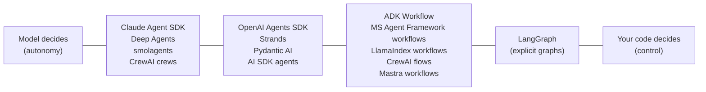

# Comparing Frameworks on One Task: The Complete Guide

> 📚 **Before you start**
>
> - The framework lessons in [Module 2](../02-vendor-agent-sdks/claude-agent-sdk.md), [Module 3](../03-orchestration-frameworks/langchain-deep-agents.md) and [Module 4](../04-type-safe-ai-and-decision-models/pydantic-ai.md). This lesson puts them side by side.
> - [Lab: A Typed Routing Layer for an Agent](../04-type-safe-ai-and-decision-models/lab-a-typed-routing-layer-for-an-agent.md), whose "measure, then decide" approach we reuse.
> - [Workflows vs Agents](../../agentic-ai-fundamentals/03-the-agent-loop/workflows-vs-agents.md), for the control spectrum used in the comparison.

## Introduction

Choosing a two-wheeler in India is a classic family debate. One cousin swears by the scooter with the biggest boot, another by the bike with the best mileage, a third by whichever brand has a service centre nearby. All are right about their own priorities. The sensible way to decide is to fix **your** daily ride (12 km of city traffic, one pillion, occasional highway) and test each option on that ride.

Agent frameworks are the same. Every one of the fifteen or so you've met in this course is "the best" in someone's blog post. The useful question is narrower: **for our task, our team and our constraints, which one fits?** This lesson takes one realistic task, shows how it looks in the main frameworks, compares them on the dimensions that actually differ, and gives you a repeatable way to choose.

By the end you will be able to describe the differences between the frameworks precisely, map a task's requirements to the framework features that matter, and run a small, honest scoring exercise.

> 💡 **Key Insight**
>
> At the level of "an LLM calls tools in a loop", all modern frameworks are nearly identical. They differ in **who owns control flow** (the model or your code), **what comes built in** (sandboxes, memory, approvals, hosting), **what is typed**, and **what it ties you to** (a model vendor, a cloud, a runtime). Compare on those, using your own task.

---

## Core Explanation

### 1. The task

A **UPI refund assistant** for a small payments app:

- Tool `lookup_payment(txn_id)` returns the amount, status and merchant.
- Tool `issue_refund(txn_id, amount)` moves money, so it **must require human approval**.
- The final answer must be **typed**: `{action: "refunded" | "rejected" | "escalated", amount, message}`.
- Model: `claude-opus-5-5`. Must be testable in CI without real model calls.

### 2. The same agent in five frameworks

Below, only the parts that differ are shown: defining the tools, the approval rule, typed output and running. Treat each as a sketch of the shape of the code; the lessons for each framework have the details.

**Claude Agent SDK** (Python). Tools are an in-process MCP server; approval is a `can_use_tool` callback; typed output via `output_format` with a JSON schema.

```python
# not-run: needs claude-agent-sdk and an API key
from claude_agent_sdk import (ClaudeAgentOptions, query, tool, create_sdk_mcp_server,
                              PermissionResultAllow, PermissionResultDeny)

@tool("lookup_payment", "Look up a UPI payment", {"txn_id": str})
async def lookup_payment(args): ...

@tool("issue_refund", "Refund a UPI payment", {"txn_id": str, "amount": float})
async def issue_refund(args): ...

async def approve(tool_name, tool_input, context):
    if tool_name.endswith("issue_refund") and not await ops_approves(tool_input):
        return PermissionResultDeny(message="Refund not approved by operations")
    return PermissionResultAllow()

options = ClaudeAgentOptions(
    model="claude-opus-5-5",
    mcp_servers={"pay": create_sdk_mcp_server("pay", "1.0.0", [lookup_payment, issue_refund])},
    allowed_tools=["mcp__pay__lookup_payment"],          # refund is not pre-approved
    can_use_tool=approve,
    output_format={"type": "json_schema", "schema": RefundOutcome.model_json_schema()},
)
async for message in query(prompt="Refund txn UPI8812, it failed", options=options): ...
```

**OpenAI Agents SDK.** `function_tool(needs_approval=True)` pauses the run; you approve on the saved state and resume. Typed output via `output_type`. Claude runs through the LiteLLM integration.

```python
# not-run: needs openai-agents[litellm] and an API key
from agents import Agent, Runner, function_tool

@function_tool
def lookup_payment(txn_id: str) -> dict: ...

@function_tool(needs_approval=True)
def issue_refund(txn_id: str, amount: float) -> str: ...

agent = Agent(name="refunds", instructions="...", tools=[lookup_payment, issue_refund],
              output_type=RefundOutcome, model="litellm/anthropic/claude-opus-5-5")
result = await Runner.run(agent, "Refund txn UPI8812, it failed")
if result.interruptions:
    state = result.to_state()
    for item in result.interruptions:
        state.approve(item) if await ops_approves(item) else state.reject(item)
    result = await Runner.run(agent, state)
print(result.final_output)
```

**Google ADK.** A plain function wrapped in `FunctionTool(..., require_confirmation=True)`; typed output via `output_schema`; Claude through `LiteLlm` or `AnthropicLlm`.

```python
# not-run: needs google-adk and an API key
from google.adk import Agent
from google.adk.tools import FunctionTool
from google.adk.models.lite_llm import LiteLlm

agent = Agent(name="refunds", model=LiteLlm(model="anthropic/claude-opus-5-5"), instruction="...",
              tools=[lookup_payment, FunctionTool(issue_refund, require_confirmation=True)],
              output_schema=RefundOutcome)
```

**Pydantic AI.** `@agent.tool(requires_approval=True)` makes the run end with `DeferredToolRequests`, which you approve and pass back; typed output is the agent's `output_type`.

```python
# not-run: needs pydantic-ai and an API key
from pydantic_ai import Agent, DeferredToolRequests

agent = Agent("anthropic:claude-opus-5-5", output_type=[RefundOutcome, DeferredToolRequests])

@agent.tool_plain
def lookup_payment(txn_id: str) -> dict: ...

@agent.tool_plain(requires_approval=True)
def issue_refund(txn_id: str, amount: float) -> str: ...
```

**Mastra** (TypeScript). `createTool({ requireApproval: true })`, typed with Zod; typed output with `structuredOutput`.

```ts
// not-run: needs @mastra/core and zod
const issueRefund = createTool({
  id: 'issue-refund', description: 'Refund a UPI payment',
  inputSchema: z.object({ txnId: z.string(), amount: z.number() }),
  requireApproval: true,
  execute: async ({ txnId, amount }) => payments.refund(txnId, amount),
});
const agent = new Agent({ id: 'refunds', name: 'Refunds', instructions: '...',
  model: 'anthropic/claude-opus-5.5', tools: { lookupPayment, issueRefund } });
```

The striking thing: **the core of each is 10 to 20 lines and nearly the same**. Every framework now has typed tools, typed output, approvals and multiple model providers. The differences are around the edges.

### 3. Where they really differ

| Framework | Who owns control flow | Built in beyond the loop | Typing | Main tie-in |
|---|---|---|---|---|
| **Claude Agent SDK** | Model (Claude Code's harness) | File, shell and web tools, sandbox, subagents, skills, sessions, hooks | JSON schema output | Claude models only |
| **OpenAI Agents SDK** | Model, with handoffs | Guardrails, sessions, tracing, sandbox agents, hosted tools | Pydantic `output_type` | Best with OpenAI; others via LiteLLM |
| **Google ADK 2.x** | Model or graph `Workflow` | Sessions, state, eval CLI, dev UI, deployment to Google Cloud | `output_schema` | Gemini and Google Cloud first |
| **Microsoft Agent Framework** | Model or typed workflows | Orchestration builders, checkpoints, Azure integration | Typed executors and `response_format` | Azure and .NET/Python teams |
| **Strands + AgentCore** | Model | Managed runtime, memory, gateway, identity on AWS | `structured_output_model` | AWS for the managed parts |
| **LangGraph / Deep Agents** | Your graph (LangGraph) or model (Deep Agents) | Checkpoints, interrupts, filesystems, subagents | State schemas | LangChain ecosystem (any model) |
| **CrewAI** | Model in crews, code in flows | Roles, processes, memory, flows | `output_pydantic` | Its own abstractions |
| **LlamaIndex** | Typed events | Data loaders, indexes, query engines | Pydantic events | Its own abstractions |
| **smolagents** | Model, writing code | Code executors (local or remote) | Light | Hugging Face ecosystem |
| **AI SDK / Mastra** | Model or typed workflows | UI streaming (AI SDK); memory, studio, workflows (Mastra) | Zod everywhere | TypeScript |
| **Pydantic AI** | Model, or your code with `pydantic-graph` | DI, test models, durable execution, decision models | Strongest in Python | None in particular |



### 4. Questions that decide it

Work through these in order; the first strong "yes" usually narrows the field to two or three:

1. **Is the language fixed?** TypeScript teams: AI SDK, Mastra, or the TS versions of the vendor SDKs. Python: everything else.
2. **Is the cloud or model fixed?** All-in on AWS: Strands + AgentCore. Google Cloud and Gemini: ADK. Azure: Microsoft Agent Framework. Claude-centred and needs files, shell and code: Claude Agent SDK.
3. **Does the agent work on files and code for a long time?** Claude Agent SDK, Deep Agents, smolagents (with a remote executor).
4. **Do you need explicit, auditable control flow?** LangGraph, or the workflow features of ADK, Microsoft Agent Framework, LlamaIndex, CrewAI flows, Mastra.
5. **Is the output feeding other systems, with a strong need for types and tests?** Pydantic AI (optionally with a decision model), or Instructor for single calls.
6. **Is it mostly about your documents?** LlamaIndex.
7. **Will a plain SDK and 100 lines of your own code do?** Often yes. That's the next lesson.

### 5. A small, honest scorecard

Teams often argue about frameworks in general terms. Writing priorities down as weights and rating each option against **your** task makes the trade-off visible. The ratings below are illustrative judgements for the refund assistant (a Python team, Claude as the model, approvals essential, CI tests required), not universal truths; your team should fill in its own after building a spike.

```python
weights = {"approvals": 3, "typed_output": 3, "testability": 2, "model_freedom": 2, "hosting_fit": 1, "team_familiarity": 2}

ratings = {   # 1 (poor) to 5 (great) for THIS task and team, after a one-day spike each
    "Claude Agent SDK":  {"approvals": 5, "typed_output": 4, "testability": 3, "model_freedom": 1, "hosting_fit": 4, "team_familiarity": 3},
    "OpenAI Agents SDK": {"approvals": 5, "typed_output": 5, "testability": 3, "model_freedom": 3, "hosting_fit": 3, "team_familiarity": 4},
    "Pydantic AI":       {"approvals": 4, "typed_output": 5, "testability": 5, "model_freedom": 5, "hosting_fit": 3, "team_familiarity": 3},
    "LangGraph":         {"approvals": 5, "typed_output": 4, "testability": 4, "model_freedom": 5, "hosting_fit": 3, "team_familiarity": 5},
    "Plain SDK + own loop": {"approvals": 3, "typed_output": 3, "testability": 4, "model_freedom": 4, "hosting_fit": 5, "team_familiarity": 5},
}

def score(r):
    return sum(weights[k] * r[k] for k in weights) / (5 * sum(weights.values()))

for name, r in sorted(ratings.items(), key=lambda kv: -score(kv[1])):
    print(f"{name:22} {score(r):.0%}")

weights["model_freedom"] = 0          # what if we commit to Claude for good?
print("--- if model freedom doesn't matter ---")
for name, r in sorted(ratings.items(), key=lambda kv: -score(kv[1]))[:3]:
    print(f"{name:22} {score(r):.0%}")
```

Output:

```
LangGraph              89%
Pydantic AI            86%
OpenAI Agents SDK      82%
Plain SDK + own loop   75%
Claude Agent SDK       69%
--- if model freedom doesn't matter ---
LangGraph              87%
OpenAI Agents SDK      85%
Pydantic AI            84%
```

Two lessons from even this toy: the top options are **close**, so team familiarity and a working spike should break the tie; and changing one weight reshuffles the list, which tells you which assumption to discuss explicitly.

### 6. Run the same evaluation on each candidate

Ratings are opinions. The strongest evidence is running the **same test cases** through each candidate: same prompts, same fake or real model, same tools, same checks (right action, right amount, approval requested before money moved, number of model calls). The [lab at the end of this module](lab-the-same-agent-in-three-frameworks.md) builds exactly that kind of shared test suite. The [Agent Evals, Observability and Reliability](../../agent-evals-observability-and-reliability/course.md) course goes much deeper.

---

## Try It Yourself

1. **Re-weight.** In the scorecard, set `weights["testability"] = 5`. Which option comes first?
2. **Match the requirement.** For each, name a framework feature from this course: (a) a TypeScript chat UI that streams tool results; (b) a long code-migration task in a repository; (c) a pipeline whose order must be auditable step by step.
3. **Spot the tie-in.** A team builds on AgentCore Memory and Gateway, with Strands. What would they have to replace to move to Google Cloud?

<details>
<summary>Show answers</summary>

**1.**

```python
weights["model_freedom"] = 2
weights["testability"] = 5
for name, r in sorted(ratings.items(), key=lambda kv: -score(kv[1]))[:3]:
    print(f"{name:22} {score(r):.0%}")
```

Output:

```
Pydantic AI            89%
LangGraph              88%
OpenAI Agents SDK      78%
```

**2.** (a) The Vercel AI SDK's `ToolLoopAgent` with `createAgentUIStreamResponse` and `useChat`. (b) The Claude Agent SDK or Deep Agents, with file tools, a sandbox and subagents. (c) LangGraph, or a workflow API (ADK `Workflow`, Microsoft Agent Framework's `WorkflowBuilder`, LlamaIndex workflows, CrewAI flows).

**3.** The Strands agent code itself is portable (it can run anywhere and call other model providers). The managed pieces are the tie-in: AgentCore Runtime (hosting), Memory (stored conversation and facts) and Gateway (tools exposed as MCP). They would need replacements such as Cloud Run hosting, their own memory store, and their own MCP servers, plus a migration of the stored memory data.

</details>

---

## Real-World Examples

- **Bake-offs.** Platform teams commonly build the same small agent in two or three frameworks over a week and compare on shared test cases, latency and code size before standardising.
- **Mixed estates.** Large organisations often run more than one: a vendor SDK for coding agents, LangGraph for audited workflows, Pydantic AI or Instructor for typed extraction services.
- **Cloud alignment.** Teams already deep in AWS, Google Cloud or Azure tend to adopt the matching vendor framework for its managed hosting and identity, accepting the tie-in.

---

## Common Misconceptions

### "There is one best framework"

There is a best fit for a task, team and set of constraints. The core loops are nearly identical.

### "Benchmarks decide it"

Public framework benchmarks mostly measure the model and the prompts. Your own test cases matter more.

### "A framework choice is forever"

If tools, prompts, typed outputs and data stay in open formats, switching costs days, not months. The next lesson shows how.

---

## Interview Relevance

*"How would you choose an agent framework for a new product?"* A strong answer fixes the task and constraints first (language, cloud, model, approval and typing needs, testing), compares frameworks on control-flow ownership, built-in capabilities, typing and tie-in rather than on the basic loop, mentions concrete features (for example `needs_approval` in the OpenAI Agents SDK, `can_use_tool` in the Claude Agent SDK, `requires_approval` in Pydantic AI, interrupts in LangGraph), and proposes a short spike with a shared evaluation suite before committing.

---

## Key Takeaways

- **The core loop is a commodity**: typed tools, approvals and typed output exist everywhere.
- **Compare on control, batteries, types and tie-in**, using your own task.
- **Answer the deciding questions in order**: language, cloud and model, task shape, control needs, typing.
- **Write weights down**: a simple scorecard exposes the assumptions behind the choice.
- **Evidence beats opinion**: run the same test cases through each candidate.

---

**Up next:** [Portability, Lock-In and Going Framework-Free](portability-lock-in-and-going-framework-free.md)
