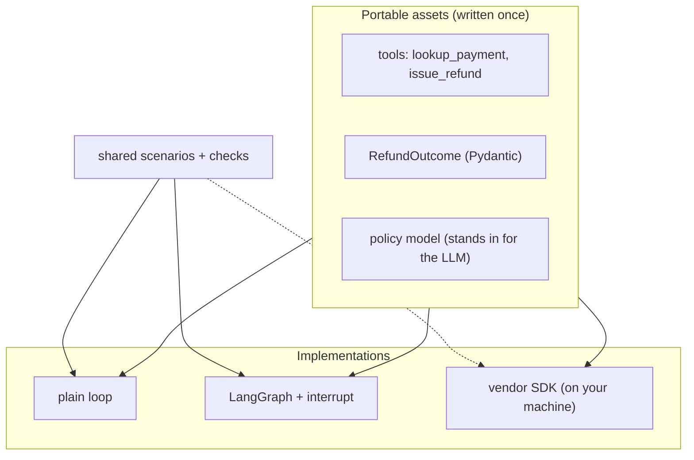

# Lab: The Same Agent in Three Frameworks

> 📚 **Before you start**
>
> - [Portability, Lock-In and Going Framework-Free](portability-lock-in-and-going-framework-free.md), for the framework-free loop and the idea of a shared behavioural test suite.
> - [Comparing Frameworks on One Task](comparing-frameworks-on-one-task.md), for the UPI refund task and how approvals look in each SDK.
> - [Pausing with interrupt and Resuming with Command](../../langgraph-complete-guide/08-human-in-the-loop-and-debugging/pausing-with-interrupt-and-resuming-with-command.md) from the LangGraph course, used for the approval step.

## What You'll Build

You'll build the **UPI refund assistant** three times and prove they behave the same:

1. A **plain Python** loop (no framework).
2. A **LangGraph** graph that pauses for approval with `interrupt` and resumes with `Command`.
3. A **vendor SDK** version (OpenAI Agents SDK and Pydantic AI shown), which needs API keys, so it is shown as code to run on your own machine.

All three use the **same portable assets**: plain tool functions, one typed `RefundOutcome`, and a deterministic "policy model" that plays the LLM. A **shared test suite** that imports no framework runs against each implementation through a tiny adapter.



> 💡 **Key Insight**
>
> The test suite talks to every implementation through the same tiny interface: `run(prompt, approve) -> Trace`. Once that holds, you can compare frameworks on evidence (same behaviour? how much code? how many model calls?) and switch between them safely.

---

## Step 1: The Portable Assets

```python
import json
from dataclasses import dataclass, field
from typing import Callable, Literal
from pydantic import BaseModel

PAYMENTS = {
    "UPI8812": {"amount": 2450.0, "status": "failed", "merchant": "Sharma Sweets"},
    "UPI9001": {"amount": 799.0, "status": "success", "merchant": "Chai Point"},
    "UPI7777": {"amount": 18500.0, "status": "failed", "merchant": "Mobile World"},
}
REFUNDS: list[str] = []

def lookup_payment(txn_id: str) -> dict:
    """Look up a UPI payment by transaction id."""
    return PAYMENTS.get(txn_id, {"error": "not found"})

def issue_refund(txn_id: str, amount: float) -> str:
    """Refund a failed UPI payment. Moves money: needs approval."""
    REFUNDS.append(txn_id)
    return f"refunded {amount:.0f} for {txn_id}"

TOOLS = {"lookup_payment": lookup_payment, "issue_refund": issue_refund}
NEEDS_APPROVAL = {"issue_refund"}

class RefundOutcome(BaseModel):
    action: Literal["refunded", "rejected", "escalated"]
    amount: float
    message: str

@dataclass
class Trace:
    tool_calls: list = field(default_factory=list)
    approvals_asked: list = field(default_factory=list)
    model_calls: int = 0
    outcome: RefundOutcome | None = None
```

The **policy model** decides the next step from the conversation, as an LLM would: look up the payment, refund if it failed, reject if it succeeded, escalate if a refund is denied. Messages are plain dictionaries, so every framework can carry them.

```python
import re

def policy_model(messages):
    """Pretend LLM: returns {'tool_call': ...} or {'final': ...} from the conversation so far."""
    prompt = messages[0]["content"]
    txn = re.search(r"UPI\d+", prompt).group()
    results = {m["name"]: json.loads(m["content"]) for m in messages if m["role"] == "tool"}
    if "lookup_payment" not in results:
        return {"tool_call": {"name": "lookup_payment", "args": {"txn_id": txn}}}
    payment = results["lookup_payment"]
    if payment.get("status") == "success":
        return {"final": {"action": "rejected", "amount": 0,
                          "message": f"Payment {txn} succeeded, so no refund is due."}}
    if "issue_refund" not in results:
        return {"tool_call": {"name": "issue_refund", "args": {"txn_id": txn, "amount": payment["amount"]}}}
    if str(results["issue_refund"]).startswith("DENIED"):
        return {"final": {"action": "escalated", "amount": 0,
                          "message": "An operator will review your refund request."}}
    return {"final": {"action": "refunded", "amount": payment["amount"],
                      "message": f"Refunded ₹{payment['amount']:,.0f} for {txn}."}}

print(policy_model([{"role": "user", "content": "Refund UPI8812 please"}]))
```

Output:

```
{'tool_call': {'name': 'lookup_payment', 'args': {'txn_id': 'UPI8812'}}}
```

## Step 2: The Shared Test Suite

Each scenario has a prompt, an approval policy and the expected behaviour. The checks never look inside an implementation; they only read the `Trace`.

```python
SCENARIOS = [
    {"name": "failed payment, approved", "prompt": "My payment UPI8812 failed but money was debited",
     "approve": lambda call: True,
     "expect": {"action": "refunded", "refunded": True, "asked": True}},
    {"name": "successful payment", "prompt": "Refund UPI9001 please",
     "approve": lambda call: True,
     "expect": {"action": "rejected", "refunded": False, "asked": False}},
    {"name": "large refund denied", "prompt": "UPI7777 failed, refund ₹18,500",
     "approve": lambda call: call["args"]["amount"] <= 5000,
     "expect": {"action": "escalated", "refunded": False, "asked": True}},
]

def check(impl_name, run_fn):
    passed = 0
    for sc in SCENARIOS:
        REFUNDS.clear()
        trace = run_fn(sc["prompt"], sc["approve"])
        txn = re.search(r"UPI\d+", sc["prompt"]).group()
        problems = []
        if trace.outcome is None or trace.outcome.action != sc["expect"]["action"]:
            problems.append(f"action={trace.outcome.action if trace.outcome else None}")
        if (txn in REFUNDS) != sc["expect"]["refunded"]:
            problems.append(f"money moved={txn in REFUNDS}")
        if bool(trace.approvals_asked) != sc["expect"]["asked"]:
            problems.append(f"approval asked={bool(trace.approvals_asked)}")
        ok = not problems
        passed += ok
        print(f"  {'PASS' if ok else 'FAIL'} {sc['name']:26} model calls={trace.model_calls} {'; '.join(problems)}")
    print(f"{impl_name}: {passed}/{len(SCENARIOS)} passed")
```

The third scenario is the important one: a refund that is **not** approved must not move money, and the agent must escalate.

## Step 3: Implementation 1, a Plain Loop

```python
def run_plain(prompt, approve, max_steps=6):
    trace = Trace()
    messages = [{"role": "user", "content": prompt}]
    for _ in range(max_steps):
        trace.model_calls += 1
        reply = policy_model(messages)
        if "final" in reply:
            trace.outcome = RefundOutcome.model_validate(reply["final"])
            return trace
        call = reply["tool_call"]
        trace.tool_calls.append(call["name"])
        if call["name"] in NEEDS_APPROVAL:
            trace.approvals_asked.append(call)
            if not approve(call):
                messages.append({"role": "tool", "name": call["name"], "content": json.dumps("DENIED")})
                continue
        result = TOOLS[call["name"]](**call["args"])
        messages.append({"role": "tool", "name": call["name"], "content": json.dumps(result)})
    return trace

check("plain loop", run_plain)
```

Output:

```
  PASS failed payment, approved   model calls=3 
  PASS successful payment         model calls=2 
  PASS large refund denied        model calls=3 
plain loop: 3/3 passed
```

## Step 4: Implementation 2, LangGraph with a Real Pause

In LangGraph, approval is a genuine pause: the `approval` node calls `interrupt(...)`, the graph stops and saves its state in a checkpointer, and the caller resumes it later with `Command(resume=decision)`. In production the resume could come minutes or days later from an operator dashboard.

```python
import operator
import uuid
from typing import Annotated, TypedDict
from langgraph.graph import StateGraph, START, END
from langgraph.types import interrupt, Command
from langgraph.checkpoint.memory import InMemorySaver

class AgentState(TypedDict):
    messages: Annotated[list, operator.add]
    pending: dict | None
    outcome: dict | None
    model_calls: Annotated[int, operator.add]

def assistant(state):
    reply = policy_model(state["messages"])
    if "final" in reply:
        return {"outcome": reply["final"], "pending": None, "model_calls": 1}
    return {"pending": reply["tool_call"], "model_calls": 1}

def route(state):
    if state["outcome"]:
        return END
    return "approval" if state["pending"]["name"] in NEEDS_APPROVAL else "tools"

def approval(state):
    decision = interrupt({"approve": state["pending"]})
    if decision:
        return {}
    call = state["pending"]
    return {"messages": [{"role": "tool", "name": call["name"], "content": json.dumps("DENIED")}],
            "pending": None}

def after_approval(state):
    return "tools" if state["pending"] else "assistant"

def tools(state):
    call = state["pending"]
    result = TOOLS[call["name"]](**call["args"])
    return {"messages": [{"role": "tool", "name": call["name"], "content": json.dumps(result)}], "pending": None}

g = StateGraph(AgentState)
g.add_node("assistant", assistant)
g.add_node("approval", approval)
g.add_node("tools", tools)
g.add_edge(START, "assistant")
g.add_conditional_edges("assistant", route, ["approval", "tools", END])
g.add_conditional_edges("approval", after_approval, ["tools", "assistant"])
g.add_edge("tools", "assistant")
saver = InMemorySaver()
refund_graph = g.compile(checkpointer=saver)

def run_langgraph(prompt, approve):
    trace = Trace()
    config = {"configurable": {"thread_id": str(uuid.uuid4())}}   # a fresh thread per run
    result = refund_graph.invoke({"messages": [{"role": "user", "content": prompt}],
                                  "pending": None, "outcome": None, "model_calls": 0}, config)
    while "__interrupt__" in result:                     # paused: ask the operator, then resume
        call = result["__interrupt__"][0].value["approve"]
        trace.approvals_asked.append(call)
        result = refund_graph.invoke(Command(resume=approve(call)), config)
    trace.tool_calls = [m["name"] for m in result["messages"] if m["role"] == "tool"]
    trace.model_calls = result["model_calls"]
    trace.outcome = RefundOutcome.model_validate(result["outcome"])
    return trace

check("LangGraph", run_langgraph)
```

Output:

```
  PASS failed payment, approved   model calls=3 
  PASS successful payment         model calls=2 
  PASS large refund denied        model calls=3 
LangGraph: 3/3 passed
```

Same behaviour, same number of model calls. What changed is **where approval lives**: in the plain loop it is a blocking function call; in LangGraph it is a saved pause that survives across processes, which is what you want when a human answers hours later.

## Step 5: See the Pause Yourself

```python
config = {"configurable": {"thread_id": "demo-1"}}
first = refund_graph.invoke({"messages": [{"role": "user", "content": "UPI8812 failed"}],
                             "pending": None, "outcome": None, "model_calls": 0}, config)
print("paused for:", first["__interrupt__"][0].value)
print("next node:", refund_graph.get_state(config).next)
REFUNDS.clear()
final = refund_graph.invoke(Command(resume=True), config)
print(final["outcome"]["message"], "| refunds:", REFUNDS)
```

Output:

```
paused for: {'approve': {'name': 'issue_refund', 'args': {'txn_id': 'UPI8812', 'amount': 2450.0}}}
next node: ('approval',)
Refunded ₹2,450 for UPI8812. | refunds: ['UPI8812']
```

Between the two `invoke` calls, nothing is running. The state sits in the checkpointer (in memory here; Postgres or SQLite in production).

## Step 6: Implementation 3, a Vendor SDK

With a real model and API key, the vendor SDK versions reuse the same tool functions and `RefundOutcome`. The adapter to the test suite collects the same `Trace` fields from the SDK's result objects. Run these on your own machine; outputs will vary with the model.

**OpenAI Agents SDK** (with Claude via LiteLLM):

```python
# not-run: needs openai-agents[litellm] and an ANTHROPIC_API_KEY
from agents import Agent, Runner, function_tool

refund_agent = Agent(
    name="refunds",
    instructions="Look up the payment. Refund failed payments; reject successful ones; escalate if a refund is denied.",
    tools=[function_tool(lookup_payment), function_tool(issue_refund, needs_approval=True)],
    output_type=RefundOutcome,
    model="litellm/anthropic/claude-opus-5-5",
)

def run_openai_sdk(prompt, approve):
    trace = Trace()
    result = Runner.run_sync(refund_agent, prompt)
    while result.interruptions:
        state = result.to_state()
        for item in result.interruptions:
            call = {"name": item.name, "args": json.loads(item.arguments)}
            trace.approvals_asked.append(call)
            state.approve(item) if approve(call) else state.reject(item)
        result = Runner.run_sync(refund_agent, state)
    trace.outcome = result.final_output
    return trace

check("OpenAI Agents SDK", run_openai_sdk)
```

**Pydantic AI**, where approval-required tools end the run with `DeferredToolRequests`:

```python
# not-run: needs pydantic-ai and an ANTHROPIC_API_KEY
from pydantic_ai import Agent, DeferredToolRequests, DeferredToolResults

pyd_agent = Agent("anthropic:claude-opus-5-5", output_type=[RefundOutcome, DeferredToolRequests],
                  instructions="Look up the payment. Refund failed payments; reject successful ones; "
                               "escalate if a refund is denied.")
pyd_agent.tool_plain(lookup_payment)
pyd_agent.tool_plain(requires_approval=True)(issue_refund)

def run_pydantic_ai(prompt, approve):
    trace = Trace()
    result = pyd_agent.run_sync(prompt)
    while isinstance(result.output, DeferredToolRequests):
        decisions = DeferredToolResults()
        for call in result.output.approvals:
            c = {"name": call.tool_name, "args": call.args_as_dict()}
            trace.approvals_asked.append(c)
            decisions.approvals[call.tool_call_id] = approve(c)
        result = pyd_agent.run_sync(message_history=result.all_messages(), deferred_tool_results=decisions)
    trace.outcome = result.output
    return trace

check("Pydantic AI", run_pydantic_ai)
```

Because a real model is involved, also run each scenario several times: a framework comparison should report pass **rates**, not single runs.

## Step 7: Compare

With all implementations passing the same suite, compare them on what differs:

| | Plain loop | LangGraph | Vendor SDK |
|---|---|---|---|
| Lines for the agent itself (this lab) | about 20 | about 40 | about 15 to 20 |
| Approval style | Blocking callback | Durable pause, resume later | Run ends with pending approvals; resume with decisions |
| Survives a process restart mid-approval | No (you'd add storage) | Yes, with a persistent checkpointer | Yes, if you store the serialised run state |
| Model choice | Any (you write adapters) | Any (LangChain model classes) | Best with the vendor's own; others through adapters |
| Extra built-ins | None | Streaming, time travel, subgraphs | Tracing, guardrails, sessions, hosted tools |

There is no universal winner. For this refund assistant, a team that needs approvals answered hours later by operators would likely pick LangGraph or an SDK with durable state; a team with instant, in-process approvals might happily keep the plain loop.

---

## Try It Yourself

1. **Break it on purpose.** Change the plain loop so it runs the tool **before** checking approval. Run `check("broken plain loop", ...)` and see which scenario catches it.
2. **Add a scenario.** Add a scenario for an unknown transaction `UPI0000` that should be `escalated` without asking approval. What do you need to change in `policy_model`?
3. **Survive a restart.** Start a run on the LangGraph version until it pauses, then build a **new** compiled graph object from the same builder and the same `saver` (as a restarted server would) and resume the thread from it.

<details>
<summary>Show answers</summary>

**1.**

```python
def run_broken(prompt, approve, max_steps=6):
    trace = Trace()
    messages = [{"role": "user", "content": prompt}]
    for _ in range(max_steps):
        trace.model_calls += 1
        reply = policy_model(messages)
        if "final" in reply:
            trace.outcome = RefundOutcome.model_validate(reply["final"])
            return trace
        call = reply["tool_call"]
        result = TOOLS[call["name"]](**call["args"])          # runs first!
        if call["name"] in NEEDS_APPROVAL:
            trace.approvals_asked.append(call)
            if not approve(call):
                result = "DENIED"
        messages.append({"role": "tool", "name": call["name"], "content": json.dumps(result)})
    return trace

check("broken plain loop", run_broken)
```

Output:

```
  PASS failed payment, approved   model calls=3 
  PASS successful payment         model calls=2 
  FAIL large refund denied        model calls=3 money moved=True
broken plain loop: 2/3 passed
```

The outcome still says "escalated", so a test that only checked the final answer would pass. Checking whether money moved catches the bug.

**2.** In `policy_model`, after the lookup, handle the error case before the status checks:

```python
_old_policy = policy_model

def policy_model(messages):
    results = {m["name"]: json.loads(m["content"]) for m in messages if m["role"] == "tool"}
    if results.get("lookup_payment", {}).get("error"):
        return {"final": {"action": "escalated", "amount": 0, "message": "We couldn't find that payment."}}
    return _old_policy(messages)

SCENARIOS.append({"name": "unknown transaction", "prompt": "Refund UPI0000",
                  "approve": lambda call: True,
                  "expect": {"action": "escalated", "refunded": False, "asked": False}})
check("plain loop", run_plain)
check("LangGraph", run_langgraph)
```

Output:

```
  PASS failed payment, approved   model calls=3 
  PASS successful payment         model calls=2 
  PASS large refund denied        model calls=3 
  PASS unknown transaction        model calls=2 
plain loop: 4/4 passed
  PASS failed payment, approved   model calls=3 
  PASS successful payment         model calls=2 
  PASS large refund denied        model calls=3 
  PASS unknown transaction        model calls=2 
LangGraph: 4/4 passed
```

Both implementations picked up the new behaviour without any change, because the policy (the "model") is a shared asset.

**3.**

```python
config = {"configurable": {"thread_id": "restart-demo"}}
paused = refund_graph.invoke({"messages": [{"role": "user", "content": "UPI8812 failed"}],
                              "pending": None, "outcome": None, "model_calls": 0}, config)
print("paused:", "__interrupt__" in paused)

restarted_graph = g.compile(checkpointer=saver)     # a new object, as after a server restart
REFUNDS.clear()
done = restarted_graph.invoke(Command(resume=True), config)
print(done["outcome"]["action"], REFUNDS)
```

Output:

```
paused: True
refunded ['UPI8812']
```

The new graph object picked up the paused thread from the shared checkpointer and finished it. With `InMemorySaver` this only works inside one process; a persistent checkpointer (SQLite, Postgres) makes it work across real restarts.

</details>

---

## What You've Learned

- Kept **tools, the output type and the policy** as portable assets shared by every implementation.
- Wrote a **framework-independent test suite** that checks behaviour (including whether money moved), not just final text.
- Built the agent as a **plain loop** and as a **LangGraph graph with a durable approval pause**, both passing the same tests.
- Saw how the **vendor SDKs** express the same approval flow, and how to adapt them to the suite.
- Compared implementations on **evidence**: behaviour, code size, approval style and durability.

---

**Up next:** This is the last lesson of the course. Continue with [Multi-Agent Systems and Agent Protocols](../../multi-agent-systems-and-agent-protocols/course.md), where several of these agents start working together.
