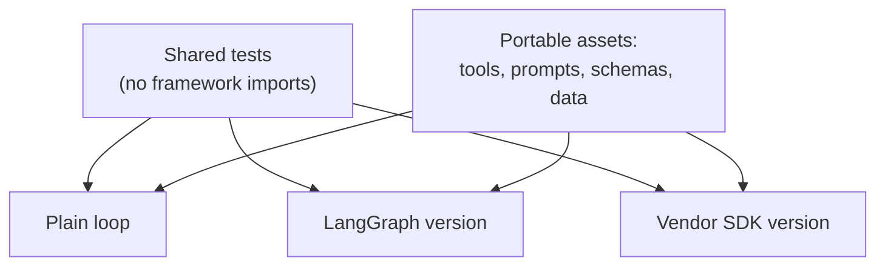

# Portability, Lock-In and Going Framework-Free: The Complete Guide

> 📚 **Before you start**
>
> - [Comparing Frameworks on One Task](comparing-frameworks-on-one-task.md), which showed that the core loop is nearly identical everywhere.
> - [Lab: Tool-Using Agent from Scratch](../../agentic-ai-fundamentals/04-tools-and-function-calling/lab-tool-using-agent-from-scratch.md), where you first wrote an agent loop by hand.
> - [Model Context Protocol](../../model-context-protocol-mcp/course.md), the open standard for tools that appears throughout this lesson.

## Introduction

When India introduced mobile number portability, people could switch telecom operators and keep their number. Overnight, the thing that had locked customers in (everyone knew your number) stopped being a reason to stay. Operators had to compete on network and price. The trick wasn't to avoid choosing an operator; it was to make sure the most valuable thing, **the number**, belonged to you.

Agent frameworks lock you in the same way telecoms used to: not through the code you write on day one, but through what accumulates around it. Conversation history in a framework's own session format, memory in a managed service, tools written against one SDK's decorator, traces in one vendor's dashboard. Six months later, switching means migrating all of that.

This lesson shows where lock-in actually lives, how to keep the valuable parts (tools, prompts, data, tests) in open formats, and how to build a small framework-free agent so you understand exactly what a framework gives you, and when you don't need one.


> 💡 **Key Insight**
>
> Lock-in is not about which framework you choose; it is about **which of your assets end up in a format only that framework understands**. Keep tools as plain functions behind JSON Schema or MCP, keep conversations as plain messages, keep state as your own typed models, keep traces in OpenTelemetry, and keep a test suite that runs against any implementation. Then the framework is a replaceable engine, not a home you can't leave.

---

## Core Explanation

### 1. The layers, from portable to sticky

| Layer | Typical lock-in | Portable choice |
|---|---|---|
| **Model** | Provider-specific message formats and features | Model strings (`"anthropic:..."`, `"anthropic/..."`), AI gateways, LiteLLM-style adapters; avoid provider-only features unless they earn their keep |
| **Tools** | Tools written against one SDK's decorator and context object | Plain typed functions; JSON Schema; publish shared tools as **MCP servers** that any framework can use |
| **Prompts and skills** | Prompts buried in framework classes | Prompts and skills as files in your repo (Markdown, Agent Skills folders) |
| **Agent loop** | Handoff, guardrail and hook APIs | Keep business logic in your own functions; the framework only wires them |
| **State and memory** | Sessions, checkpoints and memories in the framework's schema or a managed store | Store plain messages and your own typed state in your own database; export regularly |
| **Runtime** | Managed agent hosting tied to one cloud | Containers you can move; managed services for what's truly hard (identity, sandboxes) |
| **Observability** | One vendor's tracing format | OpenTelemetry (most frameworks in this course can emit it) |
| **Agent-to-agent and UI** | Custom protocols | Open protocols such as MCP for tools, A2A for agent-to-agent calls, AG-UI for agent front ends (covered in [Multi-Agent Systems and Agent Protocols](../../multi-agent-systems-and-agent-protocols/course.md)) |

The bottom layers (model and tools) are already easy to keep portable. The real cost of switching sits in **state, memory and runtime**, which is exactly where managed offerings are most convenient. That's a fair trade when chosen deliberately.

### 2. Tools as the most valuable portable asset

Tools hold your business logic: how to look up a payment, what a refund needs. Write them once as plain, typed Python functions, then adapt them to each framework. Every framework in this course can take a plain function (directly, or wrapped by a one-line decorator), and most can consume MCP servers. For example, the same `lookup_payment` function:

| Framework | Registration |
|---|---|
| OpenAI Agents SDK | `function_tool(lookup_payment)` |
| Pydantic AI | `Agent(..., tools=[lookup_payment])` |
| Google ADK | `Agent(..., tools=[lookup_payment])` |
| Strands | `@tool` on the function, or `tool(lookup_payment)` |
| LangGraph / LangChain | `@tool` from `langchain_core.tools` |
| Claude Agent SDK | wrap it in an `@tool` handler inside an SDK MCP server |
| Any MCP-capable framework | serve it once from an MCP server |

If several teams or frameworks need the same tools, an MCP server is the cleanest boundary: one implementation, many clients, and access control in one place.

### 3. A framework-free agent, in full

To see what a framework actually does for you, here is a complete agent without one. It has:

- a **model interface** (anything with a `complete(messages, tools)` method), so providers are swappable;
- **tools built from plain functions**, with schemas and validation from Pydantic;
- an **approval hook** for dangerous tools;
- a **typed final answer**;
- a **step limit**;
- **state that is just JSON**, so a run can be saved and resumed anywhere.

A scripted model stands in for the LLM so the code runs anywhere.

```python
import inspect
import json
from dataclasses import dataclass, field
from typing import Literal, Protocol
from pydantic import BaseModel, ValidationError, create_model

# ---- tools: plain functions -------------------------------------------------
PAYMENTS = {"UPI8812": {"amount": 2450.0, "status": "failed", "merchant": "Sharma Sweets"}}

def lookup_payment(txn_id: str) -> dict:
    """Look up a UPI payment by transaction id."""
    return PAYMENTS.get(txn_id, {"error": "not found"})

def issue_refund(txn_id: str, amount: float) -> str:
    """Refund a failed UPI payment."""
    return f"refunded ₹{amount:.0f} for {txn_id}"

class Tool:
    def __init__(self, fn, needs_approval=False):
        params = inspect.signature(fn).parameters
        self.fn, self.name, self.needs_approval = fn, fn.__name__, needs_approval
        self.args_model = create_model(f"{fn.__name__}_args", **{n: (p.annotation, ...) for n, p in params.items()})
        self.spec = {"name": self.name, "description": inspect.getdoc(fn),
                     "input_schema": self.args_model.model_json_schema()}

    def run(self, args):
        return self.fn(**self.args_model(**args).model_dump())

# ---- typed final answer ------------------------------------------------------
class RefundOutcome(BaseModel):
    action: Literal["refunded", "rejected", "escalated"]
    amount: float
    message: str

# ---- the model interface: any provider adapter fits ------------------------------
class Model(Protocol):
    def complete(self, messages: list[dict], tools: list[dict]) -> dict: ...

class ScriptedModel:
    def __init__(self, replies):
        self.replies = list(replies)
    def complete(self, messages, tools):
        return self.replies.pop(0)

# ---- the loop ------------------------------------------------------------------
@dataclass
class Run:
    messages: list = field(default_factory=list)
    steps: int = 0

def run_agent(model: Model, tools: list[Tool], prompt: str, approve, max_steps=6, run=None):
    run = run or Run(messages=[{"role": "user", "content": prompt}])
    registry = {t.name: t for t in tools}
    while run.steps < max_steps:
        run.steps += 1
        reply = model.complete(run.messages, [t.spec for t in tools])
        run.messages.append({"role": "assistant", "content": reply})
        if "final" in reply:
            try:
                return RefundOutcome.model_validate(reply["final"]), run
            except ValidationError as e:
                run.messages.append({"role": "user", "content": f"Invalid final answer: {e.errors()[0]['msg']}"})
                continue
        call = reply["tool_call"]
        tool = registry[call["name"]]
        if tool.needs_approval and not approve(call):
            result = "DENIED by operator"
        else:
            try:
                result = tool.run(call["args"])
            except ValidationError as e:
                result = f"invalid arguments: {e.errors()[0]['msg']}"
        run.messages.append({"role": "tool", "name": call["name"], "content": json.dumps(result)})
    raise RuntimeError("step limit reached")

tools = [Tool(lookup_payment), Tool(issue_refund, needs_approval=True)]
script = [
    {"tool_call": {"name": "lookup_payment", "args": {"txn_id": "UPI8812"}}},
    {"tool_call": {"name": "issue_refund", "args": {"txn_id": "UPI8812", "amount": "2450"}}},
    {"final": {"action": "refunded", "amount": 2450, "message": "Your ₹2,450 has been refunded."}},
]
outcome, run = run_agent(ScriptedModel(script), tools, "My payment UPI8812 failed but money was debited",
                         approve=lambda call: call["args"]["amount"] and float(call["args"]["amount"]) <= 5000)
print(outcome)
print("steps:", run.steps)
for m in run.messages:
    if m["role"] == "tool":
        print("tool", m["name"], "->", m["content"])
print(tools[1].spec["input_schema"]["required"])
```

Output:

```
action='refunded' amount=2450.0 message='Your ₹2,450 has been refunded.'
steps: 3
tool lookup_payment -> {"amount": 2450.0, "status": "failed", "merchant": "Sharma Sweets"}
tool issue_refund -> "refunded \u20b92450 for UPI8812"
['txn_id', 'amount']
```

About 80 lines, and it does what most simple production agents need. Note how the `"2450"` string from the model was converted to a float by validation before the refund ran.

### 4. Saving and resuming, framework-free

Because `Run` holds only plain messages, persistence is a JSON dump. That's the portability payoff: any process, any framework, any database can pick up where you stopped.

```python
saved = json.dumps({"messages": run.messages, "steps": run.steps}, ensure_ascii=False)
restored = Run(**json.loads(saved))
print(len(saved), "bytes;", restored.messages[0]["content"])
```

Output:

```
697 bytes; My payment UPI8812 failed but money was debited
```

### 5. A provider adapter is a translation function

Making the loop work with a real provider means writing a small adapter that translates your neutral messages into the provider's format and back. For example, the Anthropic Messages API keeps the system prompt separate, puts tool results in a `user` message as `tool_result` blocks, and represents tool calls as `tool_use` blocks. The translation is pure data mapping:

```python
def to_anthropic(messages, system):
    out = []
    for i, m in enumerate(messages):
        if m["role"] == "user":
            out.append({"role": "user", "content": m["content"]})
        elif m["role"] == "assistant" and "tool_call" in m["content"]:
            c = m["content"]["tool_call"]
            out.append({"role": "assistant", "content": [
                {"type": "tool_use", "id": f"call_{i}", "name": c["name"], "input": c["args"]}]})
        elif m["role"] == "tool":
            out.append({"role": "user", "content": [
                {"type": "tool_result", "tool_use_id": f"call_{i - 1}", "content": m["content"]}]})
    return {"system": system, "messages": out}

payload = to_anthropic(run.messages[:3], system="You handle UPI refunds.")
print(json.dumps(payload["messages"][1:], ensure_ascii=False)[:180])
```

Output:

```
[{"role": "assistant", "content": [{"type": "tool_use", "id": "call_1", "name": "lookup_payment", "input": {"txn_id": "UPI8812"}}]}, {"role": "user", "content": [{"type": "tool_res
```

The real adapter then calls the SDK with this payload and maps the response back:

```python
# not-run: needs the anthropic package and an API key
import anthropic

class AnthropicModel:
    def __init__(self, model="claude-opus-5-5", system=""):
        self.client, self.model, self.system = anthropic.Anthropic(), model, system

    def complete(self, messages, tools):
        payload = to_anthropic(messages, self.system)
        resp = self.client.messages.create(model=self.model, max_tokens=1024, tools=tools, **payload)
        for block in resp.content:
            if block.type == "tool_use":
                return {"tool_call": {"name": block.name, "args": block.input}}
        return {"final": json.loads(resp.content[0].text)}
```

Real adapters handle more (parallel tool calls, thinking blocks, streaming, the final answer as a structured output instead of parsed text), which is precisely the code frameworks and libraries like LiteLLM maintain for you.

### 6. What you give up without a framework

Writing your own loop is a real option, but be honest about what you then own:

| You'd need to build | Frameworks give you |
|---|---|
| Streaming tokens and events to a UI | Stream APIs and UI helpers |
| Durable runs that survive crashes, with resume and human approval across days | Checkpointers, interrupts, durable execution integrations |
| Parallel tool calls, timeouts, retries with backoff | Built into the runners |
| Context management for long runs (summaries, file offloading) | Deep Agents, Claude Agent SDK and others |
| Tracing with token and cost accounting | OpenTelemetry integrations, dashboards |
| Multi-agent handoffs, sandboxes, MCP clients | Prebuilt components |

A useful rule: **start with a plain SDK and your own small loop when the agent is simple; adopt a framework when you find yourself rebuilding one of the rows above.** And when you adopt one, keep the portable assets (tools, prompts, data, tests) outside it.

### 7. The test suite is your portability guarantee

The single best defence against lock-in is a set of **behavioural tests** that don't import any framework: given this prompt and these tool results, the agent must call these tools, request approval before moving money, and return this typed outcome. If every implementation must pass the same suite, switching frameworks becomes a refactor with a safety net. The lab that follows builds exactly that.



---

## Try It Yourself

1. **Deny the refund.** Run `run_agent` with an `approve` function that always returns `False`. What does the tool message say, and what should the scripted model's final answer be?
2. **Add a tool.** Add `get_merchant_contact(merchant: str) -> str` as a plain function and register it. Print its schema's `required` list.
3. **Find the sticky layer.** Your team uses a framework's built-in session store and its managed memory. List two concrete steps that make a future migration cheaper.

<details>
<summary>Show answers</summary>

**1.**

```python
script = [
    {"tool_call": {"name": "lookup_payment", "args": {"txn_id": "UPI8812"}}},
    {"tool_call": {"name": "issue_refund", "args": {"txn_id": "UPI8812", "amount": 2450}}},
    {"final": {"action": "escalated", "amount": 0, "message": "An operator will review your refund."}},
]
outcome, run = run_agent(ScriptedModel(script), tools, "Refund UPI8812", approve=lambda call: False)
print([m["content"] for m in run.messages if m["role"] == "tool"][-1])
print(outcome.action)
```

Output:

```
"DENIED by operator"
escalated
```

**2.**

```python
def get_merchant_contact(merchant: str) -> str:
    """Return the support phone number for a merchant."""
    return "+91-98xxxxxx01"

print(Tool(get_merchant_contact).spec["input_schema"]["required"])
```

Output:

```
['merchant']
```

**3.** For example: (a) also write each conversation as plain messages to your own database (or export the session store nightly), so history isn't trapped; (b) keep long-term memories as your own typed records (with a simple schema) that you sync to the managed memory, rather than only living there. Bonus: keep tools behind MCP and traces in OpenTelemetry.

</details>

---

## Real-World Examples

- **Shared MCP tool servers.** Companies expose internal systems (tickets, payments, docs) once as MCP servers so that agents in several frameworks, and coding assistants, all use the same tools.
- **"Thin framework" architectures.** Teams keep business logic in their own modules and use a framework only for the loop and streaming, so swapping frameworks touches a small adapter layer.
- **Hand-rolled loops in production.** Many simple production agents are a provider SDK plus a few dozen lines of loop code, which teams find easier to debug and audit.

---

## Common Misconceptions

### "Using a framework means lock-in"

Using a framework's **storage and runtime formats** for your only copy of important data does. Using its loop over your own portable assets mostly doesn't.

### "Framework-free is always simpler"

For a simple agent, yes. For durable, streaming, multi-agent systems, you will rebuild a framework, usually worse.

### "MCP solves portability"

It makes **tools** portable. State, memory, prompts and evaluation need their own open formats.

---

## Interview Relevance

*"How do you avoid lock-in when building agents?"* A strong answer locates lock-in in layers (model, tools, loop, state, runtime, observability), keeps tools as plain typed functions or MCP servers, stores conversations and state in your own formats, uses OpenTelemetry for traces, keeps prompts and skills as files, and relies on a framework-independent behavioural test suite. It can sketch a framework-free loop (model interface, tool registry with schemas, approval hook, typed output, step limit, JSON state) and explain when a framework's durable execution, streaming and context management are worth adopting.

---

## Key Takeaways

- **Lock-in lives in layers**; state, memory and runtime are the sticky ones.
- **Tools are your most valuable portable asset**: plain functions, JSON Schema, MCP.
- **A framework-free agent fits in about 80 lines**, and teaches you what frameworks add.
- **Adopt a framework when you'd otherwise rebuild** durability, streaming, context management or tracing.
- **A shared behavioural test suite** makes switching frameworks safe.

---

**Up next:** [Lab: The Same Agent in Three Frameworks](lab-the-same-agent-in-three-frameworks.md)
