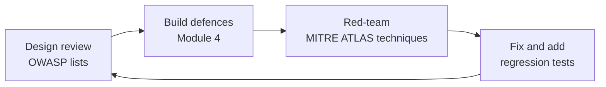

# OWASP LLM Top 10 and Agentic Top 10: The Complete Guide

> 📚 **Before you start**
>
> - [The Lethal Trifecta](the-lethal-trifecta.md) and [Direct and Indirect Prompt Injection](direct-and-indirect-prompt-injection.md), which cover the two ideas behind most entries on both lists.
> - [Why Agents Change the Security Picture](why-agents-change-the-security-picture.md), for STRIDE and the "assume breach" exercise.

## Introduction

When a cricket umpire gives a batter out LBW, nobody argues about what "LBW" means. The term is defined in the Laws of Cricket, so players, commentators and fans share one vocabulary. Security needs the same thing. When a reviewer writes "this design has an excessive agency problem", the developer, the product manager and the auditor should all know exactly what that means and what fixes are expected.

For web applications, that shared vocabulary has long been the **OWASP Top 10**. OWASP, the Open Worldwide Application Security Project, is a non-profit community that publishes free security guidance. Its **GenAI Security Project** maintains two lists that matter for this course:

- the **OWASP Top 10 for LLM Applications (2025 edition)**, for any app built on a language model, and
- the **OWASP Top 10 for Agentic Applications (2026 edition)**, published on 9 December 2025, for systems that plan, use tools and act.

This lesson explains both lists in plain words, shows how they relate, and turns them into a working checklist you can run against a design. Module 3 then takes the agentic risks one or two at a time.

> 💡 **Key Insight**
>
> The LLM Top 10 asks **"what can go wrong when a model produces text?"** The Agentic Top 10 asks **"what can go wrong when a model's decisions become actions, over many steps, with identities, tools, memory and other agents?"** Use the LLM list for every model call, and add the Agentic list as soon as the model can act. The thread running through the agentic list is **least agency**: give an agent only the autonomy, tools and access its task needs.

---

## Core Explanation

### 1. The OWASP Top 10 for LLM Applications (2025)

| ID | Name | In one line | Agent example |
|---|---|---|---|
| **LLM01** | Prompt Injection | Crafted input, typed or hidden in content, changes the model's behaviour | A supplier email steers Munshi |
| **LLM02** | Sensitive Information Disclosure | The model reveals private, regulated or confidential data | Customer phone numbers appear in a reply to a stranger |
| **LLM03** | Supply Chain | Third-party models, datasets, packages or plug-ins introduce risk | An unvetted model file or tool package |
| **LLM04** | Data and Model Poisoning | Tampered training or fine-tuning data changes behaviour | A fine-tune dataset with planted examples |
| **LLM05** | Improper Output Handling | Model output is passed to other systems without validation | Model text is pasted into SQL, a shell or a web page |
| **LLM06** | Excessive Agency | The model is given too much functionality, permission or autonomy | Munshi has `pay_upi` when it only needs to read invoices |
| **LLM07** | System Prompt Leakage | Hidden instructions are exposed, along with anything secret inside them | An override code in the prompt gets printed |
| **LLM08** | Vector and Embedding Weaknesses | Flaws in retrieval stores, such as poisoned or leaky indexes | A planted document always ranks first for "refund policy" |
| **LLM09** | Misinformation | Confident, false output that people rely on | A wrong GST rate in a generated invoice |
| **LLM10** | Unbounded Consumption | Requests, loops or huge inputs exhaust resources or budget | A page sends the agent into an expensive loop |

Three entries deserve a closer look before we reach the agentic list.

**LLM05 Improper Output Handling** is the old web vulnerabilities in new clothes. If model output goes into a SQL query, a shell command or an HTML page without the usual escaping, then a prompt injection becomes a SQL injection, a command injection or cross-site scripting. Treat model output exactly like user input.

```python
import html

model_output = 'Order confirmed '   # text a model produced

unsafe_page = f"<p>{model_output}</p>"                  # rendered as HTML: the tag becomes live
safe_page = f"<p>{html.escape(model_output)}</p>"       # rendered as text
print(unsafe_page)
print(safe_page)
```

Output:

```
<p>Order confirmed </p>
<p>Order confirmed &lt;img src=x onerror=&quot;alert(1)&quot;&gt;</p>
```

**LLM06 Excessive Agency** is the bridge to the agentic list. OWASP splits it into three kinds of "too much": **excessive functionality** (tools the task doesn't need), **excessive permissions** (a tool that can do more than the task needs, such as a database tool with write access for a read-only job) and **excessive autonomy** (high-impact actions with no human check). Nearly every agentic risk gets worse when one of these is present.

**LLM10 Unbounded Consumption** matters more for agents than for chatbots, because one agent run can make hundreds of model and tool calls. Step limits and budgets, which you met in [How an Agent Decides What to Do Next](../../agentic-ai-fundamentals/03-the-agent-loop/how-an-agent-decides-what-to-do-next.md), are security controls as well as cost controls.

### 2. The OWASP Top 10 for Agentic Applications (2026)

The agentic list was built with input from more than a hundred practitioners and researchers. Its IDs start with **ASI** (Agentic Security Issue).

| ID | Name | In one line |
|---|---|---|
| **ASI01** | Agent Goal Hijack | Content the agent reads redirects its objective, while it believes it is still serving the user |
| **ASI02** | Tool Misuse and Exploitation | A legitimate tool is used towards an illegitimate outcome, through deceptive input, misleading tool metadata or a harmful chain of individually safe calls |
| **ASI03** | Identity and Privilege Abuse | Agents run on borrowed, shared or long-lived identities with broad scopes, so a hijacked agent gets everything those identities can reach |
| **ASI04** | Agentic Supply Chain Vulnerabilities | Frameworks, MCP servers, tool registries, skills and prompt files from third parties, often added at run time |
| **ASI05** | Unexpected Code Execution | Natural language becomes running code outside intended limits: generated scripts, unsafe evaluation, sandbox escapes |
| **ASI06** | Memory and Context Poisoning | False or malicious information is planted in context, retrieval stores or long-term memory and shapes later behaviour |
| **ASI07** | Insecure Inter-Agent Communication | Messages between agents lack authentication, integrity or authorisation, so agents can be impersonated, messages altered or replayed |
| **ASI08** | Cascading Failures | One bad decision or compromise spreads through every workflow that trusts the affected agent |
| **ASI09** | Human-Agent Trust Exploitation | Agent output persuades people into unsafe approvals or actions, attacking the human check other controls rely on |
| **ASI10** | Rogue Agents | Agents acting outside policy, through compromise, misalignment or drift, while still looking legitimate |


*A way to remember the list: three risks are about what the agent reads, three about what it is and holds, and four about what it does and what follows.*

### 3. How the two lists relate

The agentic list doesn't replace the LLM list; it builds on top of it. Most agentic entries are an LLM risk that has gained hands.

| Agentic risk | Closest LLM entry | What the agentic version adds |
|---|---|---|
| ASI01 Goal hijack | LLM01 Prompt injection | Injection now redirects a multi-step plan, not one answer |
| ASI02 Tool misuse | LLM06 Excessive agency | Chains of safe tools that add up to harm; misleading tool descriptions |
| ASI03 Identity and privilege | LLM06 Excessive agency | Non-human identities, delegation, credentials that outlive the task |
| ASI04 Supply chain | LLM03 Supply chain | Components added *at run time*: MCP servers, skills, prompt files |
| ASI05 Code execution | LLM05 Improper output handling | The agent itself runs code it wrote |
| ASI06 Memory poisoning | LLM04 Poisoning, LLM08 Vector weaknesses | Poison that persists across sessions and users |
| ASI07 Inter-agent comms | (none) | Agents trusting other agents |
| ASI08 Cascading failures | LLM10 Unbounded consumption (partly) | Errors spreading across many automated steps and agents |
| ASI09 Trust exploitation | LLM09 Misinformation | Persuasive output aimed at the human approver |
| ASI10 Rogue agents | (none) | Agents drifting from policy over long lifetimes |

### 4. Least agency: the principle behind the list

Security has long had the **principle of least privilege**: give each user or program only the permissions it needs. The agentic list extends it to **least agency**: give each agent only the *autonomy, tools and permissions* its task requires. It has three dials:

| Dial | Too much | Least agency |
|---|---|---|
| **Tools** | Every tool on the MCP server is loaded | Only the tools this task uses |
| **Permissions** | An admin token "so it never gets stuck" | A short-lived token scoped to one resource |
| **Autonomy** | Runs every action without a check | High-impact actions need approval or policy sign-off |

Least agency shrinks the blast radius for *every* risk on the list at once. That's why Module 4 starts with it.

### 5. Turning the lists into a checklist

A list is only useful if you apply it. Here is a small design review that asks one concrete question per agentic risk. You answer from the design, and it prints the gaps with their IDs. Real reviews use longer questionnaires, but the shape is the same.

```python
CHECKS = [
    ("ASI01", "Untrusted content is kept away from consequential actions (plan fixed first, or gated)", "plan_fixed_or_gated"),
    ("ASI02", "Every tool call passes argument validation and a policy check", "tool_policy"),
    ("ASI03", "The agent uses its own short-lived, task-scoped credentials", "scoped_creds"),
    ("ASI04", "Every MCP server, skill and package is pinned and reviewed", "pinned_supply_chain"),
    ("ASI05", "Generated code runs only in a sandbox with egress blocked by default", "sandboxed_code"),
    ("ASI06", "Memory writes are validated, scoped per user, and can be inspected and wiped", "memory_controls"),
    ("ASI07", "Messages between agents are authenticated and authorised", "agent_auth"),
    ("ASI08", "Limits and circuit breakers stop runaway loops; dev and prod are separate", "circuit_breakers"),
    ("ASI09", "Approvals show the raw action, not the agent's summary", "raw_approvals"),
    ("ASI10", "Every agent has an owner, an expiry, logs and a tested kill switch", "owner_and_kill_switch"),
]

def review(design):
    gaps = [(asi, text) for asi, text, key in CHECKS if not design.get(key, False)]
    print(f"{len(CHECKS) - len(gaps)}/{len(CHECKS)} controls in place")
    for asi, text in gaps:
        print(f"  GAP {asi}: {text}")

munshi_v1 = {"tool_policy": True, "pinned_supply_chain": True, "raw_approvals": True}
review(munshi_v1)
```

Output:

```
3/10 controls in place
  GAP ASI01: Untrusted content is kept away from consequential actions (plan fixed first, or gated)
  GAP ASI03: The agent uses its own short-lived, task-scoped credentials
  GAP ASI05: Generated code runs only in a sandbox with egress blocked by default
  GAP ASI06: Memory writes are validated, scoped per user, and can be inspected and wiped
  GAP ASI07: Messages between agents are authenticated and authorised
  GAP ASI08: Limits and circuit breakers stop runaway loops; dev and prod are separate
  GAP ASI10: Every agent has an owner, an expiry, logs and a tested kill switch
```

Not every gap matters for every agent. Munshi has no other agents, so ASI07 may simply not apply, and a good review records that explicitly ("N/A: single agent") instead of leaving it blank. The point is that every risk gets a conscious decision.

### 6. Where the lists sit among other frameworks

You'll hear several other names in security reviews. A one-line map:

| Framework | What it is | When you meet it |
|---|---|---|
| **OWASP LLM and Agentic Top 10** | Short, practical lists of top risks | Design reviews, developer training |
| **MITRE ATLAS** | A knowledge base of real adversary tactics and techniques against AI systems, in the style of MITRE ATT&CK | Red teams and threat-intelligence teams |
| **NIST AI Risk Management Framework** | A US government framework for managing AI risk across an organisation | Governance, compliance, procurement |
| **Model provider system cards** | Each provider's published testing of its own models, including injection robustness | Choosing a model |



---

## Try It Yourself

1. **Classify incidents.** Give the best-matching ASI ID for each: (a) a coding agent deletes a production database during a code freeze; (b) an MCP package update quietly copies every email it sends to an outside address; (c) a crafted email makes an assistant leak data from the user's mailbox.
2. **Excessive agency.** Munshi's job is "answer customers' questions about order status". Its tools are `read_orders`, `update_order`, `refund`, `send_email` and `run_sql`. Which kind of excessive agency (functionality, permissions, autonomy) does each extra tool represent?
3. **Run the review.** Create a `munshi_v2` that fixes ASI03 and ASI08 on top of `munshi_v1`, and mark ASI07 as not applicable by treating it as satisfied. Run `review`.

<details>
<summary>Show answers</summary>

**1.** (a) ASI08 cascading failures, with an ASI03 element: production access that the task didn't need, and no separation between development and production. (b) ASI04 supply chain; this is the real postmark-mcp case from September 2025. (c) ASI01 goal hijack, which is LLM01 on the LLM list. EchoLeak is the real example.

**2.** `update_order`, `refund` and `send_email` are excessive **functionality**: the task is to answer questions, which needs only `read_orders` and a reply channel the app controls. `run_sql` is excessive functionality *and* excessive **permissions**: it can read and change any table. If any of these run without a human check, that's also excessive **autonomy**.

**3.**

```python
munshi_v2 = dict(munshi_v1, scoped_creds=True, circuit_breakers=True, agent_auth=True)
review(munshi_v2)
```

Output:

```
6/10 controls in place
  GAP ASI01: Untrusted content is kept away from consequential actions (plan fixed first, or gated)
  GAP ASI05: Generated code runs only in a sandbox with egress blocked by default
  GAP ASI06: Memory writes are validated, scoped per user, and can be inspected and wiped
  GAP ASI10: Every agent has an owner, an expiry, logs and a tested kill switch
```

</details>

---

## Real-World Examples

The agentic list ties each entry to public cases. Several appear in this course:

- **ASI01**: EchoLeak in Microsoft 365 Copilot (CVE-2025-32711), a zero-click data leak triggered by a crafted email.
- **ASI02**: In July 2025, a malicious prompt was inserted into version 1.84.0 of the Amazon Q Developer extension for VS Code, telling the agent to wipe a system back to a near-factory state. AWS released a fixed version, 1.85.0; reports say the injected prompt failed to run because of a formatting error.
- **ASI04**: CVE-2025-6514, a critical command-injection flaw in the widely used `mcp-remote` package, and the malicious `postmark-mcp` package.
- **ASI06**: Researchers showed hidden instructions in a document writing false long-term memories into Google's Gemini.
- **ASI08**: Replit's coding agent deleting a production database during a code freeze in July 2025.

---

## Common Misconceptions

### "The Agentic Top 10 replaces the LLM Top 10"

It complements it. An agent still makes model calls, so LLM05 output handling and LLM07 prompt leakage still apply.

### "A Top 10 list is a complete security standard"

It's a list of the most important risks, not an exhaustive checklist. Use it to start a threat model, not to finish one.

### "If an entry doesn't apply today, ignore it"

Agents gain tools, memory and peers over time. Record "not applicable because…" so the decision is revisited when the design changes.

---

## Interview Relevance

*"Walk me through the OWASP Agentic Top 10."* Name the ten, grouped so you don't lose any: what the agent reads (goal hijack, memory poisoning, inter-agent comms), what it is and holds (identity and privilege, supply chain, rogue agents), and what it does (tool misuse, code execution, cascading failures, trust exploitation). Relate them to the LLM Top 10 (injection, excessive agency, output handling, supply chain), and name least agency as the unifying principle. Give one real incident for two or three entries.

*"What is excessive agency?"* Excessive functionality, permissions or autonomy. Fix each one: fewer tools, narrower scopes, human or policy checks for high-impact actions.

---

## Key Takeaways

- **Two lists, one vocabulary**: the LLM Top 10 (2025) covers model apps; the Agentic Top 10 (2026, ASI01 to ASI10) covers agents that act.
- **Most agentic risks are LLM risks with hands**: injection becomes goal hijack, excessive agency becomes tool misuse and privilege abuse.
- **Least agency** (only the tools, permissions and autonomy the task needs) shrinks every risk at once.
- **Model output is untrusted input** for whatever consumes it (LLM05).
- **Turn the list into a review**: one concrete question per risk, and an explicit decision for each.

---

**Up next:** [Goal Hijack and Tool Misuse](../../agent-security-and-safety/course.md#m3)
