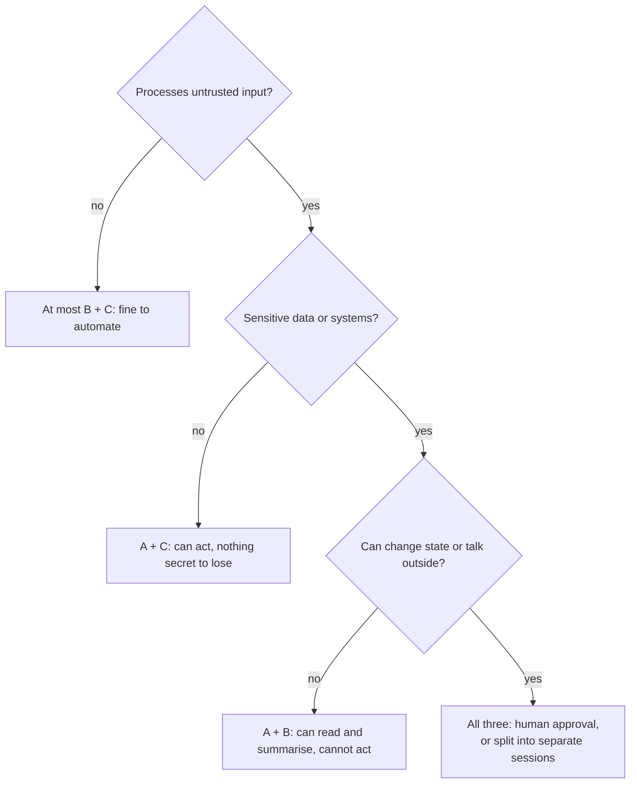

# The Lethal Trifecta: The Complete Guide

> 📚 **Before you start**
>
> - [Direct and Indirect Prompt Injection](direct-and-indirect-prompt-injection.md), for how outside text reaches an agent and the idea of an exfiltration channel.
> - [Why Agents Change the Security Picture](why-agents-change-the-security-picture.md), for the tool inventory (`reads_untrusted`, `touches_private`, `sends_out`) we reuse here.

## Introduction

A bank locker room has three things a thief needs: the lockers (the valuables), a way in for strangers (the public lobby), and a way out with the goods (the door to the street). Banks don't rely only on spotting thieves in the lobby. They make sure the three are never joined: strangers in the lobby can't reach the lockers, and nobody leaves the locker room without a guard checking them.

In June 2025, Simon Willison gave the same idea a name for AI agents: **the lethal trifecta**. If an agent combines **access to private data**, **exposure to untrusted content** and **the ability to communicate externally**, then an attacker who can get text in front of it may be able to make it send your data out. The previous lesson showed that we can't reliably stop the model from being influenced. This lesson gives you a simple test that tells you *when* that influence becomes a data-theft risk, and three ways to remove it.

By the end you will be able to spot the trifecta in any agent design, including ones assembled from several MCP servers, check for it automatically in code, apply Meta's related "Rule of Two", and choose which leg to break for a given product.

> 💡 **Key Insight**
>
> Data theft through an agent needs all three legs in the same session: **private data**, **untrusted content** and **a way out**. You don't have to detect the attack if you **make sure the three never meet**. Remove one leg, or split the work so no single context holds all three, and that class of attack has nowhere to go.

---

## Core Explanation

### 1. The three legs


*The danger is the combination, not any single tool. Break one leg and the theft path is gone.*

| Leg | Plain meaning | Munshi examples |
|---|---|---|
| **Private data** | Anything you don't want a stranger to see | The inbox, the ledger, customer phone numbers, API keys in files |
| **Untrusted content** | Text or images that someone outside your control could have written | Supplier emails, web pages, PDFs, public GitHub issues |
| **External communication** | Any way for data to reach someone outside | `send_email`, `fetch_page` (the URL itself carries data), images the UI auto-loads, posting a comment, opening a public PR |

Why all three? The untrusted content supplies the *instruction*, the private data supplies the *loot*, and the external channel supplies the *getaway*. Take away any one and the theft fails:

- No private data: the attacker can steer the agent, but there's nothing worth stealing.
- No untrusted content: nobody outside can give the agent instructions.
- No way out: the agent may read your secrets and be steered, but it can't deliver them.

### 2. Finding the trifecta in a tool list

The inventory from the first lesson already contains the three properties, so the check is mechanical:

```python
from dataclasses import dataclass

@dataclass(frozen=True)
class Tool:
    name: str
    reads_untrusted: bool
    touches_private: bool
    sends_out: bool

def trifecta(tools):
    legs = {
        "untrusted content": sorted(t.name for t in tools if t.reads_untrusted),
        "private data": sorted(t.name for t in tools if t.touches_private),
        "way out": sorted(t.name for t in tools if t.sends_out),
    }
    return all(legs.values()), legs

munshi = [
    Tool("read_inbox", reads_untrusted=True,  touches_private=True,  sends_out=False),
    Tool("read_ledger", reads_untrusted=False, touches_private=True, sends_out=False),
    Tool("fetch_page", reads_untrusted=True,  touches_private=False, sends_out=True),
    Tool("send_email", reads_untrusted=False, touches_private=False, sends_out=True),
]

danger, legs = trifecta(munshi)
print("lethal trifecta present:", danger)
for leg, names in legs.items():
    print(f"  {leg:<18} {names}")
```

Output:

```
lethal trifecta present: True
  untrusted content  ['fetch_page', 'read_inbox']
  private data       ['read_inbox', 'read_ledger']
  way out            ['fetch_page', 'send_email']
```

Notice that `read_inbox` sits in **two** legs at once: an inbox is private *and* full of text from strangers. Email, chat and ticket tools are the most common reason real assistants have the trifecta from the moment they're switched on.

### 3. How MCP makes this easy to build by accident

You'll study the Model Context Protocol in its own course ([Model Context Protocol (MCP)](../../model-context-protocol-mcp/course.md)). For now you only need to know that MCP lets a user plug many tool servers into one agent: a mail server, a file server, a browser server, a GitHub server. Each server may be perfectly safe on its own. Combined in one session, they can complete the trifecta.

```python
servers = {
    "mail-server":    [Tool("list_messages", True, True, False)],
    "files-server":   [Tool("read_file", False, True, False)],
    "browser-server": [Tool("open_url", True, False, True)],
    "notes-server":   [Tool("save_note", False, False, False)],
}

def check_combo(names):
    tools = [t for n in names for t in servers[n]]
    danger, _ = trifecta(tools)
    return "TRIFECTA" if danger else "ok"

for combo in [["mail-server", "notes-server"],
              ["files-server", "browser-server"],
              ["mail-server", "browser-server"],
              ["files-server", "notes-server"]]:
    print(f"{' + '.join(combo):<32} {check_combo(combo)}")
```

Output:

```
mail-server + notes-server       ok
files-server + browser-server    TRIFECTA
mail-server + browser-server     TRIFECTA
files-server + notes-server      ok
```

`files-server + browser-server` is a trifecta even though neither server alone is: the browser brings untrusted pages *and* a way out, and the file server brings secrets. That's why Willison stresses that **vendors can't protect users who mix tools themselves**. Whoever assembles the combination owns the risk. A good agent host warns users when they enable a combination that completes the trifecta.

Single servers can complete it alone too. In the May 2025 GitHub MCP case, one server gave the agent public issues (untrusted), private repositories (private) and the ability to open pull requests on a public repository (a way out).

### 4. The trifecta is about sessions, not just tools

What matters is whether all three legs end up **in the same context**. A tool list that has all three is a risk, but the actual danger arises when, in one run, the model has *read* untrusted content and private data and then gets to call a sending tool.

That gives you a dynamic defence: track what has entered the session, and tighten permissions as it changes. This is sometimes called **taint tracking**. Once untrusted content is in the context, the session is "tainted", and certain tools are switched off for the rest of it.

```python
class Session:
    def __init__(self, tools):
        self.tools = {t.name: t for t in tools}
        self.saw_untrusted = False
        self.saw_private = False

    def call(self, name):
        t = self.tools[name]
        if t.sends_out and self.saw_untrusted and self.saw_private:
            return f"BLOCKED {name}: session holds untrusted content and private data"
        self.saw_untrusted |= t.reads_untrusted
        self.saw_private |= t.touches_private
        return f"ran     {name}"

s = Session(munshi)
for step in ["read_ledger", "send_email", "read_inbox", "send_email", "fetch_page"]:
    print(s.call(step))
```

Output:

```
ran     read_ledger
ran     send_email
ran     read_inbox
BLOCKED send_email: session holds untrusted content and private data
BLOCKED fetch_page: session holds untrusted content and private data
```

The first `send_email` is allowed, because at that point nothing untrusted had been read. After `read_inbox`, both legs are in the context, so every outward channel closes. A real system would not just refuse: it would route the action to a human for approval (Module 4), or end the session and start a fresh one with a clean context.

### 5. Meta's Rule of Two

In October 2025, Meta published a closely related rule for agent designers, the **Agents Rule of Two**. Until injection can be reliably detected, an agent should satisfy **no more than two** of these in one session:

- **[A]** it processes untrustworthy inputs,
- **[B]** it has access to sensitive systems or private data,
- **[C]** it can change state or communicate externally.

If a task truly needs all three, the agent shouldn't run autonomously: it needs supervision such as human approval, or it should start a new session with a fresh context.

| | Lethal trifecta (Willison) | Rule of Two (Meta) |
|---|---|---|
| **Main worry** | Data theft (confidentiality) | Data theft **and** harmful actions |
| **Third leg** | Communicate externally | Change state **or** communicate externally |
| **Advice** | Never combine all three | At most two per session; all three needs supervision |

The Rule of Two's third leg is broader. "Change state" covers paying a bill or deleting a file, actions that hurt you even if no data leaves. An agent that reads untrusted emails and can pay UPI bills has [A] and [C] already. Add access to the bank balance and it has all three.



### 6. Three ways to break the trifecta, with trade-offs

| Break this leg | How | Cost to the product |
|---|---|---|
| **Private data** | Use a separate "reader" agent with no access to secrets to handle untrusted content; pass only a narrow, checked result back | More moving parts; the reader can still be fooled into a wrong result |
| **Untrusted content** | Only let the agent read content from trusted authors (your own docs, an allowlist of senders) | Loses many useful tasks; "trusted" sources often contain outside text |
| **Way out** | Block network egress except to an allowlist, never auto-load images or links from unknown domains, require approval for every send | Some friction; the most common fix vendors apply after incidents |

Closing the way out has been the most common real fix. After researchers showed leaks through image links in chat products, vendors typically stopped auto-loading images from arbitrary domains or restricted which domains could be loaded. Watch out for allowlisted domains that let anyone host content. EchoLeak got past a domain allowlist by going through trusted Microsoft domains.

Splitting the agent is the most flexible approach and is exactly the **dual LLM** and **map-reduce** patterns from the previous lesson: the part of the system that reads untrusted text has no secrets and no way out, and the part that has secrets and tools never reads the untrusted text directly.

```python
def quarantined_reader(email_text):
    """No tools, no secrets. May be fooled, but can only return a narrow, validated record."""
    # In a real system this is a model call with a strict output schema.
    words = email_text.split()
    amount = next((words[i + 1] for i, w in enumerate(words[:-1])
                   if w == "Rs" and words[i + 1].replace(",", "").isdigit()), None)
    return {"has_amount": amount is not None,
            "amount_rs": int(amount.replace(",", "")) if amount else None}

def validate(record):
    ok = isinstance(record.get("amount_rs"), int) and 0 < record["amount_rs"] < 1_000_000
    return record if ok else None

untrusted_email = "Invoice 44 for Rs 18,400 [plus whatever else the sender chose to write]"
record = validate(quarantined_reader(untrusted_email))
print("privileged side receives:", record)
```

Output:

```
privileged side receives: {'has_amount': True, 'amount_rs': 18400}
```

Whatever the email says, the privileged side only ever receives a number within a sane range. Instructions can't travel through an integer.

---

## Try It Yourself

1. **Audit a design.** A "travel assistant" can read your calendar (private), search the web for hotels (untrusted, and the search query goes out), and book with your saved card. List which legs of the trifecta and of the Rule of Two it has.
2. **Fix it two ways.** For the travel assistant, describe one fix that breaks the "private data" leg and one that breaks the "way out" leg. Which would you ship?
3. **Extend `Session`.** Change `Session.call` so that, instead of returning `BLOCKED`, it returns `NEEDS APPROVAL` for `send_email` and `BLOCKED` for every other sending tool.

<details>
<summary>Show answers</summary>

**1.** Trifecta: private data (calendar), untrusted content (web pages) and a way out (the search query itself, plus booking). Rule of Two: [A] untrusted web content, [B] calendar and saved card, [C] booking changes state and spends money. All three, so it shouldn't run unsupervised.

**2.** Private data: let a web-search sub-agent with *no* calendar access find hotels from just the city and dates you choose to give it, returning a short structured list. Way out: allow searches only through a fixed hotel API (no free URL fetching), and make the booking step a human-approved action. In practice you'd ship both. Booking with a card should always need approval.

**3.**

```python
class ApprovalSession(Session):
    def call(self, name):
        t = self.tools[name]
        if t.sends_out and self.saw_untrusted and self.saw_private:
            verdict = "NEEDS APPROVAL" if name == "send_email" else "BLOCKED"
            return f"{verdict} {name}"
        return super().call(name)

s = ApprovalSession(munshi)
for step in ["read_inbox", "send_email", "fetch_page"]:
    print(s.call(step))
```

Output:

```
ran     read_inbox
NEEDS APPROVAL send_email
BLOCKED fetch_page
```

`read_inbox` alone completes two legs, so both sending tools are caught right after it.

</details>

---

## Real-World Examples

- **Chat products leaking through images and links (2023 to 2025).** Willison's list of affected products includes ChatGPT, Google Bard, Microsoft Copilot, Slack, GitHub Copilot Chat, Amazon Q, Google NotebookLM and others. Most were fixed by **closing the way out**, for example by not loading images from arbitrary domains.
- **GitHub MCP server (May 2025).** One server held all three legs: public issues, private repositories and the ability to publish. The researchers recommended restricting a session to a single repository, which breaks the private-data leg for that session.
- **Claude Code on the web.** Sessions run in a cloud sandbox whose network goes through a proxy with an allowlist, and git credentials stay outside the sandbox. This narrows the way out even when the agent reads untrusted code (covered in [Sandboxing Files and Network](../../agent-security-and-safety/course.md#m4)).

---

## Common Misconceptions

### "We sanitise the untrusted content, so we don't have that leg"

Sanitising (removing hidden text, spotlighting) lowers the risk but doesn't make content trusted. Treat the leg as present unless the content was written by you or the user.

### "Our agent has no 'send' tool, so there's no way out"

A URL fetch, a rendered image, a link the user might click, a file in a shared folder or a public PR are all ways out. Count every channel that crosses your boundary.

### "The trifecta only matters for big companies"

It matters for anyone who connects an assistant to their own email or files. Personal agents with a browser and an inbox are a textbook trifecta.

### "Approval for every send fixes it completely"

It helps a lot, but people approve almost everything when prompts are frequent (Module 4 covers approval fatigue). Approval works best together with breaking a leg, not instead of it.

---

## Interview Relevance

*"What is the lethal trifecta?"* Private data, exposure to untrusted content and external communication in one agent. Prompt injection supplies the instruction, private data the loot, and external communication the exit. Give examples of hidden exits (URLs, auto-loaded images, public PRs), explain why MCP tool mixing creates the trifecta by accident, and give the fixes: split into a quarantined reader and a privileged actor, restrict egress and rendering, gate sends with approval, or taint-track the session.

*"How does Meta's Rule of Two differ?"* Its third property also covers changing state, so it addresses harmful actions as well as leaks, and it says an agent needing all three should be supervised or restarted with a fresh context.

---

## Key Takeaways

- **Three legs**: private data, untrusted content and a way out. Data theft needs all three in one session.
- **Inboxes and browsers are double legs**: an inbox is private *and* untrusted, and a browser is untrusted *and* a way out.
- **Combinations create the risk**: tools and MCP servers that are safe alone can complete the trifecta together.
- **Track the session**: once untrusted content and private data are in context, close or gate every outward channel.
- **Break a leg by design**: quarantined readers, egress allowlists, no auto-loaded links, approval for sends. Apply the Rule of Two for harmful actions too.

---

**Up next:** [OWASP LLM Top 10 and Agentic Top 10](owasp-llm-top-10-and-agentic-top-10.md)
