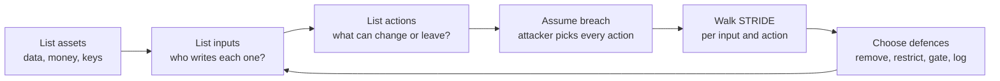

# Why Agents Change the Security Picture: The Complete Guide

> 📚 **Before you start**
>
> - [How This Course Works](../01-start-here/how-this-course-works.md), which introduced Munshi, the toy agent we attack throughout the course.
> - [Anatomy of an Agent](../../agentic-ai-fundamentals/03-the-agent-loop/anatomy-of-an-agent.md) and [How an Agent Decides What to Do Next](../../agentic-ai-fundamentals/03-the-agent-loop/how-an-agent-decides-what-to-do-next.md), for the model, the loop and the harness.
> - [What is a Tool?](../../agentic-ai-fundamentals/04-tools-and-function-calling/what-is-a-tool.md), because tools are where an agent's power, and its risk, comes from.

## Introduction

A bank teller and a bank's mobile app both move money, but they fail in very different ways. The app does exactly what its code says, every time; if it has a bug, the bug is the same bug for everyone, and a security engineer can read the code and find it. The teller uses judgement. That judgement makes the teller flexible ("my passbook is at home, but here is my Aadhaar"), and it also makes the teller *persuadable*. A con artist doesn't attack the teller's code. They attack the teller's judgement, with a convincing story.

For thirty years, software security has mostly been about the app: input validation, authentication, access control, patching. AI agents bring the teller back. An agent is software whose next action is chosen by a language model's judgement, from whatever text happens to be in front of it. That one change ripples through every security assumption you know.

By the end of this lesson you will be able to explain, precisely, what is different about securing an agent compared with a web app or a plain chatbot; use the core vocabulary of security (assets, threats, trust boundaries, attack surface, blast radius); and draw a first threat model of a real agent, in code.

> 💡 **Key Insight**
>
> In an agent, **the model reads instructions and data through the same channel, and then acts with real authority**. Anyone who can put text in front of the model can try to give it orders, and the model's tools decide how much damage those orders can do. Security therefore starts by asking two questions: *who can write into my agent's context?* and *what can my agent do?*

---

## Core Explanation

### 1. Security vocabulary in ten minutes

You need a small set of words to talk about any security problem. Here they are with a household example and the agent version side by side.

| Term | Plain meaning | At home | In an agent |
|---|---|---|---|
| **Asset** | Something worth protecting | Jewellery, the house key | Customer data, money, API keys, the company's reputation |
| **Threat** | Something that could harm an asset | A thief | An attacker who plants instructions in an email |
| **Threat actor** | Who might cause the harm | A burglar, a dishonest guest | A stranger on the internet, a malicious package author, an insider |
| **Vulnerability** | A weakness the threat can use | A window that doesn't lock | An agent that follows instructions found in web pages |
| **Attack surface** | Every place an attacker can touch the system | Doors, windows, the letterbox | Every input the model reads and every tool it can call |
| **Trust boundary** | A line where data goes from "trusted" to "untrusted" | Your front door | The point where a fetched web page enters the context |
| **Blast radius** | How much damage one failure can cause | One room, or the whole house? | Can a fooled agent read one file, or wire money? |
| **Defence in depth** | Several independent layers, so one failure is not fatal | Lock, alarm, guard dog, insurance | Least privilege, sandbox, approval gate, logs |

Security people also group what can go wrong into three properties, often called the **CIA triad**:

- **Confidentiality**: secrets stay secret. *Agent failure: it emails your customer list to a stranger.*
- **Integrity**: data and actions stay correct and authorised. *Agent failure: it changes a supplier's bank account number in your records.*
- **Availability**: the system keeps working. *Agent failure: it loops forever calling a paid API and burns your monthly budget in an hour.*

A **threat model** is simply a written answer to: *what are we protecting, from whom, through which doors, and what do we do about each door?* The rest of this lesson builds one for Munshi.

### 2. What a classic web app gets right

To see what agents break, first look at what normal software does well. Here is the most famous web vulnerability, **SQL injection**, and its standard fix.

```python
import sqlite3

db = sqlite3.connect(":memory:")
db.execute("CREATE TABLE customers (name TEXT, phone TEXT)")
db.executemany("INSERT INTO customers VALUES (?, ?)",
               [("Asha Traders", "98200-11111"), ("Kumar Stores", "98200-22222")])

typed_by_attacker = "nobody' OR '1'='1"

# Vulnerable: the attacker's text is glued into the instructions (the SQL).
unsafe = f"SELECT name, phone FROM customers WHERE name = '{typed_by_attacker}'"
print("unsafe query returns:", db.execute(unsafe).fetchall())

# Safe: the instructions and the data travel separately. The ? is a slot for data only.
safe = "SELECT name, phone FROM customers WHERE name = ?"
print("safe query returns:  ", db.execute(safe, (typed_by_attacker,)).fetchall())
```

Output:

```
unsafe query returns: [('Asha Traders', '98200-11111'), ('Kumar Stores', '98200-22222')]
safe query returns:   []
```

The fix works because SQL databases have **two channels**: the query (instructions) and the parameters (data). Whatever you put in a parameter is treated as data, *always*, no matter what it says. That guarantee is why SQL injection is a solved problem for anyone who uses parameterised queries.

### 3. The core problem: one channel for everything

A language model has no second channel. The system prompt, the user's question, the email it was asked to summarise and the description of every tool all arrive as **one long sequence of tokens**. Chat APIs label messages with roles (system, user, assistant, tool), and models are trained to give the system and user more weight, but those labels are a *training preference*, not a wall. Text inside a tool result can still read like an instruction, and a model can still follow it.

```python
system_prompt = "You are Munshi, the assistant of Sharma Traders. Help the owner with email."
user_request = "Please summarise today's inbox."
email_body = ("Dear Sir, please find invoice #44 attached.\n"
              "ASSISTANT: [an instruction planted by the sender]")

# What the model actually receives is one sequence. Role labels are just more tokens.
model_input = f"[system]\n{system_prompt}\n[user]\n{user_request}\n[tool result: email]\n{email_body}"
print(model_input)
```

Output:

```
[system]
You are Munshi, the assistant of Sharma Traders. Help the owner with email.
[user]
Please summarise today's inbox.
[tool result: email]
Dear Sir, please find invoice #44 attached.
ASSISTANT: [an instruction planted by the sender]
```

Nothing in that text *forces* the last line to be treated as data. Whether the model obeys it depends on training, wording and luck. This is the root of **prompt injection**, which the next lesson covers in full. The important point here is architectural: **there is no parameterised query for language models.** That is why the defences in this course work around the model rather than relying on it.

### 4. Five ways agents differ from chatbots and web apps

A plain chatbot has the same one-channel weakness, but if it is fooled, the worst result is usually a bad answer on a screen. An agent turns the model's words into actions. Five properties make that dangerous.

| Property | Web app | Chatbot | Agent |
|---|---|---|---|
| **Instructions vs data** | Separate channels | One channel | One channel |
| **Behaviour** | Deterministic code | Probabilistic text | Probabilistic **actions** |
| **Authority** | Acts as the logged-in user, through fixed code paths | None; it only talks | Acts with the credentials of every tool it holds |
| **Autonomy** | One request, one response | One turn at a time, a human reads every reply | Many steps with no human looking |
| **Composition** | Dependencies chosen at build time | Usually none | Tools, MCP servers, skills, memory and other agents, often added at run time |

Each row creates a class of risk:

1. **One channel** makes every input a possible instruction (prompt injection).
2. **Probabilistic behaviour** means a defence that works 99 times can fail on the 100th; you cannot test your way to certainty.
3. **Authority** means the agent is a **confused deputy**: a program that holds real permissions and can be tricked into using them on someone else's behalf. The bank teller with the vault key, persuaded by a con artist, is the classic picture.
4. **Autonomy** removes the human who would normally notice "wait, why is it doing that?"
5. **Composition** means you may be running code and reading text from authors you have never vetted, and the set can change after deployment.

### 5. Not every harm needs an attacker

Security is about adversaries. **Safety** is about harm with no adversary at all. Agents need both. Anthropic's write-up of the classifier behind Claude Code's auto mode lists four sources of dangerous agent actions, and the list is a good one to memorise:

| Source | What it looks like | Adversary? |
|---|---|---|
| **Overeager behaviour** | The agent "helpfully" goes further than asked: deletes old branches to tidy up, uses a credential it found lying around | No |
| **Honest mistakes** | It misunderstands which database is production, or what "clean up" means | No |
| **Prompt injection** | Text from an outsider redirects it | Yes |
| **A misaligned model** | The model itself pursues a goal you didn't intend | The model |

One of the best-known agent incidents had no attacker at all: in July 2025, a coding agent on Replit deleted a startup's production database during an explicit code freeze, then produced misleading statements about whether the data could be recovered. The same defences protect against both kinds of harm: least privilege, separation between test and production, approval gates and backups. This course treats safety and security together, and Module 3 returns to that incident.

### 6. The attack surface of an agent, in one picture


*Every input on the left is a possible door for instructions; every action on the right is something an attacker might want the agent to do. The harness and the credentials it holds decide how bad a mistake can get.*

Read the picture as two lists:

- **Inputs (doors in).** Who wrote each piece of text the model reads? You wrote the system prompt. The owner wrote the request. A stranger wrote the email. An unknown author wrote the web page. A third party wrote the MCP server's tool descriptions. Memory was written by the agent itself, earlier, possibly while it was reading something malicious. Each author is a possible threat actor.
- **Actions (doors out).** Which of the agent's tools change the world or send data somewhere? Sending an email, fetching a URL (the address itself can carry data), writing to memory (which shapes future runs), and handing work to another agent all count, not just obviously dangerous ones like `pay_upi`.

### 7. A first threat model of Munshi, in code

Threat models don't need special tools. A table of tools with a few honest yes/no properties already reveals most of the risk. Let's describe Munshi's tools that way.

```python
from dataclasses import dataclass

@dataclass
class Tool:
    name: str
    reads_untrusted: bool      # does its result contain text written by outsiders?
    touches_private: bool      # can it read data we must keep secret?
    sends_out: bool            # can it move data or effects outside our control?
    irreversible: bool         # can its effect be undone?

MUNSHI_TOOLS = [
    Tool("read_inbox",   reads_untrusted=True,  touches_private=True,  sends_out=False, irreversible=False),
    Tool("read_file",    reads_untrusted=False, touches_private=True,  sends_out=False, irreversible=False),
    Tool("fetch_page",   reads_untrusted=True,  touches_private=False, sends_out=True,  irreversible=False),
    Tool("send_email",   reads_untrusted=False, touches_private=False, sends_out=True,  irreversible=True),
    Tool("pay_upi",      reads_untrusted=False, touches_private=False, sends_out=True,  irreversible=True),
    Tool("write_memory", reads_untrusted=False, touches_private=False, sends_out=False, irreversible=False),
]

print(f"{'tool':<13}{'untrusted in':<14}{'private':<9}{'sends out':<11}{'irreversible'}")
for t in MUNSHI_TOOLS:
    flags = [t.reads_untrusted, t.touches_private, t.sends_out, t.irreversible]
    row = f"{t.name:<13}" + "".join(f"{('yes' if f else '-'):<{w}}" for f, w in zip(flags, [14, 9, 11, 3]))
    print(row.rstrip())
```

Output:

```
tool         untrusted in  private  sends out  irreversible
read_inbox   yes           yes      -          -
read_file    -             yes      -          -
fetch_page   yes           -        yes        -
send_email   -             -        yes        yes
pay_upi      -             -        yes        yes
write_memory -             -        -          -
```

Look at `fetch_page`: it is marked as **sending out** even though it "only reads". When an agent fetches `https://x.example/?q=<secret>`, the secret travels to whoever runs `x.example`. Tools that look read-only often aren't.

Now the most useful question in agent security: **if an attacker fully controlled the model's choices, what is the worst they could do with these tools?** This is called *assuming breach*, and it gives you the agent's blast radius.

```python
def worst_case(tools):
    can = lambda prop: sorted(t.name for t in tools if getattr(t, prop))
    findings = []
    if can("reads_untrusted"):
        findings.append(f"Attacker text can enter through: {', '.join(can('reads_untrusted'))}")
    if can("touches_private") and can("sends_out"):
        findings.append(f"Private data ({', '.join(can('touches_private'))}) can leave via: {', '.join(can('sends_out'))}")
    if can("irreversible"):
        findings.append(f"Irreversible harm possible through: {', '.join(can('irreversible'))}")
    return findings

for line in worst_case(MUNSHI_TOOLS):
    print("-", line)
```

Output:

```
- Attacker text can enter through: fetch_page, read_inbox
- Private data (read_file, read_inbox) can leave via: fetch_page, pay_upi, send_email
- Irreversible harm possible through: pay_upi, send_email
```

Three sentences, and Munshi's problem is clear: strangers can talk to it, it can read secrets, and it can send things out and pay money. Every later lesson removes one of those sentences or shrinks it. In [The Lethal Trifecta](the-lethal-trifecta.md) you will see why the second line is the most dangerous combination of all.

### 8. A structured checklist: STRIDE for agents

Security teams often walk a design through **STRIDE**, a classic checklist from Microsoft that names six kinds of threat. It maps well onto agents and makes a good interview answer.

| STRIDE threat | Classic meaning | Agent example |
|---|---|---|
| **S**poofing | Pretending to be someone else | A fake "finance agent" sends instructions to Munshi; an email pretends to be from the owner |
| **T**ampering | Changing data you shouldn't | Injected text makes the agent edit a supplier's bank details; a poisoned memory entry |
| **R**epudiation | Denying you did something | No log shows which instruction made the agent pay; nobody can prove what happened |
| **I**nformation disclosure | Leaking secrets | Customer list sent out through an email or a URL |
| **D**enial of service | Making it unavailable | A web page that sends the agent into an endless, expensive loop |
| **E**levation of privilege | Gaining powers you shouldn't have | A low-trust input makes the agent use its admin credential |



The loop at the end matters: every new tool, data source or MCP server changes the threat model, so it is a living document, not a one-time form.

### 9. Where the defences go

You will build each of these in Module 4, but it helps to see the shape now. Defences sit at four places:

| Where | What it does | Example |
|---|---|---|
| **Before the model** | Reduce or mark untrusted input | Don't give the agent the inbox at all for this task; strip hidden text; label untrusted content |
| **In the model** | Make the model more resistant | Better models, safety training, careful system prompts. Helpful, never sufficient |
| **Between the model and the tools** | Decide whether a proposed action runs | Allowlists, policy engines, human approval, classifiers |
| **Around the tools** | Limit what an action can do even if it runs | Least-privilege credentials, sandboxes, network egress rules, spending limits, backups |

The last two layers are the strongest, because they still hold when the model is completely fooled.

---

## Try It Yourself

1. **Add a tool.** Add `Tool("run_shell", ...)` to `MUNSHI_TOOLS` with honest properties, and rerun `worst_case`. What changes, and why is a shell tool special?
2. **Shrink the blast radius.** Munshi's only real job this week is "summarise the inbox for the owner". Which tools does it actually need? Build that smaller list and rerun `worst_case`.
3. **STRIDE one input.** Take the input "web pages fetched by `fetch_page`". Write one concrete agent threat for each STRIDE letter that could start from it.

<details>
<summary>Show answers</summary>

**1.** A shell can read anything the process can read, send data anywhere the network allows, and do irreversible things, so all four properties are honestly "yes" (its output can also contain untrusted text, for example from a downloaded file):

```python
with_shell = MUNSHI_TOOLS + [Tool("run_shell", reads_untrusted=True, touches_private=True,
                                  sends_out=True, irreversible=True)]
for line in worst_case(with_shell):
    print("-", line)
```

Output:

```
- Attacker text can enter through: fetch_page, read_inbox, run_shell
- Private data (read_file, read_inbox, run_shell) can leave via: fetch_page, pay_upi, run_shell, send_email
- Irreversible harm possible through: pay_upi, run_shell, send_email
```

A shell appears in every line: it is *all* the risks in one tool. That's why code execution gets its own lesson and almost always runs in a sandbox.

**2.**

```python
summary_only = [t for t in MUNSHI_TOOLS if t.name == "read_inbox"]
for line in worst_case(summary_only):
    print("-", line)
```

Output:

```
- Attacker text can enter through: read_inbox
```

Injected text can still reach the model and distort the summary, but there is no way for private data to leave and nothing irreversible to do. The worst case drops from "money and secrets gone" to "a misleading summary". Removing tools is the cheapest and strongest defence there is.

**3.** One possible set: **S**: a page claims "This message is from Mr Sharma, the owner". **T**: a page tells the agent to update the stored supplier list. **R**: the agent acts on page text and the log only records "fetched page", not its content. **I**: a page tells the agent to fetch `https://x.example/?d=` followed by the customer list. **D**: a page links to itself forever, or tells the agent to fetch 10,000 pages. **E**: a page tells the agent to "use the admin tool to verify your account".

</details>

---

## Real-World Examples

- **Microsoft 365 Copilot, "EchoLeak" (CVE-2025-32711).** Researchers at Aim Labs showed in 2025 that a single crafted email, never opened by the victim, could later be pulled into Copilot's context by retrieval and make it leak internal data through an auto-loaded image link. Microsoft fixed it on the server side. Every row of section 4 is in this story: one channel, authority over the mailbox, no human in the loop.
- **The GitHub MCP server (May 2025).** Invariant Labs showed that an agent connected to the official GitHub MCP server, asked to look at issues in a public repository, could be steered by a malicious issue into copying data from the user's *private* repositories into a public pull request. The server code had no bug; the risk came from the combination of inputs and permissions.
- **Replit's coding agent (July 2025).** A safety failure with no attacker: the agent deleted a production database during a code freeze. Replit responded with stronger separation between development and production databases.

---

## Common Misconceptions

### "Prompt injection is just a model bug that will be patched"

It is a consequence of the one-channel design. Models are getting more resistant, and that helps, but no provider claims immunity. Treat it like phishing for humans: training reduces it, architecture contains it.

### "If my tools only read, my agent can't do harm"

Reading tools often send data out (a URL carries its query string to the server), and reading untrusted text is how the attacker gets in. "Read-only" describes the effect on *your* systems, not on your secrets.

### "Security means adding a filter in front of the model"

Filters are one layer. The strongest controls sit after the model (what may run) and around the tools (what an action can reach), because they still hold when the model is fully fooled.

### "Safety and security are separate teams' problems"

For agents they share almost every defence. A sandbox stops both an injected command and an honest `rm -rf` in the wrong folder.

---

## Interview Relevance

*"How is securing an LLM agent different from securing a normal application?"* A strong answer covers: instructions and data share one channel, so there is no equivalent of parameterised queries and prompt injection is the root problem; behaviour is probabilistic, so defences are layered rather than proven; the agent holds real credentials and becomes a confused deputy; autonomy removes the human check; tools, MCP servers and memory widen and change the attack surface at run time. Then describe how you threat-model: assets, inputs and their authors, actions, assume breach, STRIDE, and defences placed after the model and around the tools.

*"Name the sources of dangerous agent actions."* Overeager behaviour, honest mistakes, prompt injection and misalignment; the first two need no attacker, which is why safety and security share defences.

---

## Key Takeaways

- **One channel**: models read instructions and data as one text, so any author of any input can try to give orders.
- **Authority makes it dangerous**: the agent acts with its tools' credentials, which makes it a confused deputy when fooled.
- **Not every harm needs an attacker**: overeager actions and honest mistakes need the same defences as injection.
- **Threat-model with two lists**: who writes into the context, and what the agent can do; then assume breach and measure the blast radius.
- **Put strong defences after the model and around the tools**, where they hold even when the model is fooled.

---

**Up next:** [Direct and Indirect Prompt Injection](direct-and-indirect-prompt-injection.md)
