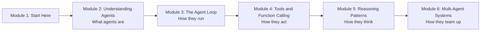

# How This Course Works

## Introduction

A year ago, "AI" in most products meant a chat box. You typed a question, you got an answer, and the rest was up to you. Today the most interesting AI products don't just answer. They **do**: they book the meeting, fix the bug, file the expense report, research the competitor and write up what they found. Those products are built on **AI agents**, and this course teaches you exactly how they work.

This first article is short. It tells you what you will learn, how the lessons are built, what you should know before starting, and how to get the most out of the course.

> 💡 **Key Insight**
>
> You will build an agent **by hand, from scratch, before you touch any framework**. Frameworks change every few months. The ideas underneath them (the loop, tools, planning, memory) do not. Learn the ideas once and every framework becomes easy to read.

---

## What You Will Learn

By the end of this course you will be able to:

- **Explain what an AI agent is** in one sentence, and how it differs from a chatbot, a traditional "agent" from older AI, and generative AI in general.
- **Write the agent loop yourself**: the decide, act, observe cycle that every agent framework is built around.
- **Give an agent tools** using function calling, and design tools that a model can use reliably.
- **Choose between a workflow and an agent**, and explain the trade-off in an interview.
- **Use the classic reasoning patterns**: ReAct, planning, and reflection.
- **Understand multi-agent systems** and the framework landscape well enough to pick the right tool for a project.

### The course at a glance

Each module builds on the one before it. Module 2 gives you the vocabulary. Module 3 gives you the engine. Module 4 connects the engine to the real world. Module 5 makes it smarter. Module 6 zooms out to systems of many agents and the tools people use to build them.

---

## How Every Lesson Is Built

Every article on this platform follows the same shape, so you always know where to look:

| Section | What it gives you |
|---|---|
| **Before you start** | Links to the earlier lessons this one depends on. If a term is unfamiliar, follow the link. |
| **Introduction** | Why the topic matters, using products you already know. |
| **Key Insight** | The one idea to remember if you remember nothing else. |
| **Core Explanation** | The topic, step by step, with analogies, diagrams and runnable code. |
| **Try It Yourself** | Small changes to make to the code, with expected results hidden in a fold. |
| **Real-World Examples** | How real products and companies use the idea. |
| **Common Misconceptions** | The mistakes almost everyone makes, corrected. |
| **Interview Relevance** | What interviewers ask about this topic and what a strong answer covers. |
| **Key Takeaways** | A one-minute summary to review later. |

**Labs** are different. A lab is a guided build: you start from an empty file and finish with something that works. Labs are where the ideas stick, so please don't skip them.

---

## What You Need Before Starting

You do **not** need a machine learning background. You do need:

- **Basic Python.** Functions, lists, dictionaries, loops and `if` statements. If any of those feel shaky, work through [Python Fundamentals](../../python-programming/course.md) first.
- **A rough idea of what a large language model (LLM) is.** You should know that it takes text in and produces text out, one token at a time. [Generative AI and LLM Foundations](../../generative-ai-and-llm-foundations/course.md) covers this properly.
- **Python 3.10 or newer** installed on your computer, and a code editor such as VS Code.

### Do I need an API key?

Not for most of this course. The early lessons use a **pretend model**, a normal Python function that returns the same kind of answer a real LLM would. This lets you see every moving part with no cost, no sign-up and no surprises. When a lesson uses a real model, it says so at the top and shows you how to set up the key safely.

---

## How to Get the Most Out of It

1. **Type the code, don't paste it.** Typing forces you to read every line. It is slower, and that is the point.
2. **Predict before you run.** Before running any example, say out loud what you think it will print. When you're wrong, you've found something worth understanding.
3. **Do the Try It Yourself exercises.** They're designed to break things in instructive ways.
4. **Use the "Before you start" links.** If something feels confusing, it's usually because a building block is missing. Go back, fill the gap, come forward again.
5. **Mark lessons complete.** The button at the bottom of each lesson saves your progress in your browser, and the course page shows how far you've got.

---

## Common Misconceptions

### Misconception 1: "I need to learn a framework like LangChain or LangGraph first"

The opposite. If you start with a framework, you learn its vocabulary without understanding what it does for you. Then the first time something breaks, you're stuck. This course builds every piece by hand first. The [LangGraph Fundamentals](../../langgraph-complete-guide/course.md) course comes after this one for exactly that reason.

### Misconception 2: "Agents are only for experts"

An agent is a loop, a model and some functions. If you can write a `for` loop and call a function, you can build one. You'll do it in the very next module.

### Misconception 3: "This is all hype that will be gone next year"

The products built on agents (coding assistants, research tools, customer-support systems that actually resolve tickets) are already in daily use. The names of frameworks will change. The core ideas you learn here won't.

---

## Key Takeaways

- This course teaches AI agents **from first principles**, building everything by hand before using frameworks.
- Every article follows the same template, so you always know where to find the definition, the code, the examples and the interview angle.
- You need basic Python and a rough idea of what an LLM is. No API key is needed for most lessons.
- Type the code, predict the output, and do the exercises.

---

**Up next:** [What is an AI Agent?](../02-understanding-agents/what-is-an-ai-agent.md)
