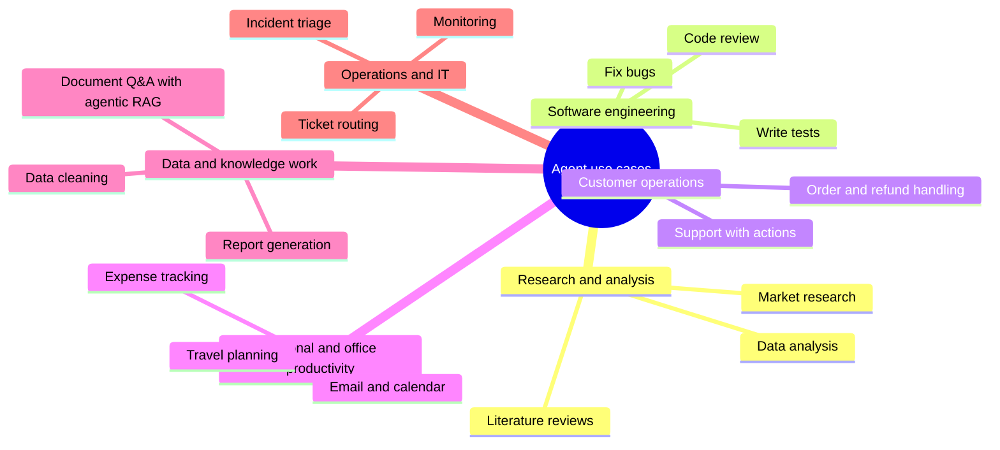

# Agentic AI Use Cases: The Complete Guide

> 📚 **Before you start**
>
> - [What is an AI Agent?](what-is-an-ai-agent.md), for the definition of an agent.
> - [Agentic AI vs Generative AI](agentic-ai-vs-generative-ai.md), for what agents add on top of a chatbot.

## Introduction

Once people understand what an agent is, the next question is always *"What can I actually use one for?"* The honest answer is: fewer things than the hype suggests, but more valuable things than most people expect.

Agents shine on tasks that need **several steps**, **real data or real actions**, and **decisions that depend on what happens along the way**. They're a poor fit for tasks a single prompt or a fixed script already handles well.

This lesson walks through the main families of use cases, with a concrete example of each, what makes it a good fit for an agent, and what can go wrong. It finishes with a simple scoring method you can use to judge any idea, and you'll find the same ideas built step by step in the rest of this course and the projects track.

> 💡 **Key Insight**
>
> A good agent use case has three ingredients: the **path isn't known in advance** (so a fixed workflow won't do), the agent can **check its work against reality** (tools, tests, data), and **mistakes are catchable or reversible** (review, approval, undo). Missing any one of these makes an agent risky or unnecessary.

---

## Core Explanation

### 1. The families of use cases



Let's look at each family.

### 2. Research and analysis

**Example:** *"Compare the five largest EV two-wheeler makers in India by sales, funding and charging network, and write a two-page summary with sources."*

**Why an agent fits:** the agent doesn't know in advance which searches will work; it reads results, notices gaps ("no funding data for company 4"), searches again, and only then writes. A fixed pipeline can't adapt like that.

**Typical tools:** web search, page reader, calculator or code runner, document writer.

**What can go wrong:** unreliable sources, made-up citations, endless searching. Mitigate with source requirements, a step budget and a review step.

You'll build this in the [Multi-Agent Research System capstone](../../multi-agent-research-system-capstone/course.md).

### 3. Software engineering

**Example:** *"The checkout test is failing after yesterday's change. Find out why and fix it."*

**Why an agent fits:** debugging is exploratory (read files, run tests, form a theory, try a fix), and **tests give an objective check**. This is why coding agents are among the most successful agent products.

**Typical tools:** read file, search code, edit file, run tests, run shell commands.

**What can go wrong:** risky commands, changes that pass tests but break something else. Mitigate with sandboxes, approval for destructive commands and human code review.

### 4. Customer operations

**Example:** *"My order arrived damaged, I want a replacement."* The agent looks up the order, checks the return policy, creates a replacement order and emails the confirmation.

**Why an agent fits:** each conversation takes a different path depending on the order, policy and customer's answers, and the agent can **act**, not just answer.

**Typical tools:** order lookup, policy search, create replacement, issue refund, send email.

**What can go wrong:** refunds or promises the business didn't authorise. Mitigate with limits enforced inside tools and human approval above a threshold (see [Designing Good Tools](../04-tools-and-function-calling/designing-good-tools.md)).

### 5. Personal and office productivity

**Example:** *"Find a 30-minute slot next week when Priya, Arjun and I are all free, book it, and send an agenda."*

**Why an agent fits:** it must check several calendars, handle conflicts, and take actions across tools.

**Typical tools:** calendar read/write, email, contacts, documents.

**What can go wrong:** sending emails or invites the user didn't want. Mitigate with a "draft, then confirm" step.

You'll build a small version, an expense assistant, in the [tool-using agent lab](../04-tools-and-function-calling/lab-tool-using-agent-from-scratch.md), and an expense-tracker MCP server in the [MCP course](../../model-context-protocol-mcp/course.md).

### 6. Data and knowledge work

**Example:** *"Using our HR policy documents, answer employee questions, and say which document and section each answer comes from."*

**Why an agent fits (sometimes):** simple questions need only plain RAG (retrieve then answer). Agentic retrieval helps when questions are vague or multi-part, because the agent can rephrase the search, check whether results are relevant, and search again.

**Typical tools:** retriever over a vector database, document reader, maybe SQL for structured data.

**What can go wrong:** confident answers from irrelevant passages. Mitigate with relevance checks and citations. → [Agentic RAG Systems](../../agentic-rag-systems/course.md)

### 7. Operations and IT

**Example:** *"An alert says checkout latency doubled. Investigate and summarise the likely cause for the on-call engineer."*

**Why an agent fits:** investigation follows the evidence: check dashboards, recent deployments, error logs, then narrow down.

**Typical tools:** metrics queries, log search, deployment history, ticketing.

**What can go wrong:** an agent "fixing" production on its own. Mitigate by keeping it **read-only** and letting humans act on its findings.

### 8. Where agents are the wrong tool

Not everything needs an agent. Use something simpler when:

| Situation | Better choice |
|---|---|
| One question, one answer, no outside data | A single LLM call |
| Same steps every time (e.g. summarise each new invoice) | A fixed workflow / chain |
| Exact rules decide the outcome (tax calculation) | Regular code |
| Errors are costly and can't be checked or undone | Human process, maybe with AI suggestions |
| Answers must be instant and cheap at huge volume | A smaller model or classic ML |

The [Workflows vs Agents](../03-the-agent-loop/workflows-vs-agents.md) lesson goes deeper into this decision.

### 9. Scoring a use case

Here's a simple way to score an idea on the three ingredients from the Key Insight, plus value. Score each from 0 to 2:

- **Open-ended path**: does the sequence of steps depend on what's found along the way?
- **Checkable**: can the agent verify its work with tools, tests or data?
- **Recoverable**: are mistakes cheap, reviewable or reversible?
- **Valuable**: does it save meaningful time or money?

```python
def score_use_case(name, open_ended, checkable, recoverable, valuable):
    total = open_ended + checkable + recoverable + valuable
    if open_ended == 0:
        verdict = "use a workflow, not an agent"
    elif recoverable == 0:
        verdict = "too risky without human approval"
    elif total >= 6:
        verdict = "strong agent candidate"
    else:
        verdict = "possible, start small"
    return f"{name:<32} {total}/8  {verdict}"

ideas = [
    ("Fix failing tests", 2, 2, 2, 2),
    ("Summarise each new invoice", 0, 1, 2, 1),
    ("Approve loans automatically", 1, 1, 0, 2),
    ("Plan a team offsite", 2, 1, 2, 1),
    ("Answer HR policy questions", 1, 1, 1, 1),
]
for idea in ideas:
    print(score_use_case(*idea))
```

Output:

```
Fix failing tests                8/8  strong agent candidate
Summarise each new invoice       4/8  use a workflow, not an agent
Approve loans automatically      4/8  too risky without human approval
Plan a team offsite              6/8  strong agent candidate
Answer HR policy questions       4/8  possible, start small
```

It's a rough tool, but it forces the right conversation before anyone writes code.

---

## Try It Yourself

1. **Score three ideas.** Use `score_use_case` for: (a) an agent that books your train tickets; (b) translating every product description on a website; (c) an agent that triages incoming support tickets into categories and drafts replies for human review.
2. **Find the ingredient.** For "an agent that trades shares with your money", which of the three ingredients is weakest, and how could you redesign the use case to make it safer?
3. **Your idea.** Write down one agent you'd like to build. Which tools would it need, which actions need approval, and how would it check its own work?

<details>
<summary>Show answers</summary>

**1.**

```python
print(score_use_case("Book train tickets", 2, 1, 1, 1))
print(score_use_case("Translate product descriptions", 0, 1, 2, 2))
print(score_use_case("Triage tickets and draft replies", 1, 1, 2, 2))
```

Output:

```
Book train tickets               5/8  possible, start small
Translate product descriptions   5/8  use a workflow, not an agent
Triage tickets and draft replies 6/8  strong agent candidate
```

Your exact scores may differ; the point is the reasoning. Booking needs payment approval; translation is the same step for every item; triage with human review is recoverable and valuable.

**2.** **Recoverable** is weakest: trades lose real money instantly. Redesign it as a research assistant that **recommends** trades with reasoning and sources, and let a human place them (or require approval with strict limits).

**3.** Example: a study-planner agent with tools to read your timetable and syllabus, create calendar blocks (approval needed), and check progress against a test score you enter.

</details>

---

## Real-World Examples

- **Coding assistants** that open pull requests are one of the most widely adopted agent products, because tests make their work checkable.
- **Deep research** features in AI assistants run dozens of searches and produce cited reports.
- **Support platforms** let agents resolve common requests end to end (order status, simple refunds) and hand complex ones to humans.
- **IT operations tools** use agents to gather evidence during incidents and summarise it for engineers.

---

## Common Misconceptions

### "Agents can replace whole jobs"

Agents take over **tasks** within jobs, usually the multi-step, tool-heavy, checkable ones. People still set goals, handle exceptions and own decisions.

### "Every chatbot should become an agent"

If it only answers questions from a fixed knowledge base, a RAG chatbot is simpler, cheaper and more predictable.

### "If it works in a demo, it works in production"

Demos show the happy path. Production needs limits, approvals, monitoring and evaluation on realistic tasks.

---

## Interview Relevance

*"Give an example of a good use case for an AI agent, and a bad one."* A strong answer uses the three ingredients: a good case (fixing failing tests: open-ended, checkable with tests, reversible with code review) and a bad case (fully automated loan approval: high-stakes and hard to reverse; better as decision support with human approval).

*"How would you decide whether to build an agent or a workflow?"* If the steps are known in advance, build a workflow; if the path depends on intermediate results, consider an agent, provided its work can be checked and its mistakes caught.

---

## Key Takeaways

- Agents fit tasks with an **open-ended path**, **checkable results** and **recoverable mistakes**.
- Main families: **research**, **software engineering**, **customer operations**, **productivity**, **knowledge work**, **IT operations**.
- Every use case needs **guardrails** matched to its risks: limits, approvals, read-only modes, review.
- Use a **single call, workflow or plain code** when they're enough.
- Score ideas before building; start small.

---

**Up next:** [The Agent Loop: Decide, Act, Observe](../03-the-agent-loop/the-agent-loop-decide-act-observe.md)
