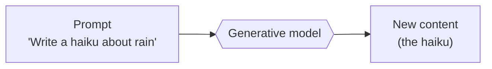
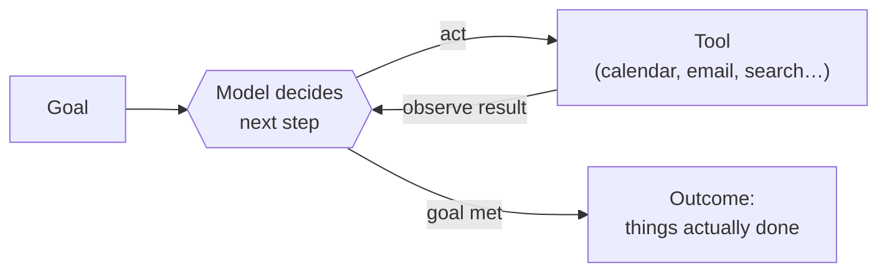
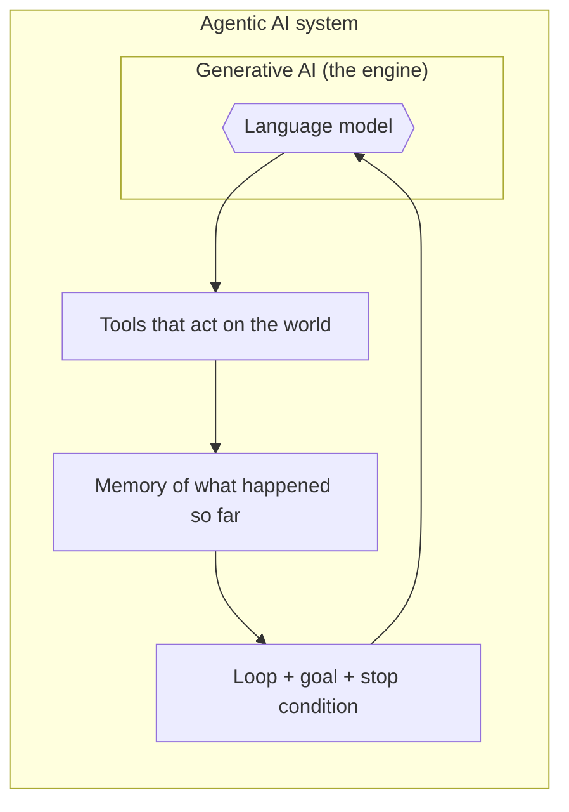
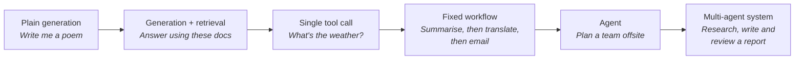

# Agentic AI vs Generative AI: The Complete Guide

> 📚 **Before you start**
>
> - [What is an AI Agent?](what-is-an-ai-agent.md), for the definition of an agent and the agent loop.
> - [Agentic AI vs Traditional AI Agents](agentic-ai-vs-traditional-ai-agents.md), for why LLMs changed what agents can do.
> - It helps to know what generative AI is. [Generative AI and LLM Foundations](../../generative-ai-and-llm-foundations/course.md) covers it in depth.

## Introduction

Ask an AI chat app to *"write a polite email declining a meeting"* and it writes one in two seconds. Impressive. Now ask it to *"decline every meeting on my calendar next Friday, politely, and suggest a new time for each based on my free slots"*, and a plain chat app is stuck. It can write the words, but it can't open your calendar, can't check your free slots, and can't send anything.

The first request is **generative AI**: produce content. The second needs **agentic AI**: pursue a goal by taking actions. The two terms get used interchangeably in news articles and product launches, which causes a lot of confusion. They are related, they often run on the same model, but they are not the same thing.

This article makes the difference precise. By the end, you'll be able to define both, see how one is built on top of the other, recognise which one a product is actually using, and explain the distinction cleanly in an interview.

> 💡 **Key Insight**
>
> **Generative AI creates content. Agentic AI achieves goals.** Agentic AI almost always *uses* generative AI as its brain, but adds a loop, tools and the authority to act. Think of generative AI as an engine and agentic AI as the whole car.

---

## Core Explanation

### What is generative AI?

**Generative AI** is any AI system that **produces new content**: text, images, audio, video or code. It learns the patterns in huge amounts of existing data and generates new examples that follow those patterns.

- **Text:** ChatGPT, Claude and Gemini write essays, summaries, code and answers.
- **Images:** Midjourney and DALL·E create pictures from descriptions.
- **Audio:** text-to-speech and music-generation models.
- **Video:** models that turn a text prompt into a short clip.

The shape of every generative AI interaction is the same: **input in, content out, done.**



The model doesn't remember the haiku after it writes it (unless the app stores it), doesn't check whether it's good, and doesn't do anything else with it. Every call is a single, self-contained act of creation.

### What is agentic AI?

**Agentic AI** is a system that **pursues a goal over multiple steps**, deciding for itself which actions to take, using tools to take them, and adjusting based on what happens. You met the core loop in [What is an AI Agent?](what-is-an-ai-agent.md):



The output of agentic AI isn't just content. It's **a changed state of the world**: a meeting moved, a file fixed, a refund issued, a report researched and saved.

### How they relate: one is built on the other

Here's the part most explanations miss. In modern systems, **agentic AI is built out of generative AI**. On every pass through the loop, the agent asks a generative model to *generate* something: usually a decision, written as text or structured data, such as *"call the calendar tool with date = Friday"*.

So an agent is a generative model used in a particular way:

1. **Repeatedly**, not once.
2. With **tools**, so its generated decisions can be carried out.
3. With **feedback**, so each new generation sees the results of the last action.
4. With **a goal**, so it knows when to stop.



*Generative AI is a component. Agentic AI is a system that uses it.*

### Side-by-side comparison

| | Generative AI | Agentic AI |
|---|---|---|
| **Core job** | Create content | Accomplish a goal |
| **Shape** | One request, one response | A loop of many steps |
| **Output** | Text, image, audio, code | Actions taken plus a report of what was done |
| **Who decides the steps** | The human, one prompt at a time | The system, between steps |
| **Uses tools** | Not necessarily | Yes, that's how it acts |
| **Sees results of its own output** | No | Yes, and adapts to them |
| **Main risk** | Wrong or made-up content (hallucination) | Wrong *actions*, which can have real consequences |
| **Typical cost and speed** | One model call, seconds | Many model calls, seconds to hours |
| **Example** | "Write a cover letter for this job." | "Find five relevant jobs, tailor my CV to each, and save drafts." |

### The same model, two modes

To make this concrete, here's one pretend model used both ways. First generatively: one prompt, one piece of content. Then agentically: in a loop, with tools.

```python
# A pretend language model. A real one would be an API call; this one returns
# canned text so the example runs anywhere without a key.
def pretend_model(prompt):
    if prompt.startswith("WRITE:"):
        return "Hi Priya, thanks for the invite. I can't make Friday's sync, could we move it to Monday?"
    if "calendar result" not in prompt:
        return "ACTION: read_calendar(Friday)"
    if "sent" not in prompt:
        return "ACTION: send_email(Priya, Moving Friday's sync to Monday)"
    return "DONE: Declined Friday's sync with Priya and proposed Monday."


# 1) Generative use: one prompt in, one piece of content out.
draft = pretend_model("WRITE: a polite email declining Friday's sync with Priya")
print("Generative output:\n ", draft)

# 2) Agentic use: the same model in a loop, with tools it can ask for.
def read_calendar(day):
    return f"calendar result: {day} 10:00 sync with Priya"

def send_email(arg):
    return f"sent email: {arg}"

tools = {"read_calendar": read_calendar, "send_email": send_email}

def run_agent(goal, max_steps=5):
    transcript = f"GOAL: {goal}"
    for _ in range(max_steps):
        reply = pretend_model(transcript)
        if reply.startswith("DONE:"):
            return reply
        name, arg = reply.removeprefix("ACTION: ").rstrip(")").split("(", 1)
        result = tools[name](arg)
        print(f"  {name}({arg}) -> {result}")
        transcript += f"\n{result}"
    return "Stopped: too many steps."

print("Agentic run:")
print(" ", run_agent("Decline my Friday meetings politely and suggest a new time"))
```

Output:

```
Generative output:
  Hi Priya, thanks for the invite. I can't make Friday's sync, could we move it to Monday?
Agentic run:
  read_calendar(Friday) -> calendar result: Friday 10:00 sync with Priya
  send_email(Priya, Moving Friday's sync to Monday) -> sent email: Priya, Moving Friday's sync to Monday
  DONE: Declined Friday's sync with Priya and proposed Monday.
```

Look at what changed between the two uses. **The model function is identical.** In the generative case you got a draft and the work stopped there. In the agentic case, the same kind of text generation was used to *choose actions*, the actions were carried out, and their results were fed back in. That's the whole difference.

### The spectrum in between

Real products don't fall neatly into two boxes. It helps to think of a spectrum of how much the system decides for itself:



Moving right, the system takes on more of the decision-making, more steps and more ability to act. Moving left, it becomes simpler, cheaper and more predictable. You'll study the [Workflows vs Agents](../03-the-agent-loop/workflows-vs-agents.md) trade-off in detail in the next module.

### Try It Yourself

Paste the code above into a file and run it. Then:

1. Change `max_steps` to `2`. What does the agent return, and why?
2. Add a third tool, `book_room(day)`, that returns `"booked: {day} room 4B"`. Change `pretend_model` so that after sending the email (but before `DONE`) it books a room for Monday.
3. In the generative case, the model wrote "could we move it to Monday?" without knowing your calendar. In the agentic case, which step gave it real information? Why does this make agents less likely to make things up about the real world?

<details>
<summary>What you should see</summary>

1. `Stopped: too many steps.` The agent needs three model calls (two actions and one `DONE`), so two steps aren't enough. Step limits protect against runaway loops, but they can also cut off a legitimate task.
2. Add a check such as `if "booked" not in prompt: return "ACTION: book_room(Monday)"` just before the final `DONE` line. The run now shows three tool calls.
3. The `read_calendar` step. Agents ground their decisions in real tool results instead of guessing, which is one of the biggest practical advantages of agentic systems.

</details>

---

## Real-World Examples

### Example 1: Writing code

**Generative:** you paste a function into a chat window and ask for a version with error handling. You get code back, then copy, paste, run and fix it yourself.

**Agentic:** coding agents such as GitHub Copilot's agent mode, Cursor's agent or Claude Code read your repository, edit several files, run the tests, read the failures, fix them, and stop when the tests pass. The model generating code is similar; the loop, the tools (file editor, terminal) and the feedback (test results) make it agentic.

### Example 2: Travel planning

**Generative:** *"Suggest a 3-day itinerary for Jaipur."* You get a nicely formatted plan and still have to check opening hours, book tickets and find hotels.

**Agentic:** a travel agent system checks live flight prices, compares hotels within your budget, verifies attraction opening hours for your dates, and either books or prepares everything for one-click confirmation.

### Example 3: Marketing content

**Generative:** a tool writes ten product descriptions from a spreadsheet of features.

**Agentic:** a system that writes the descriptions, checks each one against the brand style guide, rewrites the ones that fail, uploads the approved ones to the online store, and reports which products still need images. Notice it **evaluates its own output**, a hallmark of agentic systems.

---

## Common Misconceptions

### Misconception 1: "Agentic AI is the next version of generative AI that will replace it"

Agentic AI is built **on top of** generative AI, not instead of it. Every agent is powered by a generative model. Better generative models make better agents.

### Misconception 2: "ChatGPT is an agent"

A plain chat conversation is generative: one prompt, one response. Chat products become agentic when they're allowed to run tools in a loop, for example when they browse the web over several steps, run code to analyse a file and fix their own errors, or complete a task in a browser. The same product can work in both modes.

### Misconception 3: "Agentic AI doesn't hallucinate"

It can still produce wrong decisions. The difference is that agents can **check their work against reality** with tools (reading the actual calendar, running the actual tests), which catches many errors. But a wrong action can also do more damage than a wrong sentence, which is why agents need guardrails, permissions and human approval for risky steps.

### Misconception 4: "If it's generative, it's simple; if it's agentic, it's smart"

Many problems are best solved with a single, well-crafted generative call. Adding a loop and tools adds cost, latency and new ways to fail. "More agentic" is not automatically "better".

---

## Interview Relevance

This is a very common screening question for AI engineering roles. A strong answer:

- **Defines both crisply.** Generative AI produces content in response to a prompt. Agentic AI pursues a goal over multiple steps, choosing and taking actions with tools and adapting to results.
- **Explains the relationship.** Agents use generative models as their reasoning engine, so agentic is a system design built on generative capability.
- **Names the trade-offs.** Agents are more capable for open-ended tasks, but slower, costlier and riskier because they act on the world.
- **Gives a concrete example** of the same task done both ways, like the calendar example above.

Common follow-ups:

- *"Is RAG agentic?"* Plain RAG (retrieve documents, then generate an answer) is a fixed pipeline, so it's generative AI with retrieval. It becomes **agentic RAG** when the model decides whether, what and how many times to retrieve. You'll study this in [Agentic RAG Systems](../../agentic-rag-systems/course.md).
- *"What new risks does agentic AI introduce?"* Real-world side effects from wrong actions, prompt injection through tool results, runaway loops and costs, and the need for permissions and audit trails.

---

## Key Takeaways

- **Generative AI** creates content: one input, one output, done.
- **Agentic AI** achieves goals: a loop of deciding, acting with tools and observing results until done.
- Agentic AI is **built on** generative AI. The same model can be used in both ways.
- Agents can ground their decisions in real tool results, but wrong *actions* carry more risk than wrong *words*.
- There's a spectrum between the two. Choose the least autonomy that solves the problem.

---

**Up next:** [Agentic AI Use Cases](agentic-ai-use-cases.md)
