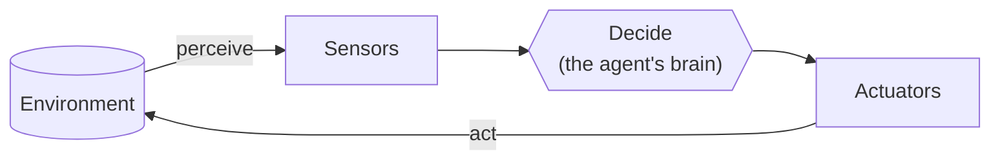
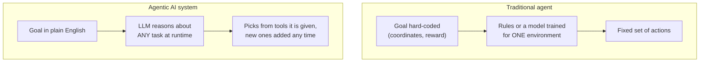

# Agentic AI vs Traditional AI Agents: The Complete Guide

> 📚 **Before you start**
>
> Read [What is an AI Agent?](what-is-an-ai-agent.md) first. This article builds directly on its definition of an agent and the agent loop.

## Introduction

The thermostat on your wall is an agent. So is the ghost chasing Pac-Man, the robot vacuum bumping around your living room, and the spam filter that quietly moved a phishing email out of your inbox this morning. Computer scientists have been building "agents" since the 1980s.

So why does everyone suddenly talk about **agentic AI** as if it were brand new?

Because something genuinely changed. Older agents were brilliant at one narrow job and helpless outside it. The new generation, built on large language models, can take a goal written in plain English, work out the steps themselves, pick the right tools, and adapt when something unexpected happens. Same word, very different capability.

This article explains exactly what changed. By the end, you will know what a "traditional" AI agent is, the main types that came before LLMs, what makes an agent "agentic" in the modern sense, and how to explain the difference clearly in an interview.

> 💡 **Key Insight**
>
> Traditional agents **follow logic a human wrote** for one narrow environment. Agentic AI systems **use a language model to work out the logic themselves**, at runtime, for goals they were never explicitly programmed for. The loop is the same. Who writes the decision-making is what changed.

---

## Core Explanation

### What "agent" has always meant

Long before ChatGPT, the classic AI textbook definition (from Russell and Norvig's *Artificial Intelligence: A Modern Approach*) was:

> An agent is anything that **perceives its environment** through sensors and **acts upon that environment** through actuators.

That definition is so broad it includes almost anything. A thermostat **perceives** temperature (sensor) and **acts** by switching the heating on or off (actuator). A chess program perceives the board and acts by moving a piece.

Notice that this is the same **perceive → decide → act** loop you saw in the previous lesson. The loop is not new. What sits in the "decide" box is what has changed.



*Every agent, old or new, runs this loop. The question is what's inside "Decide".*

### The five classic types of traditional agent

Textbooks group traditional agents into five types, from simplest to most sophisticated. Each one adds a capability the previous one lacks.

#### 1. Simple reflex agents

These follow **if-this-then-that rules** based only on what they see right now. They have no memory and no plan.

- **Example:** A thermostat. *If temperature < 20°C, turn heating on.*
- **Strength:** Fast, predictable, cheap.
- **Weakness:** Can't handle anything the rules didn't anticipate. A thermostat doesn't know you've opened a window.

```python
def thermostat(temperature):
    if temperature < 20:
        return "heating_on"
    return "heating_off"
```

#### 2. Model-based reflex agents

These keep an **internal model of the world**, a memory of things they can't currently see.

- **Example:** A robot vacuum that remembers which rooms it has already cleaned.
- **Strength:** Can act sensibly even when it can't see everything.
- **Weakness:** The model of the world is designed by engineers, room by room, sensor by sensor.

#### 3. Goal-based agents

These have an explicit **goal** and choose actions that move them toward it, often by searching through possible sequences of moves.

- **Example:** A GPS navigation app. The goal is your destination; it searches the road network for a route.
- **Strength:** Can find multi-step solutions.
- **Weakness:** The goal must be defined precisely in the system's own terms (a map coordinate), not in everyday language.

#### 4. Utility-based agents

These go beyond "reach the goal" to "reach it **in the best way**", using a score (utility) to compare options.

- **Example:** Uber's matching system choosing the driver that minimises total waiting time across all riders, not just the closest driver for you.
- **Strength:** Makes good trade-offs.
- **Weakness:** Someone has to write down the utility function, which is often the hardest part.

#### 5. Learning agents

These **improve with experience**, adjusting their behaviour based on feedback.

- **Example:** AlphaGo, which learned to play Go by playing millions of games against itself. Or a spam filter that gets better as users mark emails.
- **Strength:** Can exceed human-written rules.
- **Weakness:** Learns **one task**. AlphaGo cannot play chess, let alone book a flight.

> 💡 **Key Insight**
>
> Every traditional agent type is **narrow**. Its perception, goals and actions are hard-wired to one environment. Moving it to a new task means rebuilding it.

### What changed: the language model as the decision-maker

An **agentic AI system** keeps the same loop but puts a **large language model** in the "decide" box. That single change unlocks four capabilities traditional agents never had:

1. **Goals in plain language.** You don't encode the goal as coordinates or a reward function. You write *"Find three competitors' pricing pages and summarise how they differ."* The model interprets it.
2. **General-purpose reasoning.** The same model can plan a trip, debug code and draft a contract. It isn't trained for one environment.
3. **Tool use on the fly.** Give it a list of tools with descriptions, and it decides which to use and with what inputs. Add a new tool and it can start using it immediately, with no retraining.
4. **Adapting mid-task.** When a tool fails or returns something surprising, the model can read the error message and try a different approach, just as a person would.



### A side-by-side comparison

| | Traditional AI agent | Agentic AI system |
|---|---|---|
| **Decision-maker** | Hand-written rules, search algorithms, or a model trained for one task | A general-purpose large language model |
| **How the goal is given** | Precisely, in the system's own format | In natural language |
| **Scope** | One narrow environment | Many different tasks |
| **New capability** | Requires re-engineering or retraining | Add a tool and describe it |
| **Handling surprises** | Only if anticipated by its designers | Can read errors and re-plan |
| **Predictability** | Very high | Lower, and must be managed |
| **Cost per decision** | Tiny | Much higher (an LLM call) |
| **Explaining its choices** | Rules are inspectable | Can explain in words, but explanations aren't guaranteed to be faithful |

### What did *not* change

It's tempting to think agentic AI replaced everything that came before. It didn't, for two reasons.

**First, the old ideas live on inside new agents.** When a modern agent keeps a running summary of what it has done so far, that's a **model-based** idea. When it scores several draft answers and picks the best, that's **utility-based**. When it's improved with feedback from users, that's a **learning agent**. The vocabulary is decades old and still useful.

**Second, traditional agents are still the right choice for many jobs.** Your thermostat does not need a language model. Neither does a fraud check that runs ten thousand times a second. When the environment is narrow and well understood, rules and specialised models are faster, cheaper and more reliable.

### A tiny example of both, side by side

Here's the same task, *"keep the room comfortable"*, done both ways. The agentic version uses a pretend model so you can run it without an API key.

```python
# Traditional: a simple reflex agent. The logic is written by a human, in advance.
def traditional_thermostat(reading):
    if reading["temperature"] < 20:
        return "heating_on"
    if reading["temperature"] > 26:
        return "cooling_on"
    return "do_nothing"


# Agentic: the decision is delegated to a model that reads the whole situation.
# A real system would send this text to an LLM; we fake the answer with a few rules
# that mimic how a language model would reason about the extra context.
def pretend_llm(prompt):
    if "window is open" in prompt and "heating" in prompt:
        return "close_window_reminder"
    if "nobody home" in prompt:
        return "eco_mode"
    return "heating_on" if "18" in prompt else "do_nothing"


def agentic_thermostat(reading):
    prompt = (
        "You control a home's climate. Keep it comfortable and avoid wasting energy.\n"
        f"Temperature: {reading['temperature']}°C. Notes: {reading['notes']}\n"
        "Options: heating_on, cooling_on, eco_mode, close_window_reminder, do_nothing. "
        "Consider heating first."
    )
    return pretend_llm(prompt)


readings = [
    {"temperature": 18, "notes": "family watching TV"},
    {"temperature": 18, "notes": "the living room window is open"},
    {"temperature": 18, "notes": "nobody home until 6pm"},
]
for r in readings:
    print(f"{r['notes']:<35} traditional={traditional_thermostat(r):<12} agentic={agentic_thermostat(r)}")
```

Output:

```
family watching TV                  traditional=heating_on   agentic=heating_on
the living room window is open      traditional=heating_on   agentic=close_window_reminder
nobody home until 6pm               traditional=heating_on   agentic=eco_mode
```

The traditional agent can only see temperature, because that's all its designer gave it. The agentic version can take **any** extra context written in plain words into account. Of course, our pretend model only knows three phrases; a real LLM could handle notes it has never seen before, which is the whole point.

### Try It Yourself

1. Add a fourth reading: `{"temperature": 28, "notes": "heatwave, grandma is visiting"}`. What does each agent do? Is either answer good?
2. Change `traditional_thermostat` so it also handles the open-window case. How many `if` statements would you need to cover every situation a household might describe?
3. Our `pretend_llm` returns `heating_on` whenever it sees "18". Change the first reading to 17°C and run it again. What does this tell you about the difference between a real LLM and hand-written rules pretending to be one?

<details>
<summary>What you should see</summary>

1. Traditional returns `cooling_on`. The pretend agentic version returns `do_nothing`, because our fake model only knows three phrases. A real LLM would probably choose cooling and maybe flag that an older visitor makes it more important.
2. You'd need a new rule for every situation, forever. This is the core limitation of traditional agents: someone has to anticipate every case in advance.
3. The pretend model now returns `do_nothing` for a cold room. Our fake "LLM" is just rules, and rules break as soon as reality differs from what their author imagined. That's precisely the gap real language models fill.

</details>

---

## Real-World Examples

### Example 1: Game AI vs a game-playing LLM agent

The ghosts in Pac-Man (1980) are simple reflex agents with a few lines of logic each: Blinky chases you directly, Pinky aims a few tiles ahead of you. They feel clever because their designers tuned the rules carefully. Researchers have since built LLM agents that play Minecraft, such as NVIDIA's *Voyager* project, which writes its own code for new skills, stores them in a library, and reuses them later. Nobody wrote "how to build a pickaxe" rules. The agent worked it out.

### Example 2: Customer support

A traditional support bot is a decision tree: *"Press 1 for billing. Press 2 for delivery."* It fails the moment a customer's problem doesn't fit a branch. An agentic support system reads the customer's message, looks up their order with a tool, checks the refund policy, and either resolves the issue or hands off to a human with a summary. Companies such as Klarna have publicly reported AI assistants handling a large share of their support conversations this way.

### Example 3: Robotics

Industrial robot arms are traditional agents: superb at repeating one precise motion. Research systems such as Google DeepMind's work on robots driven by language models let people give instructions like *"pick up the snack that's healthiest"*, and the model works out what that means and which motions to use. The arm's low-level controllers are still traditional; the language model sits on top, deciding *what* to do.

---

## Common Misconceptions

### Misconception 1: "Agentic AI is a completely new idea"

The perceive-decide-act loop and the word "agent" date back decades. What's new is using a general-purpose language model as the decision-maker, which makes agents flexible enough for open-ended, real-world tasks.

### Misconception 2: "Traditional agents are obsolete"

They're everywhere and they're often the better choice: thermostats, game AI, trading systems, recommendation ranking. When a task is narrow, fast and high-volume, a specialised agent beats an LLM on cost, speed and reliability.

### Misconception 3: "An agentic system learns as it goes, like a learning agent"

Usually not. Most agentic systems use a model whose weights are **frozen**. They can remember things within a task (or store notes in a database), but the model itself doesn't learn from each conversation. That's a crucial difference from the textbook "learning agent".

### Misconception 4: "If it uses an LLM, it's agentic"

A chatbot that answers questions uses an LLM but isn't agentic. A system becomes agentic when the model **chooses actions in a loop** and those actions affect the world: calling tools, changing files, sending messages.

---

## Interview Relevance

Interviewers like this question because it checks whether you understand agents beyond the hype. A strong answer covers:

- **The classic definition:** perceive the environment, decide, act. Mention the five textbook types briefly (simple reflex, model-based, goal-based, utility-based, learning).
- **The key shift:** the decision-maker moved from hand-written logic or task-specific models to a general-purpose LLM, enabling natural-language goals, flexible tool use and re-planning.
- **Trade-offs:** agentic systems are more flexible but slower, costlier and less predictable. Traditional agents remain the right choice for narrow, high-volume tasks.
- **Hybrid reality:** many production systems combine both, with an LLM deciding *what* to do and traditional components executing *how*.

Common follow-ups:

- *"Is a recommendation system an agent?"* Under the classic definition, yes: it perceives user behaviour and acts by choosing what to show. It's a utility-based (and often learning) agent, but not an agentic LLM system.
- *"When would you choose a rules-based agent over an LLM agent?"* When the task is narrow, needs millisecond latency or very high throughput, must be fully auditable, or when mistakes are very costly and the rules are well understood.

---

## Key Takeaways

- An **agent** has always meant something that perceives its environment and acts on it, in a loop.
- **Traditional agents** come in five classic types: simple reflex, model-based, goal-based, utility-based and learning. All are **narrow**.
- **Agentic AI** puts a **large language model** in the decision-making seat, enabling plain-language goals, general reasoning, flexible tool use and adapting mid-task.
- Old ideas live on inside new agents, and traditional agents are still the right choice for narrow, fast, high-volume jobs.
- Agentic is about **choosing actions in a loop**, not just using an LLM.

---

**Up next:** [Agentic AI vs Generative AI](agentic-ai-vs-generative-ai.md)
