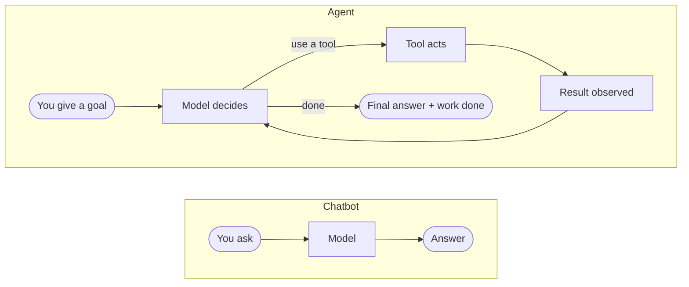
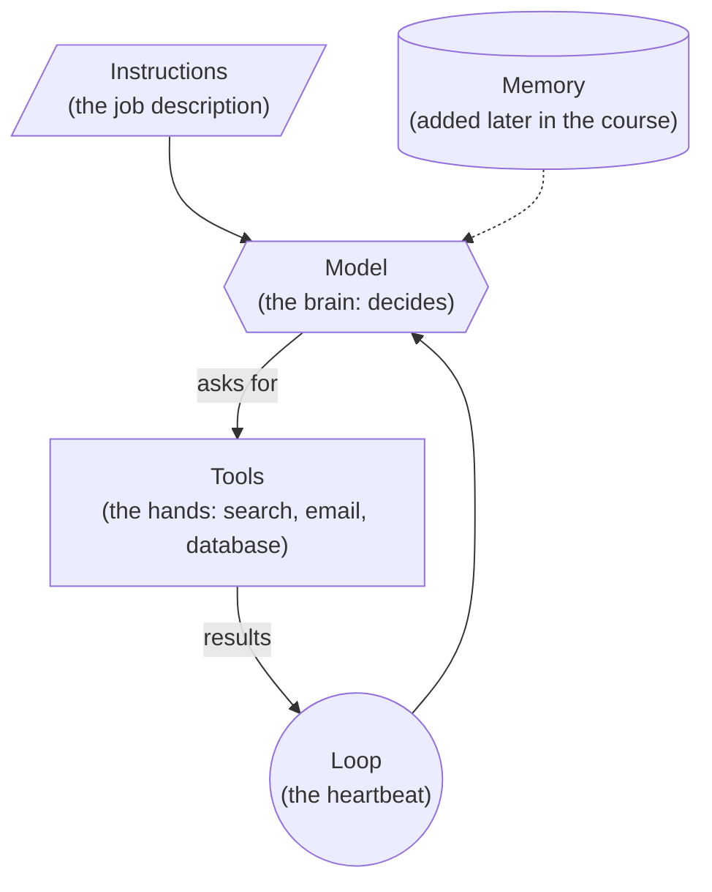

# What is an AI Agent? The Complete Guide

> 📚 **Before you start**
>
> This article assumes you know what a large language model is and roughly how it produces text. If not, read these first:
> - [How LLMs Work](../../generative-ai-and-llm-foundations/course.md#m3) (Generative AI and LLM Foundations)
> - [Functions and Iterators](../../python-programming/course.md#m6) (Python Fundamentals), for the code in this article

## Introduction

Every time a coding assistant fixes a bug across five files on its own, every time a support bot actually cancels your order instead of telling you how to, every time a research tool reads twenty web pages and hands you a cited summary, an AI agent did the work.

"Agent" is one of the most used words in technology right now, and also one of the most confusing. Ask ten people what an AI agent is and you will hear ten answers. Some will say "it's ChatGPT with plugins." Others will say "it's an AI that works on its own." Some will think it is a completely new kind of AI model. None of these answers is entirely wrong, but none of them gives you the full picture.

This article gives you that full picture. By the end, you will understand exactly what makes something an agent, the four parts every agent is built from, how the agent loop works step by step, and when you should (and should not) build one. You will also write a working agent in about 40 lines of plain Python, with no framework and no API key. Whether you are switching careers into AI engineering, preparing for interviews, or just want to understand what everyone is talking about, this is your starting point.

> 💡 **Key Insight**
>
> An agent is not a smarter model. It is the **same** language model placed inside a **loop**, given **tools** to act with, and allowed to **decide its own next step** until the goal is done. The intelligence comes from the model; the agency comes from the loop around it.

---

## Core Explanation

### What is an AI Agent?

An AI agent is a system that uses a language model to **pursue a goal by repeatedly deciding on an action, taking it, and looking at the result**, until the goal is reached or it decides to stop.

Think of it this way. A chatbot is like a very knowledgeable friend on the phone. You ask a question, they answer, and the call ends. If you need something done, you still have to go do it yourself.

An agent is like a capable assistant sitting at your desk with access to your computer. You say "book me the cheapest flight to Delhi on Friday." They open a travel site, search, compare prices, notice the cheapest one has a 9-hour layover, go back and pick a better option, book it, and tell you what they did. They chose each step themselves, based on what they saw.

Same knowledge. Very different usefulness. The difference is **action** and **iteration**.



*A chatbot answers once. An agent works in a loop until the goal is done.*

In more concrete terms, an agent can:

- **Break a goal into steps** on its own, instead of following a fixed script
- **Use tools** such as search engines, APIs, databases, calculators and code runners
- **Look at results** and change its plan when something unexpected happens
- **Keep going** across many steps until the task is complete
- **Decide when it is done**, and report back what it did

### Why Do AI Agents Exist?

Language models are remarkable at understanding and producing text, but on their own they have three hard limits:

1. **They can't act.** A model can write the perfect email, but it can't send it.
2. **They can't see anything new.** A model only knows what was in its training data. It can't check today's weather, your calendar, or your company's database.
3. **They answer in one shot.** If the first attempt is wrong, a plain model has no way to notice and try again.

Agents exist to remove all three limits. **Tools** let the model act and fetch fresh information. The **loop** lets it notice mistakes and retry. Put together, a model goes from *"here's how you could do it"* to *"done, here's what I did."*

### The Four Parts of Every Agent

No matter how complex an agent looks, from a tiny script to a coding agent with dozens of tools, you will always find these four parts inside:

| Part | What it does | Everyday analogy |
|---|---|---|
| **Model** | Reads the situation and decides the next step | The brain |
| **Instructions** | Describe the agent's job, rules and personality | The job description |
| **Tools** | Functions the agent can ask to run | The hands |
| **Loop** | Code that repeats decide → act → observe until done | The heartbeat |

Most real agents add a fifth part, **memory**, so they can remember earlier steps and past conversations. You will build it in the *LangGraph State and Memory* course.



### The Agent Loop, Step by Step

The loop is the heart of every agent. It has four steps:

1. **Decide.** The model looks at the goal and everything that has happened so far, then chooses: use a tool, or finish.
2. **Act.** If it chose a tool, *your code* runs that tool with the inputs the model asked for.
3. **Observe.** The tool's result is added to the history so the model can see it.
4. **Repeat.** Go back to step 1, until the model decides it is finished (or a step limit is hit).

One detail trips up almost every beginner: **the model never runs tools itself.** It only *asks* for a tool to be run, like "please call `get_weather` with city = Mumbai." Your program decides whether to actually run it. This is what keeps you in control, and it is why agents can be made safe.

### Build One: An Agent in 40 Lines

To see the loop with nothing hidden, we'll use a **pretend model**: an ordinary Python function that makes decisions with `if` statements. In the *Tools and Function Calling* module you will swap it for a real LLM, and you will see that **the loop does not change at all**.

The goal we'll give it: *"Will it rain in Mumbai tomorrow? If so, remind me to carry an umbrella."*

**Step 1: The tools.** Tools are just normal functions.

```python
todo_list = []

def get_weather(city):
    # In a real app this would call a weather service.
    fake_forecasts = {"Mumbai": 80, "Delhi": 10}
    chance = fake_forecasts.get(city, 0)
    return f"{chance}% chance of rain in {city} tomorrow"

def add_todo(item):
    todo_list.append(item)
    return f"Added '{item}' to the to-do list"

tools = {"get_weather": get_weather, "add_todo": add_todo}
```

**Step 2: The (pretend) model.** It reads the history and returns either *"use this tool"* or *"I'm done."* That is exactly the job a real LLM does in an agent.

```python
def pretend_model(history):
    last = history[-1]

    # First turn: we only have the user's goal, so check the weather.
    if last["role"] == "user":
        city = "Delhi" if "Delhi" in last["content"] else "Mumbai"
        return {"tool": "get_weather", "input": city}

    # We just got the weather back. Is rain likely?
    if last["role"] == "tool" and "rain" in last["content"]:
        chance = int(last["content"].split("%")[0])
        if chance >= 50:
            return {"tool": "add_todo", "input": "carry umbrella"}
        return {"final_answer": "Rain is unlikely tomorrow. No reminder needed."}

    # The to-do was added. We're done.
    return {"final_answer": "Rain is likely tomorrow, so I added 'carry umbrella' to your list."}
```

**Step 3: The loop.** Read it slowly. This is the core of every agent you will ever build.

```python
def run_agent(goal, max_steps=5):
    history = [{"role": "user", "content": goal}]

    for step in range(max_steps):
        decision = pretend_model(history)          # 1. DECIDE

        if "final_answer" in decision:             # Done?
            return decision["final_answer"]

        tool_name = decision["tool"]
        tool_input = decision["input"]
        print(f"Step {step + 1}: using {tool_name}({tool_input!r})")

        result = tools[tool_name](tool_input)      # 2. ACT
        print(f"         result: {result}")

        history.append({"role": "tool", "content": result})  # 3. OBSERVE
                                                   # 4. REPEAT (next loop)
    return "Stopped: too many steps."
```

**Step 4: Run it.**

```python
answer = run_agent("Will it rain in Mumbai tomorrow? If so, remind me to carry an umbrella.")
print("Agent:", answer)
print("To-do list:", todo_list)
```

Output:

```
Step 1: using get_weather('Mumbai')
         result: 80% chance of rain in Mumbai tomorrow
Step 2: using add_todo('carry umbrella')
         result: Added 'carry umbrella' to the to-do list
Agent: Rain is likely tomorrow, so I added 'carry umbrella' to your list.
To-do list: ['carry umbrella']
```

That is a complete agent. Ask about Delhi instead and it stops after one step, because the result it observed changed its next decision. **That** is what makes it an agent rather than a script.

Notice `max_steps=5`. Because an agent decides for itself when to stop, it can also fail to stop. A step limit is the simplest safety net, and every agent you build should have one.

### Try It Yourself

Copy the four code blocks above into one file called `agent.py` and run it with `python agent.py`. Then try these changes one at a time, and predict what will happen **before** you run each one:

1. **Ask about Delhi.** Change the goal to *"Will it rain in Delhi tomorrow?"*. How many steps does the agent take now, and why?
2. **Add a tool.** Write a `send_message(text)` function that just prints `📱 <text>`, add it to the `tools` dictionary, and change `pretend_model` so that after adding the to-do it sends you a message before finishing.
3. **Break it on purpose.** Change the last line of `pretend_model` to `return {"tool": "add_todo", "input": "carry umbrella"}` so it never says it's done. Run it with `max_steps=10`. Look at `todo_list` afterwards. This is exactly the kind of runaway loop a step limit protects you from.
4. **Print the history.** Add `print(history)` just before `return decision["final_answer"]`. This list is everything the "model" could see when it made its final decision. In a real agent, this is what gets sent to the LLM on every step.

<details>
<summary>What you should see</summary>

1. One step. The weather tool returns a 10% chance, so the model's next decision is to finish instead of adding a to-do.
2. Three steps: `get_weather`, `add_todo`, then `send_message`, followed by the final answer.
3. The loop stops after 10 steps with "Stopped: too many steps." and `todo_list` contains "carry umbrella" ten times.
4. A list of three dictionaries: the user's goal and two tool results.

</details>

---

## When to Use an Agent (and When Not To)

Agents are powerful, but they are slower, more expensive and less predictable than a fixed program. Use this as a guide:

### Use an agent when

- **The steps can't be known in advance.** "Investigate why sales dropped last week" could need two queries or twenty.
- **The task needs judgment between steps.** What to do next depends on what was just found.
- **The inputs are messy and varied.** Customer emails, open-ended research questions, unfamiliar codebases.

### Use a simple workflow when

- **The steps are always the same.** "Every morning, fetch three reports, summarise each, email the summary." Hard-code the steps and call the model only where you need language.
- **Predictability matters more than flexibility.** Billing, compliance, anything where a surprising action is costly.

### Use a single model call when

- **One answer is enough.** Translate this, summarise that, classify this ticket.

> 💡 **Key Insight**
>
> Start with the simplest thing that works. Reach for an agent only when a fixed sequence of steps genuinely can't do the job.

---

## Real-World Examples

### Example 1: How a Coding Agent Fixes a Bug

A developer types: *"The login page crashes when the email field is empty. Fix it."*

1. **Decide:** search the codebase for the login form. **Act:** runs a file search tool. **Observe:** finds `login.py`.
2. **Decide:** read the file. **Act:** file reader. **Observe:** sees the email is used without checking whether it's empty.
3. **Decide:** add a check. **Act:** file editor. **Observe:** file saved.
4. **Decide:** make sure it works. **Act:** runs the tests. **Observe:** one test fails, because a different test expected the old behaviour.
5. **Decide:** update that test. **Act:** edits it, reruns tests. **Observe:** all pass.
6. **Finish:** "Fixed. Added an empty-email check in `login.py` and updated one test."

Step 4 is the key moment. A chatbot would have handed over the fix and stopped. The agent *observed* a failure and *adjusted*.

### Example 2: How a Support Agent Handles a Refund

A customer writes: *"My order #4417 arrived broken. I want my money back."*

The agent looks up the order (tool), checks the refund policy (retrieval tool), sees the order is within the 30-day window, issues the refund (payments tool) and replies with a confirmation. If the order had been outside the window, the observation would have sent it down a different path: offering a replacement, or handing off to a human. Same agent, different route, decided at runtime.

### Example 3: How a Research Agent Writes a Report

Asked *"What are the main approaches to agent memory?"*, a research agent searches the web, opens the most relevant results, notices two sources disagree, searches again to settle it, and writes a summary with citations. The number of searches isn't fixed. It keeps going until it judges it has enough.

---

## Common Misconceptions

### Misconception 1: "An agent is a special kind of AI model"

It isn't. Agents usually run on the very same models used in chatbots. "Agent" describes **how** a model is used (in a loop, with tools, making its own decisions), not a different type of model.

### Misconception 2: "The model runs the tools itself"

The model only **requests** a tool call. Your code runs it and passes back the result. This separation is what lets you add permissions, approvals and limits.

### Misconception 3: "More autonomy is always better"

More autonomy means more cost, more time and more ways to go wrong. If you know the steps, a fixed workflow beats an agent. Good engineers choose the *least* autonomy that gets the job done.

### Misconception 4: "You need a framework like LangChain to build an agent"

You just built one in about 40 lines of Python. Frameworks save time on bigger projects, and the LangChain and LangGraph courses cover them, but the core is a loop, a model and some functions. Understanding that core is what lets you debug any framework later.

---

## Interview Relevance

"What is an AI agent?" is one of the most common opening questions in AI engineer and applied ML interviews. A strong answer covers:

- **A crisp definition:** an LLM in a loop that uses tools and decides its own next step until a goal is met.
- **The parts:** model, instructions, tools, loop, and usually memory.
- **The control point:** the model proposes tool calls; the application executes them.
- **Trade-offs:** agents vs workflows vs single calls, and when you'd pick each.
- **Safety basics:** step limits, permissions and human approval for risky actions.

Common follow-ups:

- *"How is an agent different from a chatbot with function calling?"* A single function call is one round trip. An agent loops, using each result to decide the next action.
- *"How would you stop an agent from running forever?"* Step limits, timeouts, cost budgets, and clear stop conditions in the instructions.
- *"Give an example where you would not use an agent."* Any task with fixed, known steps.

---

## Key Takeaways

- An **AI agent** is a language model running in a **loop**, using **tools**, and **deciding its own next step** until the goal is done.
- Every agent has four core parts: **model, instructions, tools and loop**. Memory is usually added as a fifth.
- The loop is **Decide → Act → Observe → Repeat**.
- The model **asks** for tools; **your code runs them**. That's where control and safety live.
- Always set a **step limit**.
- Use an agent only when the steps **can't be known in advance**. Otherwise use a workflow or a single call.

---

**Up next:** *Agentic AI vs Traditional AI Agents*
