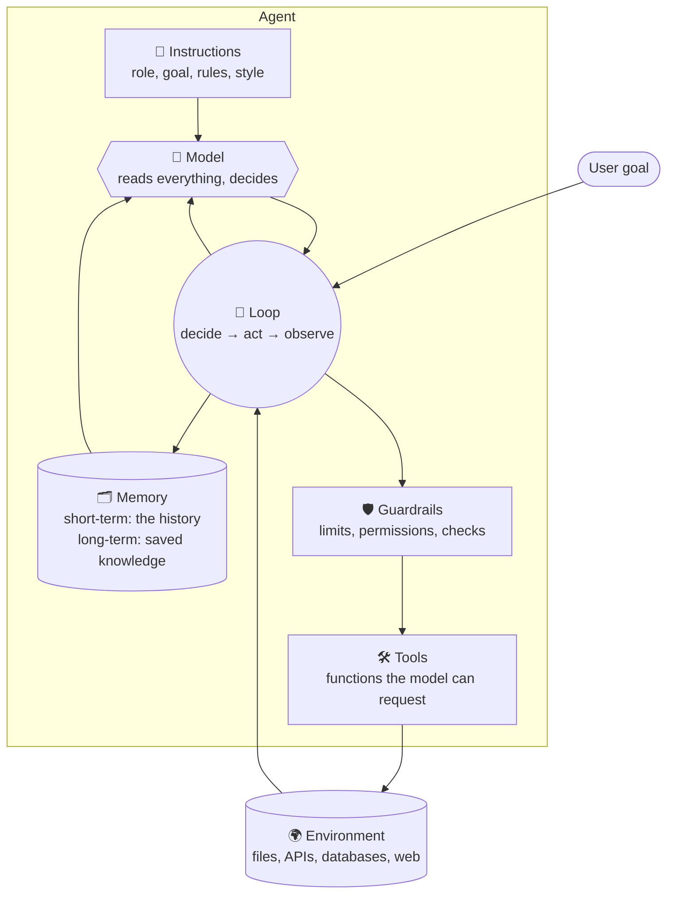
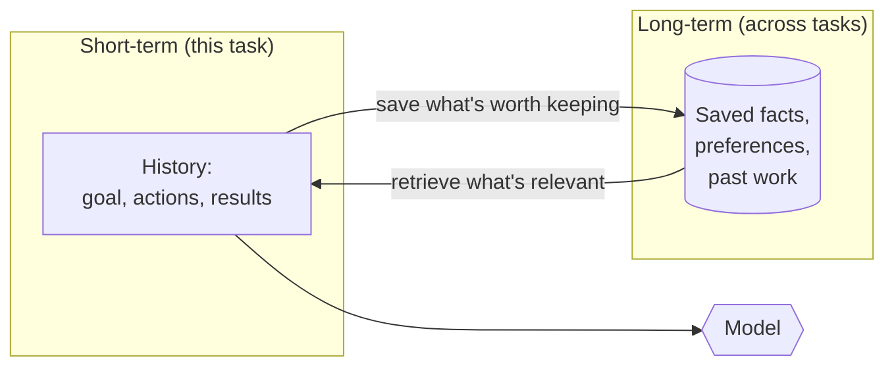

# Anatomy of an Agent: The Complete Guide

> 📚 **Before you start**
>
> - [The Agent Loop: Decide, Act, Observe](the-agent-loop-decide-act-observe.md), for the loop that drives every agent.
> - [Workflows vs Agents](workflows-vs-agents.md), for when an agent is the right choice.

## Introduction

Open the settings page of any serious AI agent product and you'll find the same handful of knobs: which **model** to use, a box for **instructions**, a list of **tools** to switch on and off, something about **memory**, some **limits** and **permissions**. Different products, same parts.

That's not a coincidence. Every agent, from a 40-line script to a coding assistant used by millions of developers, is assembled from the same components. Once you can name the parts and know what each one does, you can read any agent's design, spot what's missing, and build your own deliberately instead of by trial and error.

This article is a guided tour of those parts. For each one you'll learn what it is, what good and bad versions look like, and how it connects to the others. Then you'll put them together into a small, clean `Agent` class that you'll reuse in later lessons.

> 💡 **Key Insight**
>
> An agent is **model + instructions + tools + memory**, run by a **loop**, inside **guardrails**. When an agent behaves badly, the cause is almost always one specific part: vague instructions, a confusing tool, missing memory, or a missing guardrail. Naming the parts is how you debug them.

---

## Core Explanation

### The parts at a glance



Let's take each part in turn.

### 1. The model: the brain

The **model** is the large language model that reads the situation and decides what to do next. It's the only part that "thinks". Everything else is ordinary software.

What matters when choosing a model for an agent:

- **Tool-use ability.** Some models are much better at choosing the right tool and filling in arguments correctly. This matters more for agents than raw writing quality.
- **Reasoning on multi-step tasks.** Agents need to keep track of a goal across many steps.
- **Context window.** How much history it can read at once.
- **Cost and speed.** An agent may call the model dozens of times per task, so a small price difference per call multiplies quickly.

A common pattern is to use **different models for different jobs**: a large, capable model for planning and hard decisions, and a smaller, cheaper one for simple steps like summarising a tool result.

### 2. Instructions: the job description

The **instructions** (usually sent as the *system prompt*) tell the model who it is, what it's for and how to behave. They're the single biggest lever you have over an agent's behaviour.

Good instructions usually cover:

- **Role and goal**: *"You are a support agent for an online electronics store. Your goal is to resolve the customer's issue in as few steps as possible."*
- **How to use tools**: *"Always look up the order before discussing it. Never guess order details."*
- **Rules and limits**: *"Never issue refunds over ₹10,000; escalate those to a human."*
- **When to stop**: *"When the issue is resolved or escalated, give a short summary and stop."*
- **Style**: tone, length, language.

Compare a weak and a strong version:

| Weak | Strong |
|---|---|
| "You are a helpful assistant. Help the user with their orders." | "You are a support agent for Volt Electronics. Resolve order issues using the tools provided. Always call `lookup_order` before discussing an order; never guess. Refunds above ₹10,000 must be escalated with `escalate_to_human`. If the customer's request is ambiguous, ask one clarifying question. When done, summarise what you did in one or two sentences." |

The strong version answers the questions the model would otherwise have to guess at. Every guess is a chance for the agent to go wrong.

### 3. Tools: the hands

**Tools** are functions the model can ask your program to run. Each tool has three parts the model sees:

- **A name**: `lookup_order`.
- **A description**: what it does and when to use it.
- **A parameter schema**: what inputs it takes, with types and descriptions.

The model never sees your code, only those three things. So **the description is the interface**. A tool with a vague description gets used wrongly, no matter how good the code behind it is. You'll learn to design tools properly in [Designing Good Tools](../04-tools-and-function-calling/designing-good-tools.md).

Tools fall into two broad groups, and the difference matters for safety:

- **Read tools** gather information without changing anything: search, look up an order, read a file. Mistakes are cheap.
- **Write tools** change the world: send an email, issue a refund, delete a file. Mistakes can be expensive or irreversible, so they deserve stricter guardrails.

### 4. Memory: what the agent knows

**Short-term memory** is the conversation **history**: the goal, every action and every result, sent to the model on every step. You studied it in [The Agent Loop](the-agent-loop-decide-act-observe.md). It lasts for one task.

**Long-term memory** is anything saved **between** tasks: a user's preferences, facts learned last week, past conversations. It's stored outside the model (in a file, database or vector store) and **retrieved** into the history when relevant.



Most beginner agents need only short-term memory. Long-term memory is powerful but brings hard questions (what to save, when to forget, privacy), which you'll tackle in [LangGraph State and Memory](../../langgraph-state-and-memory/course.md).

### 5. The loop: the heartbeat

The **loop** runs everything: call the model, run the requested tool, record the result, repeat until done. It also enforces the stop conditions (final answer, step limit, budget, time). You built a robust one in [The Agent Loop](the-agent-loop-decide-act-observe.md).

### 6. Guardrails: the safety system

**Guardrails** are checks wrapped around the other parts:

- **Limits**: maximum steps, tokens, cost and time.
- **Permissions**: which tools this agent may use at all.
- **Approvals**: write tools that require a human "yes" before running.
- **Input checks**: validating tool arguments before running anything.
- **Output checks**: checking the final answer (for example, no personal data, no promises the company can't keep).

Guardrails are what make it possible to give an agent real tools without losing sleep. You'll go deep on them in [Guardrails and Security](../../enterprise-llm-systems/course.md#m6).

### 7. The environment: the world it acts on

The **environment** is everything outside the agent that its tools touch: files, databases, APIs, websites, a browser, a terminal. It's not part of the agent, but it shapes the design. A coding agent's environment is a code repository and a terminal; a support agent's is the order system and the email service. **Sandboxing** (giving the agent a safe copy of the environment) is the standard way to test agents without risk.

### Putting the parts together

Here is a compact `Agent` class with every part named. It uses a pretend model so it runs anywhere, and an approval guardrail for write tools.

```python
class Agent:
    def __init__(self, model, instructions, tools, max_steps=6, approve=None):
        self.model = model                  # 1. the brain
        self.instructions = instructions    # 2. the job description
        self.tools = tools                  # 3. the hands: name -> {"fn", "description", "writes"}
        self.memory = []                    # 4. short-term memory (the history)
        self.max_steps = max_steps          # 6. guardrail: step limit
        self.approve = approve or (lambda name, arg: False)   # 6. guardrail: approval for write tools

    def act(self, name, arg):
        tool = self.tools.get(name)
        if tool is None:
            return f"ERROR: no tool called '{name}'"
        if tool["writes"] and not self.approve(name, arg):
            return f"BLOCKED: '{name}' needs human approval, which was not given"
        return tool["fn"](arg)

    def run(self, goal):                    # 5. the loop
        self.memory = [{"role": "system", "content": self.instructions},
                       {"role": "user", "content": goal}]
        for _ in range(self.max_steps):
            decision = self.model(self.memory, self.tools)
            if "final" in decision:
                return decision["final"]
            result = self.act(decision["tool"], decision["arg"])
            self.memory.append({"role": "assistant", "content": f"{decision['tool']}({decision['arg']})"})
            self.memory.append({"role": "tool", "content": result})
        return "Stopped: step limit reached."
```

Now the tools, the instructions and a pretend model that behaves the way a good LLM would with these instructions:

```python
ORDERS = {"A100": {"item": "headphones", "price": 12999, "status": "delivered"}}

tools = {
    "lookup_order": {"fn": lambda oid: ORDERS.get(oid, "not found"),
                     "description": "Look up an order by ID. Use before discussing any order.",
                     "writes": False},
    "issue_refund": {"fn": lambda oid: f"refund issued for {oid}",
                     "description": "Refund an order in full. Requires approval.",
                     "writes": True},
}

instructions = ("You are a support agent for Volt Electronics. Always look up an order before "
                "discussing it. Use issue_refund for refunds. If a refund is blocked, tell the "
                "customer it has been sent for review.")

def pretend_model(memory, tools):
    last = memory[-1]["content"]
    if memory[-1]["role"] == "user":
        return {"tool": "lookup_order", "arg": "A100"}
    if "delivered" in str(last):
        return {"tool": "issue_refund", "arg": "A100"}
    if last.startswith("BLOCKED"):
        return {"final": "I've sent your refund for order A100 for review. You'll hear back within a day."}
    return {"final": f"Done: {last}."}
```

Run it twice, once without approval and once with a human who approves:

```python
agent = Agent(pretend_model, instructions, tools)
print("No approval:  ", agent.run("Please refund order A100, the headphones are faulty."))

agent = Agent(pretend_model, instructions, tools, approve=lambda name, arg: True)
print("With approval:", agent.run("Please refund order A100, the headphones are faulty."))

print("Steps recorded in memory:", len(agent.memory))
```

Output:

```
No approval:   I've sent your refund for order A100 for review. You'll hear back within a day.
With approval: Done: refund issued for A100.
Steps recorded in memory: 6
```

Every part did its job. The **instructions** told the model to look up the order first and how to handle a blocked refund. The **tools** gave it a read action and a write action. **Memory** carried the order details into the next decision. The **guardrail** blocked the write tool until approval was given, and the **model** adapted to that observation. The **loop** tied it together.

### Debugging by part

When an agent misbehaves, walk through the parts:

| Symptom | Likely part | Fix |
|---|---|---|
| Uses the wrong tool, or invents arguments | Tools | Clearer names and descriptions, stricter schemas |
| Ignores a rule | Instructions | State the rule explicitly, give an example |
| Forgets something from earlier in the task | Memory | Make sure it's in the history and wasn't trimmed |
| Doesn't know something from a past session | Memory | Add long-term memory and retrieval |
| Runs forever or costs too much | Loop / guardrails | Step, budget and repeat limits |
| Did something it shouldn't have | Guardrails | Permissions and human approval for write tools |
| Makes poor decisions on hard tasks | Model | Use a more capable model for that step |

### Try It Yourself

Put the three code blocks into one file and run it. Then:

1. Give the agent `max_steps=1`. What does it return? Which part is responsible?
2. Add a read tool `check_warranty(order_id)` that returns `"warranty valid until 2027"`. Update `pretend_model` so it checks the warranty before refunding.
3. Write an `approve` function that approves refunds only for orders under ₹10,000. Run it. Which branch of `pretend_model` produces the answer, and why?

<details>
<summary>What you should see</summary>

1. `Stopped: step limit reached.` The loop's guardrail fired after one step (the order lookup) before the agent could finish.
2. Add `"check_warranty": {"fn": lambda oid: "warranty valid until 2027", "description": "...", "writes": False}`, and in `pretend_model` return `{"tool": "check_warranty", "arg": "A100"}` after the lookup and before the refund (for example, when `"delivered"` is in the last message, check the warranty; when `"warranty"` is in it, issue the refund).
3. `approve = lambda name, arg: ORDERS[arg]["price"] < 10000`. The headphones cost ₹12,999, so the refund is blocked and the `BLOCKED` branch returns the "sent for review" message. The guardrail encoded a business rule without touching the model.

</details>

---

## Real-World Examples

### Example 1: Coding agents

**Model:** a strong reasoning model. **Instructions:** coding conventions, how to run tests, "ask before deleting files". **Tools:** read file, edit file, search code, run terminal commands. **Memory:** the session history plus project notes files that are loaded at the start of each session. **Guardrails:** permission prompts before running commands or editing outside the project. **Environment:** your repository and terminal.

### Example 2: Customer-support agents

**Model:** often a mid-sized model for cost. **Instructions:** company policy, tone, escalation rules. **Tools:** order lookup, refund, ticket creation, knowledge-base search. **Memory:** the conversation plus the customer's history from the CRM. **Guardrails:** refund limits, human approval above a threshold, checks that answers don't promise unsupported things.

### Example 3: Personal assistants

**Model:** a general-purpose model. **Instructions:** the user's preferences. **Tools:** calendar, email, documents. **Memory:** long-term memory of preferences ("I prefer morning meetings"). **Guardrails:** confirming before sending emails or accepting invites on the user's behalf.

---

## Common Misconceptions

### Misconception 1: "The model is the agent"

The model is one part. The same model becomes a very different agent with different instructions, tools, memory and guardrails.

### Misconception 2: "Better model = better agent"

A better model helps, but most agent failures come from unclear instructions, poorly described tools or missing guardrails. Fix those first.

### Misconception 3: "Memory means the model remembers"

The model remembers nothing. Memory is data you store and feed back into the history.

### Misconception 4: "Guardrails make agents less useful"

Guardrails are what let you give an agent **powerful** tools safely. Without them, you'd have to restrict the agent to harmless read-only tools.

---

## Interview Relevance

*"What are the components of an AI agent?"* is a very common question. A strong answer lists and explains:

- **Model** (decision-making), **instructions** (role, goals, rules), **tools** (actions, described by name, description and schema), **memory** (short-term history and long-term stored knowledge), **loop** (orchestration and stop conditions), **guardrails** (limits, permissions, approvals, checks), and the **environment** the tools act on.
- **How they interact**: instructions and memory feed the model, the model chooses tools, guardrails gate execution, results flow back into memory.
- **Read vs write tools**, and why write tools need stronger guardrails.

Common follow-ups:

- *"Your agent keeps calling the wrong tool. What do you check?"* Tool names and descriptions first, then the instructions, then whether the model is capable enough.
- *"How would you add long-term memory?"* Store important facts outside the model (database or vector store), retrieve relevant ones into the history at the start of each task, and decide explicitly what's worth saving.

---

## Key Takeaways

- Every agent is built from **model, instructions, tools, memory, loop and guardrails**, acting on an **environment**.
- **Instructions** are your biggest lever. Be explicit about goals, tool use, rules and when to stop.
- The model only sees a tool's **name, description and schema**, so those are the real interface.
- **Short-term memory** is the history; **long-term memory** is stored outside the model and retrieved.
- **Guardrails**, especially approval for write tools, are what make powerful agents safe.
- Debug agents **part by part**.

---

**Up next:** [Lab: Agent loop with a pretend model](lab-agent-loop-with-a-pretend-model.md)
