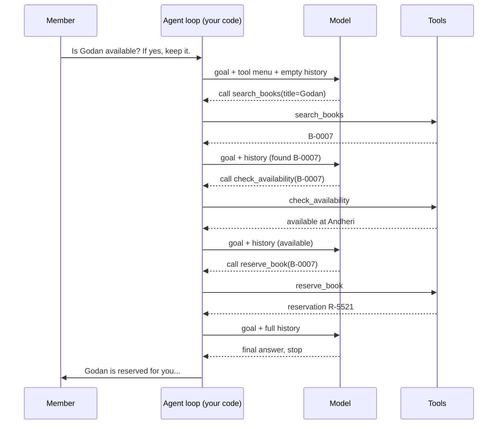
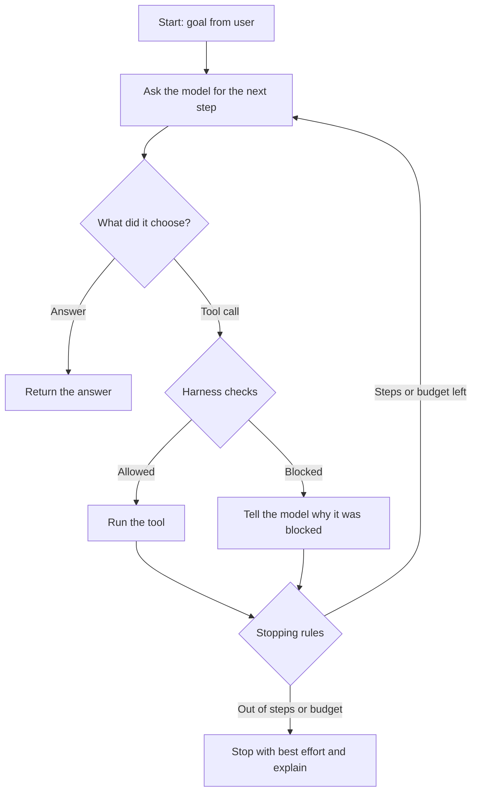
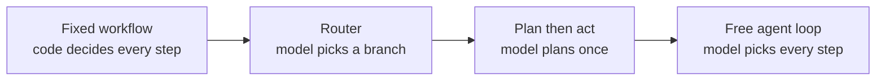

# How an Agent Decides What to Do Next: The Complete Guide

> 📚 **Before you start**
>
> - [The Agent Loop: Decide, Act, Observe](the-agent-loop-decide-act-observe.md), which introduced the loop this lesson zooms into.
> - [How LLMs Work](../../generative-ai-and-llm-foundations/course.md#m3), for the idea that a model predicts the next token.

## Introduction

Picture a new librarian on their first day. A member walks up and says, *"Is Godan available? If yes, keep it for me."* The librarian doesn't panic about the whole request at once. They look at what they know (the member's words, the library's rules, the computer in front of them) and pick **one sensible next step**: search the catalogue. Then they look at the result and pick the next step: check whether a copy is on the shelf. Then: reserve it. Then: tell the member it's done.

An AI agent works the same way. People often imagine an agent "thinking up a plan and executing it", but under the hood it is much simpler and much more interesting: **at every turn of the loop, the model looks at everything in front of it and writes down the single most sensible next step**. That step might be calling a tool, asking a question, updating a plan, or answering and stopping.

This lesson answers the two questions beginners ask most:

1. **How does the agent choose *which* action to take?**
2. **Who decides *when* it acts, and when it stops?**

By the end, you'll be able to trace any agent's decision, explain why it picked a tool, steer its choices with descriptions, instructions and settings, and add the safety checks that decide whether a chosen action is allowed to run.

> 💡 **Key Insight**
>
> The **model decides *what*** the next step should be, by writing it out (as a tool call or as text) based on everything in its context. **Your code decides *when*** the model is asked, **whether** the step is allowed to run, and **when the loop ends**. Good agents get both halves right.

---

## Core Explanation

### 1. The decision in one picture


*Everything the model sees on the left shapes the choice in the middle. The harness at the bottom has the final say.*

Three groups of things decide the next step:

| Group | What it contains | Who controls it |
|---|---|---|
| **What the model sees** | Instructions (system prompt), the tool menu, the history of the task so far, and any retrieved facts or memory | You (the developer), plus whatever happened in earlier steps |
| **What the model chooses** | Call a tool, ask the user, write a plan, or answer and stop | The model |
| **What the harness checks** | Is this tool allowed? Does it need approval? Is there budget left? Are the inputs valid? | You, in plain code |

The rest of this lesson takes each group apart.

### 2. What "deciding" actually means inside the model

A language model does one thing: given some text, it predicts the next token, again and again. So how can it "choose a tool"?

When you give a model tools, the API adds a description of each tool (its name, what it does, and the inputs it takes) to what the model reads. The model has been trained on huge numbers of examples where the right response to a situation is a **structured tool call** rather than prose. So when the most likely good continuation is *"I should look this up"*, the tokens it produces form a tool call, something like:

```json
{"type": "tool_use", "name": "search_books", "input": {"title": "Godan"}}
```

If the most likely good continuation is a final answer, it produces ordinary text and signals that it is finished.

So "deciding" is **generation**. There is no separate decision module. That has three practical consequences:

- **Everything in the context influences the choice.** A vague tool description, a confusing instruction or a misleading earlier result changes which tokens are most likely.
- **The choice is probabilistic.** The same situation can occasionally produce a different step, especially with higher temperature. Your code must cope with that.
- **The model can only choose what it can see.** A tool that isn't in the menu can't be called; a fact that isn't in the context can't be used.

### 3. A rough mental model: matching the request to the menu

Real models understand meaning, not just shared words, but a useful first intuition is that the model picks the tool whose **name and description best fit what needs doing right now**. Here's a deliberately crude version of that idea, just to make it concrete:

```python
import re

TOOLS = {
    "search_books": "Find books in the library catalogue by title or author.",
    "check_availability": "Check whether a specific book copy is available to borrow today.",
    "reserve_book": "Reserve a book copy for a member. Only after availability is confirmed.",
}

STOP_WORDS = {"a", "the", "to", "for", "by", "or", "is", "in", "of", "it", "if"}

def words(text):
    return set(re.findall(r"[a-z]+", text.lower())) - STOP_WORDS

def overlap_scores(need, tools):
    wanted = words(need)
    return {name: len(wanted & words(name.replace("_", " ") + " " + desc)) for name, desc in tools.items()}

need = "Is the book Godan available to borrow today?"
for name, score in sorted(overlap_scores(need, TOOLS).items(), key=lambda kv: -kv[1]):
    print(f"{name:<20} matching words: {score}")
```

Output:

```
check_availability   matching words: 4
reserve_book         matching words: 1
search_books         matching words: 0
```

Two lessons hide in this toy:

- The **description is the strongest signal** the model has about when to use a tool. `check_availability` wins because its description talks about exactly what was asked.
- The toy got something **wrong**: before you can check availability you need to know *which* book record "Godan" is, so `search_books` should come first. Real models get this right far more often because they also read the **instructions** and the **history**, which is where the next section comes in.

### 4. The same request, decided step by step

A real agent doesn't decide once. It decides **at every turn**, and each decision depends on what earlier steps found. Let's build a pretend model that behaves the way a well-instructed real model does: it reads the goal and the history, and writes the next step.

```python
def pretend_model(goal, history):
    """Return the next step as a dict, the way a model returns a tool call or text."""
    done = {step["tool"]: step["result"] for step in history if "tool" in step}

    if "search_books" not in done:
        return {"tool": "search_books", "input": {"title": "Godan"},
                "why": "I don't know which book record the member means yet."}
    book = done["search_books"][0]
    if "check_availability" not in done:
        return {"tool": "check_availability", "input": {"book_id": book["id"]},
                "why": f"Found {book['title']} ({book['id']}); need to know if a copy is free."}
    if done["check_availability"]["available"] and "keep it" in goal and "reserve_book" not in done:
        return {"tool": "reserve_book", "input": {"book_id": book["id"], "member": "M-104"},
                "why": "A copy is free and the member asked me to keep it."}
    return {"answer": "Godan is reserved for you at the Andheri branch until Friday.",
            "why": "Every part of the request is handled."}

# Fake tools that return fixed results, so the example runs offline.
def search_books(title):
    return [{"id": "B-0007", "title": "Godan", "author": "Premchand"}]

def check_availability(book_id):
    return {"book_id": book_id, "available": True, "branch": "Andheri"}

def reserve_book(book_id, member):
    return {"reservation": "R-5521", "book_id": book_id, "member": member, "until": "Friday"}

TOOL_FUNCTIONS = {"search_books": search_books, "check_availability": check_availability,
                  "reserve_book": reserve_book}

goal = "Is Godan available? If yes, keep it for me."
history = []
for turn in range(1, 6):
    step = pretend_model(goal, history)
    print(f"Turn {turn}: {step.get('tool', 'ANSWER')}  <- {step['why']}")
    if "answer" in step:
        print("   Final answer:", step["answer"])
        break
    result = TOOL_FUNCTIONS[step["tool"]](**step["input"])
    history.append({"tool": step["tool"], "input": step["input"], "result": result})
```

Output:

```
Turn 1: search_books  <- I don't know which book record the member means yet.
Turn 2: check_availability  <- Found Godan (B-0007); need to know if a copy is free.
Turn 3: reserve_book  <- A copy is free and the member asked me to keep it.
Turn 4: ANSWER  <- Every part of the request is handled.
   Final answer: Godan is reserved for you at the Andheri branch until Friday.
```

Notice how each decision is driven by **what's missing**. The model asks itself, in effect, *"Given the goal and what I know so far, what is the most useful thing I can do next?"* When nothing useful is left to do, the best next step is to answer and stop.

Here's the same run as a sequence diagram:



### 5. What shapes the model's choice

Because the decision is generated from the context, you steer it by changing the context. In rough order of impact:

| Lever | Example | Effect on decisions |
|---|---|---|
| **Tool descriptions** | "Reserve a copy. Only after availability is confirmed." | Tells the model *when* a tool fits, not just what it does |
| **Instructions (system prompt)** | "Always confirm with the member before reserving more than 2 books." | Adds rules and an order of operations |
| **The history** | The result of `check_availability` says `available: false` | The next step changes (suggest a waitlist instead of reserving) |
| **Examples** | A short example conversation showing the ideal sequence | Teaches a pattern the model copies |
| **Tool menu size** | 3 relevant tools vs 60 loosely related ones | Fewer, clearer choices mean fewer mistakes |
| **Tool choice setting** | Force a tool, allow any, or allow none (next section) | Hard limits on what kind of step is allowed |
| **Temperature** | Lower values | More consistent choices for the same situation |

A practical rule: **if an agent keeps picking the wrong tool, fix the descriptions and instructions before anything else.** That fixes most problems.

### 6. Forcing or limiting the choice: tool choice

Model APIs let you control how free the choice is on each call. With Anthropic's Messages API the setting is called `tool_choice`:

| `tool_choice` | Meaning | When to use it |
|---|---|---|
| `{"type": "auto"}` (default) | The model decides whether to call a tool, and which | Normal agent turns |
| `{"type": "any"}` | The model must call *some* tool | A step where text alone would be wrong, such as "classify this ticket using one of these tools" |
| `{"type": "tool", "name": "..."}` | The model must call this specific tool | Forcing structured output, or a fixed first step |
| `{"type": "none"}` | The model may not call tools | A final "write the summary" step |

```python
# not-run: needs the anthropic package and an API key
import anthropic

client = anthropic.Anthropic()
response = client.messages.create(
    model="claude-opus-5-5",
    max_tokens=1024,
    tools=[{
        "name": "search_books",
        "description": "Find books in the library catalogue by title or author.",
        "input_schema": {"type": "object", "properties": {"title": {"type": "string"}}, "required": ["title"]},
    }],
    tool_choice={"type": "tool", "name": "search_books"},   # must search first
    messages=[{"role": "user", "content": "Is Godan available? If yes, keep it for me."}],
)
print(response.stop_reason)          # "tool_use"
print(response.content[-1].input)    # {"title": "Godan"}
```

Example output:

```
tool_use
{'title': 'Godan'}
```

The `stop_reason` is how your loop learns what the model decided: `"tool_use"` means "run the tool and come back to me"; `"end_turn"` means "I'm done". (You built this loop in [Function Calling Step by Step](../04-tools-and-function-calling/function-calling-step-by-step.md).)

### 7. Who decides *when*: the loop, not the model

The model never runs on its own. **Your loop decides when to ask it**, and that gives you the "when" half of every decision:

- **When a step happens:** the loop calls the model once per turn, after the previous tool result is added to the history.
- **When the agent stops:** the loop ends when the model answers without a tool call, *or* when one of your own stopping rules fires.



The stopping rules you should always have:

| Rule | Why |
|---|---|
| **Maximum steps** | Stops loops where the model keeps trying the same thing |
| **Budget** (tokens, money or time) | Stops expensive runaways |
| **Goal reached** | The normal exit: the model says it's done |
| **Unrecoverable error** | A tool keeps failing; better to stop and explain |
| **Human said stop** | Users must be able to interrupt |

### 8. The harness has the final say

The model *proposes* a step; your code decides whether it **runs**. This is where you put rules that must never be broken, because a rule written only in the prompt is a strong suggestion, not a guarantee.

```python
ALLOWED_TOOLS = {"search_books", "check_availability", "reserve_book"}
NEEDS_APPROVAL = {"reserve_book"}
MAX_STEPS = 4

def harness_check(step, steps_used, approved_by_human):
    if step["tool"] not in ALLOWED_TOOLS:
        return False, f"{step['tool']} is not on the allowed list"
    if steps_used >= MAX_STEPS:
        return False, "step budget used up"
    if step["tool"] in NEEDS_APPROVAL and not approved_by_human:
        return False, "needs a librarian's approval first"
    return True, "ok"

proposals = [
    {"tool": "search_books", "input": {"title": "Godan"}},
    {"tool": "delete_member", "input": {"member": "M-104"}},
    {"tool": "reserve_book", "input": {"book_id": "B-0007", "member": "M-104"}},
]
for i, step in enumerate(proposals):
    ok, reason = harness_check(step, steps_used=i, approved_by_human=False)
    print(f"{step['tool']:<14} -> {'RUN' if ok else 'BLOCKED'} ({reason})")
```

Output:

```
search_books   -> RUN (ok)
delete_member  -> BLOCKED (delete_member is not on the allowed list)
reserve_book   -> BLOCKED (needs a librarian's approval first)
```

When a step is blocked, **tell the model why** (as the tool result). A good model then chooses a different step, such as asking the user to get approval, instead of retrying the same call.

### 9. Patterns that make decisions more reliable

As tasks get harder, letting the model improvise every step gets risky. These patterns trade some freedom for reliability, and you'll build each of them later in the track:

| Pattern | How it changes the decision | Learn it in |
|---|---|---|
| **ReAct** | The model writes a short reason before each action, which improves choices and makes them readable | [ReAct](../05-reasoning-patterns/react.md) |
| **Plan first, then act** | The model decides the whole list of steps once, then executes them, replanning only if something fails | [Planning and Reflection](../05-reasoning-patterns/planning-and-reflection.md) |
| **Routers** | A small, fast decision (often with structured output) picks which branch or specialist handles the request | [Conditional Workflows](../../langgraph-fundamentals/03-workflow-patterns-in-langgraph/conditional-workflows.md) |
| **Fixed workflows with an LLM inside** | Your code fixes the order of steps; the model only fills in content | [Workflows vs Agents](workflows-vs-agents.md) |
| **Typed decision models** | A model built for decisions returns a choice with a probability instead of text, so code can branch on it directly | [Decision Models: Typed Answers instead of Text](../../agent-frameworks-and-sdks/course.md#m4) |
| **Human approval** | Risky steps pause until a person says yes | [Human-in-the-Loop with LangGraph](../../human-in-the-loop-with-langgraph/course.md) |

A useful way to see the spectrum:



Move right only when the task truly needs the flexibility.

### 10. Debugging bad decisions

| Symptom | Likely cause | Fix |
|---|---|---|
| Calls the wrong tool | Two tools have overlapping or vague descriptions | Rewrite descriptions to say *when* to use each, and when not to |
| Skips a required step | The order isn't stated anywhere | Add the order to instructions, or enforce it in the harness |
| Repeats the same call | The tool result doesn't tell it what changed, or errors are unclear | Return clear results and helpful error messages; cap steps |
| Stops too early | Instructions don't define "done" | Say exactly what a complete answer includes |
| Never stops | No clear goal, or the model keeps finding "one more thing" | Define done; enforce maximum steps and budget |
| Invents a tool or input | Too many tools, or schemas without required fields | Trim the menu; validate inputs and reject bad ones with a clear message |

The single most useful debugging habit: **log the full context and the chosen step at every turn**. When a decision looks wrong, read exactly what the model saw at that moment. Nine times out of ten, the context explains it.

---

## Try It Yourself

1. **Change the history.** In the step-by-step example, make `check_availability` return `"available": False`. What does the pretend model do now, and what *should* a good agent say to the member?
2. **Fix a vague tool.** Change the description of `reserve_book` to just `"Books."` and rerun the overlap scores for the request `"Please reserve Godan for me"`. Which tool wins now, and why does that matter for a real model too?
3. **Add a stopping rule.** Modify `harness_check` so that a tool which has already failed twice is blocked.

<details>
<summary>Show answers</summary>

**1.**

```python
def check_availability(book_id):
    return {"book_id": book_id, "available": False, "branch": "Andheri"}

TOOL_FUNCTIONS["check_availability"] = check_availability
history = []
for turn in range(1, 6):
    step = pretend_model(goal, history)
    print(f"Turn {turn}: {step.get('tool', 'ANSWER')}")
    if "answer" in step:
        break
    history.append({"tool": step["tool"], "input": step["input"],
                    "result": TOOL_FUNCTIONS[step["tool"]](**step["input"])})
```

Output:

```
Turn 1: search_books
Turn 2: check_availability
Turn 3: ANSWER
```

It correctly skips `reserve_book`, but our pretend model's answer still says "reserved", which is wrong. A good agent would answer something like *"Godan is out right now. Shall I add you to the waitlist?"* The fix in a real system is instructions that say what to do when a book is unavailable, so the final answer reflects the history.

**2.**

```python
vague = dict(TOOLS, reserve_book="Books.")
for name, score in sorted(overlap_scores("Please reserve Godan for me", vague).items(), key=lambda kv: -kv[1]):
    print(f"{name:<20} matching words: {score}")
```

Output:

```
reserve_book         matching words: 1
search_books         matching words: 0
check_availability   matching words: 0
```

Only the tool's *name* still matches. A real model would probably still pick it here, but with many similar tools a vague description is exactly how agents start choosing the wrong one. Descriptions should say what the tool does **and** when to use it.

**3.**

```python
def harness_check_with_failures(step, steps_used, approved_by_human, failures):
    if failures.get(step["tool"], 0) >= 2:
        return False, f"{step['tool']} failed twice; try something else or ask the user"
    return harness_check(step, steps_used, approved_by_human)

print(harness_check_with_failures({"tool": "search_books"}, 1, False, {"search_books": 2}))
```

Output:

```
(False, 'search_books failed twice; try something else or ask the user')
```

</details>

---

## Real-World Examples

- **Coding agents** decide between reading a file, searching the codebase, editing, or running tests. Their harnesses block destructive commands and ask for approval before pushing code.
- **Customer support agents** look up the order first, then decide between answering, refunding (with a limit enforced in code) or escalating to a human.
- **Research agents** decide when they have enough sources to stop searching, guided by instructions such as "stop after three independent sources agree".

---

## Common Misconceptions

### "The agent makes a full plan and follows it"

Most agents decide **one step at a time**, using the latest results. Planning first is a separate pattern you add on purpose.

### "The model runs the tools"

The model only **writes** a request to call a tool. Your code runs it, and can refuse.

### "If I write a rule in the prompt, the agent will always obey it"

Prompts strongly influence decisions but don't guarantee them. Rules that must never break belong in the harness.

### "Better models don't need good tool descriptions"

Better models make fewer mistakes, but every model can only choose based on what it reads. Clear descriptions help every model.

---

## Interview Relevance

*"How does an LLM agent decide which tool to call?"* A strong answer says: the model generates the next step token by token from its context (instructions, tool definitions, conversation and tool results); a tool call is just structured output it was trained to produce; the choice is shaped mostly by tool descriptions, instructions and history; `tool_choice` can force or forbid tool use; and the loop, not the model, controls when the model is called, when to stop (max steps, budget, goal reached) and whether a proposed call is allowed (allowlists, validation, human approval). Mention logging the full context per step for debugging.

---

## Key Takeaways

- **Deciding is generating:** at each turn the model writes the most sensible next step from everything in its context.
- **Descriptions, instructions and history** steer the choice more than anything else.
- **`tool_choice`** can force a tool, require some tool, or forbid tools on a given call.
- **Your loop owns "when"**: when to ask the model and when to stop, with step and budget limits.
- **The harness has the final say**: allowlists, validation and approvals decide whether a proposed step runs.

---

**Up next:** [Workflows vs Agents](workflows-vs-agents.md)
