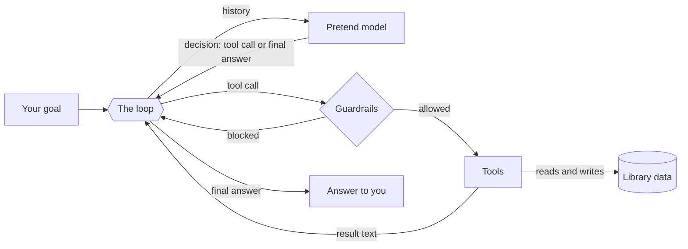

# Lab: Agent Loop with a Pretend Model

> 📚 **Before you start**
>
> - [The Agent Loop: Decide, Act, Observe](the-agent-loop-decide-act-observe.md), for the three steps you'll code here.
> - [Anatomy of an Agent](anatomy-of-an-agent.md), for the parts (model, instructions, tools, memory, loop, guardrails).
> - [Functions](../../python-programming/course.md#m6) and dictionaries from Python Fundamentals. That's all the Python you need.

## What You'll Build

A small **library assistant agent**. You ask it something like *"Is 'Atomic Habits' available? If yes, reserve it for me."* and it works out, step by step, which tools to call: search the catalogue, check the shelf, and reserve the book (but only with your approval).

You'll build every part yourself, in plain Python, in about 100 lines:

1. A fake **environment** (the library's data).
2. **Tools** the agent can use, with descriptions.
3. A **pretend model** that makes decisions by reading the history, the same way a real LLM does.
4. The **loop** that ties them together, with a full trace so you can watch it think.
5. **Guardrails**: a step limit, repeated-action detection and human approval.

Then you'll deliberately **break** the agent three ways and watch the guardrails catch it.

> 💡 **Key Insight**
>
> The pretend model is not a shortcut. In a real agent the LLM is just a function from *history* to *decision*. Swap our pretend function for a real API call and nothing else in this lab changes. Building with a pretend model first lets you test the loop, the tools and the guardrails offline, for free, with completely predictable results.

### Why a pretend model?

| | Real LLM | Pretend model |
|---|---|---|
| Needs an API key and internet | Yes | No |
| Costs money per call | Yes | No |
| Same output every run | Not guaranteed | Always |
| Good for testing the loop and guardrails | Hard (unpredictable) | Ideal |
| Good for understanding open-ended language | Yes | No |

Professional teams do exactly this: they test agent plumbing with scripted "fake" models, and only then plug in a real one.

### How the pieces fit



Run every code block in order, in one notebook or one `.py` file. Each block builds on the previous ones.

---

## Step 1: The Environment

The environment is the world the agent acts on. Here it's two dictionaries: the catalogue (what books exist) and the shelf (how many copies are free right now).

```python
CATALOGUE = {
    "B1": {"title": "Atomic Habits", "author": "James Clear"},
    "B2": {"title": "Deep Work", "author": "Cal Newport"},
    "B3": {"title": "The Pragmatic Programmer", "author": "Andrew Hunt and David Thomas"},
}
SHELF = {"B1": 2, "B2": 0, "B3": 1}     # free copies per book id
RESERVATIONS = []                        # what the agent has reserved

for book_id, book in CATALOGUE.items():
    print(book_id, book["title"], "| free copies:", SHELF[book_id])
```

Output:

```
B1 Atomic Habits | free copies: 2
B2 Deep Work | free copies: 0
B3 The Pragmatic Programmer | free copies: 1
```

Notice the agent will **never** touch these dictionaries directly. It can only change the world through tools. That boundary is what makes an agent safe to reason about.

---

## Step 2: The Tools

Each tool is an ordinary function plus the information the model needs to choose it: a **description**, the **argument** it takes, and whether it **writes** (changes the world). Read tools are harmless; write tools will need approval later.

```python
def search_books(query):
    hits = [f"{bid}: {b['title']} by {b['author']}"
            for bid, b in CATALOGUE.items() if query.lower() in b["title"].lower()]
    return "; ".join(hits) if hits else f"No books match '{query}'"

def check_availability(book_id):
    if book_id not in SHELF:
        return f"ERROR: unknown book id '{book_id}'"
    return f"{book_id} has {SHELF[book_id]} free copies"

def reserve_book(book_id):
    if SHELF.get(book_id, 0) == 0:
        return f"ERROR: no free copies of {book_id}"
    SHELF[book_id] -= 1
    RESERVATIONS.append(book_id)
    return f"Reserved {book_id}. {SHELF[book_id]} copies left"

TOOLS = {
    "search_books":       {"fn": search_books,       "arg": "query",
                           "description": "Find books whose title contains the query. Returns ids.",
                           "writes": False},
    "check_availability": {"fn": check_availability, "arg": "book_id",
                           "description": "How many free copies a book id has right now.",
                           "writes": False},
    "reserve_book":       {"fn": reserve_book,       "arg": "book_id",
                           "description": "Reserve one copy for the user. Changes library records.",
                           "writes": True},
}

print(search_books("habits"))
print(check_availability("B2"))
```

Output:

```
B1: Atomic Habits by James Clear
B2 has 0 free copies
```

Two design choices worth copying:

- **Tools return text, even for errors.** The model can read `"ERROR: unknown book id"` and try something else. An exception would crash the loop instead.
- **Results mention ids.** The next decision needs `B1`, so `search_books` puts it in the result. A tool's output is the model's only window onto the world.

---

## Step 3: The Pretend Model

A real model reads the whole history and outputs either a **tool call** or a **final answer**. Our pretend model does the same, using simple rules instead of a neural network. Read it as the "reasoning" a good LLM would do:

1. If nothing has been searched yet, search for the title in the question.
2. If a search found an id, check whether it's available.
3. If it's available and the user asked to reserve, reserve it.
4. Otherwise, answer.

```python
import re

def pretend_model(history):
    goal = history[1]["content"]                       # the user's request
    observations = [m["content"] for m in history if m["role"] == "tool"]
    last = observations[-1] if observations else ""

    if not observations:                               # nothing known yet: search
        title = re.search(r"'(.+?)'", goal).group(1)
        return {"tool": "search_books", "arg": title}

    if last.startswith("BLOCKED"):
        return {"final": "I found the book and it's available, but you didn't approve the reservation."}
    if last.startswith("No books"):
        return {"final": "Sorry, the library doesn't have that book."}

    found = re.match(r"(B\d+):", last)
    if found:                                          # we have an id: check the shelf
        return {"tool": "check_availability", "arg": found.group(1)}

    free = re.match(r"(B\d+) has (\d+) free", last)
    if free:
        book_id, copies = free.group(1), int(free.group(2))
        if copies == 0:
            return {"final": f"{book_id} is in the catalogue but all copies are out right now."}
        if "reserve" in goal.lower():
            return {"tool": "reserve_book", "arg": book_id}
        return {"final": f"Yes, {book_id} has {copies} free copies."}

    if last.startswith("Reserved"):
        return {"final": f"Done! {last}."}
    return {"final": f"I couldn't finish: {last}"}

# Try one decision by hand
history = [{"role": "system", "content": "You are a library assistant."},
           {"role": "user", "content": "Is 'Atomic Habits' available?"}]
print(pretend_model(history))
```

Output:

```
{'tool': 'search_books', 'arg': 'Atomic Habits'}
```

The model **didn't run anything**. It only decided. Running the tool is the loop's job, and that separation is the heart of every agent.

---

## Step 4: The Loop

Now the engine. Each turn of the loop is **decide → act → observe**, and every step is printed so you can watch the agent work.

```python
def run_agent(goal, model, tools, max_steps=6, approve=lambda name, arg: True):
    history = [{"role": "system", "content": "You are a library assistant. Use tools; never guess."},
               {"role": "user", "content": goal}]
    seen = set()

    for step in range(1, max_steps + 1):
        decision = model(history)                                   # DECIDE
        if "final" in decision:
            print(f"  final  -> {decision['final']}")
            return decision["final"]

        name, arg = decision["tool"], decision["arg"]
        if (name, arg) in seen:                                     # guardrail: repeats
            print(f"  step {step}: {name}({arg!r}) repeated, stopping")
            return "Stopped: the agent repeated the same action."
        seen.add((name, arg))

        tool = tools.get(name)                                      # ACT
        if tool is None:
            result = f"ERROR: no tool called '{name}'. Tools: {', '.join(tools)}"
        elif tool["writes"] and not approve(name, arg):             # guardrail: approval
            result = f"BLOCKED: {name}({arg!r}) needs approval"
        else:
            result = tool["fn"](arg)

        print(f"  step {step}: {name}({arg!r}) -> {result}")
        history.append({"role": "assistant", "content": f"{name}({arg!r})"})
        history.append({"role": "tool", "content": result})        # OBSERVE

    print("  step limit reached")                                   # guardrail: budget
    return "Stopped: step limit reached."

print("Q1")
run_agent("Is 'Atomic Habits' available? If yes, reserve it for me.", pretend_model, TOOLS)
print("Q2")
run_agent("Can I get 'Deep Work'?", pretend_model, TOOLS)
print("Q3")
run_agent("Do you have 'Dune'?", pretend_model, TOOLS)
print("Reservations:", RESERVATIONS, "| shelf:", SHELF)
```

Output:

```
Q1
  step 1: search_books('Atomic Habits') -> B1: Atomic Habits by James Clear
  step 2: check_availability('B1') -> B1 has 2 free copies
  step 3: reserve_book('B1') -> Reserved B1. 1 copies left
  final  -> Done! Reserved B1. 1 copies left.
Q2
  step 1: search_books('Deep Work') -> B2: Deep Work by Cal Newport
  step 2: check_availability('B2') -> B2 has 0 free copies
  final  -> B2 is in the catalogue but all copies are out right now.
Q3
  step 1: search_books('Dune') -> No books match 'Dune'
  final  -> Sorry, the library doesn't have that book.
Reservations: ['B1'] | shelf: {'B1': 1, 'B2': 0, 'B3': 1}
```

Look at what just happened:

- **Same code, three different paths.** Q1 took 3 tool calls, Q2 took 2, Q3 took 1. Nobody wrote an `if` for "book exists but is out". The path came from the model reading each observation. That's what makes it an agent rather than a fixed workflow (see [Workflows vs Agents](workflows-vs-agents.md)).
- **The model never touched `SHELF`.** It changed only through `reserve_book`.
- **The history grew by two messages per step**: what the agent did, and what happened.

---

## Step 5: Human Approval for Write Tools

So far `approve` always said yes. In real life, an agent that books, pays, sends or deletes should ask first. Let's plug in an approval function. In an app this would be a button; here it's a function that prints the request and returns the human's answer.

```python
def ask_human(answer):
    def approve(name, arg):
        print(f"  [approval] agent wants to run {name}({arg!r}) -> human says {'yes' if answer else 'no'}")
        return answer
    return approve

print("Human says no:")
run_agent("Is 'The Pragmatic Programmer' available? Please reserve it.", pretend_model, TOOLS,
          approve=ask_human(False))
print("Shelf for B3:", SHELF["B3"])
```

Output:

```
Human says no:
  step 1: search_books('The Pragmatic Programmer') -> B3: The Pragmatic Programmer by Andrew Hunt and David Thomas
  step 2: check_availability('B3') -> B3 has 1 free copies
  [approval] agent wants to run reserve_book('B3') -> human says no
  step 3: reserve_book('B3') -> BLOCKED: reserve_book('B3') needs approval
  final  -> I found the book and it's available, but you didn't approve the reservation.
Shelf for B3: 1
```

Three things to notice:

- **Read tools ran without asking.** Only the write tool triggered approval. Asking about everything would make the agent unbearable to use.
- **"BLOCKED" is an observation, not a crash.** The model read it and explained the situation to the user.
- **The world didn't change.** `SHELF["B3"]` is still 1.

---

## Step 6: Break It on Purpose

Guardrails only matter when something goes wrong, so let's make things go wrong. Each "broken model" below mimics a real failure you'll see with LLMs.

### Break 1: The model gets stuck in a loop

Real models sometimes call the same tool again and again, hoping for a different answer.

```python
def stuck_model(history):
    return {"tool": "check_availability", "arg": "B2"}    # never gives up

run_agent("Is 'Deep Work' free yet?", stuck_model, TOOLS)
```

Output:

```
  step 1: check_availability('B2') -> B2 has 0 free copies
  step 2: check_availability('B2') repeated, stopping
```

The **repeat detector** stopped it on step 2, before it wasted any more calls.

### Break 2: The model keeps going without repeating itself

Repeat detection can't catch a model that tries a *different* thing every time. That's what the step limit is for.

```python
def wandering_model(history):
    n = sum(1 for m in history if m["role"] == "tool")
    return {"tool": "search_books", "arg": f"book number {n}"}   # always a new query

result = run_agent("Find me something good", wandering_model, TOOLS, max_steps=3)
print(result)
```

Output:

```
  step 1: search_books('book number 0') -> No books match 'book number 0'
  step 2: search_books('book number 1') -> No books match 'book number 1'
  step 3: search_books('book number 2') -> No books match 'book number 2'
  step limit reached
Stopped: step limit reached.
```

The **step limit** is the last line of defence. Every production agent has one, because every model eventually misbehaves.

### Break 3: The model calls a tool that doesn't exist

Models sometimes invent tool names. A good loop turns that into a helpful error the model can learn from, within the same run.

```python
def confused_model(history):
    last = history[-1]["content"]
    if history[-1]["role"] == "user":
        return {"tool": "find_book", "arg": "Deep Work"}          # invented name
    if last.startswith("ERROR: no tool"):
        return {"tool": "search_books", "arg": "Deep Work"}       # reads the error, recovers
    return {"final": f"Found it: {last}"}

run_agent("Find 'Deep Work'", confused_model, TOOLS)
```

Output:

```
  step 1: find_book('Deep Work') -> ERROR: no tool called 'find_book'. Tools: search_books, check_availability, reserve_book
  step 2: search_books('Deep Work') -> B2: Deep Work by Cal Newport
  final  -> Found it: B2: Deep Work by Cal Newport
```

Because the error message **listed the real tools**, the model could correct itself. Compare this with letting a `KeyError` crash the program: the user would get nothing.

### Summary of the guardrails

| Failure | Guardrail that caught it | Where in `run_agent` |
|---|---|---|
| Same call over and over | Repeat detection | the `seen` set |
| Endless new calls | Step limit | `max_steps` |
| Made-up tool | Error returned as an observation | `tools.get(name)` check |
| Risky action | Human approval | `approve(name, arg)` |

---

## Step 7: Swapping in a Real Model (Preview)

Here's the payoff. To use a real LLM, you replace **only** `pretend_model` with a function that sends the history and tool descriptions to an API and turns the reply into the same `{"tool": ..., "arg": ...}` or `{"final": ...}` shape. The loop, tools and guardrails stay exactly as they are.

```python
# not-run: needs an API key; the exact API is covered in "Function Calling Step by Step"
def real_model(history):
    reply = call_llm_api(messages=history, tools=describe(TOOLS))   # one HTTP request
    if reply.wants_tool:
        return {"tool": reply.tool_name, "arg": reply.tool_input}
    return {"final": reply.text}

run_agent("Is 'Atomic Habits' available? If yes, reserve it for me.", real_model, TOOLS)
```

You'll write the real version, with the actual API shapes, in [Function Calling Step by Step](../04-tools-and-function-calling/function-calling-step-by-step.md).

---

## Try It Yourself

1. **Add a tool.** Write `list_all_books()` (ignore the argument) and register it as a read tool. Then change `pretend_model` so that if the user's goal contains no quoted title, it calls `list_all_books` first.
2. **Count the cost.** Make `run_agent` also return how many tool calls it made. Real agents are billed per model call, so this number matters.
3. **Approve only cheap actions.** Give each book a price in `CATALOGUE` and write an `approve` function that says yes automatically under 500 and asks (returns `False`) above it.
4. **Return a trace.** Instead of printing, collect each step as a dictionary (`step`, `tool`, `arg`, `result`) in a list. This is the beginning of the *observability* you'll meet in [Enterprise LLM Systems](../../agent-evals-observability-and-reliability/course.md#m4).

<details>
<summary>Show answers</summary>

**1.** The tool and the new first rule:

```python
# not-run: a sketch to merge into your own copy
def list_all_books(_):
    return "; ".join(f"{bid}: {b['title']}" for bid, b in CATALOGUE.items())

TOOLS["list_all_books"] = {"fn": list_all_books, "arg": "none",
                           "description": "List every book in the catalogue.", "writes": False}

# first lines of pretend_model:
if not observations and "'" not in goal:
    return {"tool": "list_all_books", "arg": ""}
```

**2.** Keep a counter that goes up each time a tool runs, and return `(answer, calls)` from every `return` in the loop.

**3.**

```python
# not-run: a sketch to merge into your own copy
PRICES = {"B1": 399, "B2": 650, "B3": 899}
def approve_cheap(name, arg):
    return PRICES.get(arg, 10**9) < 500
```

**4.** Create `trace = []` at the top of `run_agent`, append `{"step": step, "tool": name, "arg": arg, "result": result}` where the loop currently prints, and return `answer, trace`.

</details>

---

## Real-World Examples

- **Coding assistants** run this exact loop: read a file (read tool), run the tests (read tool), edit a file (write tool, often needing approval), stop when tests pass or a step budget runs out.
- **Customer-support agents** search orders and policies freely but need approval or strict rules before issuing refunds, the same read/write split as `reserve_book`.
- **Agent test suites** at AI companies use scripted fake models, just like `stuck_model` and `confused_model`, to prove the guardrails work before any real model is connected.

---

## Common Misconceptions

### "A pretend model is cheating"

It tests everything except the model's judgement: the loop, the tools, the error handling and the guardrails. Those are where most agent bugs live.

### "Agents need a framework"

You just built one in about 100 lines of plain Python. Frameworks like LangGraph add persistence, streaming and visual graphs, which is why you'll learn them in [LangGraph Fundamentals](../../langgraph-complete-guide/course.md). But the core is this loop.

### "If the model is good, guardrails are optional"

Good models still loop, invent tool names and misread results occasionally. At thousands of runs a day, "occasionally" means every day.

---

## Interview Relevance

You may be asked to **"write a minimal agent loop on a whiteboard"**. A strong answer looks like `run_agent`: a history list, a loop with a step limit, a decide call, a branch for "final answer" vs "tool call", tool execution with errors returned as text, and the result appended to history. Mention repeat detection and approval for write tools as follow-ups; that shows production thinking.

A common follow-up: *"How do you test an agent without paying for API calls?"* Answer: inject the model as a parameter and use scripted fake models to test each path and each guardrail deterministically.

---

## Key Takeaways

- An agent is a **loop**: the model **decides**, the loop **acts** through tools, the result is **observed** into the history.
- The model is just a function from **history to decision**, so a pretend model lets you test everything offline.
- Tools should **return text, including errors**, so the model can recover.
- **Guardrails** (repeat detection, step limit, approval for write tools) turn a fragile demo into something safe to run.
- Replacing the pretend model with a real LLM changes **one function**.

---

**Up next:** [What is a Tool?](../04-tools-and-function-calling/what-is-a-tool.md)
