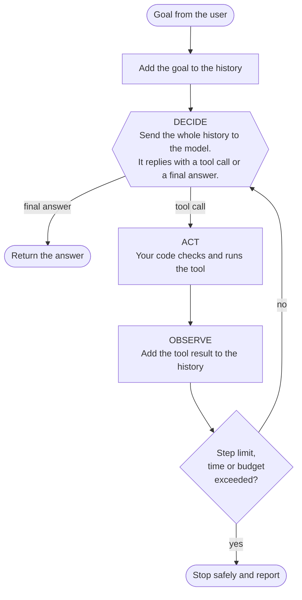

# The Agent Loop: Decide, Act, Observe, The Complete Guide

> 📚 **Before you start**
>
> - [What is an AI Agent?](../02-understanding-agents/what-is-an-ai-agent.md), where you built a first 40-line agent.
> - [Agentic AI vs Generative AI](../02-understanding-agents/agentic-ai-vs-generative-ai.md), for why an agent is a generative model used in a loop.

## Introduction

When a coding agent spends ten minutes fixing a failing test, it can look like magic: it reads files, edits code, runs commands, reads errors and tries again. But if you could slow it down and watch each step, you would see the same small cycle repeated dozens of times. **Decide** what to do next. **Act** by running a tool. **Observe** the result. Repeat.

That cycle is the **agent loop**. Every agent framework you'll ever use (LangGraph, CrewAI, the OpenAI Agents SDK, the Claude Agent SDK) is, at its core, a well-engineered version of it. Once you understand the loop deeply, frameworks stop being mysterious: you can look at any of them and ask *"where's the decide step? where's the act step? what's in the history? what stops it?"*

In [What is an AI Agent?](../02-understanding-agents/what-is-an-ai-agent.md) you built a minimal loop. This article takes it apart properly. You'll learn what happens in each step, what the **history** really is and why it grows, every way a loop can end, what goes wrong in practice, and how to make a loop robust. You'll finish with a loop that is much closer to what production agents use.

> 💡 **Key Insight**
>
> The model has no memory between calls. Each time round the loop, **the entire history is sent again**, and the model decides from scratch based on what it reads. The "state" of an agent is simply that growing list of messages. Control the history and you control the agent.

---

## Core Explanation

### The loop in one picture



Let's go through each box.

### Step 1: Decide

In the decide step, your program sends the model three things:

1. **Instructions** (often called the *system prompt*): what the agent is for and how to behave.
2. **The tool list**: the name, description and expected inputs of every tool it may use.
3. **The history**: the user's goal, plus every action taken and every result observed so far.

The model reads all of it and replies with **exactly one of two things**:

- **A tool call:** "run `get_weather` with `{"city": "Mumbai"}`".
- **A final answer:** "It will rain tomorrow, so I added a reminder."

Some models can ask for several tool calls at once (we'll handle that later in the course), but the principle is the same: the reply is either *more work to do* or *done*.

> 💡 **Key Insight**
>
> The decide step is the **only** place the model is involved. Everything else in the loop is ordinary code that you write and control.

### Step 2: Act

If the model asked for a tool, your code runs it. This is the most important safety boundary in the whole system, because **this is where the agent touches the real world**. A good act step does more than call a function:

- **Validate** the request. Does the tool exist? Are the inputs the right type? Is the value sensible?
- **Check permissions.** Is this agent allowed to use this tool? Does this action need human approval first (sending money, deleting files, emailing customers)?
- **Run it safely.** Catch exceptions, apply a timeout, and never let a crash in one tool crash the whole agent.
- **Return a useful result**, including clear error messages, because the model will read them.

### Step 3: Observe

The tool's result is added to the history as a new message. On the next decide step, the model sees it and can react. This is what makes agents adaptive: if the result is surprising (an error, an empty search, a test failure), the next decision can take that into account.

A subtle but crucial point: **errors are observations too.** If a tool fails, don't stop the agent. Tell the model what went wrong, in plain words, and let it decide what to do. Models are often good at recovering ("the city wasn't found; let me try the full name") if you give them a readable error.

### The history: what the agent "remembers"

Here's what the history looks like after two trips round the loop of a weather agent. Most model APIs use a list of messages with a **role** and **content**, very much like this:

```python
history = [
    {"role": "user",      "content": "Will it rain in Mumbai tomorrow? If so, remind me to carry an umbrella."},
    {"role": "assistant", "content": {"tool": "get_weather", "args": {"city": "Mumbai"}}},
    {"role": "tool",      "content": "80% chance of rain in Mumbai tomorrow"},
    {"role": "assistant", "content": {"tool": "add_todo", "args": {"item": "carry umbrella"}}},
    {"role": "tool",      "content": "Added 'carry umbrella' to the to-do list"},
]
for message in history:
    print(f"{message['role']:>9}: {message['content']}")
```

Output:

```
     user: Will it rain in Mumbai tomorrow? If so, remind me to carry an umbrella.
assistant: {'tool': 'get_weather', 'args': {'city': 'Mumbai'}}
     tool: 80% chance of rain in Mumbai tomorrow
assistant: {'tool': 'add_todo', 'args': {'item': 'carry umbrella'}}
     tool: Added 'carry umbrella' to the to-do list
```

Three roles appear:

- **user**: what the person asked.
- **assistant**: what the model decided (here, tool calls).
- **tool**: what happened when the tool ran.

On the third decide step, the model receives all five messages and concludes the job is done. It doesn't "remember" anything from the earlier calls. It simply **re-reads the story so far**.

This has three big consequences:

1. **The history grows with every step**, so each call costs more and takes longer than the last.
2. **Models have a maximum input size** (the *context window*). Long-running agents must trim or summarise old history, which you'll study in [LangGraph State and Memory](../../langgraph-state-and-memory/course.md).
3. **Whatever is in the history can steer the agent**, including text that came back from tools. A web page that says "ignore your instructions" ends up in the history. This is the root of *prompt injection*, covered in [Guardrails and Security](../../enterprise-llm-systems/course.md#m6).

### How a loop can end

A well-built loop has **one happy ending and several safety exits**:

| Ending | What triggers it | What to do |
|---|---|---|
| **Final answer** | The model says it's done | Return the answer |
| **Step limit** | Too many trips round the loop | Stop, return what's known and say it didn't finish |
| **Budget limit** | Too many tokens or too much cost | Same as above |
| **Time limit** | The task has run too long | Same as above |
| **Repeated action** | The model asks for the exact same call again and again | Stop, or tell the model it's repeating itself |
| **Human stop** | A person cancels, or declines an approval | Stop and record why |
| **Fatal error** | Something unrecoverable, like an expired API key | Stop and surface the error |

Beginners usually build only the first ending. Production agents need all of them.

### A robust loop, built step by step

Let's build a loop that handles validation, errors, step limits and repeated actions. We'll keep using a pretend model so you can run everything offline, but we'll make it return the same structured shape a real tool-calling model returns.

**The tools.** Notice that `divide` can fail.

```python
def add(a, b):
    return a + b

def divide(a, b):
    return a / b   # raises ZeroDivisionError when b == 0

TOOLS = {
    "add":    {"fn": add,    "params": {"a": float, "b": float}},
    "divide": {"fn": divide, "params": {"a": float, "b": float}},
}
```

**The act step**, with validation and error handling. It always returns text the model can read, never an exception.

```python
def run_tool(name, args):
    if name not in TOOLS:
        return f"ERROR: unknown tool '{name}'. Available tools: {', '.join(TOOLS)}"
    spec = TOOLS[name]
    missing = [p for p in spec["params"] if p not in args]
    if missing:
        return f"ERROR: missing argument(s) {missing} for tool '{name}'"
    try:
        clean = {p: spec["params"][p](args[p]) for p in spec["params"]}
        return f"RESULT: {spec['fn'](**clean)}"
    except Exception as e:
        return f"ERROR: {type(e).__name__}: {e}"

print(run_tool("divide", {"a": 10, "b": 4}))
print(run_tool("divide", {"a": 10, "b": 0}))
print(run_tool("multiply", {"a": 2, "b": 3}))
print(run_tool("add", {"a": 2}))
```

Output:

```
RESULT: 2.5
ERROR: ZeroDivisionError: float division by zero
ERROR: unknown tool 'multiply'. Available tools: add, divide
ERROR: missing argument(s) ['b'] for tool 'add'
```

**The pretend model.** It's asked to work out *(10 + 5) ÷ 0* and must cope with the error. A real LLM would figure this out from reading the history; our pretend one follows a script that mimics that reasoning.

```python
def pretend_model(history):
    last = history[-1]["content"]
    if history[-1]["role"] == "user":
        return {"tool": "add", "args": {"a": 10, "b": 5}}
    if last == "RESULT: 15.0":
        return {"tool": "divide", "args": {"a": 15, "b": 0}}
    if "ZeroDivisionError" in last:
        return {"final": "(10 + 5) = 15, but dividing by 0 is undefined, so there is no numeric answer."}
    return {"final": f"Done: {last}"}
```

**The loop**, with a step limit and repeated-action detection.

```python
def run_agent(goal, model, max_steps=6):
    history = [{"role": "user", "content": goal}]
    seen_calls = set()

    for step in range(1, max_steps + 1):
        decision = model(history)                                   # DECIDE
        if "final" in decision:
            return decision["final"], history

        call_key = (decision["tool"], tuple(sorted(decision["args"].items())))
        if call_key in seen_calls:                                  # safety exit
            return "Stopped: the agent repeated the same action.", history
        seen_calls.add(call_key)

        history.append({"role": "assistant", "content": decision})
        result = run_tool(decision["tool"], decision["args"])        # ACT
        history.append({"role": "tool", "content": result})          # OBSERVE
        print(f"step {step}: {decision['tool']}({decision['args']}) -> {result}")

    return "Stopped: step limit reached.", history                  # safety exit


answer, history = run_agent("What is (10 + 5) divided by 0?", pretend_model)
print("Answer:", answer)
print("Messages in history:", len(history))
```

Output:

```
step 1: add({'a': 10, 'b': 5}) -> RESULT: 15.0
step 2: divide({'a': 15, 'b': 0}) -> ERROR: ZeroDivisionError: float division by zero
Answer: (10 + 5) = 15, but dividing by 0 is undefined, so there is no numeric answer.
Messages in history: 5
```

The tool failed, but the agent didn't crash. The error became an **observation**, and the model used it to produce a sensible final answer.

**Now break the model** to see the safety exits work. This model gets stuck and keeps asking for the same call:

```python
def stuck_model(history):
    return {"tool": "add", "args": {"a": 1, "b": 1}}

answer, _ = run_agent("Add one and one", stuck_model)
print("Answer:", answer)
```

Output:

```
step 1: add({'a': 1, 'b': 1}) -> RESULT: 2.0
Answer: Stopped: the agent repeated the same action.
```

Without the repeated-action check, it would have burned through all six steps (and, with a real model, six paid API calls) doing nothing useful.

### Where the real model plugs in

In a real agent, `pretend_model` is replaced by a function that calls an LLM API. The shape stays the same: send instructions, tool descriptions and history; get back either a tool call or a final answer. You'll do exactly that in [Function Calling Step by Step](../course.md#m4). The loop you just wrote won't need to change, which is the point of building it by hand first.

### Try It Yourself

Put the code blocks above into one file and run it. Then:

1. Ask the agent for *"(10 + 5) divided by 3"* by changing the `divide` args in `pretend_model` to `{"a": 15, "b": 3}`. What's the final answer?
2. Make `pretend_model` request a tool that doesn't exist, `"multiply"`, as its first step. What does the history contain after step 1? How might a real model use that error message?
3. Add a **budget** safety exit: count the total characters in the history and stop if it goes over 400. Test it with a model that keeps calling `add` with a different number each time (so the repeated-action check doesn't fire).

<details>
<summary>What you should see</summary>

1. Step 2 returns `RESULT: 5.0` and the model's last branch fires: `Done: RESULT: 5.0`.
2. The tool message reads `ERROR: unknown tool 'multiply'. Available tools: add, divide`. A real model would read the list and switch to an available tool, or explain that it can't multiply. Listing the valid options in the error makes recovery much easier.
3. Inside the loop, before calling the model: `if sum(len(str(m["content"])) for m in history) > 400: return "Stopped: budget reached.", history`. A model like `lambda h: {"tool": "add", "args": {"a": len(h), "b": 1}}` triggers it after a few steps.

</details>

---

## Real-World Examples

### Example 1: Coding agents

When a coding agent fixes a bug, each trip round the loop is one action: search the codebase, read a file, edit a file, run the tests. The test output is an observation. If tests fail, the error text goes into the history and shapes the next edit. Coding agents often run dozens of steps, which is why they rely heavily on step limits, cost limits and asking permission before risky commands.

### Example 2: Research assistants

"Deep research" features in AI products search the web, open pages, read them and search again based on what they found. The loop can run for many minutes. These systems summarise or prune old pages from the history so the context window doesn't overflow, which is exactly the "history grows" problem from this article.

### Example 3: Support agents with approval steps

A refund agent might be allowed to look up orders freely but need a human to approve any refund over a threshold. In loop terms, the act step pauses, asks a person, and records the answer as an observation. You'll build this pattern in [Human-in-the-Loop with LangGraph](../../human-in-the-loop-with-langgraph/course.md).

---

## Common Misconceptions

### Misconception 1: "The model remembers what it did earlier"

It doesn't. It re-reads the history on every call. If something isn't in the history, the model doesn't know it happened.

### Misconception 2: "If a tool fails, the agent should stop"

Usually the opposite. Turn the failure into a clear observation and let the model adapt. Stop only for unrecoverable problems or when a safety exit triggers.

### Misconception 3: "A step limit is enough protection"

It's the minimum. Production loops also need budget and time limits, repeated-action detection, input validation, permissions and approval for risky actions.

### Misconception 4: "The loop is the framework's job, I don't need to understand it"

When an agent misbehaves, the cause is almost always visible in the loop: a confusing tool result, a missing error message, an overgrown history, a missing stop condition. Understanding the loop is how you debug every framework.

---

## Interview Relevance

You'll often be asked to *"describe how an agent works"* or *"write a simple agent loop"*. A strong answer:

- **Names the three steps**: decide (model picks a tool call or final answer), act (application runs the tool), observe (result appended to history).
- **Explains the history**: the model is stateless; the message list is the state and is resent every call, so cost grows with steps and context limits matter.
- **Lists termination conditions**: final answer, plus step, budget and time limits, repeated-action detection and human interruption.
- **Treats errors as observations** and mentions validation and permissions in the act step.

Common follow-ups:

- *"How do you stop an agent looping forever?"* Step limits, budgets, timeouts and detecting repeated calls, plus clear instructions about when to finish.
- *"What happens when the history is too long?"* Trim old tool results, summarise earlier steps, or store details outside the context and retrieve them when needed.
- *"Where would you add human approval?"* In the act step, before any irreversible or high-impact action.

---

## Key Takeaways

- Every agent runs the same loop: **decide, act, observe, repeat**.
- The model is only involved in **decide**. Acting and observing are your code, and that's where safety lives.
- The **history** is the agent's entire state. It's resent every call and grows every step.
- **Errors are observations.** Return clear, readable error messages instead of crashing.
- A robust loop has a happy ending (final answer) **and** safety exits: step, budget and time limits, repeated-action detection and human stops.

---

**Up next:** [Workflows vs Agents](workflows-vs-agents.md)
