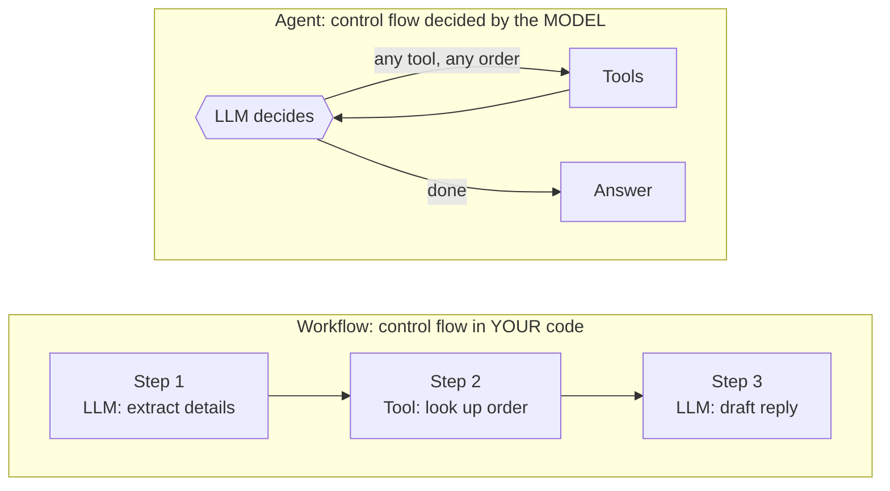
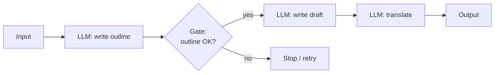
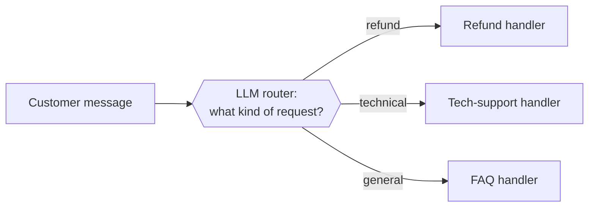
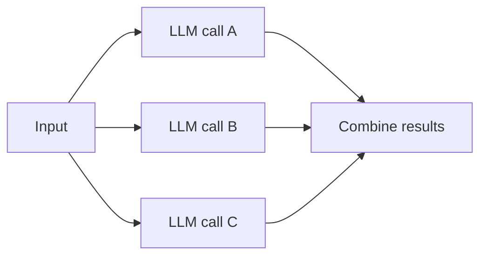
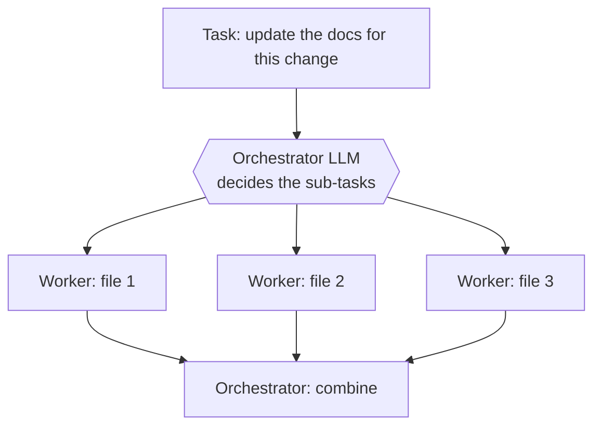
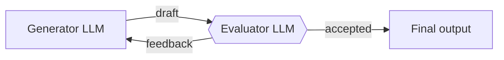

# Workflows vs Agents: The Complete Guide

> 📚 **Before you start**
>
> - [The Agent Loop: Decide, Act, Observe](the-agent-loop-decide-act-observe.md), for how an agent runs.
> - [Agentic AI vs Generative AI](../02-understanding-agents/agentic-ai-vs-generative-ai.md), for the spectrum from plain generation to full agents.

## Introduction

Imagine two ways to make a cup of tea. In the first, you follow a recipe card: boil water, put a tea bag in a cup, pour, wait three minutes, remove the bag, add milk. Every step is written down in advance. In the second, you hand the job to a friend: *"Make me a tea, the way I like it."* Your friend checks whether there's milk, notices the kettle is broken, decides to use the microwave, and asks whether you'd like honey instead of sugar.

The recipe card is a **workflow**. Your friend is an **agent**.

Both use the same skills. The difference is **who decides the steps**. In a workflow, you (the developer) decide the steps in advance and write them into code. In an agent, the model decides the steps at runtime, based on what it sees.

This is the single most important design decision in any LLM application, and most teams get it wrong the first time by reaching for an agent when a workflow would be simpler, cheaper and more reliable. This article teaches you the difference, the five standard workflow patterns, when an agent is genuinely worth it, and how to choose.

> 💡 **Key Insight**
>
> **Workflows**: LLMs and tools are orchestrated through **code paths you define in advance**. **Agents**: the LLM **dynamically directs its own process** and tool use. Start with the simplest option that works, and add autonomy only when the steps genuinely can't be known ahead of time.

---

## Core Explanation

### The defining difference: who controls the flow

Both workflows and agents can call language models and tools. The difference is **where the control flow lives**.



In a workflow, if you read the code, you know exactly which steps will run and in what order (possibly with some branches you wrote). In an agent, you only know which steps **might** run. The model chooses.

### The building block: an augmented LLM

Both approaches are built from the same basic unit: a language model **augmented** with extra capabilities:

- **Retrieval**: it can be given relevant documents.
- **Tools**: it can request actions.
- **Memory**: it can be given information from earlier.

A workflow wires several augmented LLM calls together in a fixed pattern. An agent puts one augmented LLM in a loop and lets it choose.

### The five workflow patterns

Most production LLM systems are built from a handful of recurring workflow patterns. These were described clearly by Anthropic in its widely cited guide *Building Effective Agents*, and you'll see them in every framework under various names.

#### 1. Prompt chaining

Break a task into a **fixed sequence** of steps. Each step's output becomes the next step's input. You can add checks ("gates") between steps.



- **Use it when:** the task splits cleanly into steps that always happen in the same order.
- **Example:** write marketing copy, check it against brand rules, then translate it.
- **Why it helps:** each call has one small job, so each is easier for the model to do well.

#### 2. Routing

Classify the input first, then send it down a **specialised path**.



- **Use it when:** inputs fall into distinct categories that are best handled differently.
- **Example:** support tickets, or sending easy questions to a small cheap model and hard ones to a large model.

#### 3. Parallelisation

Run several LLM calls **at the same time** and combine the results. It comes in two flavours:

- **Sectioning:** split the task into independent parts (summarise each chapter separately).
- **Voting:** run the same task several times and compare (ask three times whether this code has a vulnerability, flag it if any say yes).



#### 4. Orchestrator–workers

A central LLM **breaks the task down at runtime** and hands pieces to worker LLMs, then combines their output. Unlike sectioning, the number and kind of sub-tasks aren't known in advance.



- **Use it when:** you can't predict the sub-tasks. For example, a code change might need edits in two files or twenty.
- This is the most "agent-like" of the workflows, but the overall shape (split, work, combine) is still fixed.

#### 5. Evaluator–optimiser

One LLM **produces**, another **critiques**, and they loop until the critic is satisfied.



- **Use it when:** there are clear quality criteria and feedback measurably improves the result.
- **Example:** literary translation, where a critic can point out nuances the first draft missed.

### Agents: when the path itself is unknown

An **agent** is what you reach for when even the *shape* of the solution can't be known in advance. The model plans, acts, observes and re-plans, for as many steps as it takes.

- **Use it when:** the task is open-ended, the number of steps is unpredictable, and you can't hard-code a path. Examples: fixing a bug in an unfamiliar codebase, researching an open question, resolving a complex customer issue.
- **Requirements:** you need to **trust the model's decisions** within the environment you give it, so agents need good tools, clear stopping conditions, guardrails, and testing in a safe sandbox.

### The trade-off, in one table

| | Single LLM call | Workflow | Agent |
|---|---|---|---|
| **Who decides the steps** | Nobody, there's one step | You, in code | The model, at runtime |
| **Predictability** | Highest | High | Lower |
| **Cost and latency** | Lowest | Medium | Highest, and variable |
| **Handles unexpected situations** | Poorly | Only the branches you wrote | Well |
| **Ease of testing and debugging** | Easy | Moderate | Hardest |
| **Best for** | One well-defined transformation | Known, repeatable multi-step processes | Open-ended tasks with unpredictable steps |

### The same task, built both ways

Let's handle customer messages about orders, first as a **routing workflow**, then as an **agent**. Both use a pretend model so they run offline.

```python
ORDERS = {"A100": {"status": "delivered", "item": "headphones", "days_since_delivery": 5},
          "B200": {"status": "in transit", "item": "keyboard", "days_since_delivery": None}}

def lookup_order(order_id):
    return ORDERS.get(order_id, "not found")

def start_refund(order_id):
    return f"refund started for {order_id}"


# ----- Workflow: the developer fixes the path. -----
def classify(message):                       # pretend LLM call #1: routing
    return "refund" if "refund" in message.lower() else "status"

def workflow(message, order_id):
    route = classify(message)
    order = lookup_order(order_id)           # always looks up the order
    if route == "refund":
        if order != "not found" and order["status"] == "delivered":
            return start_refund(order_id)
        return "Sorry, only delivered orders can be refunded."
    return f"Your {order['item']} is {order['status']}."

print("Workflow:", workflow("Where is my order?", "B200"))
print("Workflow:", workflow("I want a refund", "A100"))
```

Output:

```
Workflow: Your keyboard is in transit.
Workflow: refund started for A100
```

Every path is visible in the code. Easy to test, easy to reason about, cheap to run. But look what happens with a message nobody anticipated:

```python
print("Workflow:", workflow("My headphones arrived broken. Refund or replace, whichever is faster?", "A100"))
```

Output:

```
Workflow: refund started for A100
```

The workflow saw the word "refund" and charged ahead. It never considered a replacement, because nobody wrote that branch.

Now the agent version. The pretend model below mimics how an LLM would reason about the same message; with a real model, none of these rules would be written by hand.

```python
def check_replacement_stock(item):
    return f"{item}: 12 in stock, ships tomorrow"

AGENT_TOOLS = {"lookup_order": lookup_order, "start_refund": start_refund,
               "check_replacement_stock": check_replacement_stock}

def pretend_agent_model(history):
    seen = " ".join(str(m["content"]) for m in history)
    if "status" not in seen:
        return {"tool": "lookup_order", "arg": "A100"}
    if "in stock" not in seen and "replace" in history[0]["content"]:
        return {"tool": "check_replacement_stock", "arg": "headphones"}
    return {"final": "Sorry they arrived broken! A replacement can ship tomorrow, which is faster "
                     "than a refund (3-5 days). Shall I send the replacement?"}

def agent(message, max_steps=5):
    history = [{"role": "user", "content": message}]
    for _ in range(max_steps):
        d = pretend_agent_model(history)
        if "final" in d:
            return d["final"]
        result = AGENT_TOOLS[d["tool"]](d["arg"])
        print(f"  {d['tool']}({d['arg']}) -> {result}")
        history.append({"role": "tool", "content": result})
    return "Stopped."

print("Agent:", agent("My headphones arrived broken. Refund or replace, whichever is faster?"))
```

Output:

```
  lookup_order(A100) -> {'status': 'delivered', 'item': 'headphones', 'days_since_delivery': 5}
  check_replacement_stock(headphones) -> headphones: 12 in stock, ships tomorrow
Agent: Sorry they arrived broken! A replacement can ship tomorrow, which is faster than a refund (3-5 days). Shall I send the replacement?
```

The agent chose its own path: look up the order, check stock, then **ask** instead of acting, because the customer's preference was unclear. That flexibility is real value. But notice the costs: more model calls, a path you can't fully predict, and harder testing.

> 💡 **Key Insight**
>
> A good rule of thumb: if you can **draw the flowchart** before seeing the input, build a workflow. If the flowchart depends on what you discover along the way, you need an agent.

### Hybrid designs are normal

Real systems mix both. A common design is a **routing workflow** that sends simple, frequent requests down cheap fixed paths, and only escalates unusual requests to an agent. Another is an agent whose individual tools are themselves small workflows. You don't have to choose one for the whole system.

### A decision checklist

Ask these questions in order:

1. **Can a single, well-written prompt do it?** If yes, stop there.
2. **Are the steps always the same?** Use prompt chaining.
3. **Do inputs fall into clear categories?** Use routing.
4. **Can it be split into independent parts, or would multiple opinions help?** Use parallelisation.
5. **Are there clear quality criteria and is iteration useful?** Use evaluator–optimiser.
6. **Are the sub-tasks unknown until you see the input?** Use orchestrator–workers.
7. **Is the whole path unpredictable, and can you trust the model with your tools?** Now consider an agent.

### Try It Yourself

Paste the code into one file and run it. Then:

1. Add a branch to `workflow` so a message containing "replace" checks replacement stock before refunding. How many messages would you need to handle by hand to cover every variation customers might write?
2. Call `agent("Where is my order?")`. What happens? Why? What does this tell you about the pretend model compared with a real one?
3. Decide which pattern fits each task: (a) summarise 50 PDF reports, (b) answer HR questions about leave, payroll or IT, (c) translate a novel chapter with high literary quality, (d) investigate why last week's sales dropped.

<details>
<summary>What you should see</summary>

1. You can add `if "replace" in message.lower(): ...`, but every new phrasing ("swap", "exchange", "send another") needs another rule. Workflows are only as flexible as the branches you write.
2. It looks up A100 (hard-coded) and then gives the broken-headphones answer, which makes no sense for this question. Our pretend model is scripted for one conversation. A real model would read the actual question and answer about order status. This is why we use pretend models only to learn the loop's shape.
3. (a) Parallelisation (sectioning). (b) Routing. (c) Evaluator–optimiser. (d) An agent: the investigation path depends on what each query reveals.

</details>

---

## Real-World Examples

### Example 1: Customer support at scale

Many companies route the bulk of tickets ("where's my order?", "reset my password") through fixed workflows: fast, cheap and fully auditable. Only complex, multi-issue tickets reach an agent that can investigate across several systems, and the agent hands off to a human when it isn't confident.

### Example 2: Coding assistants

Inline code completion is a single LLM call. "Explain this function" is a single call with retrieval. "Fix this failing test" is an agent: it must search, read, edit, run tests and iterate, and nobody can predict how many steps it needs.

### Example 3: Content pipelines

A news organisation generating daily market summaries uses prompt chaining: fetch the data, draft the summary, check the facts against the data, and format it. The steps never change, so an agent would add cost and risk with no benefit.

---

## Common Misconceptions

### Misconception 1: "Agents are always better because they're smarter"

Agents are more **flexible**, not more **correct**. For a fixed process they're slower, costlier and less predictable than a workflow doing the same job.

### Misconception 2: "Workflows don't use AI judgement"

Every LLM call in a workflow uses judgement: classifying, writing, evaluating. What workflows fix is the **order of steps**, not the intelligence inside each one.

### Misconception 3: "Orchestrator–workers is just an agent"

It's close, but the overall shape (break down, delegate, combine) is fixed in code. In a true agent the model decides the shape too.

### Misconception 4: "You have to pick one for the whole product"

Hybrids are the norm: routing to workflows for common cases and to agents for rare, complex ones.

---

## Interview Relevance

*"When would you use an agent versus a workflow?"* is one of the most common system-design questions for AI engineers. A strong answer:

- **Defines both by control flow**: predefined code paths vs model-directed steps.
- **Names the patterns**: prompt chaining, routing, parallelisation, orchestrator–workers, evaluator–optimiser.
- **States the trade-off**: predictability, cost and testability vs flexibility.
- **Gives a rule**: start with the simplest solution, and add autonomy only when the path can't be known in advance.
- **Mentions hybrids** and safety requirements for agents (sandboxing, permissions, limits).

Common follow-ups:

- *"Design a support system for 1 million tickets a month."* Routing first; workflows for the top categories; an agent with human handoff for the long tail; evaluation and monitoring throughout.
- *"How would you test an agent?"* Scenario-based test sets, checking both final outcomes and the steps taken, run repeatedly because outputs vary. Covered in [Agent Evals, Observability and Reliability](../../agent-evals-observability-and-reliability/course.md#m2).

---

## Key Takeaways

- **Workflows** follow code paths you define; **agents** let the model decide the path at runtime.
- The five core workflow patterns are **prompt chaining, routing, parallelisation, orchestrator–workers** and **evaluator–optimiser**.
- Agents are worth it when the **path can't be known in advance**, and you can trust the model with the tools.
- Workflows win on **cost, speed, predictability and testability**.
- If you can draw the flowchart before seeing the input, build a workflow. Hybrids are normal.

---

**Up next:** [Anatomy of an Agent](anatomy-of-an-agent.md)
