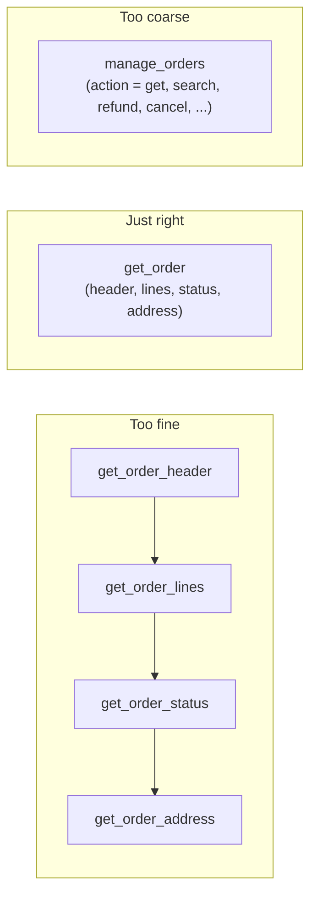

# Designing Good Tools: The Complete Guide

> 📚 **Before you start**
>
> - [What is a Tool?](what-is-a-tool.md), for the parts of a tool definition.
> - [Function Calling Step by Step](function-calling-step-by-step.md), for how calls and results travel.

## Introduction

Two teams build the same support agent with the same model. Team A's agent picks the wrong tool a third of the time, passes dates in three different formats and drowns in 5,000-line results. Team B's agent just works. The difference is rarely the model. It's the **tools**.

A tool definition is a tiny user interface, and its user is a language model. The model can't ask you what you meant, can't read your source code, and can't scroll back to your onboarding doc. It sees a name, a description, a schema and whatever text your tool returns. Everything it does depends on those four things being clear.

This lesson collects the design rules that make tools easy for models to use correctly, with a bad and a good version of each, and finishes with a checklist you can apply to every tool you write.

> 💡 **Key Insight**
>
> Design tools for **a smart new colleague who has only the tool's documentation**. If a capable person couldn't use the tool correctly from its name, description, schema and output alone, a model can't either. Most "the agent is dumb" bugs are really "the tool is confusing" bugs.

---

## Core Explanation

### Rule 1: Name tools as clear actions

The name is the first thing the model matches against the user's request.

| Bad | Why it's bad | Good |
|---|---|---|
| `process` | Process what? | `refund_order` |
| `data_tool_v2` | No verb, no object | `search_customers` |
| `get` + `get_info` + `fetch` | Three names for overlapping things | `get_order`, `get_customer` |
| `doIt` | Meaningless | `send_invoice_email` |

Use **verb_object** names in one consistent style. If you have several related tools, give them a shared prefix (`orders_search`, `orders_get`, `orders_refund`) so the model sees them as a family.

### Rule 2: Write descriptions that say what, when and what not

A good description answers three questions: **what** the tool does, **when** to use it, and **when not** to (or what to use instead). It also mentions anything surprising about inputs or outputs.

```python
bad = {
    "name": "search_orders",
    "description": "Searches orders.",
}

good = {
    "name": "search_orders",
    "description": (
        "Find a customer's orders by email or phone number. Returns up to 10 orders, newest first, "
        "each with order_id, date, total and status. Use this when the user hasn't given an "
        "order_id. If they have an order_id, use get_order instead, which is faster and returns "
        "line items."
    ),
}
print(len(bad["description"].split()), "words vs", len(good["description"].split()), "words")
```

Output:

```
2 words vs 47 words
```

Longer isn't automatically better, but **three or four informative sentences** beat a vague phrase every time. The model reads descriptions on every request, so make every sentence carry information.

### Rule 3: Make inputs hard to get wrong

Each argument is a chance for a mistake. Reduce the chances.

- **Use specific types.** `amount: number`, not `amount: string`.
- **Use enums for fixed choices.** `status` should be one of `["pending", "shipped", "delivered"]`, not free text.
- **Describe formats with an example.** `"date": "Delivery date as YYYY-MM-DD, e.g. 2026-10-16"`.
- **Use unambiguous names.** `user_email`, not `user` (an id? a name? an email?).
- **Keep required arguments few** and give the rest sensible defaults.

Here's a schema written that way, plus a tiny validator. Validating **before** running a tool turns a confusing downstream failure into a clear message the model can fix:

```python
schema = {
    "type": "object",
    "properties": {
        "user_email": {"type": "string", "description": "Customer's email, e.g. asha@example.com"},
        "status": {"type": "string", "enum": ["pending", "shipped", "delivered"]},
        "limit": {"type": "integer", "description": "Max results, 1-10. Default 5."},
    },
    "required": ["user_email"],
}

TYPES = {"string": str, "integer": int, "number": (int, float)}

def validate(args, schema):
    problems = []
    for name in schema["required"]:
        if name not in args:
            problems.append(f"missing required argument '{name}'")
    for name, value in args.items():
        spec = schema["properties"].get(name)
        if spec is None:
            problems.append(f"unknown argument '{name}' (allowed: {', '.join(schema['properties'])})")
        elif not isinstance(value, TYPES[spec["type"]]):
            problems.append(f"'{name}' should be {spec['type']}, got {type(value).__name__}")
        elif "enum" in spec and value not in spec["enum"]:
            problems.append(f"'{name}' must be one of {spec['enum']}, got '{value}'")
    return problems

print(validate({"user_email": "asha@example.com", "status": "shipped"}, schema))
print(validate({"status": "sent", "limit": "5", "email": "x"}, schema))
```

Output:

```
[]
["missing required argument 'user_email'", "'status' must be one of ['pending', 'shipped', 'delivered'], got 'sent'", "'limit' should be integer, got str", "unknown argument 'email' (allowed: user_email, status, limit)"]
```

Every message says **what was wrong and what's allowed**, which is exactly what the model needs to retry correctly. (Real projects use a library such as Pydantic or `jsonschema` for this; many model APIs can also enforce the schema for you with a *strict* mode.)

### Rule 4: Return small, useful, model-friendly results

Tool output goes straight into the model's context window. Huge, noisy outputs cost money, slow things down and bury the important part.

```python
raw_api_response = {
    "data": {"orders": [
        {"order_id": "A17", "created_at": "2026-10-02T10:14:55.123Z", "total_cents": 249900,
         "status_code": 3, "internal_flags": [0, 1, 0, 0, 1], "warehouse_shard": "eu-w-4",
         "line_items": [{"sku": "KB-01", "qty": 1}, {"sku": "MS-07", "qty": 2}]},
        {"order_id": "A09", "created_at": "2026-09-18T08:01:12.900Z", "total_cents": 59900,
         "status_code": 4, "internal_flags": [0, 0, 0, 0, 0], "warehouse_shard": "eu-w-1",
         "line_items": [{"sku": "CB-11", "qty": 1}]},
    ]},
    "meta": {"page": 1, "trace_id": "9f3c2e7a", "took_ms": 41},
}

STATUS = {3: "shipped", 4: "delivered"}

def summarise_orders(resp):
    lines = []
    for o in resp["data"]["orders"]:
        items = sum(li["qty"] for li in o["line_items"])
        lines.append(f"{o['order_id']} | {o['created_at'][:10]} | ₹{o['total_cents'] / 100:,.2f} | "
                     f"{STATUS[o['status_code']]} | {items} items")
    return f"{len(lines)} orders (newest first):\n" + "\n".join(lines)

print(len(str(raw_api_response)), "characters raw")
print(summarise_orders(raw_api_response))
```

Output:

```
533 characters raw
2 orders (newest first):
A17 | 2026-10-02 | ₹2,499.00 | shipped | 3 items
A09 | 2026-09-18 | ₹599.00 | delivered | 1 items
```

The good version:

- **drops internal noise** (`internal_flags`, `warehouse_shard`, `trace_id`),
- **translates codes into words** (`status_code: 3` becomes `shipped`),
- **uses human units** (rupees, not cents; a date, not a timestamp),
- **keeps the ids** the model will need for the next call (`A17`).

If results can be long, **paginate or truncate and say so** ("showing 10 of 240; refine your search"), so the model knows there's more.

### Rule 5: Make errors helpful

When a tool fails, the error message is the model's only clue. Compare:

| Unhelpful | Helpful |
|---|---|
| `Error 500` | `Order 'A71' not found. Order ids look like 'A17'. Use search_orders to find ids by email.` |
| `Invalid input` | `'date' must be YYYY-MM-DD, got '16/10/2026'.` |
| `Permission denied` | `Refunds over ₹10,000 need a manager. Tell the user it has been escalated.` |

A helpful error says **what happened**, **why**, and **what to do next**.

### Rule 6: Choose the right size and number of tools

Too many tiny tools and the model has to orchestrate many calls (and can mix them up). One giant do-everything tool and the schema gets confusing.



Guidelines:

- **One tool per task a user would recognise** ("look up an order", "refund an order"), not one per database table or API endpoint.
- **Combine steps that always happen together.** If every `get_order_header` is followed by `get_order_lines`, merge them.
- **Split read from write.** Keep `get_order` and `refund_order` separate so the risky one can have approval and stricter rules.
- **Keep the list short.** Every extra tool adds description text to every request and another option to confuse. If an agent needs dozens of tools, consider splitting the work across specialised agents (you'll meet this in [What are Multi-Agent Systems?](../06-multi-agent-systems-and-the-ecosystem/what-are-multi-agent-systems.md)).

### Rule 7: Build safety into the tool, not just the prompt

Instructions like *"never refund more than ₹10,000"* in the system prompt are good, but a model can still slip. Enforce limits **inside the tool**, where they can't be talked around:

```python
def refund_order(order_id, amount_inr, reason):
    if amount_inr <= 0:
        return "ERROR: amount_inr must be positive."
    if amount_inr > 10_000:
        return (f"NOT DONE: refunds over ₹10,000 need manager approval. "
                f"Escalation created for {order_id}; tell the user a manager will respond within 24 hours.")
    return f"Refunded ₹{amount_inr:,} for {order_id} (reason: {reason})."

print(refund_order("A17", 2_499, "damaged keyboard"))
print(refund_order("A17", 25_000, "customer insisted"))
```

Output:

```
Refunded ₹2,499 for A17 (reason: damaged keyboard).
NOT DONE: refunds over ₹10,000 need manager approval. Escalation created for A17; tell the user a manager will respond within 24 hours.
```

Other built-in protections worth adding to write tools: **idempotency keys** (so a retried call doesn't refund twice), **dry-run modes**, and **audit logs** of who asked for what.

### The tool design checklist

Before you give a tool to an agent, check:

1. **Name**: a clear `verb_object`, consistent with sibling tools?
2. **Description**: says what, when, when not, and anything surprising?
3. **Inputs**: specific types, enums for choices, formats with examples, few required fields?
4. **Validation**: bad inputs produce a message saying what's allowed?
5. **Output**: small, human units, no internal noise, ids kept, truncation announced?
6. **Errors**: say what happened, why, and what to do next?
7. **Granularity**: matches one recognisable task; read and write split?
8. **Safety**: limits enforced in code; approval for irreversible actions?
9. **Test**: you've tried realistic requests and read the transcript of what the model actually called?

Point 9 matters most. Read real transcripts: when the model misuses a tool, ask *"what in the definition made that a reasonable choice?"* and fix the definition.

---

## Try It Yourself

1. **Rewrite a description.** Improve this definition: name `weather`, description `"Gets weather."`, input `{"loc": string}`.
2. **Validate.** Using `validate` and `schema` above, what does `validate({"user_email": 42}, schema)` return?
3. **Shrink an output.** Write `summarise_orders` so that, given more than 3 orders, it shows only the first 3 and adds a line `"...and N more. Ask for a status filter to narrow down."`.
4. **Spot the design flaw.** A tool `database(query: string)` lets the model run any SQL. What two rules does it break, and what would you offer instead?

<details>
<summary>Show answers</summary>

**1.** For example: name `get_current_weather`; description *"Get the current temperature and conditions for a city. Use for questions about weather right now; for future days use get_forecast."*; input `{"city": {"type": "string", "description": "City name, e.g. 'Pune'"}, "unit": {"type": "string", "enum": ["celsius", "fahrenheit"]}}` with `city` required.

**2.**

```python
print(validate({"user_email": 42}, schema))
```

Output:

```
["'user_email' should be string, got int"]
```

**3.** Build `lines` as before, then:

```python
# not-run: a sketch of the change
shown, extra = lines[:3], len(lines) - 3
text = f"{len(lines)} orders (newest first):\n" + "\n".join(shown)
if extra > 0:
    text += f"\n...and {extra} more. Ask for a status filter to narrow down."
```

**4.** It's far too coarse (Rule 6) and has no built-in safety (Rule 7): the model could run `DELETE` or `DROP` statements or read tables it shouldn't. Offer specific tools instead (`search_orders`, `get_order`), or at minimum a read-only connection with an allow-list of tables and a row limit.

</details>

---

## Real-World Examples

- **Coding agents** provide `edit_file` tools that replace an exact snippet rather than rewriting whole files, because smaller, precise inputs produce fewer mistakes.
- **Search tools in AI assistants** return a handful of titles, snippets and URLs rather than full web pages, and offer a separate "fetch page" tool for when the model needs details.
- **Payment and banking agents** enforce limits and two-step confirmation inside the payment tool itself, never relying on the prompt alone.

---

## Common Misconceptions

### "The model will figure out a vague tool"

Sometimes, inconsistently. Vague tools produce agents that work in demos and fail in production. Clarity is cheap; debugging is expensive.

### "Return everything, the model can filter"

Every extra character costs tokens, time and attention. Filter in code, where it's free and deterministic.

### "Safety rules belong in the system prompt"

Put them in the prompt **and** in the tool. Prompts guide; code enforces.

### "One tool per API endpoint is the natural design"

APIs are designed for programmers. Tools should be designed for tasks. Often one tool wraps several endpoint calls.

---

## Interview Relevance

*"How do you design tools for an LLM agent?"* is a favourite system-design question. Cover: clear names and descriptions (what, when, when not); constrained inputs (types, enums, formats) plus validation with actionable errors; concise outputs in human units with ids preserved and truncation signalled; task-level granularity with read and write split; and safety enforced in code (limits, approvals, idempotency). Finish with evaluation: test on realistic requests and read transcripts.

A common follow-up: *"Your agent keeps calling the wrong tool. What do you do?"* Read the transcripts, compare the two tools' names and descriptions, make the boundary explicit ("use X when..., use Y when..."), merge or rename overlapping tools, and re-test.

---

## Key Takeaways

- A tool definition is a **UI for the model**: name, description, schema and output are all it sees.
- **Names** are clear actions; **descriptions** say what, when and when not.
- **Constrain inputs** and **validate** with messages that say what's allowed.
- **Return less**: no noise, human units, ids kept, truncation announced.
- **Errors** explain what happened and what to do next.
- Size tools to **user-recognisable tasks**, split **read from write**, and **enforce safety in code**.

---

**Up next:** [Lab: Tool-using agent from scratch](lab-tool-using-agent-from-scratch.md)
