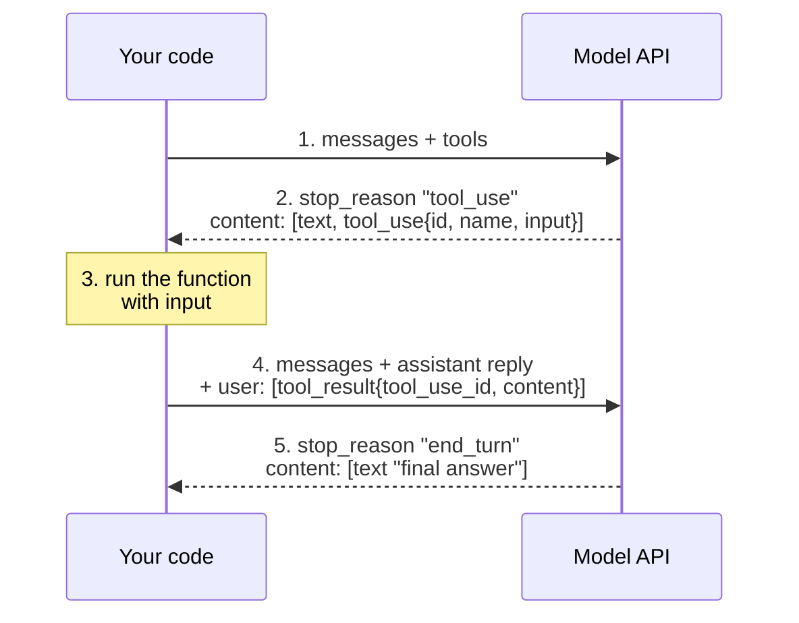

# Function Calling Step by Step: The Complete Guide

> 📚 **Before you start**
>
> - [What is a Tool?](what-is-a-tool.md), for tool definitions (name, description, input schema).
> - [The Agent Loop: Decide, Act, Observe](../03-the-agent-loop/the-agent-loop-decide-act-observe.md), because function calling is that loop over a real API.
> - [Your first LLM API call](../../generative-ai-and-llm-foundations/course.md#m3), for API keys and basic requests.

## Introduction

In the last lesson you saw the idea: the model writes a tool request, your code runs it, and you send back the result. This lesson turns that idea into the **exact messages** a real LLM API sends and expects, one step at a time.

We'll use the Anthropic Messages API (the API behind Claude) as the concrete example, because its shapes are clean and explicit. OpenAI, Google and open-source servers use different field names for the same four moves, and once you understand one you can read the others in minutes.

Every step has two versions:

- the **real API call** (marked `# not-run`, because it needs an API key and internet), and
- an **offline simulation** that uses the same data shapes, so you can run and inspect every message on your own machine for free.

> 💡 **Key Insight**
>
> Function calling is a **conversation with an extra kind of message**. The model's reply can contain a `tool_use` block (with an `id`, a `name` and an `input`), and your next message must contain a matching `tool_result` block with the same `id`. Everything else (loops, frameworks, agents) is built on that one pairing.

---

## Core Explanation

### The whole flow on one page



Five steps. Let's do each one.

### Step 1: Define the tool and send the request

We'll build a currency helper. First the function and its definition (exactly the format from [What is a Tool?](what-is-a-tool.md)):

```python
RATES_TO_INR = {"USD": 83.0, "EUR": 90.0, "GBP": 105.0, "INR": 1.0}

def convert_currency(amount, from_currency, to_currency):
    if from_currency not in RATES_TO_INR or to_currency not in RATES_TO_INR:
        raise ValueError(f"Unsupported currency. Supported: {', '.join(RATES_TO_INR)}")
    value = amount * RATES_TO_INR[from_currency] / RATES_TO_INR[to_currency]
    return f"{amount} {from_currency} = {value:.2f} {to_currency}"

tools = [{
    "name": "convert_currency",
    "description": "Convert an amount of money from one currency to another using today's rate. "
                   "Use this for any question about prices in a different currency.",
    "input_schema": {
        "type": "object",
        "properties": {
            "amount": {"type": "number", "description": "The amount to convert"},
            "from_currency": {"type": "string", "description": "ISO code, e.g. USD"},
            "to_currency": {"type": "string", "description": "ISO code, e.g. INR"},
        },
        "required": ["amount", "from_currency", "to_currency"],
    },
}]

messages = [{"role": "user", "content": "My course costs 120 dollars. How much is that in rupees?"}]
print(convert_currency(120, "USD", "INR"))
```

Output:

```
120 USD = 9960.00 INR
```

The real request passes `tools` alongside the usual `messages`:

```python
# not-run: needs `pip install anthropic` and an API key
import anthropic

client = anthropic.Anthropic()          # reads ANTHROPIC_API_KEY from the environment

response = client.messages.create(
    model="claude-opus-5-5",
    max_tokens=16000,
    tools=tools,
    messages=messages,
)
```

Nothing about the tool runs yet. You've only told the model *"these tools exist; here's how to call them"*.

### Step 2: Read the model's reply

The response has two fields that matter:

- **`stop_reason`**: why the model stopped. `"tool_use"` means *"I want a tool run before I continue"*. `"end_turn"` means *"I'm done"*.
- **`content`**: a **list of blocks**. Text blocks hold words; `tool_use` blocks hold calls.

Here is what that reply looks like, written as plain Python data so we can work with it offline:

```python
response = {
    "stop_reason": "tool_use",
    "content": [
        {"type": "text", "text": "I'll convert that for you."},
        {"type": "tool_use", "id": "toolu_01A", "name": "convert_currency",
         "input": {"amount": 120, "from_currency": "USD", "to_currency": "INR"}},
    ],
}

for block in response["content"]:
    if block["type"] == "text":
        print("TEXT     :", block["text"])
    elif block["type"] == "tool_use":
        print("TOOL CALL:", block["name"], block["input"], "id =", block["id"])
```

Output:

```
TEXT     : I'll convert that for you.
TOOL CALL: convert_currency {'amount': 120, 'from_currency': 'USD', 'to_currency': 'INR'} id = toolu_01A
```

Three details to notice:

- **The `input` is already a dictionary** that matches your `input_schema`. The model turned "120 dollars" into `amount: 120, from_currency: "USD"` by itself. That translation from fuzzy language to clean arguments is the real magic of function calling.
- **Every call has an `id`.** You'll need it in step 4.
- **There can be text and several tool calls in one reply.** Always loop over all blocks; never assume the tool call is `content[0]`.

With the real SDK the blocks are objects, so you read `block.type`, `block.name`, `block.input` and `block.id` instead of dictionary keys. The shapes are identical.

### Step 3: Run the function

Your code finds the function by name and calls it with the model's input. Wrap it so errors become text instead of crashing your program:

```python
FUNCTIONS = {"convert_currency": convert_currency}

def execute_tool(name, tool_input):
    try:
        return FUNCTIONS[name](**tool_input), False          # (result, is_error)
    except KeyError:
        return f"Unknown tool '{name}'", True
    except Exception as e:
        return f"{type(e).__name__}: {e}", True

tool_calls = [b for b in response["content"] if b["type"] == "tool_use"]
for call in tool_calls:
    print(execute_tool(call["name"], call["input"]))
print(execute_tool("convert_currency", {"amount": 5, "from_currency": "JPY", "to_currency": "INR"}))
```

Output:

```
('120 USD = 9960.00 INR', False)
('ValueError: Unsupported currency. Supported: USD, EUR, GBP, INR', True)
```

This is the step where **you** are in control. It's where you'd check permissions, ask a human for approval (as in the [agent loop lab](../03-the-agent-loop/lab-agent-loop-with-a-pretend-model.md)), log the call, or apply a timeout.

### Step 4: Send the result back

Now the most important rule in function calling. The next request must contain:

1. the **assistant's reply, unchanged** (including its `tool_use` blocks), and then
2. a **user message containing a `tool_result` block** whose `tool_use_id` equals the call's `id`.

```python
messages.append({"role": "assistant", "content": response["content"]})

tool_results = []
for call in tool_calls:
    result, is_error = execute_tool(call["name"], call["input"])
    tool_results.append({
        "type": "tool_result",
        "tool_use_id": call["id"],          # must match the tool_use block's id
        "content": result,
        "is_error": is_error,
    })
messages.append({"role": "user", "content": tool_results})

for m in messages:
    kinds = m["content"] if isinstance(m["content"], str) else [b["type"] for b in m["content"]]
    print(f"{m['role']:>9}: {kinds}")
```

Output:

```
     user: My course costs 120 dollars. How much is that in rupees?
assistant: ['text', 'tool_use']
     user: ['tool_result']
```

Why does the result go in a **user** message? Because, from the model's point of view, anything that isn't the model's own output arrives from "outside". The `tool_use_id` is what links the result to the request, which matters when the model asks for several tools at once.

Why must the assistant message be sent back unchanged? The API is **stateless**: it remembers nothing between calls. A `tool_result` that points at an `id` the model can't see in the history is an error.

### Step 5: Get the final answer

Send the updated `messages` (with the same `tools`) again:

```python
# not-run: needs an API key
response = client.messages.create(
    model="claude-opus-5-5",
    max_tokens=16000,
    tools=tools,
    messages=messages,
)
print(response.stop_reason)                     # "end_turn"
print(next(b.text for b in response.content if b.type == "text"))
```

The model reads the result and replies, typically something like:

```
end_turn
Your course costs about ₹9,960 (120 USD at ₹83 per dollar).
```

That's one complete round of function calling.

### Putting it in a loop

A real task may need several rounds: the model calls a tool, reads the result, calls another, and so on. So we repeat steps 2 to 4 **while `stop_reason` is `"tool_use"`**. Below is the loop with a pretend client that returns realistic responses, so you can run it. Swap `FakeClient` for `anthropic.Anthropic()` and the loop itself doesn't change.

```python
import json

class FakeClient:
    """Mimics the response shapes of a real API for a two-tool conversation."""
    def __init__(self):
        self.calls = 0
    def create(self, messages, tools):
        self.calls += 1
        last = messages[-1]["content"]
        if isinstance(last, str):                                   # first turn
            return {"stop_reason": "tool_use", "content": [
                {"type": "tool_use", "id": "toolu_1", "name": "convert_currency",
                 "input": {"amount": 120, "from_currency": "USD", "to_currency": "INR"}},
                {"type": "tool_use", "id": "toolu_2", "name": "convert_currency",
                 "input": {"amount": 80, "from_currency": "EUR", "to_currency": "INR"}}]}
        results = {r["tool_use_id"]: r["content"] for r in last}
        return {"stop_reason": "end_turn", "content": [{"type": "text", "text":
                f"Course A: {results['toolu_1'].split('= ')[1]}. Course B: {results['toolu_2'].split('= ')[1]}."}]}

def run_with_tools(client, user_text, tools, max_rounds=5):
    messages = [{"role": "user", "content": user_text}]
    for _ in range(max_rounds):
        response = client.create(messages=messages, tools=tools)
        if response["stop_reason"] != "tool_use":
            return next(b["text"] for b in response["content"] if b["type"] == "text")
        messages.append({"role": "assistant", "content": response["content"]})
        results = []
        for call in (b for b in response["content"] if b["type"] == "tool_use"):
            output, is_error = execute_tool(call["name"], call["input"])
            print(f"  ran {call['name']}({json.dumps(call['input'])}) -> {output}")
            results.append({"type": "tool_result", "tool_use_id": call["id"],
                            "content": output, "is_error": is_error})
        messages.append({"role": "user", "content": results})   # all results in ONE message
    return "Stopped: too many rounds"

client = FakeClient()
print(run_with_tools(client, "Course A is 120 USD and course B is 80 EUR. Compare them in INR.", tools))
print("API calls made:", client.calls)
```

Output:

```
  ran convert_currency({"amount": 120, "from_currency": "USD", "to_currency": "INR"}) -> 120 USD = 9960.00 INR
  ran convert_currency({"amount": 80, "from_currency": "EUR", "to_currency": "INR"}) -> 80 EUR = 7200.00 INR
Course A: 9960.00 INR. Course B: 7200.00 INR.
API calls made: 2
```

The model asked for **two tool calls in one reply** (called *parallel tool use*). We ran both and returned **both results in a single user message**. That's the correct pattern; splitting them across messages confuses the model and makes it stop using parallel calls.

### Letting the SDK run the loop

Because this loop is the same in every app, the Anthropic Python SDK offers a **tool runner** that writes the schema from your function's type hints and docstring, and runs the loop for you:

```python
# not-run: needs an API key; the tool runner is a beta feature of the SDK
import anthropic
from anthropic import beta_tool

client = anthropic.Anthropic()

@beta_tool
def convert_currency(amount: float, from_currency: str, to_currency: str) -> str:
    """Convert money between currencies using today's rate.

    Args:
        amount: The amount to convert.
        from_currency: ISO code to convert from, e.g. USD.
        to_currency: ISO code to convert to, e.g. INR.
    """
    value = amount * RATES_TO_INR[from_currency] / RATES_TO_INR[to_currency]
    return f"{amount} {from_currency} = {value:.2f} {to_currency}"

runner = client.beta.messages.tool_runner(
    model="claude-opus-5-5",
    max_tokens=16000,
    tools=[convert_currency],
    messages=[{"role": "user", "content": "How much is 120 USD in INR?"}],
)
for message in runner:          # one message per round; stops when the model is done
    print(message.stop_reason)
```

Use the runner for everyday work, but understand the manual loop: when something goes wrong, the manual loop is what you'll be debugging. Frameworks like LangChain (`bind_tools`, see [Tool Calling in LangChain](../../langchain-complete-guide/course.md#m7)) and LangGraph (`ToolNode`) wrap the same steps.

### The same idea in other APIs

| Concept | Anthropic Messages API | Typical other APIs |
|---|---|---|
| Tool definition schema | `input_schema` | `parameters` |
| Model asks for a tool | content block `type: "tool_use"` | a `tool_calls` list on the message |
| Arguments | `input` (already a dict) | `arguments` (often a JSON **string** you must parse) |
| Link between call and result | `id` / `tool_use_id` | `id` / `tool_call_id` |
| Where the result goes | `tool_result` block in a `user` message | a message with role `tool` |
| "Wants a tool" signal | `stop_reason: "tool_use"` | `finish_reason: "tool_calls"` |

Same four moves, different spelling.

---

## Try It Yourself

1. **Read a response.** A reply has `stop_reason: "tool_use"` and content `[text, tool_use(id="t9"), tool_use(id="t10")]`. How many `tool_result` blocks must your next message contain, in how many messages, and with which ids?
2. **Find the bug.** A developer appends only the tool results to `messages`, not the assistant reply. What goes wrong?
3. **Handle an error.** Change the `FakeClient` so the first call uses `"from_currency": "JPY"`. What does `execute_tool` return, and how does the model find out it failed?
4. **Add a tool.** Add `get_rate(currency)` that returns the INR rate, register it in `FUNCTIONS` and `tools`, and test `execute_tool("get_rate", {"currency": "GBP"})`.

<details>
<summary>Show answers</summary>

**1.** Two `tool_result` blocks, in **one** user message, with `tool_use_id` values `"t9"` and `"t10"`.

**2.** The model's history no longer contains the `tool_use` blocks the results refer to, so the real API rejects the request (a `tool_result` must follow the `tool_use` it answers). Always append the assistant's full `content` first.

**3.** It returns `("ValueError: Unsupported currency. Supported: USD, EUR, GBP, INR", True)`. The loop sends it as a `tool_result` with `"is_error": True`, so the model reads the message and can apologise, ask the user, or try a supported currency.

**4.**

```python
def get_rate(currency):
    return f"1 {currency} = {RATES_TO_INR[currency]} INR"

FUNCTIONS["get_rate"] = get_rate
tools.append({"name": "get_rate", "description": "Today's rate from a currency to INR.",
              "input_schema": {"type": "object",
                               "properties": {"currency": {"type": "string"}},
                               "required": ["currency"]}})
print(execute_tool("get_rate", {"currency": "GBP"}))
```

Output:

```
('1 GBP = 105.0 INR', False)
```

</details>

---

## Real-World Examples

- **Travel assistants** turn "a cheap flight to Goa next Friday" into `search_flights(destination="GOI", date="2026-10-16", sort="price")`, then call `get_fare_rules` for the cheapest result.
- **Spreadsheet copilots** call a code or formula tool rather than doing arithmetic in text, so totals are exact.
- **Customer-support bots** call `lookup_order(order_id)` in parallel with `get_return_policy(category)` and combine both results in one answer.

---

## Common Misconceptions

### "Function calling means the model executes my function"

It never does. It produces a `tool_use` block. Your code decides whether and how to run it.

### "The model remembers the earlier tool call"

The API is stateless. You must resend the whole history, including the assistant's `tool_use` blocks, on every request.

### "One reply means one tool call"

Replies can contain several `tool_use` blocks plus text. Always loop over every block, and return every result together.

### "If the tool fails, I should raise an exception"

Return the error as a `tool_result` with `is_error: true`. The model can often recover; a crashed program can't.

---

## Interview Relevance

*"Walk me through how function calling works."* Answer with the five steps: send tools with the request; model replies with `stop_reason` "tool_use" and `tool_use` blocks containing id, name and input; app executes the function; app sends back the assistant message plus a user message of `tool_result` blocks keyed by `tool_use_id`; repeat until `end_turn`.

Likely follow-ups:

- *"How do you handle parallel tool calls?"* Run them (concurrently if safe) and return all results in one message, matched by id.
- *"How do you handle tool errors?"* Catch them and return the error text with an error flag, so the model can adapt.
- *"Why is the API stateless and what does that cost you?"* Every round resends the full history, so long tool loops grow token usage; that's why context management and caching matter.

---

## Key Takeaways

- Send **tools with every request**; the model may reply with **`tool_use`** blocks (id, name, input).
- **`stop_reason`** tells you what to do next: `"tool_use"` means run tools, `"end_turn"` means done.
- Append the **assistant reply unchanged**, then one **user message of `tool_result` blocks**, each with the matching **`tool_use_id`**.
- Return **errors as results** (`is_error: true`), not exceptions.
- Loop until the model stops asking for tools, with a **round limit** as a safety net. SDK tool runners and frameworks automate this same loop.

---

**Up next:** [Designing Good Tools](designing-good-tools.md)
