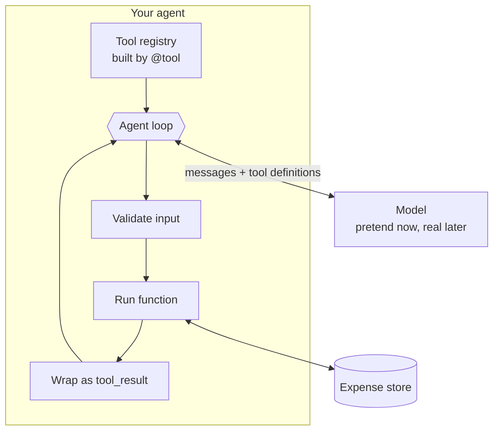

# Lab: Tool-Using Agent from Scratch

> 📚 **Before you start**
>
> - [Lab: Agent loop with a pretend model](../03-the-agent-loop/lab-agent-loop-with-a-pretend-model.md), for the loop and guardrails.
> - [What is a Tool?](what-is-a-tool.md), for generating tool definitions from functions.
> - [Function Calling Step by Step](function-calling-step-by-step.md), for `tool_use` and `tool_result` blocks.
> - [Designing Good Tools](designing-good-tools.md), for names, descriptions, validation and outputs.

## What You'll Build

An **expense assistant agent**. You'll be able to say *"I spent 450 on lunch and 1200 on a train ticket today. How much have I spent on food this month?"* and it will add both expenses, then total the food category, then answer.

Unlike the first lab, this agent uses the **real message format** of a function-calling API (`tool_use` blocks with ids, `tool_result` blocks in a user message, `stop_reason`). The model is still a pretend one, so everything runs offline, but the agent code is written so that swapping in a real API is a three-line change (Step 7).

You'll build:

1. A small **expense store** (the environment).
2. **Tools** written as normal Python functions with type hints and docstrings.
3. A **`@tool` decorator** that turns them into tool definitions automatically, with **input validation**.
4. A **pretend model** that speaks the API's message format.
5. The **agent loop**: parallel tool calls, errors as results, a round limit and approval for write tools.
6. A **transcript printer**, so you can see every message exactly as an API would.

> 💡 **Key Insight**
>
> A framework's `@tool` decorator and agent runner are not magic. They're about 80 lines of the code you're about to write: read a function's signature into a schema, validate the model's arguments, run the function, wrap the result, loop. Build it once and every framework becomes easy to read.



Run the blocks in order in one file or notebook.

---

## Step 1: The Expense Store

```python
from datetime import date

EXPENSES = [
    {"id": 1, "date": "2026-10-03", "amount": 320.0, "category": "food", "note": "groceries"},
    {"id": 2, "date": "2026-10-05", "amount": 2000.0, "category": "rent", "note": "share of WiFi and power"},
    {"id": 3, "date": "2026-10-08", "amount": 180.0, "category": "food", "note": "chai and snacks"},
]
TODAY = date(2026, 10, 11)          # fixed so the lab gives the same output every time
CATEGORIES = ["food", "travel", "rent", "shopping", "other"]
print(len(EXPENSES), "expenses so far")
```

Output:

```
3 expenses so far
```

---

## Step 2: A `@tool` Decorator with Validation

This decorator does what framework decorators do: it reads the function's **name**, **docstring** and **type hints**, builds the tool definition, and registers the function. Extra hints (like allowed values) go in a small `choices` argument.

```python
import inspect

REGISTRY = {}
JSON_TYPES = {str: "string", int: "integer", float: "number", bool: "boolean"}

def tool(writes=False, choices=None):
    choices = choices or {}
    def decorator(fn):
        props, required = {}, []
        for name, p in inspect.signature(fn).parameters.items():
            props[name] = {"type": JSON_TYPES[p.annotation]}
            if name in choices:
                props[name]["enum"] = choices[name]
            if p.default is inspect.Parameter.empty:
                required.append(name)
        REGISTRY[fn.__name__] = {
            "fn": fn,
            "writes": writes,
            "definition": {
                "name": fn.__name__,
                "description": inspect.getdoc(fn),
                "input_schema": {"type": "object", "properties": props, "required": required},
            },
        }
        return fn
    return decorator

def validate(name, args):
    schema = REGISTRY[name]["definition"]["input_schema"]
    errors = [f"missing '{r}'" for r in schema["required"] if r not in args]
    for key, value in args.items():
        spec = schema["properties"].get(key)
        if spec is None:
            errors.append(f"unknown argument '{key}'")
            continue
        expected = {"string": str, "integer": int, "number": (int, float), "boolean": bool}[spec["type"]]
        if not isinstance(value, expected):
            errors.append(f"'{key}' must be {spec['type']}")
        elif "enum" in spec and value not in spec["enum"]:
            errors.append(f"'{key}' must be one of {spec['enum']}")
    return errors
```

There's no output yet; the decorator does its work when we define tools.

---

## Step 3: The Tools

Three tools: one write tool and two read tools. Notice how the docstrings follow the "what, when, when not" rule from [Designing Good Tools](designing-good-tools.md), and how outputs are short and readable.

```python
@tool(writes=True, choices={"category": CATEGORIES})
def add_expense(amount: float, category: str, note: str = "", day: str = "") -> str:
    """Record one expense. Use once per expense the user says they spent.
    day is YYYY-MM-DD and defaults to today. Do not use this to change existing expenses."""
    if amount <= 0:
        return "ERROR: amount must be greater than 0."
    new_id = max(e["id"] for e in EXPENSES) + 1
    EXPENSES.append({"id": new_id, "date": day or TODAY.isoformat(), "amount": float(amount),
                     "category": category, "note": note})
    return f"Added expense #{new_id}: ₹{amount:,.0f} {category} ({note or 'no note'})."

@tool(choices={"category": CATEGORIES})
def total_by_category(category: str, month: str = "") -> str:
    """Total spent in one category for a month (YYYY-MM, default this month).
    Use for 'how much did I spend on X' questions."""
    month = month or TODAY.strftime("%Y-%m")
    items = [e for e in EXPENSES if e["category"] == category and e["date"].startswith(month)]
    total = sum(e["amount"] for e in items)
    return f"{category} in {month}: ₹{total:,.0f} across {len(items)} expenses."

@tool()
def list_recent(limit: int = 5) -> str:
    """List the most recent expenses, newest first, up to limit (max 10).
    Use when the user wants to see what they've logged."""
    rows = sorted(EXPENSES, key=lambda e: (e["date"], e["id"]), reverse=True)[:min(limit, 10)]
    return "\n".join(f"#{e['id']} {e['date']} ₹{e['amount']:,.0f} {e['category']} ({e['note']})" for e in rows)

import json
print(json.dumps(REGISTRY["total_by_category"]["definition"], indent=1))
print(validate("add_expense", {"amount": "450", "category": "lunch"}))
```

Output:

```
{
 "name": "total_by_category",
 "description": "Total spent in one category for a month (YYYY-MM, default this month).\nUse for 'how much did I spend on X' questions.",
 "input_schema": {
  "type": "object",
  "properties": {
   "category": {
    "type": "string",
    "enum": [
     "food",
     "travel",
     "rent",
     "shopping",
     "other"
    ]
   },
   "month": {
    "type": "string"
   }
  },
  "required": [
   "category"
  ]
 }
}
["'amount' must be number", "'category' must be one of ['food', 'travel', 'rent', 'shopping', 'other']"]
```

The definition was **generated**, not hand-written, so it can never drift out of sync with the function.

---

## Step 4: A Pretend Model That Speaks the API Format

This model receives `messages` and `tools` like a real API and returns a response with `stop_reason` and `content` blocks. Its "reasoning" is a script for our demo conversation, written to behave the way a capable model would:

- first turn: it extracts **two expenses** from the sentence and asks for **two parallel `add_expense` calls**;
- after both succeed: it calls `total_by_category` for food;
- after that: it writes the final answer from the tool results.

```python
import itertools
_ids = itertools.count(1)

def make_tool_use(name, tool_input):
    return {"type": "tool_use", "id": f"toolu_{next(_ids):02d}", "name": name, "input": tool_input}

def pretend_model(messages, tools):
    last = messages[-1]
    available = {t["name"] for t in tools}
    if isinstance(last["content"], str):                      # a fresh user request
        assert "add_expense" in available
        return {"stop_reason": "tool_use", "content": [
            {"type": "text", "text": "I'll log both expenses first."},
            make_tool_use("add_expense", {"amount": 450, "category": "food", "note": "lunch"}),
            make_tool_use("add_expense", {"amount": 1200, "category": "travel", "note": "train ticket"}),
        ]}
    results = [b["content"] for b in last["content"] if b["type"] == "tool_result"]
    if any(r.startswith("Added") for r in results):
        return {"stop_reason": "tool_use", "content": [
            make_tool_use("total_by_category", {"category": "food"})]}
    if results and results[0].startswith("food in"):
        return {"stop_reason": "end_turn", "content": [{"type": "text", "text":
                f"Done! I logged lunch (₹450) and the train ticket (₹1,200). "
                f"So far this month you've spent {results[0].split(': ')[1].split(' across')[0]} on food."}]}
    return {"stop_reason": "end_turn", "content": [{"type": "text", "text": f"I hit a problem: {results}"}]}
```

---

## Step 5: The Agent

Now the core. It's the loop from [Function Calling Step by Step](function-calling-step-by-step.md) plus the guardrails from the first lab, using the registry for validation and approvals.

```python
def run_tool(block, approve):
    name, args = block["name"], block["input"]
    if name not in REGISTRY:
        return f"Unknown tool '{name}'. Available: {', '.join(REGISTRY)}", True
    problems = validate(name, args)
    if problems:
        return "Invalid input: " + "; ".join(problems), True
    if REGISTRY[name]["writes"] and not approve(name, args):
        return f"The user did not approve {name}. Do not retry; ask the user what to do.", True
    try:
        result = REGISTRY[name]["fn"](**args)
        return result, result.startswith("ERROR")
    except Exception as e:
        return f"{type(e).__name__}: {e}", True

class Agent:
    def __init__(self, model, system, max_rounds=6, approve=lambda name, args: True):
        self.model, self.system = model, system
        self.max_rounds, self.approve = max_rounds, approve
        self.tools = [t["definition"] for t in REGISTRY.values()]
        self.messages = []

    def ask(self, text):
        self.messages.append({"role": "user", "content": text})
        for _ in range(self.max_rounds):
            response = self.model(self.messages, self.tools)
            self.messages.append({"role": "assistant", "content": response["content"]})
            if response["stop_reason"] != "tool_use":
                return next(b["text"] for b in response["content"] if b["type"] == "text")
            results = []
            for block in response["content"]:
                if block["type"] == "tool_use":
                    output, is_error = run_tool(block, self.approve)
                    results.append({"type": "tool_result", "tool_use_id": block["id"],
                                    "content": output, "is_error": is_error})
            self.messages.append({"role": "user", "content": results})
        return "Stopped: round limit reached."

agent = Agent(pretend_model, system="You help the user track expenses in INR. Always use tools for numbers.")
print(agent.ask("I spent 450 on lunch and 1200 on a train ticket today. "
                "How much have I spent on food this month?"))
```

Output:

```
Done! I logged lunch (₹450) and the train ticket (₹1,200). So far this month you've spent ₹950 on food.
```

Check the arithmetic: groceries ₹320 + chai ₹180 + lunch ₹450 = ₹950. The number came from **your code**, not from the model's guesswork.

---

## Step 6: Read the Transcript

The single most useful debugging habit with agents is reading the full message history. Let's print it compactly:

```python
def show(messages):
    for i, m in enumerate(messages, 1):
        if isinstance(m["content"], str):
            print(f"{i}. {m['role']}: {m['content'][:60]}...")
            continue
        for b in m["content"]:
            if b["type"] == "text":
                print(f"{i}. {m['role']} text: {b['text'][:60]}...")
            elif b["type"] == "tool_use":
                print(f"{i}. {m['role']} tool_use {b['id']}: {b['name']}({b['input']})")
            elif b["type"] == "tool_result":
                print(f"{i}. {m['role']} tool_result {b['tool_use_id']}: {b['content']}")

show(agent.messages)
```

Output:

```
1. user: I spent 450 on lunch and 1200 on a train ticket today. How m...
2. assistant text: I'll log both expenses first....
2. assistant tool_use toolu_01: add_expense({'amount': 450, 'category': 'food', 'note': 'lunch'})
2. assistant tool_use toolu_02: add_expense({'amount': 1200, 'category': 'travel', 'note': 'train ticket'})
3. user tool_result toolu_01: Added expense #4: ₹450 food (lunch).
3. user tool_result toolu_02: Added expense #5: ₹1,200 travel (train ticket).
4. assistant tool_use toolu_03: total_by_category({'category': 'food'})
5. user tool_result toolu_03: food in 2026-10: ₹950 across 3 expenses.
6. assistant text: Done! I logged lunch (₹450) and the train ticket (₹1,200). S...
```

Everything you learned in the last two lessons is visible here: parallel calls in message 2, both results in **one** message 3 with matching ids, a second round in 4 and 5, and the final answer in 6.

### Approval in action

Run the same request with a user who declines write actions:

```python
def deny_writes(name, args):
    print(f"  [approval] {name}({args}) -> declined")
    return False

before = len(EXPENSES)
cautious = Agent(pretend_model, system="...", approve=deny_writes)
print(cautious.ask("I spent 450 on lunch and 1200 on a train ticket today. How much on food?"))
print("Expenses added:", len(EXPENSES) - before)
```

Output:

```
  [approval] add_expense({'amount': 450, 'category': 'food', 'note': 'lunch'}) -> declined
  [approval] add_expense({'amount': 1200, 'category': 'travel', 'note': 'train ticket'}) -> declined
I hit a problem: ['The user did not approve add_expense. Do not retry; ask the user what to do.', 'The user did not approve add_expense. Do not retry; ask the user what to do.']
Expenses added: 0
```

Nothing was written, and the model received a clear explanation it could pass on. (Our pretend model just reports the problem; a real model would phrase it more politely and ask what you'd like to do.)

---

## Step 7: Plugging In a Real Model

To use a real model, replace `pretend_model` with a function that calls the API and converts the SDK's response objects into the same plain dictionaries. Everything else, including the registry, validation, approvals and the loop, stays the same.

```python
# not-run: needs `pip install anthropic` and an API key
import anthropic

client = anthropic.Anthropic()

def claude_model(messages, tools):
    response = client.messages.create(
        model="claude-opus-5-5",
        max_tokens=16000,
        system="You help the user track expenses in INR. Always use tools for numbers.",
        tools=tools,
        messages=messages,
    )
    return {"stop_reason": response.stop_reason,
            "content": [block.to_dict() for block in response.content]}

agent = Agent(claude_model, system="")
print(agent.ask("I spent 450 on lunch today. How much have I spent on food this month?"))
```

> **Note:** with a real model, the assistant's reply may also contain thinking blocks or other block types. Converting every block with `to_dict()` and sending them back unchanged (as above) keeps the history valid.

---

## Try It Yourself

1. **New tool.** Add a read tool `biggest_expense(month: str = "")` that returns the single largest expense of the month. Check that its definition appears in `Agent(...).tools` without any extra code.
2. **Validation in action.** Call `run_tool(make_tool_use("add_expense", {"amount": -5, "category": "food"}), lambda n, a: True)`. Which layer catches the problem, the validator or the function?
3. **Approve small amounts only.** Write an `approve` function that auto-approves `add_expense` under ₹5,000 and declines above it.
4. **Stretch.** Add a `delete_expense(expense_id: int)` write tool. What protections would you add inside it, following Rule 7 of [Designing Good Tools](designing-good-tools.md)?

<details>
<summary>Show answers</summary>

**1.**

```python
@tool()
def biggest_expense(month: str = "") -> str:
    """The single largest expense in a month (YYYY-MM, default this month)."""
    month = month or TODAY.strftime("%Y-%m")
    items = [e for e in EXPENSES if e["date"].startswith(month)]
    top = max(items, key=lambda e: e["amount"])
    return f"#{top['id']} ₹{top['amount']:,.0f} {top['category']} ({top['note']}) on {top['date']}"

print([t["name"] for t in Agent(pretend_model, system="").tools])
print(biggest_expense())
```

Output:

```
['add_expense', 'total_by_category', 'list_recent', 'biggest_expense']
#2 ₹2,000 rent (share of WiFi and power) on 2026-10-05
```

**2.** The validator accepts it (−5 is a valid `number`), so the function's own check catches it and returns `"ERROR: amount must be greater than 0."`, which `run_tool` marks as an error. Validation checks **shape**; the function checks **business rules**. You need both.

**3.**

```python
# not-run: a sketch
def approve_small(name, args):
    return name != "add_expense" or args.get("amount", 0) < 5000
```

**4.** For example: check the id exists and return a helpful error if not; return the deleted row in the result so the model can confirm it to the user; keep a "recently deleted" list so it can be undone; and always require approval because it's a write.

</details>

---

## Real-World Examples

- **LangChain's `@tool`** and the **Anthropic SDK's `@beta_tool`** both generate tool definitions from function signatures and docstrings, exactly like your decorator.
- **MCP servers** written with FastMCP use the same idea (`@mcp.tool()`), which you'll build in [Model Context Protocol (MCP)](../../model-context-protocol-mcp/course.md).
- **Production agents** log transcripts like the one in Step 6 to tracing tools such as LangSmith, so engineers can see every call. See [Observability](../../agent-evals-observability-and-reliability/course.md#m4).

---

## Common Misconceptions

### "Validation is the model's job"

Models make occasional argument mistakes. Code-side validation turns them into clear, fixable errors.

### "Parallel calls need threads"

Parallel here means *several calls in one reply*. You may run them one after another (as we did) or concurrently; what matters is returning all results together.

### "Once it works with the pretend model, the real model will behave the same"

The plumbing will; the decisions won't always. Test with realistic requests and read transcripts after switching.

---

## Interview Relevance

You may be asked to **"build a minimal tool-calling agent without a framework"**. The pieces interviewers look for are all here: a tool registry with generated schemas, argument validation, a loop driven by `stop_reason`, results returned with matching ids (several in one message), errors returned as results, a round limit, and approval for write tools. Being able to explain the transcript in Step 6 line by line is a strong signal that you understand what frameworks do for you.

---

## Key Takeaways

- A `@tool` decorator can build **definitions from signatures and docstrings**, so code and schema never drift.
- **Validate** inputs before running tools; let functions enforce **business rules**.
- The loop runs while **`stop_reason` is `"tool_use"`**, returning **all results in one message** with matching **`tool_use_id`s**.
- **Read transcripts**: they show exactly what the model asked for and what it got back.
- Swapping in a real model changes **one function**.

---

**Up next:** [ReAct](../05-reasoning-patterns/react.md)
