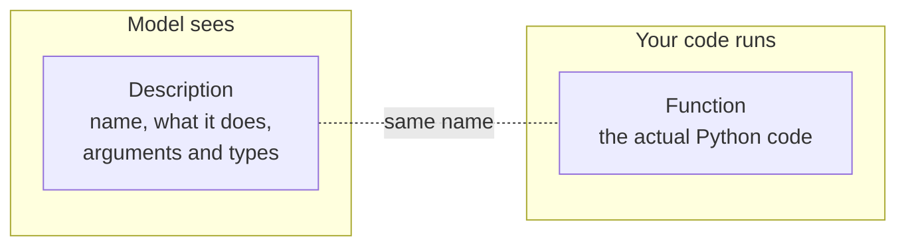
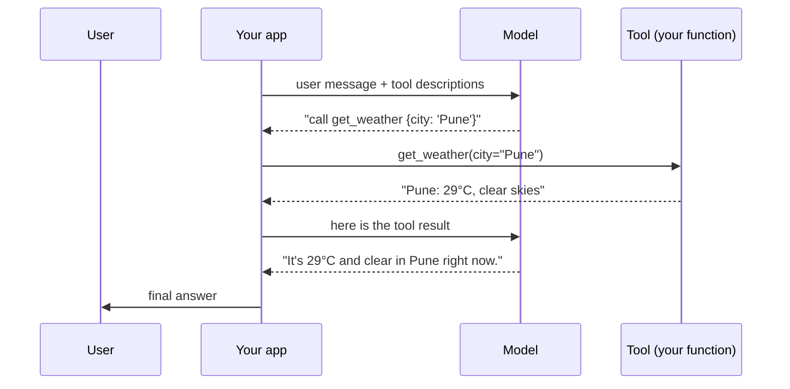

# What is a Tool? The Complete Guide

> 📚 **Before you start**
>
> - [Lab: Agent loop with a pretend model](../03-the-agent-loop/lab-agent-loop-with-a-pretend-model.md), where you already gave an agent three tools.
> - [Anatomy of an Agent](../03-the-agent-loop/anatomy-of-an-agent.md), for where tools sit among the other parts.
> - [Prompting and Structured Output](../../generative-ai-and-llm-foundations/course.md#m4), because a tool call is structured output.

## Introduction

Ask a language model *"What's the weather in Pune right now?"* and, on its own, it can only guess. It was trained months ago, it has no internet connection, and it can't look out of a window. Ask it *"What's 48,213 × 7,019?"* and it may get it slightly wrong, because it predicts digits rather than calculating them.

Now give the same model two small functions, `get_weather(city)` and `calculator(expression)`, and both answers become exact. The model didn't get smarter. It got **hands**.

That's what a tool is. This article explains exactly what a tool is made of, how a model "uses" something it can't actually run, which kinds of tools exist, and how to think about the risks they bring. By the end you'll be able to turn any Python function into a tool a model can understand.

> 💡 **Key Insight**
>
> A model never runs a tool. It **writes a request** ("call `get_weather` with `city = Pune`") and **your code** runs it and hands back the result. A tool is therefore two things: a **function** your code can execute, and a **description** the model can read. Get the description wrong and the best function in the world will never be called correctly.

---

## Core Explanation

### 1. Why models need tools

Think of a brilliant consultant locked in a room with no phone, no computer and a calendar stuck at the date they entered. They can reason, write and advise extremely well, but they can't check today's stock price, look up your order, or send an email. Pass a phone under the door and suddenly they can do all three.

A language model has four built-in limits that tools remove:

| Limit | Example question it fails | Tool that fixes it |
|---|---|---|
| **Frozen knowledge** (training cutoff) | "Who won yesterday's match?" | Web search |
| **No private data** | "What's the status of order #4411?" | Database lookup |
| **Unreliable exact work** | "What's 48,213 × 7,019?" | Calculator, code runner |
| **Can't change anything** | "Book me a table for 8 pm." | Booking API |

The first three are **read** problems: the model lacks information. The last is a **write** problem: the model can't act. Tools handle both, and that difference matters a lot for safety (section 5).

### 2. The two halves of a tool

Every tool has two halves that live in different places:



- **The function** is ordinary code: it takes arguments and returns a result. The model never sees it.
- **The description** (often called the **schema** or **tool definition**) is what the model reads. It has three parts:
  - a **name**, such as `get_weather`;
  - a **description** in plain language, saying what it does and when to use it;
  - an **input schema**: which arguments exist, their types, and which are required.

Here's one tool with both halves:

```python
def get_weather(city, unit="celsius"):
    fake_data = {"pune": 29, "delhi": 34, "shimla": 12}
    temp = fake_data.get(city.lower())
    if temp is None:
        return f"No weather data for {city}"
    if unit == "fahrenheit":
        temp = round(temp * 9 / 5 + 32)
    return f"{city}: {temp}°{'F' if unit == 'fahrenheit' else 'C'}, clear skies"

get_weather_tool = {
    "name": "get_weather",
    "description": "Get the current weather for a city. Use this whenever the user asks "
                   "about temperature or weather conditions right now.",
    "input_schema": {
        "type": "object",
        "properties": {
            "city": {"type": "string", "description": "City name, e.g. 'Pune'"},
            "unit": {"type": "string", "enum": ["celsius", "fahrenheit"],
                     "description": "Temperature unit. Default celsius."},
        },
        "required": ["city"],
    },
}

print(get_weather("Pune"))
print(get_weather("Shimla", unit="fahrenheit"))
print(get_weather_tool["input_schema"]["required"])
```

Output:

```
Pune: 29°C, clear skies
Shimla: 54°F, clear skies
['city']
```

The `input_schema` is written in **JSON Schema**, a standard way to describe the shape of JSON data. Almost every model provider uses it for tools, so learning it once pays off everywhere. You've met the same idea in [Pydantic Models](../../apis-and-apps-fastapi-streamlit-and-docker/course.md#m4), which can generate JSON Schema for you.

### 3. How a model "uses" a tool

Since the model can't run code, "using a tool" is a conversation in four moves:



1. **You send** the user's message plus the descriptions of all available tools.
2. **The model replies** with either normal text or a **tool call**: a tool name and arguments, as structured data.
3. **Your code runs** the matching function with those arguments.
4. **You send the result back**, and the model continues, either with another tool call or a final answer.

That's exactly the decide → act → observe loop from [The Agent Loop](../03-the-agent-loop/the-agent-loop-decide-act-observe.md). A tool call is just the "decide" step written as data.

Let's simulate the model's half with a pretend model, then write the part your code owns, the **dispatcher**:

```python
import json

def pretend_model_reply(user_message):
    # A real model would choose this based on the descriptions it was given.
    return json.dumps({"type": "tool_call", "name": "get_weather", "arguments": {"city": "Pune"}})

FUNCTIONS = {"get_weather": get_weather}

def dispatch(raw_reply):
    reply = json.loads(raw_reply)                 # the model's reply is text/JSON
    fn = FUNCTIONS[reply["name"]]                 # look the tool up by name
    return fn(**reply["arguments"])               # run it with the model's arguments

raw = pretend_model_reply("Is it hot in Pune right now?")
print("Model asked for:", raw)
print("Tool returned: ", dispatch(raw))
```

Output:

```
Model asked for: {"type": "tool_call", "name": "get_weather", "arguments": {"city": "Pune"}}
Tool returned:  Pune: 29°C, clear skies
```

Notice the link between the halves is **only the name**. The model writes `"get_weather"`; your code finds the function registered under that name. If they ever drift apart (say you rename the function but not the description), calls silently break.

### 4. Generating descriptions from functions

Writing schemas by hand is repetitive and error-prone. Since Python functions already carry names, parameters, type hints and docstrings, we can build the description automatically. Frameworks like LangChain's `@tool` decorator and the MCP SDK's `@mcp.tool()` do exactly this; here's the idea in a few lines:

```python
import inspect

PY_TO_JSON = {str: "string", int: "integer", float: "number", bool: "boolean"}

def make_tool(fn):
    sig = inspect.signature(fn)
    props, required = {}, []
    for name, p in sig.parameters.items():
        props[name] = {"type": PY_TO_JSON.get(p.annotation, "string")}
        if p.default is inspect.Parameter.empty:
            required.append(name)
    return {
        "name": fn.__name__,
        "description": inspect.getdoc(fn),
        "input_schema": {"type": "object", "properties": props, "required": required},
    }

def convert_currency(amount: float, from_code: str, to_code: str = "INR") -> str:
    """Convert money between currencies using today's rate. Codes are ISO, e.g. USD, EUR, INR."""
    rates_to_inr = {"USD": 83.0, "EUR": 90.0, "INR": 1.0}
    inr = amount * rates_to_inr[from_code]
    return f"{amount} {from_code} = {inr / rates_to_inr[to_code]:.2f} {to_code}"

print(json.dumps(make_tool(convert_currency), indent=2))
print(convert_currency(10, "USD"))
```

Output:

```
{
  "name": "convert_currency",
  "description": "Convert money between currencies using today's rate. Codes are ISO, e.g. USD, EUR, INR.",
  "input_schema": {
    "type": "object",
    "properties": {
      "amount": {
        "type": "number"
      },
      "from_code": {
        "type": "string"
      },
      "to_code": {
        "type": "string"
      }
    },
    "required": [
      "amount",
      "from_code"
    ]
  }
}
10 USD = 830.00 INR
```

This is why good **docstrings and type hints** matter so much in agent code: they become the model's instructions. A function with no docstring becomes a tool with no description, and the model has to guess what it does.

### 5. Kinds of tools

Tools come in a few families. Knowing which family a tool belongs to tells you how careful to be with it.

| Family | Examples | Changes the world? | Typical guardrail |
|---|---|---|---|
| **Information retrieval** | web search, database query, RAG retriever, read a file | No | Rate limits, result size limits |
| **Computation** | calculator, code interpreter, unit converter | No (if sandboxed) | Sandbox, timeouts |
| **Actions** | send email, create ticket, place order, write file | **Yes** | Human approval, allow-lists, undo logs |
| **Other agents** | "ask the research agent", "ask the coder agent" | Depends | Same as what *they* can do |

The read/write split is the most important line on that table:

- **Read tools** are cheap to get wrong: a bad search just wastes a step.
- **Write tools** can be impossible to undo: an email can't be unsent, money can't be un-transferred.

You saw this in the lab, where `reserve_book` needed approval but `search_books` didn't.

### 6. Where tools come from

You'll get tools from three places as you progress through this platform:

- **Write your own** Python functions, as in this article. Best for business logic only you have.
- **Use a framework's built-in tools**, such as LangChain's search and Wikipedia tools. See [Tools and Tool Calling in LangChain](../../langchain-complete-guide/course.md#m7).
- **Connect to MCP servers**, which package tools so any AI app can use them without custom glue. See [Model Context Protocol (MCP)](../../model-context-protocol-mcp/course.md).

All three end up in the same shape: a name, a description, an input schema, and something that runs.

---

## Try It Yourself

1. **Read the schema.** Using `get_weather_tool`, which arguments can the model leave out, and what values may `unit` take?
2. **Spot the bug.** A teammate renamed the function `get_weather` to `fetch_weather` but left `get_weather_tool["name"]` unchanged and registered `FUNCTIONS = {"fetch_weather": fetch_weather}`. What happens when the model asks for the tool?
3. **Make a tool.** Write `def word_count(text: str) -> int` with a good docstring and pass it to `make_tool`. Which argument is required?
4. **Classify.** Read or write: `get_bank_balance`, `transfer_money`, `search_flights`, `delete_file`, `run_sql_select`?

<details>
<summary>Show answers</summary>

**1.** Only `city` is required, so `unit` can be left out. `unit` must be `"celsius"` or `"fahrenheit"` (the `enum`).

**2.** The model still sees and asks for `get_weather`, but `FUNCTIONS["get_weather"]` doesn't exist, so the dispatcher raises a `KeyError` (or, with a safer dispatcher like the one in the lab, returns an "unknown tool" error). The two halves must share the name.

**3.**

```python
def word_count(text: str) -> int:
    """Count the words in a piece of text."""
    return len(text.split())

print(make_tool(word_count)["input_schema"]["required"])
print(word_count("tools give models hands"))
```

Output:

```
['text']
4
```

**4.** Read: `get_bank_balance`, `search_flights`, `run_sql_select`. Write: `transfer_money`, `delete_file`. (A "select only" SQL tool is read-only only if you actually enforce that, for example with a read-only database user.)

</details>

---

## Real-World Examples

- **Chat assistants with web search** call a search tool when a question needs fresh information, then answer from the results with citations.
- **Coding agents** use tools like `read_file`, `run_tests` and `edit_file`. The model decides which file to open next; the tools do the actual reading and writing.
- **Banking chatbots** let a model call `get_recent_transactions` freely but route `block_card` through extra confirmation, the read/write split in action.
- **Data analysis assistants** hand calculations to a Python code interpreter tool instead of doing arithmetic "in their head", which is why their numbers are exact.

---

## Common Misconceptions

### "The model runs the tool"

It only writes the request. Your application runs the function, which means **you** control permissions, logging, timeouts and approvals.

### "Tools make the model smarter"

They make it **better informed and able to act**. Reasoning quality still comes from the model and your instructions. A confused model with more tools is often *more* confused.

### "More tools are always better"

Every tool's description takes up context and gives the model another option to get wrong. Start with the few tools the task needs. You'll learn how to design and trim them in [Designing Good Tools](designing-good-tools.md).

### "The description is just documentation"

For a human, a docstring is a nice-to-have. For a model, the description is the **only** way it knows what the tool does and when to use it.

---

## Interview Relevance

*"What is a tool in the context of LLM agents?"* A strong answer: a capability exposed to the model as a **name, description and input schema** (usually JSON Schema); the model emits a structured **tool call**; the **application executes** it and returns the result as a new message; the model continues. Mention that tools address frozen knowledge, private data, exact computation and taking actions.

Common follow-ups:

- *"Who executes the tool, the model or the app?"* The app. The model only produces arguments.
- *"How do you make tool use safe?"* Separate read and write tools, validate arguments, sandbox code execution, require approval for irreversible actions, and log every call.
- *"How does the model know which tool to use?"* From the tool names and descriptions in its context, combined with the user's request and your instructions.

---

## Key Takeaways

- A tool is a **function** (run by your code) plus a **description** (read by the model): name, description, input schema.
- The model **requests** tool calls as structured data; your app **executes** them and returns results.
- The name is the only link between the halves, so keep them in sync, ideally by **generating schemas from functions**.
- Tools fix **frozen knowledge, missing private data, inexact computation** and the inability to **act**.
- Treat **write tools** with far more care than read tools.

---

**Up next:** [Function Calling Step by Step](function-calling-step-by-step.md)
