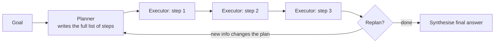
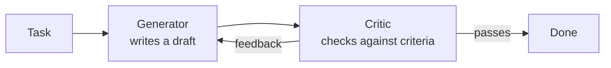
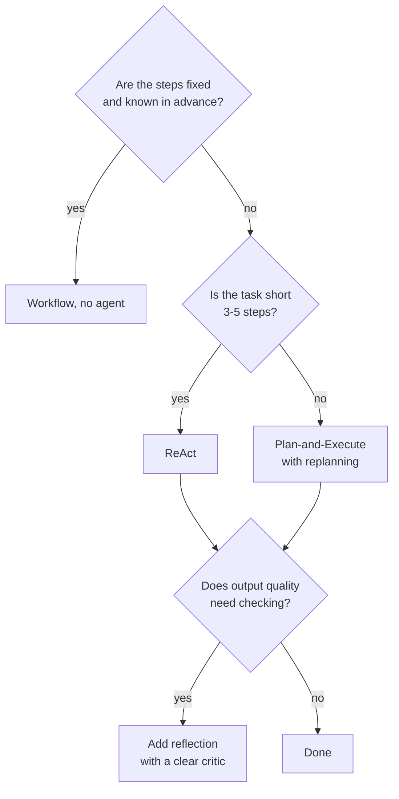

# Planning and Reflection: The Complete Guide

> 📚 **Before you start**
>
> - [ReAct](react.md), the step-by-step pattern this lesson improves on.
> - [Workflows vs Agents](../03-the-agent-loop/workflows-vs-agents.md), because planning sits between the two.

## Introduction

Imagine two students writing an essay. The first starts typing the opening sentence immediately and decides what comes next as they go. The second spends five minutes on an outline, writes from it, then rereads the draft and fixes the weak paragraphs. The second essay is usually better, and it's not because the second student is smarter. They **planned** before acting and **reflected** after.

Agents benefit from the same two habits. [ReAct](react.md) decides one step at a time, which works well for short tasks but drifts on long ones. **Planning** patterns make the agent think through the whole task first. **Reflection** patterns make it critique and improve its own output. Together they're behind most high-quality agent systems, from research assistants to coding agents.

This lesson covers both, with runnable from-scratch versions of each.

> 💡 **Key Insight**
>
> **Planning** spends effort *before* acting so the agent knows where it's going. **Reflection** spends effort *after* acting so the agent catches its own mistakes. Both trade extra model calls for better results, so use them where quality matters more than speed.

---

## Core Explanation

### 1. Why step-by-step isn't enough

ReAct chooses each action from what it just saw. On a long task like *"Research three laptops under ₹80,000, compare battery life and weight, and recommend one for a student"*, a step-by-step agent may:

- research the first laptop in great depth and run out of steps before the third;
- forget the "student" requirement by the time it writes the recommendation;
- repeat a search it already did ten steps earlier.

The cause is the same: **no overall picture of the task**. Planning gives it one.

### 2. Plan-and-Execute

The simplest planning pattern splits the agent into two roles:



- The **planner** reads the goal and writes a numbered list of steps.
- The **executor** carries out each step (often with a small ReAct loop and tools).
- Optionally a **replanner** looks at results so far and revises the remaining steps.
- Finally, the results are **synthesised** into an answer.

Benefits: the whole task is visible up front, steps can be checked or approved by a human before anything runs, and a cheaper model can often execute the steps while a stronger model plans.

Let's build it. First, a pretend planner (a real one is a single model call with a prompt like *"Break this goal into 3 to 6 concrete steps. Return a JSON list."*):

```python
import json

def pretend_planner(goal):
    # A real model would generate this list from the goal.
    return json.dumps([
        "Find battery life and weight for Laptop A",
        "Find battery life and weight for Laptop B",
        "Find battery life and weight for Laptop C",
        "Pick the best laptop for a student who carries it all day",
    ])

plan = json.loads(pretend_planner("Compare three laptops under ₹80,000 for a student"))
for i, step in enumerate(plan, 1):
    print(f"{i}. {step}")
```

Output:

```
1. Find battery life and weight for Laptop A
2. Find battery life and weight for Laptop B
3. Find battery life and weight for Laptop C
4. Pick the best laptop for a student who carries it all day
```

Asking for **JSON** makes the plan easy to parse and loop over (structured output, from [Prompting and Structured Output](../../generative-ai-and-llm-foundations/course.md#m4)).

Next, an executor that handles one step at a time, using a fake product database as its tool, and a synthesiser that writes the final answer from all results:

```python
SPECS = {
    "Laptop A": {"battery_h": 9, "weight_kg": 1.8, "price": 72000},
    "Laptop B": {"battery_h": 14, "weight_kg": 1.2, "price": 79000},
    "Laptop C": {"battery_h": 11, "weight_kg": 1.6, "price": 65000},
}

def execute_step(step, results):
    for name, spec in SPECS.items():
        if name in step:
            return f"{name}: {spec['battery_h']} h battery, {spec['weight_kg']} kg, ₹{spec['price']:,}"
    if step.startswith("Pick"):
        # score: hours of battery per kg carried
        best = max(SPECS, key=lambda n: SPECS[n]["battery_h"] / SPECS[n]["weight_kg"])
        return f"Best for carrying all day: {best}"
    return "Could not execute this step"

def plan_and_execute(goal, planner):
    steps = json.loads(planner(goal))
    results = []
    for i, step in enumerate(steps, 1):
        result = execute_step(step, results)
        results.append(result)
        print(f"step {i}: {result}")
    return results[-1]

print("ANSWER:", plan_and_execute("Compare three laptops under ₹80,000 for a student", pretend_planner))
```

Output:

```
step 1: Laptop A: 9 h battery, 1.8 kg, ₹72,000
step 2: Laptop B: 14 h battery, 1.2 kg, ₹79,000
step 3: Laptop C: 11 h battery, 1.6 kg, ₹65,000
step 4: Best for carrying all day: Laptop B
ANSWER: Best for carrying all day: Laptop B
```

All three laptops were covered, in order, because the plan said so. No step was forgotten.

### 3. Replanning when the world surprises you

Plans go stale. Maybe Laptop B turns out to be out of stock. A good plan-and-execute agent checks results and **replans** the remaining steps:

```python
def needs_replan(result):
    return "out of stock" in result.lower()

def replan(goal, done, failed_step):
    # A real replanner is a model call given the goal, completed steps and the problem.
    return [f"Find battery life and weight for Laptop D (replacing: {failed_step.split('for ')[1]})",
            "Pick the best laptop for a student who carries it all day"]

steps = ["Find battery life and weight for Laptop B", "Pick the best laptop for a student who carries it all day"]
fake_results = {"Find battery life and weight for Laptop B": "Laptop B is out of stock"}
done = []
while steps:
    step = steps.pop(0)
    result = fake_results.get(step, "ok")
    print(f"ran: {step} -> {result}")
    if needs_replan(result):
        steps = replan("laptop for student", done, step)
        print("replanned ->", steps)
    done.append(step)
```

Output:

```
ran: Find battery life and weight for Laptop B -> Laptop B is out of stock
replanned -> ['Find battery life and weight for Laptop D (replacing: Laptop B)', 'Pick the best laptop for a student who carries it all day']
ran: Find battery life and weight for Laptop D (replacing: Laptop B) -> ok
ran: Pick the best laptop for a student who carries it all day -> ok
```

Replanning gives you the **overview of planning** with the **adaptability of ReAct**.

### 4. Other planning styles (quick tour)

You'll see these names in papers and frameworks:

| Pattern | Idea | Good for |
|---|---|---|
| **Plan-and-Execute** | Plan all steps, execute in order, replan if needed | Multi-part research and reports |
| **ReWOO** (reasoning without observation) | Plan all tool calls up front with placeholders, run them, then answer once | Cutting model calls when steps don't depend much on each other |
| **LLM Compiler / parallel planning** | Plan steps as a dependency graph and run independent ones in parallel | Speed when many lookups are independent |
| **Task decomposition into sub-agents** | Planner assigns sub-tasks to specialised agents | Big tasks; see [What are Multi-Agent Systems?](../06-multi-agent-systems-and-the-ecosystem/what-are-multi-agent-systems.md) |

All share the core move: **think about the whole task before doing it**.

### 5. Reflection: critique and revise

Planning helps the agent start well. **Reflection** helps it finish well. The agent (or a second model) reviews an output against criteria and produces specific feedback; then the output is revised using that feedback. Repeat until it passes or a limit is hit.



This is also called the **evaluator-optimizer** or **generator-critic** pattern. You'll build it as a looping graph in LangGraph (a post generator with an evaluator loop) in [LangGraph Fundamentals](../../langgraph-fundamentals/course.md#m3).

Here's a from-scratch version. The task: write a one-line product tagline under 60 characters that mentions battery life and doesn't use the word "best". The **critic is plain code** here (rule checks), which is a great practice whenever criteria can be checked mechanically:

```python
def critic(draft):
    problems = []
    if len(draft) > 60:
        problems.append(f"too long ({len(draft)} chars, max 60)")
    if "battery" not in draft.lower():
        problems.append("must mention battery life")
    if "best" in draft.lower():
        problems.append("must not use the word 'best'")
    return problems

def pretend_generator(task, feedback):
    # A real model would rewrite its draft using the feedback.
    drafts = [
        "The best laptop you will ever own, light and powerful for everyone",
        "Light, powerful and ready for anything you throw at it all day",
        "14 hours of battery in a 1.2 kg body. Study anywhere.",
    ]
    return drafts[min(len(feedback), len(drafts) - 1)]

def reflect_loop(task, generator, max_rounds=4):
    feedback_history = []
    for round_no in range(1, max_rounds + 1):
        draft = generator(task, feedback_history)
        problems = critic(draft)
        print(f"round {round_no}: {draft!r}")
        if not problems:
            print("  critic: passes")
            return draft
        print("  critic:", "; ".join(problems))
        feedback_history.append(problems)
    return draft

final = reflect_loop("tagline for Laptop B", pretend_generator)
```

Output:

```
round 1: 'The best laptop you will ever own, light and powerful for everyone'
  critic: too long (66 chars, max 60); must mention battery life; must not use the word 'best'
round 2: 'Light, powerful and ready for anything you throw at it all day'
  critic: too long (62 chars, max 60); must mention battery life
round 3: '14 hours of battery in a 1.2 kg body. Study anywhere.'
  critic: passes
```

Three things make reflection work well:

- **Specific feedback.** "Too long (66 chars, max 60)" is actionable; "could be better" isn't.
- **Objective checks where possible.** Tests, linters, schema validators and word counts are cheap, deterministic critics. Use a model as critic only for things code can't judge (tone, accuracy against a source, helpfulness), ideally with a clear rubric ("LLM-as-a-judge", covered in [RAG Evaluation](../../enterprise-llm-systems/course.md#m2)).
- **A round limit.** Some outputs never satisfy a critic. Stop after a few rounds and return the best attempt or ask a human.

### 6. Reflection on actions, not just text

Reflection isn't only for polishing writing. Agents also reflect on **their own process**:

- **Self-check before answering:** "Does my answer actually address every part of the question?"
- **Learning from failure:** after a failed attempt, write a short lesson ("searching the full product name returned nothing; search the model number instead") and include it in the next attempt. This is the idea behind the **Reflexion** research pattern.
- **Coding agents** are the clearest case: write code, run the tests (the critic), read failures, fix, rerun.

### 7. Choosing a pattern



Patterns combine: a plan-and-execute agent can use ReAct for each step and reflection on the final report.

---

## Try It Yourself

1. **Write a plan.** Write a 4 to 5 step plan (as a JSON list) for *"Find two vegetarian restaurants near the office that are open after 9 pm, and book the cheaper one for four people."* Which step needs human approval?
2. **Make the critic stricter.** Add a rule to `critic` that the tagline must end with a full stop. Which draft passes now?
3. **Replan trigger.** Change `needs_replan` so it also replans when a result contains `"not found"`. Why is it better to check results in code than to always ask the model whether to replan?
4. **Pick a pattern.** For each, choose workflow, ReAct, plan-and-execute or reflection (or a combination): (a) translate 500 product descriptions; (b) answer "what's the weather in Pune?"; (c) write a market research report on electric scooters in India; (d) generate SQL from a question and make sure it runs.

<details>
<summary>Show answers</summary>

**1.** For example:
```json
["Search vegetarian restaurants within 2 km of the office",
 "Filter to those open after 9 pm",
 "Get the price for four people at the top two",
 "Book the cheaper one for four people",
 "Confirm the booking details to the user"]
```
The booking step is a write action, so it needs approval.

**2.**

```python
_old_critic = critic
def critic(draft):
    problems = _old_critic(draft)
    if not draft.endswith("."):
        problems.append("must end with a full stop")
    return problems

print(critic("14 hours of battery in a 1.2 kg body. Study anywhere."))
```

Output:

```
[]
```

The third draft still passes because it ends with a full stop.

**3.** `return any(s in result.lower() for s in ("out of stock", "not found"))`. Code checks are free, instant and consistent; asking a model after every step adds cost and can be inconsistent. Use a model to decide *how* to replan, not *whether* a known failure happened.

**4.** (a) Workflow (same steps for each item), maybe with a reflection check on a sample. (b) ReAct, or even a single tool call. (c) Plan-and-execute with replanning, plus reflection on the final report. (d) ReAct with a reflection loop where the critic actually runs the SQL and returns any error.

</details>

---

## Real-World Examples

- **Deep research assistants** first draft a research plan (often shown to the user for approval), execute many searches per step, then write and self-review a long report.
- **Coding agents** plan changes across files, then reflect using test results: the tests are the critic.
- **Content pipelines** generate a draft, check it against brand rules and length limits (code critics) and a tone rubric (model critic), and revise.

---

## Common Misconceptions

### "Planning means the agent can't adapt"

Plan-and-execute with replanning adapts; it just adapts with the whole goal in view.

### "Reflection always improves quality"

Only with a good critic. Vague self-critique can make outputs worse or just longer. Give the critic concrete criteria, and prefer code checks.

### "A model can't critique its own output"

It often can, especially against explicit criteria, but a separate critic prompt (or a different model) reduces the tendency to approve its own work.

---

## Interview Relevance

Expect questions like *"How would you make an agent reliable on long, multi-step tasks?"* Strong answers mention plan-and-execute (with replanning), breaking tasks into checkable steps, human approval of the plan for risky work, and reflection/evaluator loops with objective critics (tests, validators) plus round limits.

Also common: *"Compare ReAct and plan-and-execute."* ReAct is adaptive and simple but myopic and call-heavy on long tasks; plan-and-execute keeps the whole goal in view, enables plan review and cheaper executors, but needs replanning to handle surprises.

---

## Key Takeaways

- **Planning**: think through the whole task first. **Plan-and-execute** with **replanning** keeps long tasks on track.
- Ask for plans as **structured output** (JSON) so code can drive execution.
- **Reflection**: generate, **critique against clear criteria**, revise, with a **round limit**.
- Use **code critics** (tests, validators, rules) wherever possible, and model critics with rubrics for the rest.
- Patterns combine: plan the task, ReAct each step, reflect on the result.

---

**Up next:** [What are Multi-Agent Systems?](../06-multi-agent-systems-and-the-ecosystem/what-are-multi-agent-systems.md)
