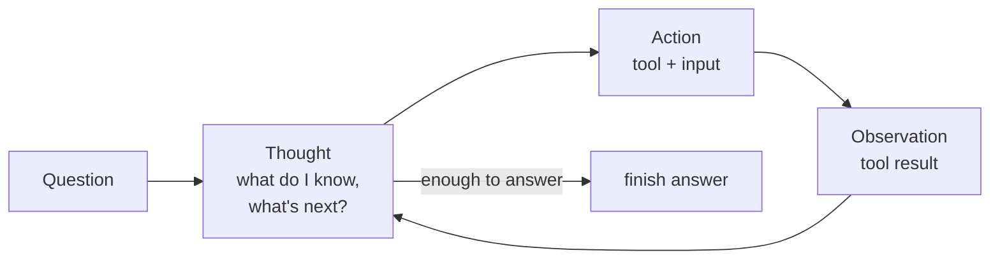

# ReAct: The Complete Guide

> 📚 **Before you start**
>
> - [The Agent Loop: Decide, Act, Observe](../03-the-agent-loop/the-agent-loop-decide-act-observe.md), the loop that ReAct adds reasoning to.
> - [Lab: Tool-using agent from scratch](../04-tools-and-function-calling/lab-tool-using-agent-from-scratch.md), for a working tool-calling agent.

## Introduction

Ask a friend *"Which is older, the Eiffel Tower or the Statue of Liberty, and by how many years?"* and watch what they do. They don't answer instantly. They think *"I need both dates"*, look up the Eiffel Tower (1889), think *"now the Statue of Liberty"*, look it up (1886), think *"so the statue is older by 3 years"*, and answer.

That pattern, **think, act, look at the result, think again**, is so natural we rarely notice it. In 2022 researchers showed that prompting language models to do the same thing, writing out a short **thought** before each **action** and reading each **observation** before the next thought, made them much better at multi-step tasks. They called it **ReAct**: **Re**asoning + **Act**ing.

ReAct is the most widely used agent pattern. LangChain's classic agents, LangGraph's prebuilt `create_react_agent`, and most tool-calling assistants are ReAct agents underneath. This lesson explains how it works, builds one from scratch, and shows its strengths and failure modes.

> 💡 **Key Insight**
>
> ReAct interleaves **reasoning** and **acting**. Reasoning alone (thinking in your head) can't check facts; acting alone (calling tools blindly) can't plan or adapt. Writing a thought before every action lets the model plan its next step from what it has **just observed**, and gives you a readable record of *why* it did each thing.

---

## Core Explanation

### 1. Three ways to answer a question

Compare three strategies on the question above.

| Strategy | What the model does | Typical problem |
|---|---|---|
| **Reason only** (chain-of-thought) | Thinks step by step, no tools | Confidently uses a wrong remembered date |
| **Act only** | Calls tools with no written reasoning | Loses track of the goal; repeats searches; can't explain itself |
| **ReAct** | Thought → Action → Observation, repeated | Slower and costlier, but grounded and adaptive |

ReAct combines the strengths: the **thoughts** keep a plan and interpret results, and the **actions** fetch real information instead of guessing.

### 2. The ReAct trace

A ReAct agent produces a **trace**: alternating lines of reasoning, tool calls and results.

```
Question: Which is older, the Eiffel Tower or the Statue of Liberty, and by how many years?
Thought: I need the completion year of each. Start with the Eiffel Tower.
Action: search[Eiffel Tower completed]
Observation: The Eiffel Tower was completed in 1889.
Thought: Now the Statue of Liberty.
Action: search[Statue of Liberty dedicated]
Observation: The Statue of Liberty was dedicated in 1886.
Thought: 1889 - 1886 = 3, so the Statue of Liberty is older by 3 years.
Action: finish[The Statue of Liberty is older, by 3 years (1886 vs 1889).]
```



This is the [agent loop](../03-the-agent-loop/the-agent-loop-decide-act-observe.md) with one addition: the **decide** step is written out as a thought.

### 3. Building a text-based ReAct agent

The original ReAct used **plain text**: the prompt explains the format, the model writes `Thought:` and `Action:` lines, and your code parses the action, runs it, and appends an `Observation:` line. Let's build that version first, because it shows every moving part.

**The prompt** explains the tools and the format:

```python
REACT_PROMPT = """Answer the question by repeating these steps:
Thought: reason about what you know and what to do next
Action: one of search[query], calculate[expression], finish[answer]
Observation: (the result will be added here)

Use finish[...] only when you can fully answer.

Question: {question}
"""
print(REACT_PROMPT.format(question="How old was the Eiffel Tower in 2000?").splitlines()[-1])
```

Output:

```
Question: How old was the Eiffel Tower in 2000?
```

**The tools** (a fake search over a few facts, and a safe calculator):

```python
import re

FACTS = {
    "eiffel tower": "The Eiffel Tower was completed in 1889 for the World's Fair in Paris.",
    "statue of liberty": "The Statue of Liberty was dedicated in 1886 in New York Harbor.",
    "taj mahal": "The Taj Mahal's main mausoleum was completed around 1643.",
}

def search(query):
    for key, fact in FACTS.items():
        if key in query.lower():
            return fact
    return f"No results for '{query}'. Try a shorter query naming the landmark."

def calculate(expression):
    if not re.fullmatch(r"[\d\s+\-*/().]+", expression):
        return "ERROR: only numbers and + - * / ( ) are allowed"
    return str(eval(expression))          # safe here: input restricted to arithmetic

TOOLS = {"search": search, "calculate": calculate}
print(search("When was the Eiffel Tower built?"))
print(calculate("2000 - 1889"))
```

Output:

```
The Eiffel Tower was completed in 1889 for the World's Fair in Paris.
111
```

**The pretend model.** It reads the trace so far and writes the next `Thought` and `Action`, the way a real model would if prompted with `REACT_PROMPT`:

```python
def pretend_react_model(trace):
    steps = trace.split("Question:", 1)[1]               # ignore the format example in the prompt
    observations = re.findall(r"Observation: (.*)", steps)
    if not observations:
        return "Thought: I need the year the Eiffel Tower was finished.\nAction: search[Eiffel Tower completed]"
    year = re.search(r"\b(1\d{3})\b", observations[0]).group(1)
    if len(observations) == 1:
        return f"Thought: It was completed in {year}. Age in 2000 is 2000 minus {year}.\nAction: calculate[2000 - {year}]"
    return f"Thought: The calculation gives {observations[-1]}.\nAction: finish[It was {observations[-1]} years old in 2000.]"
```

**The ReAct loop**: ask the model for the next step, parse the action, run it, append the observation, repeat.

```python
ACTION = re.compile(r"Action:\s*(\w+)\[(.*)\]\s*$", re.S)

def react(question, model, max_steps=6, verbose=True):
    trace = REACT_PROMPT.format(question=question)
    for step in range(max_steps):
        output = model(trace)
        trace += output + "\n"
        if verbose:
            print(output)
        match = ACTION.search(output)
        if not match:
            trace += "Observation: Invalid format. Write an Action line like search[...].\n"
            continue
        tool, arg = match.groups()
        if tool == "finish":
            return arg
        result = TOOLS[tool](arg) if tool in TOOLS else f"Unknown action '{tool}'"
        trace += f"Observation: {result}\n"
        if verbose:
            print(f"Observation: {result}")
    return "Stopped: step limit reached."

answer = react("How old was the Eiffel Tower in 2000?", pretend_react_model)
print("ANSWER:", answer)
```

Output:

```
Thought: I need the year the Eiffel Tower was finished.
Action: search[Eiffel Tower completed]
Observation: The Eiffel Tower was completed in 1889 for the World's Fair in Paris.
Thought: It was completed in 1889. Age in 2000 is 2000 minus 1889.
Action: calculate[2000 - 1889]
Observation: 111
Thought: The calculation gives 111.
Action: finish[It was 111 years old in 2000.]
ANSWER: It was 111 years old in 2000.
```

Read the trace: you can see exactly **why** each action was taken. That transparency is one of ReAct's biggest practical benefits.

### 4. ReAct with native function calling

Text parsing is fragile: models sometimes write `Action: Search(...)` or forget the brackets. Modern APIs solve this with [function calling](../04-tools-and-function-calling/function-calling-step-by-step.md): the action becomes a structured `tool_use` block, and the thought becomes ordinary text (or the model's built-in thinking) before it.

| Text ReAct (original) | ReAct with function calling (today) |
|---|---|
| `Thought: ...` line | text block, or the model's internal thinking |
| `Action: search[...]` parsed by regex | `tool_use` block with validated JSON input |
| `Observation: ...` appended to the prompt | `tool_result` block in the next user message |
| `finish[...]` | a reply with `stop_reason: "end_turn"` |

The pattern is identical; only the wire format changed. That's why your [tool-using agent](../04-tools-and-function-calling/lab-tool-using-agent-from-scratch.md) already **is** a ReAct agent: its "I'll log both expenses first" text is the thought.

In frameworks you'll meet it as:

- **LangChain:** `create_react_agent` with an `AgentExecutor` ([LangChain Agents](../../langchain-complete-guide/course.md#m8)).
- **LangGraph:** the prebuilt `create_react_agent`, or your own graph with a model node, a `ToolNode` and a loop back ([LangGraph Fundamentals](../../langgraph-fundamentals/course.md#m4)).

### 5. Where ReAct struggles

ReAct is a great default, but know its limits:

- **Cost and latency.** One model call per step. A ten-step task is ten round trips.
- **Short-sightedness.** It plans one step at a time, so on long tasks it can wander or forget part of the goal. *Planning* patterns (next lesson) fix this by making a full plan first.
- **Loops.** A model can repeat the same search with tiny variations. Use step limits and repeat detection, as in the [first lab](../03-the-agent-loop/lab-agent-loop-with-a-pretend-model.md).
- **Misread observations.** If a tool returns noisy output, the next thought builds on a misunderstanding. Keep tool results clean ([Designing Good Tools](../04-tools-and-function-calling/designing-good-tools.md)).
- **Thoughts aren't guaranteed to be faithful.** The written reasoning is helpful, but it's generated text, not a perfect window into the model's computation. Judge the agent by its actions and results.

---

## Try It Yourself

1. **Trace by hand.** Write the ReAct trace (Thought / Action / Observation) for *"How many years apart were the Taj Mahal and the Eiffel Tower completed?"* using `search` and `calculate`.
2. **Bad format.** What does `react` do if the model writes `Action: Search the web for Taj Mahal`? Why is that better than crashing?
3. **Add a tool.** Add `lookup_country[landmark]` to `TOOLS`, returning `"France"` for anything containing "eiffel" and `"Unknown"` otherwise. Test it directly.
4. **Think about cost.** Your ReAct agent needs on average 6 steps per question and each model call costs ₹0.40. What does 10,000 questions a day cost, and name one way to reduce it?

<details>
<summary>Show answers</summary>

**1.**
```
Thought: I need both completion years. Start with the Taj Mahal.
Action: search[Taj Mahal completed]
Observation: The Taj Mahal's main mausoleum was completed around 1643.
Thought: Now the Eiffel Tower.
Action: search[Eiffel Tower completed]
Observation: The Eiffel Tower was completed in 1889 for the World's Fair in Paris.
Thought: Subtract 1643 from 1889.
Action: calculate[1889 - 1643]
Observation: 246
Thought: They were completed about 246 years apart.
Action: finish[About 246 years (1643 vs 1889).]
```

**2.** The regex doesn't match, so `react` appends `Observation: Invalid format...` and loops. The model sees the correction and can fix its format on the next step, which is far more robust than raising an error.

**3.**

```python
TOOLS["lookup_country"] = lambda landmark: "France" if "eiffel" in landmark.lower() else "Unknown"
print(TOOLS["lookup_country"]("Eiffel Tower"), TOOLS["lookup_country"]("Big Ben"))
```

Output:

```
France Unknown
```

**4.** 6 × ₹0.40 × 10,000 = ₹24,000 a day. Ways to reduce it: return richer tool results so fewer steps are needed, use a smaller model for easy questions, cache repeated searches, or use a fixed workflow when the steps are always the same (see [Workflows vs Agents](../03-the-agent-loop/workflows-vs-agents.md)).

</details>

---

## Real-World Examples

- **AI assistants with web search** think about what to look up, search, read the snippets, and decide whether to search again or answer: ReAct.
- **Coding agents** reason about a failing test, open a file, read it, reason again, edit, rerun the tests: ReAct over code tools.
- **Customer-support agents** reason "I need the order first", call `get_order`, then reason about the refund policy before acting.

---

## Common Misconceptions

### "ReAct is a library"

It's a **pattern** (a way of structuring prompts and loops). Many libraries implement it.

### "The thoughts are the model's true reasoning"

They're useful, generated explanations. Helpful for debugging, but verify behaviour through actions and outcomes.

### "ReAct is always the best agent design"

It's the best **default**. For long tasks, plan-first patterns work better; for fixed procedures, a plain workflow is cheaper and more reliable.

---

## Interview Relevance

*"What is ReAct?"* Explain it as interleaving **reasoning traces** and **actions**: Thought → Action → Observation in a loop until a final answer. Mention the problem it solves (reasoning-only hallucinates facts; acting-only can't plan or adapt), and that modern implementations use **native function calling** instead of text parsing.

Likely follow-ups:

- *"What are ReAct's weaknesses?"* Cost per step, myopic planning on long tasks, looping, sensitivity to noisy observations.
- *"How would you stop a ReAct agent looping?"* Step limits, repeat detection, clearer tool results, and a planning step for long tasks.

---

## Key Takeaways

- **ReAct = Reasoning + Acting**: Thought → Action → Observation, repeated until finish.
- Thoughts **plan and interpret**; actions **ground** the answer in real data.
- The original used **text parsing**; today the same pattern runs on **function calling**.
- It's the default agent pattern in LangChain and LangGraph.
- Watch for **cost, myopia and loops**; add limits and consider planning for long tasks.

---

**Up next:** [Planning and Reflection](planning-and-reflection.md)
